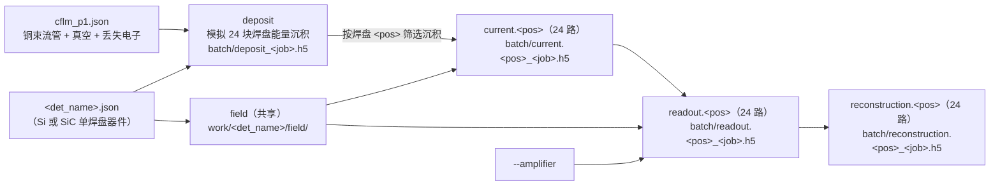

# CEPC 快速亮度监测器应用（`apps/cflm`）

`raser cflm` 运行 CEPC 快速亮度监测器（CEPC Fast Luminosity Monitor）的多位置全链路仿真。它在 [`stages/chain`](../stages/README.md) 的多位置展开机制下，先用专用的 `deposit` 切片模拟束团丢失电子撞击铜束流管后在两侧 24 块探测焊盘（pad）留下的能量沉积，再共用同一个 `field` 切片，为 24 个焊盘位置分别展开 `current.<pos>`、`readout.<pos>` 与 `reconstruction.<pos>`（共 74 个切片），写入 `work/<det_name>/cflm/`。



## 命令

```bash
raser cflm <det_name> [选项]
```

## 输入

- **单焊盘器件定义文件 `<det_name>.json`**（[`../components/device.md`](../components/device.md)）：读取尺寸 `l_x`、`l_y`、`l_z`（`um`）、材料 `material`（`"Si"` 或 `"SiC"`）、偏压 `bias.voltage`（`V`）、温度 `temperature`（`K`）及读出电极。该器件被放置在束流管两侧的 24 个焊盘位置 `PADS`（`<side>_<i>_<j>`，其中 `side` 取 `"I"` 或 `"II"`，`i` 取 `-3` 至 `2`，`j` 取 `0` 或 `1`）。
- **束流管与丢失电子配置文件 `src/raser/apps/cflm/cflm_p1.json`**：
  - **世界与束流管几何**：世界材料 `"world": "G4_AIR"`（半边长 `2000 mm`）；铜束流管 `"pipe"`（`"material": "G4_Cu"`，内半径 `"Rmin": 28 mm`，外半径 `"Rmax": 31 mm`，全长 `"Pipe_Z": 700 mm`，起始角 `"PipeSphi": 0 deg`，张角 `"PipeDphi": 360 deg`，中心 `[0, 0, 250] mm`）；管内真空圆柱 `"vacuum"`（材料 `G4_Galactic`，内半径 `"VACmin": 0 mm`，外半径 `"VACmax": 28 mm`，全长 `"VAC_Z": 700 mm`，中心 `[0, 0, 250] mm`）。
  - **24 块焊盘排布**：`"pads_from_z_mm": 225`（`mm`）为焊盘沿束流方向的起始 z 坐标；`I` 侧贴在 `x = -Rmax`（`-31 mm`），`II` 侧贴在 `x = +Rmax`（`+31 mm`）；每侧沿 y 方向排 6 行（中心 `y = (i + 0.5) * l_x` `um`）、沿 z 方向排 2 列（中心 `z = pads_from_z_mm * 1000 + (j + 0.5) * l_y` `um`）。
  - **束团粒子枪参数**：`"BeamOn": 1`（每作业模拟的束团数）、`"NumofGun": 3`（每束团同时发射粒子数）、`"par_type": "e-"`、`"par_energy": [21.906, 25.9726, 24.7832]`（`GeV`）、`"par_in"`（3 个粒子的起始坐标 `[x, y, z]`，`mm`）、`"par_direct"`（3 个粒子的动量方向向量）、`"maxStep": 2`（焊盘内最大步长，`um`）。
- **模拟前端电路文件 `<part>.cir`**：由 `--amplifier` 指定（[`../components/afe.md`](../components/afe.md)）。
- **共享场目录 `work/<det_name>/field/`**：若目标偏压与辐照注量下的场尚未就绪，工作流在启动作业前自动调用 [`raser field`](../stages/field.md) 求解。

### 独立辅助脚本

`src/raser/apps/cflm/` 下另含一组独立辅助程序（其中 `cflm_spd.py` 与 `p1_sample.py` 可直接作为脚本运行，`spd_dis.py` 须以 `python -m raser.apps.cflm.spd_dis` 运行，`data_file.py` 与 `spd_plot.py` 仅提供 `main()` 函数供导入调用）：

| 脚本 | 读取输入 | 说明 |
| --- | --- | --- |
| `cflm_spd.py` | `cflm_spd.json` | 独立运行次级粒子分布统计，读取键 `geant4_model`、`pipe`、`vacuum`、`world`、`BeamOn`、`NumofGun`、`par_type`、`par_energy`、`par_in`、`par_direct`、`maxStep`、`vis`、`PosBaseName` |
| `spd_dis.py`、`data_file.py`、`p1_sample.py` | `src/raser/apps/cflm/input/`（如 `datafile_p1.root`，该目录不在仓库中） | 按当前目录相对路径读取输入；`spd_dis.py` 会改写 `cflm_spd.json` 并调用 `cflm_spd.main()` |
| `spd_plot.py` | `cflm_spd` 输出的 `SecondaryParticle_*` 文本文件 | 绘制次级粒子在束流方向与垂直方向的分布图 |

## 输出

实验目录为 `work/<det_name>/cflm/`，顶层写入 `config.json`；各扫描点种子目录 `<point>/<seed_folder>/` 下写入 `run.json` 与 `batch/`（[`../lifecycle/experiments.md`](../lifecycle/experiments.md)、[`../lifecycle/slices.md`](../lifecycle/slices.md)）。`WORKFLOW.slices` 通过 `chain.expand` 展开为 `deposit`、`field` 与 24 个位置的 `current.<pos>`、`readout.<pos>`、`reconstruction.<pos>`（共 74 个切片）。每个作业 `<job>` 在持有各切片的点目录 `batch/` 下依次写出：

| 输出路径 | 写出切片 | 内容与说明 |
| --- | --- | --- |
| `batch/deposit_<job>.h5` | `deposit`（`deposits.deposits`） | 单次运行 `cflm_p1.simulate_bunches` 记录全部 24 块焊盘的能量沉积。跳过能量 `<= 0` 的步，其余步通过 `pad_frame` 转到所属焊盘局部坐标（`z` 为从紧贴束流管外壁向焊盘内部的深度 [`um`]，时刻 `t` 固定为 `0.0 s`），`detector` 记为 `<side>_<i>_<j>` 并按 `ionized_pairs` 抽样 `pairs`（[`../stages/deposit.md`](../stages/deposit.md)）；全部焊盘均无沉积时以 `Ended` 结束作业 |
| `batch/current.<pos>_<job>.h5` | [`current`](../stages/current.md) | `<pos>` 为 `I_-3_0` 至 `II_2_1`；存在该焊盘沉积时漂移载流子并写出感应电流（`A`）、`dt`（`s`）与积分电荷 `charge`（`C`）；`--plots > 0` 时在 `plots/job_<job>_<pos>/event_<number>/` 绘图。该焊盘无沉积时切片 `.done` 记 `{"events": 0}` |
| `batch/readout.<pos>_<job>.h5` | [`readout`](../stages/readout.md) | 对应焊盘经前端放大器链与噪声叠加后的输出电压波形（`V`）。该焊盘无电流文件时切片 `.done` 记 `{"events": 0}` |
| `batch/reconstruction.<pos>_<job>.h5` | [`reconstruction`](../stages/reconstruction.md) | 对应焊盘的指定触发沿（默认 `pulse_edge`）过阈时刻 `ToA`、过阈时间 `ToT`、时间重心 `CoG`、恒比定时 `CFD`（`s`）、幅度 `amplitude`（`V`）、面积 `area`（`V s`）与簇信息表。该焊盘无读出文件时切片 `.done` 记 `{"events": 0}` |

## 选项表

| 选项名 | 默认值 | 单位 | 含义 |
| --- | --- | --- | --- |
| `det_name` | 无（必填位置参数） | 无 | 探测器组件名称或路径 |
| `--plots` | `0` | 束团数 | 每个焊盘绘制漂移路径与电流图的前 N 个记录束团 |
| `-vol`, `--voltage` | 取 `device.bias.voltage` | `V` | 探测器偏置电压（写入 `device.bias.voltage`） |
| `-irr`, `--irradiation` | `None`（未给定时取器件 `irradiation_flux`，无则为 `0`） | `neq/cm^2` | 辐照注量 |
| `-amp`, `--amplifier` | `"SantaCruz+Gali52+Termination50"` | 无 | 以 `+` 连接的前端放大器级与终端负载名称 |
| `--sheet-resistance` | `None` | `Ohm` | 覆盖焊盘器件文件中阻性层的方块电阻 |
| `-threshold` | `10.0` | `mV` | 脉冲时间量与面积计算的过阈阈值 |
| `-amplitude_threshold` | `10.0` | `mV` | 事例入选与簇种子判定的幅度阈值 |
| `fractions`（通过 `--set`/`--scan` 设置） | `[0.1, 0.2, 0.3, 0.4, 0.5, 0.6, 0.7, 0.8, 0.9]` | 无 | 恒比定时（CFD）的幅度分数列表 |
| `--edge` | `None`（取 `readout` 导出的脉冲边沿） | 无 | 阈值触发边沿，可选 `"rising"` 或 `"falling"` |
| `-s`, `--jobs` | `None`（单作业） | 作业数 | 并发或提交的索引作业数 |
| `--seed` | 随机生成 31 位整数 | 无 | 随机数主种子 |
| `--same-seeds` | `False` | 无 | 各扫描点是否共用同一批随机数种子 |
| `-b`, `--batch` | `False` | 无 | 将作业提交到集群队列 |
| `-mem` | `1` | 档位 | 集群作业内存档位 |
| `--dry-run` | `False` | 无 | 打印将要运行的点、切片和作业列表后直接返回 |
| `--scan` | `[]` | 无 | 扫描参数 `地址=值1,值2,...`（可重复指定） |
| `--set` | `[]` | 无 | 固定单个参数 `地址=值`（可重复指定） |

## 常见报错

| 报错信息 | 触发原因 |
| --- | --- |
| `ValueError: the Geant4 of cflm builds pads of Si or SiC, not of <material>` | 探测器 `material` 不是 `"Si"` 或 `"SiC"` |
| `` FileNotFoundError: no field of <det_name> ready for this run: solve it with `raser field <det_name>` `` | 场切片执行时未找到就绪的求解场 |
| `ValueError: <det_name> has no resistive layer to give a sheet resistance of <sheet_ohm> Ohm` | 对未配置 `resistive_layer` 的探测器传入了 `--sheet-resistance` |

## 相关页面

- [`../getting-started.md`](../getting-started.md)
- [`../cli.md`](../cli.md)
- [`../lifecycle/experiments.md`](../lifecycle/experiments.md)
- [`../lifecycle/slices.md`](../lifecycle/slices.md)
- [`../components/device.md`](../components/device.md)
- [`../components/afe.md`](../components/afe.md)
- [`../stages/README.md`](../stages/README.md)
- [`../stages/deposit.md`](../stages/deposit.md)
- [`../stages/field.md`](../stages/field.md)
- [`../stages/current.md`](../stages/current.md)
- [`../stages/readout.md`](../stages/readout.md)
- [`../stages/reconstruction.md`](../stages/reconstruction.md)
