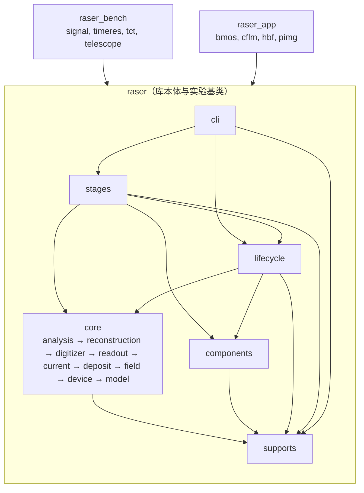
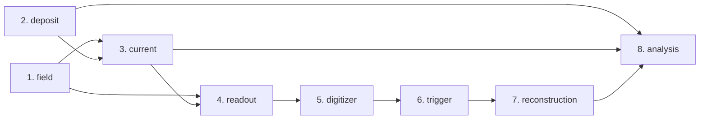

# 架构总纲

本页说明 RASER 的源码布局、实验类机制、project 与配置、结果怎么存放、八环节仿真链、组件与物理模型，以及资产放在哪。文件格式、字段、单位与选项细节分别见 [stages/README.md](stages/README.md)、[lifecycle/experiments.md](lifecycle/experiments.md)、[core/model.md](core/model.md) 与 [components/device.md](components/device.md) 等各页。

## 布局

```text
src/
├── raser/        # 库本体：core、stages、lifecycle、components、cli、supports，以及供继承的实验基类
├── raser_bench/  # 测试类：signal、timeres、tct、telescope
└── raser_app/    # 应用类：bmos、cflm、hbf、pimg
examples/         # 配好的示例 project，只在仓库里，和 work/ 平级
work/             # 用户自己的 project
```



- **一个分发**：`pip install raser` 同时装上 `raser`、`raser_bench`、`raser_app` 三个包。
- **依赖单向**：`raser_bench`、`raser_app` 导入 `raser`；`raser` 只含库和机制，具体的测试和应用都在两个平行包里。分层由 `pyproject.toml` 的 `import-linter` 契约检查。
- **测试与应用全称**：测试类里，`timeres` 是 Time Resolution，`tct` 是 Transient Current Technique；应用类里，`bmos` 是 Beam Monitor Online System（在线束流监测系统），`cflm` 是 CEPC Fast Luminosity Monitor，`hbf` 是 Hydrogen–Boron Fusion（p–¹¹B，氢硼聚变），`pimg` 是 Proton Imaging（质子成像）。

## 实验是 Python 类

- **继承实验基类**：每个测试或应用是一个继承 `raser` 实验基类的 Python 类。类里写明它由哪些环节组成、有哪些器件、各器件是什么角色（例如被测器件、参考器件）。类里不写设置的取值：取值只来自实验文件夹的 `config.json`，示例 project 里的 `config.json` 就是各实验的起点；代码不留默认值，`config.json` 缺了要用的键就报错，并指出缺的是哪个“段.键”。
- **被测器件是主体**：命令行给的器件替换的是被测器件。例如 `telescope` 默认用 `TAICHU3` 做参考层，中间放两块被测器件，命令行给的器件把这两块都换掉。
- **测试类的输出**：放在器件的 project 下，即 `work/<器件>/<测试>/`，同一块器件的各种测试结果放在一起。
- **应用类的输出**：放在 `work/<应用>/` 下，器件可以是扫描轴（可以有多个器件轴），用来比较不同器件放上去的结果。
- **自定义实验注册**：用户自己的测试或应用就是写一个这样的类，按名字注册，有两种放法，官方的 `raser_bench`、`raser_app` 走第一种：
  - 放在自己的包里，在包的 `pyproject.toml` 里用入口点登记，每行一个实验，名字就是命令词：

    ```toml
    [project.entry-points."raser.experiments"]
    my-scan = "mypackage.experiments:MyScan"
    ```

    装好这个包后，`raser my-scan` 就能用。
  - 放在 project 文件夹里：project 根下的 `*.py` 文件中继承实验基类的类自动发现，类名转成小写加连字符作命令词（`MyScan` 是 `my-scan`），只在这个 project 里可用。
  - 两处有同名的实验时，project 文件夹里的优先；名字和环节名、短命令、`status`、`new`、`model`、`device` 重名时报错。

## project

- **project**：`work/` 下的一个器件文件夹或一个应用文件夹。
- **examples**：`examples/` 里的每个示例就是一个 project，例如 `examples/HPK-Si-PiN/`（下有 `signal/`、`timeres/` 等，每个带一份完整的 `config.json`）、`examples/bmos/`。
- **分段配置文件**：每个实验文件夹里的 `config.json` 写全这次运行用的设置，按环节分段（`field`、`deposit`、`current`、`readout`、`digitizer`、`trigger`、`reconstruction`、`analysis` 各一段）。`--set`、`--scan` 用“段.键”作地址，例如 `--set field.voltage=100`、`--scan field.voltage=100,200`。运行用到的每个设置都来自配置文件，八段在文件里都写全；页面上的示例只摘和那一页有关的段。
- **新建 project**：`raser new --from <示例> <路径>` 把示例 project 整个复制过去，配置是完整的，之后和示例互不影响。例如 `raser new --from HPK-Si-PiN work/my-PiN`。
- **引用器件**：project 文件夹里有自己的器件文件就用自己的；只写名字时到组件库里找。
- **组件槽位**：段里选组件的键是槽位，例如 `deposit.source`、`deposit.laser`、`readout.amplifier`、`digitizer.device`。槽位写成组件名字符串，或写成带 `name` 的对象，对象里其余的键覆盖组件文件里的同名键：`"laser": {"name": "PIL037_top_SiC", "fz_rel": 0.5}`。组件里的一个键用“段.槽位.键”寻址，例如 `--scan deposit.laser.fz_rel=0.1,0.5`、`--set digitizer.device.full_scale_V=0.08`；`readout.amplifier` 由几级串成，地址再加一层级名，例如 `readout.amplifier.SantaCruz.R1`。
- **换组件就是换整套**：`name` 不能用 `--set`、`--scan` 改。换组件写 `--set 段.槽位=<组件名>`，扫组件写 `--scan 段.槽位=<组件名1>,<组件名2>`；这时槽位整个换成那个组件文件，原来覆盖的键（例如激光的 `fx_rel`、`fy_rel`、`fz_rel`）一并去掉；同一条命令里另给的 `段.槽位.键` 作用在换上去的组件上，例如 `--set deposit.laser=LA01IR_top_Si --set deposit.laser.fz_rel=0.3`。要让换上的组件带着别的取值，就另写一个组件文件放进 project，或在 `config.json` 里给它写整套对象。

配置合并、扫描点展开与作业调度的细节见 [lifecycle/experiments.md](lifecycle/experiments.md) 和 [lifecycle/jobs.md](lifecycle/jobs.md)。

## 结果

一个实验的结果分两层存：底下是按内容存放的节点，上面是给人按扫描点看的视图。参数和结果靠指纹对应，不靠文件夹的名字。示例在 `examples/` 里就地跑，结果存在示例自己的 project 里，和 SWB 的 project 一样；`work/` 下的 project 也是如此。

```text
work/HPK-Si-PiN/                      # 器件 project
├── field/                            # 这块器件的场节点，各实验共用
│   └── <节点号>/
└── signal/                           # 一个实验
    ├── config.json                   # 设置，按环节分段
    ├── points.json                   # 参数表
    ├── nodes/                        # 节点，按环节分开
    │   ├── deposit/<节点号>/          #   这一环节写出的文件，加一份 node.json
    │   ├── current/<节点号>/
    │   └── …
    ├── points/                       # 视图，全是软链接
    │   ├── voltage_100/
    │   │   ├── field -> ../../../field/<节点号>
    │   │   ├── deposit/              #   每个作业一个链接
    │   │   │   ├── 0 -> ../../../nodes/deposit/<节点号>
    │   │   │   └── 1 -> ../../../nodes/deposit/<节点号>
    │   │   ├── …
    │   │   └── analysis -> ../../nodes/analysis/<节点号>
    │   └── voltage_200/
    └── analysis/                     # 跨点的统计和趋势图
```

### 节点

一个环节在一组输入下算出的一份结果是一个节点。`deposit` 到 `reconstruction` 按作业算，一个扫描点跑几个作业，每个环节就有几个节点；`field` 和 `analysis` 一个扫描点一个节点。节点的输入有四样：

- 这个环节用到的设置值；
- 组件文件里它用到的那一部分；
- 上游各节点的节点号；`analysis` 的上游是这个点各作业的节点，所以它的指纹记下了它统计了哪些作业；
- 测量环节（deposit、current）的种子，以及 readout（NGspice 噪声）、digitizer（时钟相位、孔径抖动）自己的种子。这些种子都由作业的种子派生，作业的种子由主种子（`--seed`）、作业号和这个点上测量相关的扫描轴取值派生，不用点名，规则见 [lifecycle/experiments.md](lifecycle/experiments.md#种子)。

对这些输入取指纹，指纹就是节点号。节点文件夹里的 `node.json` 把输入原样记下来；代码版本、运行环境和运行状态也记在里面，但不进指纹。器件的场同样是节点，存在 `work/<器件>/field/` 下，被这块器件的各个实验引用。

### 参数表

每次运行时，程序从 `config.json` 算出 `points.json`：一行一个扫描点，写着各扫描轴的取值，以及每个环节用的节点号。`raser status` 打印的就是这张表，每格是这个点在这个环节的状态和节点号。

### 视图

`points/<点名>/<环节>/` 是一个文件夹，这个点的每个作业在里面有一个软链接，名字是作业号，指向这个作业在这一环节的节点；`field` 和 `analysis` 一个点只有一个节点，`points/<点名>/field`、`points/<点名>/analysis` 直接是软链接。点名按扫描轴的取值起，例如 `voltage_100`，是给人看的入口；改了设置或加了扫描轴，点名可能不变，指向的节点会跟着变，参数和结果始终对得上。

### 复用

指纹相同就复用，不管它是在哪个点、哪次运行里算出来的。扫描只影响下游的设置时，上游节点在各点之间共用。节点只增不减：把设置改回去，视图重新指回原来的节点，不用重算。

### 加锁

每个节点单独加锁。写到一半的节点带 `.part` 后缀，写完才改成正式的名字，中断不会留下半份结果。

### 过期

代码版本和节点记录的不一致时，只给一条提示，结果照常复用。

### 例子

在 signal 上同时扫两件事：`field.voltage=100,200`，和 readout 里一个电阻的两档取值。

| 环节 | 节点数 | 原因 |
| --- | --- | --- |
| deposit、current | 2 | 换偏压是重新测，两档偏压各测各的；电阻只有 readout 读，两档电阻共用这两个节点 |
| readout 及以后 | 4 | 两档偏压乘两档电阻 |

之后把每个作业的事例数从 20 改成 40：所有指纹都变了，全部算成新节点，旧节点留着。再改回 20 时，视图指回旧节点，一个都不用重算。

把每点的作业数从 `-s 3` 改成 `-s 5`（同一个 `--seed`）：作业 0、1、2 的种子不变，它们的节点照常复用，只新算作业 3、4；`analysis` 统计的作业变了，每个点的 `analysis` 算成新节点，`<实验>/analysis/` 下的跨点统计随之重写。

## 链



八个环节依次是 `field`、`deposit`、`current`、`readout`、`digitizer`、`trigger`、`reconstruction`、`analysis`，地位相同。每个环节本身是完整的工作流，可以单独跑，也可以从后往前拼起来跑；命令和参数由各环节自己管理，交给 `cli` 分发：

1. `field`：算器件里的电场、权重场、IV/CV。
2. `deposit`：用 Geant4 算粒子沉积的能量。
3. `current`：让载流子在场中漂移，算电极上的感应电流。
4. `readout`：把电流送进器件等效电路和前端放大器，得到波形。
5. `digitizer`：按示波器或数字化板的采样和量化把波形变成数字波形。
6. `trigger`：按真实触发设备的条件决定记录哪些事例。
7. `reconstruction`：从波形里取击中时间和幅度，束流测试里做径迹拟合。
8. `analysis`：统计效率、时间分辨。

- **结果与图像归属**：`analysis` 对整个实验的结果负责，每个扫描点有自己的结果，并在 `<实验>/analysis/` 下直接出统计各点、看趋势的图。每个环节的图放在这个环节自己的输出里。
- **共享场**：同一器件的场是这个器件的资产，放在 `work/<器件>/field/`，被它的各个实验共用。
- **过期提示与节点指纹**：过期判断只提示，代码版本和节点记录的不一致时给一条提示，已有结果照常复用。每个环节节点的身份由它读到的输入指纹（`node.json`）确定，各扫描点用到的节点号记录在 `points.json` 中。

各环节读写的数据文件与切片依赖规则见 [stages/README.md](stages/README.md) 和 [lifecycle/slices.md](lifecycle/slices.md)。

## 组件

- **组件目录**：组件放在 `raser/components/`，随包安装，只放定义。`device/` 放器件；其余按读它的环节分文件夹：`deposit/`（Geant4 装置、放射源和束流、激光）、`readout/`（前端放大器和端接电路）、`digitizer/`（采样和量化设置；一台设备同时管采样和触发时，例如示波器，设置放一份在这里，`digitizer` 和 `trigger` 都读它）、`trigger/`（触发条件）。
- **出处与对照**：每个组件注明出处；对应真实器件的组件和实测对照；用户可以把自己的设计放进组件库。
- **几何与网格分离**：器件的几何（各层厚度和材料、电极在哪一面）是器件的固有性质，写在器件文件里，Geant4 用同一份几何。网格属于 `field`：同一个器件可以有几套网格，用哪一套由 `field` 的选项指定。
- **物理模型与算法开关**：物理模型的代码在 `raser.core.model`，每个模型按名字注册；用户自己的模型同样注册。器件文件里按名字选用模型。每个物理算法都带开关。
- **实验装置范式**：每个实验的装置按学术界做这个实验的通用范式搭建。

各组件定义与物理模型公式见 [components/device.md](components/device.md) 等 `components/` 各页和 [core/model.md](core/model.md)。

## 资产

有些结果不属于某一个实验，而是被很多实验反复引用，这类结果叫资产。资产跟着它依赖的东西走：只取决于器件的，放在器件的 project 里；只取决于电路或装置的，各自单立一个文件夹，像器件一样被各实验引用。

| 资产 | 谁算出来 | 取决于什么 | 放在哪 | 谁用 |
| --- | --- | --- | --- | --- |
| 器件参数电路图：结电容、耦合电容、未耗尽层，标上数值 | field | 器件和偏压 | `work/<器件>/field/` | readout 接进器件电路 |
| 前端电路图和冲击响应 | readout | 电路和它的参数 | `work/<电路名>/` | 各实验的 readout |
| 放射源到第一个器件前一个平面的相空间文件 | deposit | 源和到这个平面为止的几何 | `work/<装置名>/` | 各实验的 deposit 从这个平面接着发粒子 |
