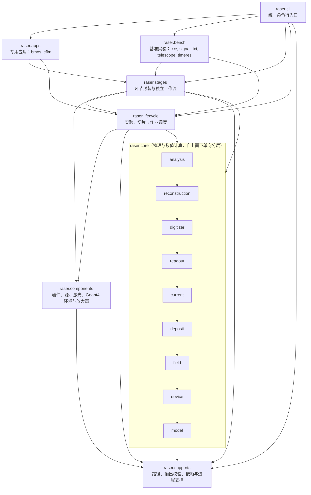
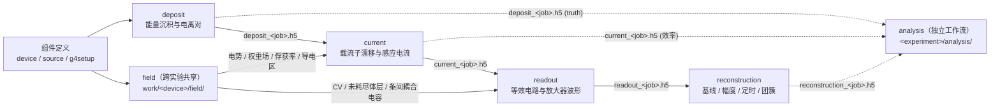
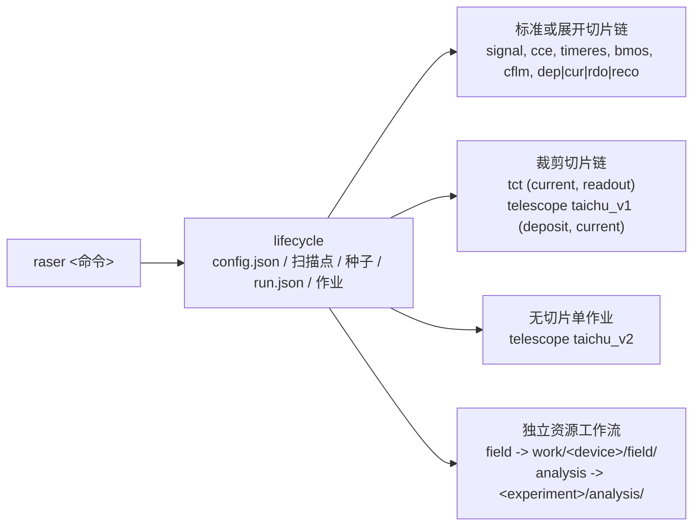

# 架构总纲

本页总览 RASER 的源码分层与模块依赖方向、仿真链各环节如何衔接、各片之间交接哪些数据与完成标记、实验工作流与环节的组装关系，以及各环节图像输出位置；各参数、选项表与接口细节分别见 [lifecycle/](lifecycle/experiments.md)、[stages/](stages/README.md) 与 `core/` 各页。

## 源码目录分层与依赖方向

`src/raser/` 下包含 8 个子包，模块间的单向依赖与实验独立性由 `pyproject.toml` 中的 `importlinter` 契约在 `make lint` 时强制检查（箭头表示导入与依赖方向）：



各层职责与边界如下：

- **`raser.cli`**（[cli.md](cli.md)）：唯一顶层命令行入口，负责解析全局选项、自动补全实验目录命令并将参数分发到对应模块；下层模块单向被其调用。
- **`raser.bench` 与 `raser.apps`**：各基准实验（`cce`、`signal`、`tct`、`telescope`、`timeres`）与专用应用（`bmos`、`cflm`）彼此保持独立，各自基于 `stages` 与 `lifecycle` 组装工作流。
- **`raser.stages`**（[stages/README.md](stages/README.md)）：将物理计算封装为可组合的生命周期切片、阶段命令（`dep`、`cur`、`rdo`、`reco`）以及独立工作流（`field`、`analysis`），独立于具体实验。
- **`raser.lifecycle`**（[lifecycle/experiments.md](lifecycle/experiments.md)、[lifecycle/slices.md](lifecycle/slices.md)、[lifecycle/jobs.md](lifecycle/jobs.md)）：管理实验目录、`config.json`、`run.json`、参数扫描、切片复用与本地/集群作业调度。
- **`raser.core`**：纯物理与数值计算层，与命令行和调度层解耦；内部 9 个环节子包按 `model` → `device` → `field` → `deposit` → `current` → `readout` → `digitizer` → `reconstruction` → `analysis` 严格单向分层，上层只可导入下层。
- **`raser.components` 与 `raser.supports`**（[supports/README.md](supports/README.md)）：提供内置及外部组件查找加载与路径、输出边界、依赖提示、进程清理等公共支撑。

## 仿真链：各环节如何衔接

在一次标准的单器件单位置仿真中，每个作业依次经过 `deposit`、`field`、`current`、`readout`、`reconstruction` 五个切片；作业全部完成后，再由独立的 `analysis` 工作流跨扫描点汇总结果：



链上衔接与复用遵循以下规则：

- **跨实验共享场（`field`）**：同一器件的各实验共享 `work/<device>/field/` 中的求解结果。决定一个场是否可复用或需重算的输入包括：实验选项 `voltage`（映射到器件偏压 `device.bias.voltage`）和 `irradiation`、器件定义中 `"field"` 下的求解设置以及求解器实际读取的属性、JSON 键和辅助网格/掺杂文件、场求解选项 `irradiation_flux` 与 `mode`、线性求解器设置 `-umf` 与外部 TCAD 导入文件 `-ext`；`run.json` 中记录这些输入、完整器件快照、代码版本 `commit` 与已求解偏压列表，供下游 `current` 与 `readout` 检查读取（详见 [stages/field.md](stages/field.md)）。
- **多器件与多位置展开**：当实验包含多个器件时按器件展开为 `field.<device>`；当位置总数大于 `1` 时（例如单器件、24 个位置的 `cflm` 仍共用 `field`），按位置展开为 `current.<position>`、`readout.<position>` 与 `reconstruction.<position>`，并在对应位置有沉积事例时读写带位置后缀的切片文件（详见 [stages/README.md](stages/README.md)）。
- **参数扫描与上游切片复用**：使用 `--scan` 扫描只影响下游的电子学或重建参数（如 `amplifier`、`threshold`、`amplitude_threshold`、`edge`），或启用 `--same-seeds` 且上游切片未读取被扫描参数时，各扫描点会复用基准点的上游切片文件，仅重跑受影响的后续切片（详见 [lifecycle/slices.md](lifecycle/slices.md)）。
- **跨点统计汇总（`analysis`）**：`raser analysis <experiment>` 汇总实验所有扫描点已完成作业的 `deposit_<job>.h5`、`current_<job>.h5` 与 `reconstruction_<job>.h5`，计算电荷收集效率与时间分辨并写入 `<experiment>/analysis/`（详见 [stages/analysis.md](stages/analysis.md)）。

## 实验与环节的关系

命令行入口通过 `Workflow` 把生命周期管理（`config.json`、扫描点与种子目录展开、作业调度）与具体的环节切片或单作业函数组装起来：



仓库中全部 10 个已注册 `Workflow` 的组装方式如下（各工作流选项与运行细节见对应文档）：

| 工作流名称 | 所属模块 | 组装的环节或执行模式 | 文档 |
| --- | --- | --- | --- |
| `signal` | `raser.bench.signal` | 5 个切片：`deposit`、`field`、`current`、`readout`、`reconstruction` | [bench/signal.md](bench/signal.md) |
| `cce` | `raser.bench.cce` | 5 个切片（默认 `g4setup="charge_collection"`、`events_per_job=10000`、`plots=0`） | [bench/cce.md](bench/cce.md) |
| `timeres` | `raser.bench.timeres` | 5 个切片（默认 `g4setup="time_resolution"`、`events_per_job=10000`、`plots=0`） | [bench/timeres.md](bench/timeres.md) |
| `bmos` | `raser.apps.bmos` | 5 个切片（默认 `source="bunch"`、`plots=0`） | [apps/bmos.md](apps/bmos.md) |
| `cflm` | `raser.apps.cflm` | `deposit`、`field` 及 24 个垫片的 `current.<pad>`、`readout.<pad>`、`reconstruction.<pad>`（共 74 个切片） | [apps/cflm.md](apps/cflm.md) |
| `tct` | `raser.bench.tct` | 2 个切片：`current`、`readout`（激光脉冲直接产生初始电流） | [bench/tct.md](bench/tct.md) |
| `telescope taichu_v1` | `raser.bench.telescope` | 2 个切片：`deposit`、`current`（按 6 个芯片层写出 `current.Layer_0` 至 `Layer_5`） | [bench/telescope.md](bench/telescope.md) |
| `telescope taichu_v2` | `raser.bench.telescope` | 无切片 `job` 模式（默认 1 个作业，支持 `-s N`）：像素尺寸扫描与空间分辨拟合 | [bench/telescope.md](bench/telescope.md) |
| `field` | `raser.stages.field` | 单作业模式：求解电场、权重场与 IV/CV；使用 `-ext` 时导入单个偏压的 TCAD 场解并求解权重势 | [stages/field.md](stages/field.md) |
| `analysis` | `raser.stages.analysis` | 单作业模式：汇总实验所有扫描点的效率与时间分辨，输出至 `<experiment>/analysis` | [stages/analysis.md](stages/analysis.md) |

## 各片之间交接的文件清单

### 共享场目录（`work/<device>/field/`）

辐照注量扫描点位于该目录下的对应子目录中；各文件读写方与单位如下（完整字段见 [stages/field.md](stages/field.md) 与 [core/field.md](core/field.md)）：

| 文件名 | 写入方 | 读取方 | 内容与单位 |
| --- | --- | --- | --- |
| `run.json` | `lifecycle`、`stages/field`、`core/field` | `stages/field`、`core/field` | `point`、`commit`、`options`（`irradiation_flux`、`mode`）、`files.device`、`settings`（`umf`、`imported`）、`read`（求解器读取的器件属性与键快照）、`axes`、`solved`（已求解的 `potential`、`weighting`、`undepleted`、`capacitance` 偏压列表 [V]） |
| `Potential_<V>V.pkl` | `core/field` | `current` | 偏压 `<V>` [V] 下网格节点电势 `values` [V]、坐标 `points` [cm] 与 `metadata`（`voltage` [V]、`dimension`） |
| `TrappingRate_n_<V>V.pkl`、`TrappingRate_p_<V>V.pkl` | `core/field` | `current` | 电子与空穴俘获率 `values` [1/s] 及坐标 `points` [cm] |
| `NetDoping_0V.pkl`（TCAD 导入为 `NetDoping_<V>V.pkl`） | `core/field` | `core/field`（`DevsimField`） | 净掺杂浓度 `values` [cm$^{-3}$] 及坐标 `points` [cm] |
| `Electrons_<V>V.pkl`、`Holes_<V>V.pkl` | `core/field` | — | 电子与空穴浓度 `values` [cm$^{-3}$] 及坐标 `points` [cm] |
| `Conductive_<V>V.pkl` | `core/field` | `stages/field`、`current` | 节点导电标志 `values`（`1.0` 或 `0.0`）及坐标 `points` [cm] |
| `weightingfield/<contact>/Potential_<V>V.pkl` | `core/field` | `current` | 读出电极 `<contact>` 在 `<V>` [V] 下的无量纲权重势 `values`、坐标 `points` [cm] 与 `metadata` |
| `weightingfield/<contact>/Capacitance_<V>V.json` | `core/field` | `readout` | 条型电极单元间耦合电容：`unit`（`"F/cm"`）、`of`、`total` [F/cm]、`to`（各相邻电极电容 [F/cm]）、`neighbours_coupled` |
| `<V>V.cv.json` | `stages/field`（`-cv`） | `readout` | 偏压 `<V>` [V] 下的电容：`voltage_V` [V]、`specific_capacitance_pF`（按 `per` 取 `"cm^2"`、`"cm"` 或 `"device"` 对应 `pF/cm$^2$`、`pF/cm` 或 `pF`）、`area_factor`、`frequency_Hz` [Hz] |
| `<V>V.undepleted.json` | `core/field`（1D 器件） | `readout` | 1D 平面器件未耗尽体层参数：`voltage_V` [V]、`undepleted_width_um` [um]、`specific_resistance_ohm_cm2` [Ohm·cm$^2$]、`specific_capacitance_pF` [pF/cm$^2$]（未耗尽宽度为 `0` 时为 `null`）、`per`（`"cm^2"`） |

### 作业切片数据与完成标记（`batch/`）

在各扫描点种子目录的 `batch/` 下，作业 `<job>`（从 `0` 开始的整数索引）读写以下切片文件与标记（完整布局见 [stages/README.md](stages/README.md)）：

| 文件名 | 写入切片 | 读取环节 | HDF5 属性（`attrs`）与数据集（`datasets`）及单位 |
| --- | --- | --- | --- |
| `deposit_<job>.h5` | `deposit` | `current`、`analysis` | **attrs**：`generated_events`、`recorded_events`、`generated_fraction`、`edep_min` [MeV]（若设）、`edep_max` [MeV]（若设）<br/>**datasets**：按事例 `event`（int64）、`count`（int64）；按沉积步 `detector`（string）、`x`/`y`/`z` [um]（步中点局部坐标）、`x_start`/`y_start`/`z_start` [um]（若有）、`t` [s]、`t_fwhm` [s]（若有）、`e` [MeV]、`pairs`（float64） |
| `current_<job>.h5`（多位置 `current.<position>_<job>.h5`） | `current` | `readout`、`analysis` | **attrs**：`electrodes`、`dt` [s]<br/>**datasets**：按事例 `event`（int64）、`t0` [s]、`count`（int64）、`pairs`（倍增前对数）、`sensitive_pairs` 与 `carriers_without_field`（场漂移时写出，望远镜分层文件省略）、`charge` [C] `(events, electrodes)`、`stored`（int64）；按存储电极 `index`（int64）；按时间 bin `current` [A]（一维展平） |
| `readout_<job>.h5`（多位置 `readout.<position>_<job>.h5`） | `readout` | `reconstruction` | **attrs**：`electrodes`、`dt` [s]、`pulse_edge`（`"rising"` / `"falling"` 数组）、`device_circuit`（等效电路 JSON 字符串）<br/>**datasets**：按事例 `event`（int64）、`t0` [s]、`count`（int64）、`stored`（int64）；按存储电极 `index`（int64）；按采样点 `voltage` [V]（一维展平，bin 中心电压） |
| `reconstruction_<job>.h5`（多位置 `reconstruction.<position>_<job>.h5`） | `reconstruction` | `analysis` | **attrs**：`electrodes`、`threshold` [V]、`amplitude_threshold` [V]、`fractions`、`edge`<br/>**datasets**：按事例 `event`（int64）、`selected`（bool）、`cluster_size`（int64）、`cluster_center`（float64）；按事例与电极 `(events, electrodes)`：`traced`（bool）、`baseline` [V]、`noise` [V]、`amplitude` [V]、`above`（bool）、`ToA` [s]、`ToT` [s]、`CoG` [s]、`area` [V s]；按事例、电极与分数 `(events, electrodes, fractions)`：`CFD` [s] |
| `<slice>_<job>.done`、`job_<job>.done` | `lifecycle` | `lifecycle`、`analysis` | `job_<job>.done` 为空文件；`<slice>_<job>.done` 无返回值时为空文件，有返回值时为 JSON 文本（如 `field` 记录场目录路径，无沉积提前结束时记录 `{"ended": true}`） |

### 分析环节汇总输出（`analysis/`）

`raser analysis <experiment>` 在 `<experiment>/analysis/` 下写入跨作业与跨点汇总文件（详见 [stages/analysis.md](stages/analysis.md)）：

| 文件名 | 位置与条件 | 内容与单位 |
| --- | --- | --- |
| `result.json` | 每个扫描点目录 `<point>/`（无扫描或等于默认值时直接位于 `analysis/` 根下） | `reconstruction`（有记录事例时写入，阈值单位 mV）、`collection`（至少 2 个事例时含无量纲效率均值与展宽，否则为 `events` 与 `error`）、`timing`（样本充足时各定时量时间分辨位于 `timing.times.<名>` [s]，否则含 `error`） |
| `events.h5` | 同上（有记录事例时生成） | 选中事例数据集：`job`、`event`、`ToA` [s]、`ToT` [s]、`truth` [s]、`CoG` [s]、按实际 `fractions` 生成的 `CFD<百分数>` 列（如默认的 `CFD10`...`CFD90` [s]）、`amplitude` [V]、`baseline` [V]、`noise` [V] |
| `points.json` | `<experiment>/analysis/` 根目录（完成的扫描点多于 `1` 个时生成） | 各扫描点汇总列表，包含扫描参数、效率与时间分辨（时间分辨单位 s） |

## 示例实验文件夹缩略树

在 [快速入门](getting-started.md) 的示例中运行 `raser signal HPK-Si-PiN --scan voltage=100,200 -s 2 -evt 200 --seed 1` 与 `raser analysis work/HPK-Si-PiN/signal` 后，`200 V`（器件默认偏压）点落在 `signal/seed_1/` 与 `analysis/` 根下，`100 V` 点落在 `voltage_100/` 子目录下，共享场位于 `work/HPK-Si-PiN/field/`：

```text
work/HPK-Si-PiN/
├── field/                                     # field 工作流（或自动解场）写出，跨实验共享
│   ├── config.json                            # lifecycle：场目录配置
│   ├── run.json                               # lifecycle + stages/field + core/field：求解元数据与已求解偏压
│   ├── Potential_200V.pkl                     # core/field：电势（另有 0V、100V 及载流子/俘获率/导电标志 .pkl）
│   ├── 200.0V.undepleted.json                 # core/field：一维未耗尽体区参数（另有 0.0V、100.0V）
│   ├── HPK-Si-PiN_iv.png                      # core/field：IV 曲线（另有 CV 与场分布图）
│   └── weightingfield/top/Potential_200V.pkl  # core/field：200 V 下的权重势节点数据（另有 100V）
└── signal/                                    # 实验根目录（同时承载默认偏压 200 V 点）
    ├── config.json                            # lifecycle：实验设置与扫描配置
    ├── seed_1/                                # 200 V 点（默认偏压点位于实验根下）
    │   ├── run.json                           # lifecycle：运行选项、文件快照、切片摘要与 held_in
    │   ├── plots/job_0/event_4/...            # current：前 100 个记录事例的漂移路径与感应电流图
    │   └── batch/
    │       ├── deposit_0.h5 ...               # deposit：作业 0 能量沉积（另有 deposit_1.h5）
    │       ├── current_0.h5 ...               # current：作业 0 感应电流（另有 current_1.h5）
    │       ├── readout_0.h5 ...               # readout：作业 0 读出波形（另有 readout_1.h5）
    │       ├── reconstruction_0.h5 ...        # reconstruction：作业 0 重建表（另有 reconstruction_1.h5）
    │       ├── deposit_0.done ...             # lifecycle：各切片完成标记（field_0.done 记有共享场路径）
    │       ├── job_0.done, job_0.log          # lifecycle：作业 0 完成标记与标准输出日志（另有 job_1）
    ├── voltage_100/seed_1/                    # 100 V 扫描点（内部结构与 seed_1/ 相同）
    └── analysis/                              # analysis 工作流写出
        ├── config.json                        # lifecycle：分析工作流配置
        ├── run.json                           # lifecycle：分析运行记录
        ├── batch/job_0.done, job_0.log        # lifecycle：分析作业标记与日志
        ├── result.json                        # analysis：200 V 点的效率与时间分辨汇总
        ├── events.h5                          # analysis：200 V 点的选中事例表
        ├── efficiency.png ...                 # analysis：200 V 点的 4 张单点分布图
        ├── points.json                        # analysis：100 V 与 200 V 跨扫描点对比表
        ├── points.png                         # analysis：效率与时间分辨随偏压变化图
        └── voltage_100/                       # 100 V 点的 result.json、events.h5 与单点分布图
```

## 各环节的图像输出位置

有图像输出的环节及文件位置如下：

| 环节 | 图像保存位置 | 主要图像文件与格式 |
| --- | --- | --- |
| `field` | `work/<device>/field/`（辐照扫描位于其子目录，权重场位于 `weightingfield/<contact>/`） | `<device>_iv.png`、`simIV*`（`.pdf` / `.root`）、`<device>_cv.png`、`<device>_c^-2v.png`、`simCV*`（`.pdf` / `.root`）、`<device>_noise.png`、`simnoise*`（开启 `-noise` 时）、电势/电场/载流子/俘获率/权重场分布图（`.png` / `.pdf` / `.root`） |
| `deposit` | 运行目录（种子或扫描点文件夹） | 开启 `-g4_vis` 且 `--g4-vis-driver` 为 `TSG`、`TSG_FILE`、`TSG_OFFSCREEN`（忽略大小写）或以 `OGL` 开头时写出 `g4_geometry` 图像（上述三种 TSG 驱动为 `.png`，`OGL` 为矢量图） |
| `current` | `<point>/<seed>/plots/job_<作业>/event_<事例>/`（多位置为 `job_<作业>_<position>`） | 每个作业前 `--plots` 个记录事例的载流子漂移路径图（`<det_model>_drift_path.pdf`、`.root`）、存在非零电流分量的电极感应电流图（`No_<N>electrode_basic_infor.pdf`、`.root`）以及条型/像素器件的电荷收集图（`cce.pdf`、`.root`） |
| `analysis` | `<实验>/analysis/<点>/`（无扫描或等于默认值时位于 `<实验>/analysis/`） | 有记录事例时输出 `amplitude.png`，至少 2 个效率值时输出 `efficiency.png`，时间样本充足时输出 `time_difference.png`、`resolution_of_fraction.png`；多扫描点且为单一数值扫描变量时在 `<实验>/analysis/` 根目录输出 `points.png` |

## 相关页面

- [README.md](README.md)
- [getting-started.md](getting-started.md)
- [cli.md](cli.md)
- [lifecycle/experiments.md](lifecycle/experiments.md)
- [lifecycle/slices.md](lifecycle/slices.md)
- [lifecycle/jobs.md](lifecycle/jobs.md)
- [stages/README.md](stages/README.md)
- [stages/field.md](stages/field.md)
- [stages/deposit.md](stages/deposit.md)
- [stages/current.md](stages/current.md)
- [stages/readout.md](stages/readout.md)
- [stages/reconstruction.md](stages/reconstruction.md)
- [stages/analysis.md](stages/analysis.md)
- [core/model.md](core/model.md)
- [core/device.md](core/device.md)
- [core/field.md](core/field.md)
- [core/deposit.md](core/deposit.md)
- [core/current.md](core/current.md)
- [core/readout.md](core/readout.md)
- [core/digitizer.md](core/digitizer.md)
- [core/reconstruction.md](core/reconstruction.md)
- [core/analysis.md](core/analysis.md)
- [supports/README.md](supports/README.md)
