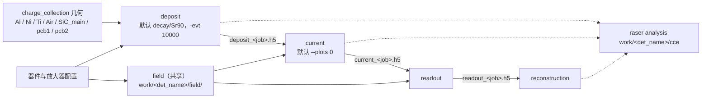

# 电荷收集效率测试台（`bench/cce`）

`raser cce` 是面向电荷收集效率（CCE）测量的基准实验工作流。它运行与 [`signal`](signal.md) 相同的五片仿真链（`deposit`、`field`、`current`、`readout`、`reconstruction`），默认加载电荷收集实验几何环境 `charge_collection`，并将每作业记录事例数提高到 `10000`、关闭单事例绘图（`--plots 0`），实验结果写入 `work/<det_name>/cce/`，随后由 `raser analysis` 汇总电荷收集效率与时间分辨率。



## 命令

```bash
raser cce <det_name> [source] [选项]
```

## 输入

- **实验默认配置**：`src/raser/bench/cce/charge_collection.json` 指定默认 `"g4setup": "charge_collection"`，工作流在此基础上覆盖 `events_per_job = 10000` 与 `plots = 0`。
- **组件搜索路径**：依次挂载 `src/raser/bench/cce/components` 与 `src/raser/bench/signal/components`（以及项目和全局 `components/`，见 [`../supports/README.md`](../supports/README.md)）。
- **器件、源与前端电路文件**：
  - `<det_name>.json`（[`../components/device.md`](../components/device.md)）：读取尺寸 `l_x`、`l_y`、`l_z`（`um`）、材料 `material`、读出电极布局、偏压 `bias.voltage`（`V`）、温度 `temperature`（`K`）与辐照参数。
  - `<source>.json`（默认 `"decay/Sr90"`，[`../components/source.md`](../components/source.md)）：读取源类型 `kind` 及发射粒子或核素参数。
  - `<part>.cir`（由 `--amplifier` 指定，[`../components/afe.md`](../components/afe.md)）。
- **Geant4 环境脚本 `<g4setup>.py`**：默认 `src/raser/bench/cce/components/g4setup/charge_collection.py`（[`../components/g4setup.md`](../components/g4setup.md)），读取 `G4SETUP`：
  - 全局设置：`"world": "G4_Galactic"`、`"maxstep": 2`（`um`）、`"source": {"at": [0, 0, -17000], "towards": [0, 0, 0], "angle": 0}`（`um`, `degree`）。
  - 周边几何体清单：

| 几何体 | 类别 | 材料 | 尺寸与挖孔参数（`um`） | 中心 `position_z`（`um`） |
| --- | --- | --- | --- | --- |
| `Al` | `elemental` | `G4_Al` | `5000 x 5000 x 0.08` | `-89.3` |
| `Ni` | `elemental` | `G4_Ni` | `5000 x 5000 x 0.05` | `-89.395` |
| `Ti` | `elemental` | `G4_Ti` | `5000 x 5000 x 0.015` | `-89.38` |
| `Air` | `binary_compounds` | `Air`（N/O 70:30） | `5000 x 5000 x 5000`，减去沿 z 轴圆柱（`tub_radius = 5000`, `tub_depth = 5000`） | `-89.4` |
| `SiC_main` | `binary_compounds` | `SiC`（Si/C 50:50） | `5000 x 5000 x 41.3`，减去沿 z 轴圆柱（`tub_radius = 5000`, `tub_depth = 41.3`） | `0` |
| `pcb1` | `binary_compounds` | `SiO2`（Si/O 33.4:66.6） | `5000 x 5000 x 15`，减去沿 z 轴圆柱（`tub_radius = 5000`, `tub_depth = 15`） | `-74.3` |
| `pcb2` | `binary_compounds` | `SiO2`（Si/O 33.4:66.6） | `5000 x 5000 x 15`，减去沿 z 轴圆柱（`tub_radius = 5000`, `tub_depth = 1500`） | `15` |

- **共享场目录 `work/<det_name>/field/`**：若目标偏压与辐照注量下的场尚未就绪，工作流在启动作业前自动调用 [`raser field`](../stages/field.md) 求解。

## 输出

实验目录为 `work/<det_name>/cce/`，目录组织、切片文件格式与 [快速入门](../getting-started.md) 中的五片信号链完全相同（见 [`../lifecycle/experiments.md`](../lifecycle/experiments.md)、[`../lifecycle/slices.md`](../lifecycle/slices.md)）。每个作业 `<job>` 在持有各切片的点目录 `batch/` 下依次写出：

- `deposit_<job>.h5`：记录事例的能量沉积步（见 [`../stages/deposit.md`](../stages/deposit.md)）。
- `current_<job>.h5`：各读出电极的感应电流与积分电荷（见 [`../stages/current.md`](../stages/current.md)）；当 `--plots` 大于 `0` 时，在 `plots/job_<job>/event_<number>/` 下写出前 `plots` 个事例的载流子漂移路径图、电流图，以及条形（strip）或像素（pixel）器件的电荷收集图。
- `readout_<job>.h5`：摆幅不小于本事例最大摆幅 `1e-3` 倍的读出通道的输出电压波形（仅对存在感应电流的事例保存输出；见 [`../stages/readout.md`](../stages/readout.md)）。
- `reconstruction_<job>.h5`：各事例的重建结果表（见 [`../stages/reconstruction.md`](../stages/reconstruction.md)）。

开启 `-g4_vis` 时，绘制等于 `-evt`（或 `-gen`）取值的生成事例数（默认 `10000` 个生成事例）的几何与径迹；若 `--g4-vis-driver`（不区分大小写）为 `"TSG"`、`"TSG_FILE"`、`"TSG_OFFSCREEN"`（写出 `g4_geometry.png`）或以 `"OGL"` 开头，在运行目录下写出 `g4_geometry` 图像（其余以 `"TSG"` 开头的驱动会触发 `ValueError: the driver '<driver>' writes no picture to a given path; use a TSG or an OGL driver, or no output`），随后作业以 `SystemExit` 结束。仿真完成后，对实验目录运行 `raser analysis work/<det_name>/cce` 可汇总各扫描点的电荷收集效率分布与时间分辨率（见 [`../stages/analysis.md`](../stages/analysis.md)）。

## 选项表

| 选项名 | 默认值 | 单位 | 含义 |
| --- | --- | --- | --- |
| `det_name` | 无（必填位置参数） | 无 | 探测器组件名称或路径 |
| `source` | `"decay/Sr90"` | 无 | 信号源组件名称或路径（可选位置参数） |
| `--g4setup` | `"charge_collection"` | 无 | Geant4 几何环境组件名称或路径 |
| `-evt`, `--events-per-job` | `10000` | 事例数 | 每个作业记录的事例数（与 `-gen` 二选一） |
| `-gen`, `--generated-per-job` | `None` | 事例数 | 每个作业生成的源事例数（替代 `-evt`） |
| `--generated-limit` | `None`（运行时取 `10000000`） | 事例数 | 为录满 `-evt` 个事例允许生成的最大源事例数 |
| `--edep-min` | `None` | `MeV` | 记录事例在探测器内沉积总能量的下限 |
| `--edep-max` | `None` | `MeV` | 记录事例在探测器内沉积总能量的上限 |
| `fano`（通过 `--set`/`--scan` 设置） | `True` | 无 | 是否按 Fano 因子抽样每个沉积步的电子-空穴对数 |
| `-g4_vis` | `False` | 无 | 启动 Geant4 几何与径迹可视化（绘制 `-evt` 或 `-gen` 个生成事例，默认 `10000`），完成后以 `SystemExit` 结束作业 |
| `--g4-vis-driver` | `"OGL"` | 无 | `-g4_vis` 使用的 Geant4 可视化驱动名称 |
| `--plots` | `0` | 事例数 | 每个作业绘制漂移路径、电流图及（strip/pixel 器件）电荷收集图的前 N 个记录事例 |
| `-vol`, `--voltage` | 取 `device.bias.voltage` | `V` | 探测器偏置电压（写入 `device.bias.voltage`） |
| `-irr`, `--irradiation` | `None`（未给定时取器件 `irradiation_flux`，无则为 `0`） | `neq/cm^2` | 辐照注量 |
| `-amp`, `--amplifier` | `"SantaCruz+Gali52+Termination50"` | 无 | 以 `+` 连接的前端放大器级与终端负载名称 |
| `--sheet-resistance` | `None` | `Ohm` | 覆盖器件文件中阻性层的方块电阻 |
| `-threshold` | `10.0` | `mV` | 脉冲时间量与面积计算的过阈阈值 |
| `-amplitude_threshold` | `10.0` | `mV` | 事例入选与簇种子判定的幅度阈值 |
| `fractions`（通过 `--set`/`--scan` 设置） | `[0.1, 0.2, 0.3, 0.4, 0.5, 0.6, 0.7, 0.8, 0.9]` | 无 | 恒比定时（CFD）的幅度分数列表 |
| `--edge` | `None`（取 `readout` 导出的脉冲边沿） | 无 | 阈值触发边沿，可选 `"rising"` 或 `"falling"` |
| `-s`, `--jobs` | `None`（单作业） | 作业数 | 并发或提交的索引作业数 |
| `--seed` | 随机生成 31 位整数 | 无 | 随机数主种子 |
| `--same-seeds` | `False` | 无 | 各扫描点是否共用同一批随机数种子 |
| `-b`, `--batch` | `False` | 无 | 将作业提交到集群队列 |
| `-mem` | `1` | 档位 | 集群作业内存档位 |
| `--dry-run` | `False` | 无 | 打印将要运行的点、切片和作业列表后直接返回 |
| `--scan` | `[]` | 无 | 扫描参数 `地址=值1,值2,...`（可重复指定） |
| `--set` | `[]` | 无 | 固定单个参数 `地址=值`（可重复指定） |

## 常见报错

| 报错信息 | 触发原因 |
| --- | --- |
| `ValueError: events_per_job and generated_per_job are given at once in the command line; give one of them` | 命令行同时给出了 `-evt` 与 `-gen`（若在 `config.json` 的 `"set"` 中同时给出则报 `in the "set" of config.json`） |
| `ValueError: events_per_job (<events>) and generated_per_job (<generated>): a job records a number of events or generates one, so exactly one of them is set` | `events_per_job` 与 `generated_per_job` 最终同时为空 |
| `RuntimeError: <recorded> of the <events> events asked for were recorded when the limit of <generated> generated events was reached ...` | 生成的源事例达到 `generated_limit` 时仍未录满请求的 `events_per_job` 个事例 |
| `` FileNotFoundError: no field of <det_name> ready for this run: solve it with `raser field <det_name>` `` | 场切片执行时未找到就绪的求解场 |
| `ValueError: <det_name> has no resistive layer to give a sheet resistance of <sheet_ohm> Ohm` | 对未配置 `resistive_layer` 的探测器传入了 `--sheet-resistance` |

## 相关页面

- [`../getting-started.md`](../getting-started.md)
- [`../cli.md`](../cli.md)
- [`../lifecycle/experiments.md`](../lifecycle/experiments.md)
- [`../lifecycle/slices.md`](../lifecycle/slices.md)
- [`../components/device.md`](../components/device.md)
- [`../components/source.md`](../components/source.md)
- [`../components/g4setup.md`](../components/g4setup.md)
- [`../components/afe.md`](../components/afe.md)
- [`../stages/deposit.md`](../stages/deposit.md)
- [`../stages/field.md`](../stages/field.md)
- [`../stages/current.md`](../stages/current.md)
- [`../stages/readout.md`](../stages/readout.md)
- [`../stages/reconstruction.md`](../stages/reconstruction.md)
- [`../stages/analysis.md`](../stages/analysis.md)
