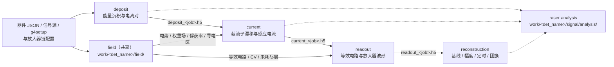

# 单探测器信号测试台（`bench/signal`）

`raser signal` 是 RASER 的单探测器全链路信号仿真基准工作流。它在标准仿真链的起点组装 `deposit`、`field`、`current`、`readout`、`reconstruction` 五个切片（沿用 [`stages/README.md`](../stages/README.md) 的链默认配置），将放射源或束流在单个器件中的能量沉积一路转化为电子学输出波形与重建特征表，供后续 [`raser analysis`](../stages/analysis.md) 统计效率与时间分辨率。



## 命令

```bash
raser signal <det_name> [source] [选项]
```

## 输入

- **链路默认配置**：读取 `raser.stages.chain.DEFAULTS`（默认源 `"decay/Sr90"`、几何环境 `"device_alone"`、`-evt 1`、`--plots 100`、放大器 `"SantaCruz+Gali52+Termination50"`、`-threshold 10.0`、`-amplitude_threshold 10.0`）。
- **组件搜索路径**：挂载 `src/raser/bench/signal/components`（提供 `g4setup/Sr90_collimator.py`、`g4setup/pcb_readout_gdml.py` 与 `g4macro/vis_pcb.mac`）及工程、全局组件目录（见 [`../supports/README.md`](../supports/README.md)）。
- **器件、源与前端电路文件**：`<det_name>.json`（[`../components/device.md`](../components/device.md)）、`<source>.json`（[`../components/source.md`](../components/source.md)）与 `--amplifier` 指定的 `<part>.cir`（[`../components/afe.md`](../components/afe.md)）。
- **Geant4 环境脚本 `<g4setup>.py`**：默认 `"device_alone"`，可选 `"Sr90_collimator"`、`"pcb_readout_gdml"` 等（[`../components/g4setup.md`](../components/g4setup.md)）。
  - 选用 `"pcb_readout_gdml"` 时，`GDMLDetectorConstruction` 依次在各组件根目录、各组件根目录下的 `g4experiment/` 与 `src/raser/` 下查找并读取 `pcb_readout.gdml`。
  - 辅助脚本 `src/raser/bench/signal/patch_pcb_gdml_material.py`（直接作为 Python 脚本运行）读取项目路径下的 `g4experiment/pcb_readout_raw.gdml`；确认 `pcb_readout_gdml.py` 中 `gdml.position_um == [0, 0, 0]` 且 `gdml.auto_center == False` 后，计算去除首尾 10% 游离点后的 `Mesh2Tess_*` 几何中心并取负值写入 `<position name="center" x="..." y="..." z="..." unit="mm"/>`，移除 `dummy` 物理体积，将包含 `WorldBox` 的外层体积重命名为 `World_Wrapper`（尺寸设为 `2000000 x 2000000 x 2000000 um`）并将 `"Material"` 替换为 `"FR4"`，写出项目路径下的 `g4experiment/pcb_readout.gdml`。
- **共享场目录 `work/<det_name>/field/`**：若目标偏压与辐照注量下的场尚未就绪，工作流在启动作业前自动调用 [`raser field`](../stages/field.md) 求解。

## 输出

实验目录为 `work/<det_name>/signal/`，顶层写入实验配置 `config.json`；各扫描点种子目录 `<point>/<seed_folder>/` 下写入 `run.json` 与 `batch/`（[`../lifecycle/experiments.md`](../lifecycle/experiments.md)、[`../lifecycle/slices.md`](../lifecycle/slices.md)）。每个作业 `<job>` 在持有各切片的点目录 `batch/` 下依次写出：

| 输出文件 / 目录 | 写出切片 | 主要内容与说明 |
| --- | --- | --- |
| `batch/deposit_<job>.h5` | [`deposit`](../stages/deposit.md) | 沉积能量（`MeV`）、坐标（`um`）、时刻（`s`）与电离电子-空穴对数 |
| `batch/current_<job>.h5` | [`current`](../stages/current.md) | 各电极感应电流（`A`）、时间步长 `dt`（`s`）与积分电荷 `charge`（`C`） |
| `plots/job_<job>/event_<number>/` | [`current`](../stages/current.md) | 前 `--plots`（默认 `100`）个记录事例的载流子漂移路径图与电极感应电流图 |
| `batch/readout_<job>.h5` | [`readout`](../stages/readout.md) | 波形电压 `voltage`（`V`）、起始时刻 `t0`（`s`）、时间步长 `dt`（`s`）、脉冲边沿 `pulse_edge` 与器件等效电路参数 `device_circuit`（JSON 字符串，未给器件电路值时不写） |
| `batch/reconstruction_<job>.h5` | [`reconstruction`](../stages/reconstruction.md) | 基线、噪声、幅度（`V`）、指定触发沿（默认 `pulse_edge`）过阈时刻 `ToA`、过阈时间 `ToT`、时间重心 `CoG`、恒比定时 `CFD`（`s`）、主瓣面积 `area`（`V s`）及簇大小与重心 |

开启 `-g4_vis` 时，绘制等于 `-evt`（或 `-gen`）取值的生成事例数（默认 `1` 个生成事例）的几何与径迹（`gdml_import` 几何使用宏 `vis_pcb.mac`）；若 `--g4-vis-driver`（不区分大小写）为 `"TSG"`、`"TSG_FILE"`、`"TSG_OFFSCREEN"`（写出 `g4_geometry.png`）或以 `"OGL"` 开头，在运行目录写出 `g4_geometry` 图像（其余以 `"TSG"` 开头的驱动会触发 `ValueError: the driver '<driver>' writes no picture to a given path; use a TSG or an OGL driver, or no output`），随后作业以 `SystemExit` 结束。

## 示例运行（`HPK-Si-PiN` 偏压扫描）

以 [快速入门](../getting-started.md) 中的全链路示例运行 `HPK-Si-PiN` 平面硅探测器（`--dry-run` 可在正式运行前预览扫描点与切片计划）：

```bash
raser signal HPK-Si-PiN --scan voltage=100,200 -s 2 -evt 200 --seed 1
```

本次运行使用默认放射源 `decay/Sr90`、`device_alone` 几何与 `SantaCruz+Gali52+Termination50` 放大器链，完整记录如下事实：

- **自动求解共享场与扫描点落点**：由于 `work/HPK-Si-PiN/field/` 尚未求解，`raser signal` 先自动调用 `raser field HPK-Si-PiN -bias 100.0` 与 `-bias 200.0` 写入共享场目录；`200 V` 为器件文件默认偏压，结果直接落在实验根下的 `work/HPK-Si-PiN/signal/seed_1/`，`100 V` 落在 `work/HPK-Si-PiN/signal/voltage_100/seed_1/`。
- **切片文件与统计（以 `seed_1/batch/` 作业 `0` 为例）**：
  - `deposit_0.h5`：Geant4 生成 `7359` 个事例，记下 `200` 个有效沉积事例（`generated_fraction = 0.017037`），共 `5476` 条沉积步记录。
  - `current_0.h5`：`dt = 5e-12 s`，`electrodes = ['top']`，写出 `200` 个事例的 `charge` `(200, 1)`、`pairs` `(200,)` 等数据集与前 `100` 个事例的漂移路径、感应电流图（位于 `plots/job_0/event_<事例号>/`）。
  - `readout_0.h5`：`dt = 5e-12 s`，`electrodes = ['top']`，`pulse_edge = ['falling']`，`device_circuit` 记录结电容 `3.44162280284e-12 F`。
  - `reconstruction_0.h5`：`threshold = 0.01 V`、`amplitude_threshold = 0.01 V`、`edge = ['falling']`、`fractions = [0.1, ..., 0.9]`，写出 `CFD` `(200, 1, 9)`、`ToA` `(200, 1)`、`selected` `(200,)` 等数据集。
- **下游统计（`raser analysis work/HPK-Si-PiN/signal`）**：汇总两个偏压点各 `400` 个记录事例，在 `analysis/` 下写入 `points.json`、`points.png` 及各点 `result.json`、`events.h5` 与分布图。在 `200 V` 下平均电荷收集效率为 `0.9348`（`spread = 0.1445`），`276` 个事例超过 `10 mV` 幅度阈值，`CFD30` 时间分辨 `sigma = 33.35 ps`、`sigma68 = 31.66 ps`；在 `100 V` 下平均收集效率为 `0.9195`，选中 `257` 个事例。


完整的终端输出、状态查询命令与其余分布图见 [快速入门](../getting-started.md)。

## 选项表

| 选项名 | 默认值 | 单位 | 含义 |
| --- | --- | --- | --- |
| `det_name` | 无（必填位置参数） | 无 | 探测器组件名称或路径 |
| `source` | `"decay/Sr90"` | 无 | 信号源组件名称或路径（可选位置参数） |
| `--g4setup` | `"device_alone"` | 无 | Geant4 几何环境组件名称或路径 |
| `-evt`, `--events-per-job` | `1` | 事例数 | 每个作业记录的事例数（与 `-gen` 二选一） |
| `-gen`, `--generated-per-job` | `None` | 事例数 | 每个作业生成的源事例数（替代 `-evt`） |
| `--generated-limit` | `None`（运行时取 `10000000`） | 事例数 | 为录满 `-evt` 个事例允许生成的最大源事例数 |
| `--edep-min` | `None` | `MeV` | 记录事例在探测器内沉积总能量的下限 |
| `--edep-max` | `None` | `MeV` | 记录事例在探测器内沉积总能量的上限 |
| `fano`（通过 `--set`/`--scan` 设置） | `True` | 无 | 是否按 Fano 因子抽样每个沉积步的电子-空穴对数 |
| `-g4_vis` | `False` | 无 | 启动 Geant4 几何与径迹可视化（绘制 `-evt` 或 `-gen` 个生成事例，默认 `1`；`gdml_import` 几何用 `vis_pcb.mac`），完成后以 `SystemExit` 结束作业 |
| `--g4-vis-driver` | `"OGL"` | 无 | `-g4_vis` 使用的 Geant4 可视化驱动名称 |
| `--plots` | `100` | 事例数 | 每个作业绘制漂移路径与电流图的前 N 个记录事例 |
| `-vol`, `--voltage` | 取 `device.bias.voltage` | `V` | 探测器偏置电压（写入 `device.bias.voltage`） |
| `-irr`, `--irradiation` | `None`（未给定时取器件 `irradiation_flux`，无则为 `0`） | `neq/cm^2` | 辐照注量 |
| `-amp`, `--amplifier` | `"SantaCruz+Gali52+Termination50"` | 无 | 以 `+` 连接的前端放大器级与终端负载名称 |
| `--sheet-resistance` | `None` | `Ohm` | 覆盖器件文件中阻性层的方块电阻 |
| `-threshold` | `10.0` | `mV` | 脉冲时间量与面积计算的过阈阈值 |
| `-amplitude_threshold` | `10.0` | `mV` | 事例入选与簇种子判定的幅度阈值 |
| `fractions`（通过 `--set`/`--scan` 设置） | `[0.1, 0.2, 0.3, 0.4, 0.5, 0.6, 0.7, 0.8, 0.9]` | 无 | 恒比定时（CFD）的幅度分数列表 |
| `--edge` | `None`（取 `readout` 导出的脉冲边沿） | 无 | 阈值触发边沿，可选 `"rising"` 或 `"falling"` |
| `-s`, `--jobs` | `None`（单作业） | 作业数 | 并发或提交的索引作业数 |
| `--seed` | 随机生成 31 位整数 | 无 | 随机数主种子 |
| `--same-seeds` | `False` | 无 | 各扫描点是否共用同一批随机数种子 |
| `-b`, `--batch` | `False` | 无 | 将作业提交到集群队列 |
| `-mem` | `1` | 档位 | 集群作业内存档位 |
| `--dry-run` | `False` | 无 | 打印将要运行的点、切片和作业列表后直接返回 |
| `--scan` | `[]` | 无 | 扫描参数 `地址=值1,值2,...`（可重复指定） |
| `--set` | `[]` | 无 | 固定单个参数 `地址=值`（可重复指定） |

## 常见报错

| 报错信息 | 触发原因 |
| --- | --- |
| `ValueError: events_per_job and generated_per_job are given at once in the command line; give one of them` | 命令行同时给出了 `-evt` 与 `-gen`（若在 `config.json` 的 `"set"` 中同时给出则报 `in the "set" of config.json`） |
| `ValueError: events_per_job (<events>) and generated_per_job (<generated>): a job records a number of events or generates one, so exactly one of them is set` | `events_per_job` 与 `generated_per_job` 最终同时为空 |
| `RuntimeError: <recorded> of the <events> events asked for were recorded when the limit of <generated> generated events was reached ...` | 生成的源事例达到 `generated_limit` 时仍未录满请求的 `events_per_job` 个事例 |
| `` FileNotFoundError: no field of <det_name> ready for this run: solve it with `raser field <det_name>` `` | 场切片执行时未找到就绪的求解场 |
| `FileNotFoundError: Cannot find GDML file: pcb_readout.gdml\nSearched:\n  - <候选路径列表>` | 使用 `--g4setup pcb_readout_gdml` 时在各组件根、各组件根下 `g4experiment/` 与 `src/raser/` 中均未找到 `pcb_readout.gdml` |
| `SystemExit: [Error] ... 的 gdml 段应当是 position_um = [0, 0, 0]、auto_center = False ...` | `patch_pcb_gdml_material.py` 检查 `pcb_readout_gdml.py` 的 `gdml` 配置不满足居中前提时退出 |

## 相关页面

- [`../getting-started.md`](../getting-started.md)
- [`../cli.md`](../cli.md)
- [`../lifecycle/experiments.md`](../lifecycle/experiments.md)
- [`../lifecycle/slices.md`](../lifecycle/slices.md)
- [`../components/device.md`](../components/device.md)
- [`../components/source.md`](../components/source.md)
- [`../components/g4setup.md`](../components/g4setup.md)
- [`../components/afe.md`](../components/afe.md)
- [`../stages/deposit.md`](../stages/deposit.md)
- [`../stages/field.md`](../stages/field.md)
- [`../stages/current.md`](../stages/current.md)
- [`../stages/readout.md`](../stages/readout.md)
- [`../stages/reconstruction.md`](../stages/reconstruction.md)
- [`../stages/analysis.md`](../stages/analysis.md)
