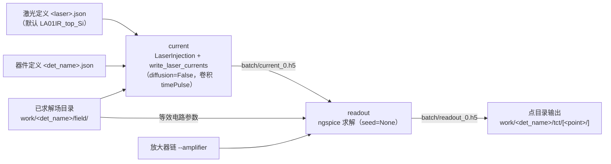

# 瞬态电流技术测试台（`bench/tct`）

`raser tct` 运行瞬态电流技术（TCT）激光脉冲仿真。它的切片链由 `current` 和 `readout` 两个切片构成，并关闭随机种子目录管理（`seeds=False`）：`current` 切片直接由激光注入参数与 [`work/<det_name>/field/`](../stages/field.md) 中已求解的器件电场计算漂移感应电流，随后 `readout` 切片求解前端放大器链的无噪声输出电压波形。



## 命令

```bash
raser tct <det_name> [laser] [选项]
```

## 输入

- **实验默认配置**：`src/raser/bench/tct/transient_current.json` 指定默认激光组件 `"laser": "LA01IR_top_Si"`；读出默认值沿用 `chain.READOUT_DEFAULTS`（默认 `--amplifier "SantaCruz+Gali52+Termination50"`）。
- **器件定义文件 `<det_name>.json`**（[`../components/device.md`](../components/device.md)）：读取几何尺寸 `l_x`、`l_y`、`l_z`（`um`）、材料 `material`、读出电极、偏压 `bias.voltage`（`V`）、温度 `temperature`（`K`）、辐照参数及可选场插值分箱 `field_interpolation_bins`。
- **激光定义文件 `<laser>.json`**（[`../components/laser.md`](../components/laser.md)）：读取吸收机制 `tech`（`"SPA"` 或 `"TPA"`）、入射方向 `direction`（`"top"`、`"bottom"` 或 `"edge"`）、折射率 `refractionIndex`、双光子吸收系数 `beta_2`（`tech` 为 `"TPA"` 时读取）、波长 `wavelength`（`nm`）、可选吸收系数 `alpha`（`1/m`，未给定时查材料吸收表 `components/laser/absorption/<material>.txt`，波长超过表末行时取 `0.0`）、脉冲时间半高全宽 `temporal_FWHM`（`s`）、脉冲能量 `pulse_energy`（`J`）、焦点光斑半高全宽 `spacial_FWHM`（`um`）、中心时刻 `central_time`（`s`）、可选瑞利长度 `l_Rayleigh`（`um`）、焦点相对坐标 `fx_rel, fy_rel, fz_rel` 以及分组参数 `pairs_per_group`、`groups`。
- **模拟前端电路文件 `<part>.cir`**：由 `--amplifier` 指定（[`../components/afe.md`](../components/afe.md)）。
- **已求解场目录 `work/<det_name>/field/`**：需预先通过 [`raser field <det_name>`](../stages/field.md) 求解目标偏压与辐照注量下的电势、掺杂、导电区域、俘获率与权重场文件。

## 输出

`tct` 工作流设置 `seeds=False`，实验目录为 `work/<det_name>/tct/`，顶层写入 `config.json`；每个扫描点直接在点目录（基准点为 `work/<det_name>/tct/`，其余扫描点为 `work/<det_name>/tct/<point>/`）下写入 `run.json`、`batch/` 与 `plots/`（[`../lifecycle/experiments.md`](../lifecycle/experiments.md)、[`../lifecycle/slices.md`](../lifecycle/slices.md)）：

| 输出路径 | 写出切片 | 内容与单位 |
| --- | --- | --- |
| `batch/current_0.h5` | [`current`](../stages/current.md) | 通过 `LaserInjection` 与 `write_laser_currents`（`diffusion=False`）漂移载流子，将感应电流与激光高斯时间脉冲 `timePulse` 卷积后作为事例 `event = 0` 写入（`current` [`A`]、`dt` [`s`]、`t0` [`s`]、`charge` [`C`]，见 [`../core/current.md`](../core/current.md)） |
| `plots/nocarrier_<fx_rel>_<fy_rel>_<fz_rel>.pdf` | `current` | 激光载流子三维空间分布图（坐标轴单位 `um`） |
| `plots/nocarrier2D_<fx_rel>_<fy_rel>_<fz_rel>.pdf` | `current` | 激光载流子 x-z 二维投影分布图（坐标轴单位 `um`），另附电流波形图 |
| `batch/readout_0.h5` | [`readout`](../stages/readout.md) | 读取 `batch/current_0.h5`，以 `seed=None` 通过 ngspice 求解器件等效电路与放大器链，写入事例 `0` 的无噪声输出电压波形 `voltage`（`V`）、`t0`（`s`）、`dt`（`s`）、`pulse_edge` 与器件电路参数 `device_circuit`（JSON 字符串，未给器件电路值时不写，见 [`../core/readout.md`](../core/readout.md)） |

## 选项表

| 选项名 | 默认值 | 单位 | 含义 |
| --- | --- | --- | --- |
| `det_name` | 无（必填位置参数） | 无 | 探测器组件名称或路径 |
| `laser` | `"LA01IR_top_Si"` | 无 | 激光组件名称或路径（可选位置参数） |
| `-vol`, `--voltage` | 取 `device.bias.voltage` | `V` | 探测器偏置电压（写入 `device.bias.voltage`） |
| `-amp`, `--amplifier` | `"SantaCruz+Gali52+Termination50"` | 无 | 以 `+` 连接的前端放大器级与终端负载名称 |
| `-b`, `--batch` | `False` | 无 | 将作业提交到集群队列 |
| `-mem` | `1` | 档位 | 集群作业内存档位 |
| `--dry-run` | `False` | 无 | 打印将要运行的点、切片和作业列表后直接返回 |
| `--scan` | `[]` | 无 | 扫描参数 `地址=值1,值2,...`（可重复指定） |
| `--set` | `[]` | 无 | 固定单个参数 `地址=值`（可重复指定） |

## 常见报错

| 报错信息 | 触发原因 |
| --- | --- |
| `` FileNotFoundError: no <mode> field of <det_name> at the irradiation flux <flux> in <root> ...; solve it with `raser field <det_name> -bias <voltage> --mode <mode> -irr <flux>` `` | `work/<det_name>/field/` 下在该辐照注量或模式下没有场 |
| `` ValueError: the field in <folder> was solved for another device (<differing>); solve it again with `raser field <det_name> -bias <voltage> --mode <mode>` `` | `work/<det_name>/field/` 中的场是为改动前的器件求解的 |
| `` FileNotFoundError: the field in <folder> is not solved at <voltage> V (solved at: ...); solve it with `raser field <det_name> -bias <voltage> --mode <mode>` `` | 该场目录下尚未求解目标偏压 `<voltage>` V 的电势场 |
| `` FileNotFoundError: the field in <folder> has no weighting field at <voltage> V (solved at: ...); solve it with `raser field <det_name> -bias <voltage> --mode <mode> -wf` `` | 该场目录下缺少目标偏压 `<voltage>` V 的权重场 |
| `ValueError: no absorption table of <material>: give alpha [1/m] in the laser file` | 激光文件未给出 `alpha`，且 `components/laser/absorption/<material>.txt` 不存在 |
| `ValueError: the absorption table of <material> starts at <min> nm, the laser has <wavelength> nm: give alpha [1/m] in the laser file` | 激光波长短于吸收系数表下限且未显式给定 `alpha`（波长超过吸收系数表最后一行时 `alpha` 取 `0.0`） |
| `NameError: <tech>` | 激光 `tech` 不是 `"SPA"` 或 `"TPA"` |
| `NameError: <direction>` | 激光 `direction` 不是 `"top"`、`"bottom"` 或 `"edge"` |

## 相关页面

- [`../cli.md`](../cli.md)
- [`../lifecycle/experiments.md`](../lifecycle/experiments.md)
- [`../lifecycle/slices.md`](../lifecycle/slices.md)
- [`../components/device.md`](../components/device.md)
- [`../components/laser.md`](../components/laser.md)
- [`../components/afe.md`](../components/afe.md)
- [`../stages/field.md`](../stages/field.md)
- [`../core/current.md`](../core/current.md)
- [`../core/readout.md`](../core/readout.md)
