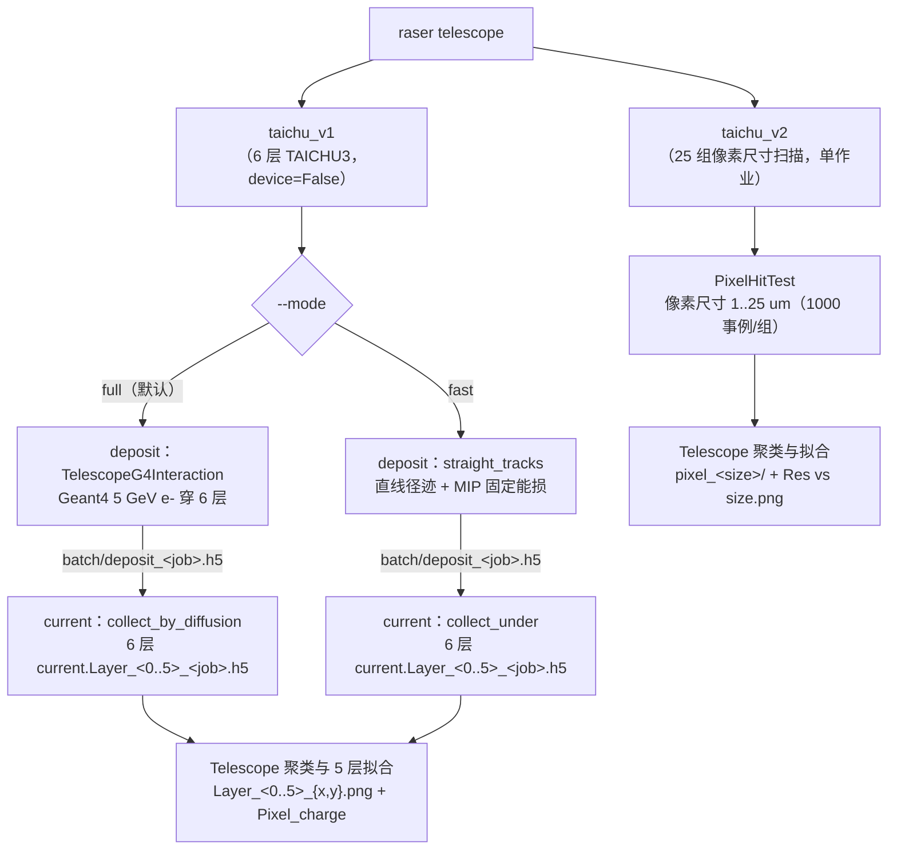

# 束流望远镜测试台（`bench/telescope`）

`raser telescope` 面向像素探测器束流望远镜的空间分辨率研究，提供 `taichu_v1` 与 `taichu_v2` 两个必选子命令。其中 `taichu_v1` 通过 `deposit` 与 `current` 两个切片模拟 5 GeV 电子穿过 6 层 `TAICHU3` 像素阵列、逐层收集像素电荷并完成岛屿聚类、留一法直线拟合与残差高斯拟合；`taichu_v2` 则在单作业内生成 25 组不同像素尺寸的合成击中数据，用于扫描像素尺寸与望远镜分辨率的关系。



## 命令

```bash
raser telescope taichu_v1 [选项]
raser telescope taichu_v2 [variant] [选项]
```

## 输入

### `taichu_v1`

- **望远镜配置文件 `src/raser/bench/telescope/telescope.json`**：
  - 模拟与拟合参数：`"geant4_model": "telescope"`、`"total_events": 1000`（默认每作业事例数）、`"ltz": [20000.0, 60000.0, 100000.0, 140000.0, 180000.0, 220000.0]`（`um`，径迹拟合使用的 6 层 z 坐标）、`"seedcharge": 100`（电子数，聚类种子像素阈值）、`"collection_window_s": 10e-9`（`s`，`"full"` 模式横向扩散收集时间窗）。
  - 像素体与阵列定义：`"object.pixel.Taichu"`（`G4_Si`，`25 x 25 x 20 um`）与 `"object.pixel.Taichu_2"`（`G4_Si`，`25 x 25 x 150 um`，含 `part_1`、`part_2` 两个混合物部件，`"object.pixel"` 下的每个条目都会建成像素体）；`"object.layer"` 定义 `Layer_0` 至 `Layer_5` 共 6 层像素阵列，每层为 `60 x 60` 个 `Taichu` 像素，中心 z 坐标依次为 `-100000`、`-60000`、`-20000`、`20000`、`60000`、`100000 um`，旋转角 `"rotation_xyz": [0, 0, 0]`（`degree`）。
  - 束流与世界参数：`"world": "G4_Galactic"`、`"par_type": "e-"`、`"par_energy": 5000`（`MeV`）、`"maxstep": 2`（`um`）、`"par_in": [0, 0, -400000]`（`um`）、`"par_out": [0, 0, 100000]`（`um`）、`"par_randx": 750`（`um`）、`"par_randy": 750`（`um`）。
- **探测器组件 `TAICHU3`**（`src/raser/components/device/TAICHU3.json`，[`../components/device.md`](../components/device.md)）：读取像素间距 `p_x = 25.0`、`p_y = 25.0`（`um`）、厚度 `l_z = 20`（`um`）、像素数 `x_ele_num = 60`、`y_ele_num = 60`、收集区宽度 `e_width_x = 10.0`、`e_width_y = 10.0`（`um`）、掺杂 `doping` 与温度 `temperature`（`300.0 K`）。

### `taichu_v2`

- `taichu_v2` 在内存中构造 25 组虚拟探测器与几何参数（像素尺寸 `p_x = p_y` 从 `1.0 um` 均匀递增至 `25.0 um`，厚度 `l_z = 200.0 um`，`seedcharge = 100`，`ltz = [20000.0, 60000.0, 100000.0, 140000.0, 180000.0, 220000.0] um`），每组由 `PixelHitTest` 从随机流 `"pixel_hit_test"` 生成 `1000` 个直线穿过 6 层的合成击中事例。

## 输出

### `taichu_v1`

`taichu_v1` 工作流设置 `device=False`，实验目录为 `work/telescope/taichu_v1/`，顶层写入 `config.json`；各扫描点的种子目录 `<point>/<seed_folder>/` 下写入 `run.json` 与 `batch/`（[`../lifecycle/experiments.md`](../lifecycle/experiments.md)、[`../lifecycle/slices.md`](../lifecycle/slices.md)）。每个作业 `<job>` 依次运行 `deposit` 与 `current` 两个切片：

| 输出文件 | 写出切片 / 函数 | 内容与说明 |
| --- | --- | --- |
| `batch/deposit_<job>.h5` | `deposit`（`telescope_signal.deposits`） | `"full"` 模式运行 `TelescopeG4Interaction`（Geant4 模拟 5 GeV 电子穿过 6 层像素阵列）；`"fast"` 模式运行 `straight_tracks`（从随机流 `"telescope_straight_tracks"` 抽样束流斜率，按 `maxstep` 切分直线径迹并赋予固定 MIP 平均能损）。每个生成事例均写入记录；`detector` 记为层名 `"Layer_0"`–`"Layer_5"`，坐标 `x, y, z`（`um`）转换为层局部坐标，并按 `ionized_pairs` 抽样 `pairs`（[`../core/deposit.md`](../core/deposit.md)） |
| `batch/current.Layer_<0..5>_<job>.h5` | `current`（`telescope_signal.currents`） | 每层一个电流文件（时间步长 `DIFFUSION_STEP = 50e-12 s`，电流 `A`，电荷 `C`，见 [`../core/current.md`](../core/current.md)）。`"full"` 模式调用 `collect_by_diffusion`（电子在无场外延层按 `50e-12 s` 步长横向随机游走，在 `10e-9 s` 窗口内进入像素中心 `e_width_x * e_width_y` 区域即收集）；`"fast"` 模式调用 `collect_under`（沉积对立即由所在像素收集）。某层在某事例无沉积时不写该事例行；收集电子数大于 `HIT_ELECTRONS = 0.2` 的像素记为击中 |
| `plots/job_<job>/Pixel_charge.{pdf,root}` | `current`（`draw_charge`） | 最后一个事例在最后一层（`Layer_5`）的二维像素收集电子数分布图 |
| `plots/job_<job>/Layer_<0..5>_{x,y}.png` | `current`（`Telescope`） | 对收集电子数不少于 `seedcharge`（`100`）的像素用深度优先搜索（`island`）聚类，筛选 6 层均恰好只有 1 个簇的事例，每次留出 1 层作为待测层（DUT）、其余 5 层簇中心拟合直线，绘制各层 x、y 残差直方图与高斯拟合（标注 Entries、Mean、Sigma [`um`]）；拟合标准差 `Resolution_Tol` 及乘以杠杆因子 `sqrt(1 - kt)` 后的 `Resolution_DUT`（`um`）打印到标准输出 |

### `taichu_v2`

- 实验目录 `work/telescope/taichu_v2/` 下，种子目录 `<seed_folder>/` 写入 `run.json` 与 `batch/`；与它并列，在 `work/telescope/taichu_v2/<YYYY_MMDD_HHMM>/` 下写出 25 个子目录 `pixel_<size>/Layer_<0..5>_{x,y}.png`（各像素尺寸下的残差高斯拟合图）以及汇总曲线 `Res vs size.png`（`Layer_2` 的 x 方向标准差 `Resolution_Tol[2][0]` 随像素尺寸 `Pixel Size [um]` 的变化图，纵轴单位 `um`）。

## 选项表

### `raser telescope taichu_v1`

| 选项名 | 默认值 | 单位 | 含义 |
| --- | --- | --- | --- |
| `-evt`, `--events-per-job` | `1000` | 事例数 | 每个作业模拟的事例数 |
| `--mode` | `"full"` | 无 | 模拟模式：`"full"`（Geant4 沉积 + `collect_by_diffusion` 横向扩散收集）或 `"fast"`（`straight_tracks` 直线径迹 + `collect_under` 像素正下方即时收集） |
| `-s`, `--jobs` | `None`（单作业） | 作业数 | 并发或提交的索引作业数 |
| `--seed` | 随机生成 31 位整数 | 无 | 随机数主种子 |
| `--same-seeds` | `False` | 无 | 各扫描点是否共用同一批随机数种子 |
| `-b`, `--batch` | `False` | 无 | 将作业提交到集群队列 |
| `-mem` | `1` | 档位 | 集群作业内存档位 |
| `--dry-run` | `False` | 无 | 打印将要运行的点、切片和作业列表后直接返回 |
| `--scan` | `[]` | 无 | 扫描参数 `地址=值1,值2,...`（可重复指定） |
| `--set` | `[]` | 无 | 固定单个参数 `地址=值`（可重复指定） |

### `raser telescope taichu_v2`

| 选项名 | 默认值 | 单位 | 含义 |
| --- | --- | --- | --- |
| `variant` | `"taichu_v2"` | 无 | `Res vs size.png` 图例标签字符串（可选位置参数） |
| `-s`, `--jobs` | `None`（单作业） | 作业数 | 并发或提交的索引作业数 |
| `--seed` | 随机生成 31 位整数 | 无 | 随机数主种子 |
| `--same-seeds` | `False` | 无 | 各扫描点是否共用同一批随机数种子 |
| `-b`, `--batch` | `False` | 无 | 将作业提交到集群队列 |
| `-mem` | `1` | 档位 | 集群作业内存档位 |
| `--dry-run` | `False` | 无 | 打印将要运行的作业后直接返回 |
| `--scan` | `[]` | 无 | 扫描参数 `地址=值1,值2,...` |
| `--set` | `[]` | 无 | 固定单个参数 `地址=值` |

## 常见报错

| 报错信息 | 触发原因 |
| --- | --- |
| `ValueError: <layer_name> is rotated: the fast mode has straight tracks through layers that face the beam only` | `--mode fast` 下 `telescope.json` 中存在 `"rotation_xyz"` 非零的层 |
| `ValueError: <det_name> is not a pixel device` | `collect_by_diffusion` 接收的探测器 `electrodes` 不是 `"pixel"` |
| `ValueError: the device file of <det_name> has no e_width_x [um]`（或 `e_width_y`） | 像素探测器定义缺少收集区宽度 `e_width_x` 或 `e_width_y` |

## 相关页面

- [`../cli.md`](../cli.md)
- [`../lifecycle/experiments.md`](../lifecycle/experiments.md)
- [`../lifecycle/slices.md`](../lifecycle/slices.md)
- [`../components/device.md`](../components/device.md)
- [`../core/deposit.md`](../core/deposit.md)
- [`../core/current.md`](../core/current.md)
