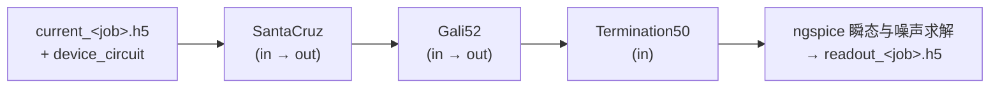

# 模拟前端组件（`components/afe`）

`src/raser/components/afe/` 存放模拟前端（AFE）放大器级与终端负载的 SPICE 子电路文件（`.cir`）。模拟前端组件作用于仿真链下游的 [`readout`](../stages/readout.md) 切片：命令行通过 `-amp` / `--amplifier`（默认 `"SantaCruz+Gali52+Termination50"`）按 `"+"` 顺序列出从探测器到终端负载的各级电路，加载并解析为结构化字典后交给 `ngspice` 求解瞬态响应与噪声谱，将各电极感应电流转换为电压波形 `readout_<job>.h5`。



## 查找顺序与文件格式

`named_chain(name)`（[`../core/readout.md`](../core/readout.md)）将 `--amplifier` 选项按 `"+"` 拆分为各级名称，按组件搜索优先级（[`../supports/README.md`](../supports/README.md)）依次查找 `afe/<part>.cir`，并经 `read_subcircuit(path)` 解析后送入 `raser.core.readout.spice`。

### 示例放大器链：`SantaCruz+Gali52+Termination50`

在 [快速入门](../getting-started.md) 的示例 `raser signal HPK-Si-PiN --scan voltage=100,200 -s 2 -evt 200 --seed 1` 中，命令行沿用默认放大器链 `"SantaCruz+Gali52+Termination50"`，依次读取 `src/raser/components/afe/` 下的三个 `.cir` 文件：

1. **第一级 `SantaCruz.cir`**：文件顶部定义晶体管子电路 `.subckt BFR840L3RHESD 1 2 3` 及其二极管/晶体管 `.MODEL`（写入 `"models"`），主子电路为两端口反相跨阻级：

```spice
.subckt SantaCruz in out
VCC 8 0 dc 2.25
R13 in 0 1MEG
C1 in 3 3.3n
x1 5 3 0 BFR840L3RHESD ; npn
R1 3 4 475
R2 4 5 3k
C2 4 5 3.3n
C5 5 out 3.3n
L1 5 6 47U
R3 6 7 63.7
C7 8 0 10n
C8 7 0 10n
C3 7 0 1n
C4 7 0 1n
L2 8 7 2.2u
.ends SantaCruz
```

2. **第二级 `Gali52.cir`**：两端口反相增益级，通过无热噪声辅助电阻 `Rp` 与电容 `Cp` 构造 `1.41 GHz` 单极点，并在 `50 Ohm` 匹配下给出 `22.66 dB` 增益：

```spice
.subckt Gali52 in out
Rin in 0 50
* minus twice 10^(22.66/20): the 50 Ohm output and the 50 Ohm load halve it
E1 a 0 in 0 -27.17
Rp a b 1
Cp b 0 112.9p
E2 c 0 b 0 1
Rout c out 50
.ends Gali52
```

3. **终端负载 `Termination50.cir`**：单端口 `50 Ohm` 接地负载：

```spice
.subckt Termination50 in
R1 in 0 50
.ends Termination50
```

在示例中，前端链与 `HPK-Si-PiN` 结电容 `3.44162280284 pF` 联立求解瞬态波形，`readout_0.h5` 写出 `pulse_edge = ['falling']`、`dt = 5e-12 s`；随后 `reconstruction` 在 `200 V` 下从 `400` 个事例中选出 `276` 个超过 `10 mV` 阈值的波形，`CFD30` 时间分辨 `sigma` 为 `33.35 ps`。

### 子电路与端口规则

- 每个 `<name>.cir` 文件必须包含一个与文件名词干同名的子电路定义：`.subckt <name> <ports>` ... `.ends`（解析器也接受在同名子电路内直接到达文件末尾的输入，并在生成网表时自行补写 `.ends <name>`）。
- 接地节点固定为 `"0"`。
- 端口按出现位置依次绑定（`dict(zip(("in", "out"), ports))`）：位于终端负载之前的放大器级必须声明两个端口（第 1 个为输入 `"in"`、第 2 个为输出 `"out"`）；链中最后一个组件为终端负载，必须只声明一个输入端口 `"in"`。
- 同一名称的放大器级在链中重复出现时，后续实例在链字典中依次命名为 `<name>_2`、`<name>_3` 等。
- `*` 开头的整行作为 SPICE 注释忽略；位于 `.subckt <name>` 外部的其他非注释、非空行（如晶体管 `.subckt` 与 `.MODEL` 定义）按原始文本（保留行尾 `;` 注释）保存在阶段描述的 `"models"` 列表中，写入 `ngspice` 网表顶部时按整份 `"models"` 列表去重（仅完全相同的模型块合并为一份）。
- 主子电路 `.subckt <name>` 内的元件行中，`;` 右侧的文本在 `read_subcircuit` 中略去，并在 `src/raser/core/readout/schematic.py` 中作为原理图布局提示读取。

### `.subckt <name>` 内支持的元件语法

| SPICE 元件行格式 | 解析后的字典表示 | 单位 | 含义 |
| --- | --- | --- | --- |
| `R<名> <节点1> <节点2> <数值>` | `{"between": [n1, n2], "ohm": R}` | `Ohm` | 含热噪声的电阻 |
| `R<名> <节点1> <节点2> <数值> noisy=0` | `{"between": [n1, n2], "ohm": R, "noiseless": True}` | `Ohm` | 无热噪声电阻（用于模拟反馈等效输入阻抗或极点辅助网络） |
| `C<名> <节点1> <节点2> <数值>` | `{"between": [n1, n2], "farad": C}` | `F` | 电容 |
| `L<名> <节点1> <节点2> <数值>` | `{"between": [n1, n2], "henry": L}` | `H` | 电感 |
| `V<名> <正节点> <负节点> [dc] <数值>` | `{"between": [plus, minus], "volt": V}` | `V` | 直流电压源 |
| `E<名> <输出+> <输出-> <跟随+> <跟随-> <增益>` | `{"between": [o+, o-], "follows": [i+, i-], "gain": G}` | 无量纲 | 压控电压源（增益为 `G`） |
| `X<名> <节点...> <子电路模型名>` | `{"model": model, "nodes": [...]}` | 无 | 文件内 `"models"` 所定义的子电路实例 |

元件数值支持不区分大小写的 SPICE 词头：`t`（$10^{12}$）、`g`（$10^{9}$）、`meg`（$10^{6}$）、`k`（$10^{3}$）、`m`（$10^{-3}$）、`u`（$10^{-6}$）、`n`（$10^{-9}$）、`p`（$10^{-12}$）、`f`（$10^{-15}$），词头后紧跟的单位字母会被忽略。

## 库中组件

`src/raser/components/afe/` 包含以下 5 个 SPICE 组件：

| 组件名称 | 端口数 | 电路描述 |
| --- | --- | --- |
| `BroadBandCividec` | 2（放大器级） | CIVIDEC C2 宽带电流放大器，带宽 `1 MHz - 2 GHz`，增益 `40 dB` |
| `ChargeSensitiveCremat` | 2（放大器级） | Cremat CR-110-R2.2 电荷灵敏前放，空载增益 `1.4 V/pC`，衰减时间 `140 us` |
| `Gali52` | 2（放大器级） | Mini-Circuits GALI-52+ 反相增益模块，低频增益 `22.66 dB`，极点 `1.41 GHz` |
| `SantaCruz` | 2（放大器级） | UC Santa Cruz 单通道 LGAD 读出板，基于 `BFR840L3RHESD` 的 `475 Ohm` 反馈反相跨阻级 |
| `Termination50` | 1（终端负载） | `50 Ohm` 接地终端电阻 |

## 常见报错

| 报错信息 | 触发条件 |
| --- | --- |
| `FileNotFoundError: Cannot find RASER component afe/<name>.cir` | 组件搜索路径中找不到指定的 `.cir` 文件 |
| `ValueError: <text> is not a SPICE number` | 元件数值或增益无法解析为 SPICE 数字 |
| `ValueError: Cannot read the element <line> of <path>` | 子电路内含有 `R`、`C`、`L`、`V`、`E`、`X` 之外的 SPICE 语句 |
| `ValueError: <path> has to hold .subckt <name> with the nodes in, or in and out` | 文件中缺少与文件名词干同名的 `.subckt`，或端口数不为 1 或 2 |
| `ValueError: <path> has no output: it can only be the load, the last of the chain, not its part <place> of <len>` | 单端口负载文件被放在了放大器链的非末尾位置 |
| `ValueError: <load_path> is the last of the chain and has to be a load, with the node in alone` | 放大器链末尾文件声明了第二个端口（输出端口） |
| `ValueError: The stage <name> has the node <node> as input and as output; give the output a node of its own` | 写入网表时发现子电路输入端口与输出端口使用了同一个节点名 |
| `ValueError: A stage cannot be named "load"` | 链中放大器级的名称为 `"load"` |

## 相关页面

- [快速入门](../getting-started.md)
- [`../stages/readout.md`](../stages/readout.md)
- [`../core/readout.md`](../core/readout.md)
- [`../supports/README.md`](../supports/README.md)
