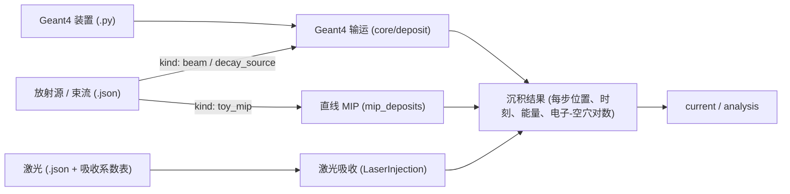

# 能量沉积组件（`components/deposit`）

能量沉积组件统一存放在 `components/deposit/` 下（见[架构总纲](../architecture.md#组件)），由 [`components/loader.py`](../supports/README.md) 的 `read_g4setup`、`load_source` 与 `load_laser` 定位加载。它们结合 [探测器组件](device.md) 的几何尺寸与材料，分别描述 Geant4 周边几何装置（Python 脚本）、放射源与粒子束流（JSON）以及激光脉冲与材料带间吸收系数表（JSON 与 `.txt`），由 [`deposit`](../stages/deposit.md) 环节（[`core/deposit`](../core/deposit.md)）读取并算出器件内的能量沉积步与初始电子-空穴对，结果交给 [`current`](../stages/current.md)（[`core/current`](../core/current.md)）和 [`analysis`](../stages/analysis.md)（[`core/analysis`](../core/analysis.md)）。



查找组件时，project 文件夹里自己的组件优先，找不到再到组件库按名字找。

## 组件文件原文

### Geant4 装置：`device_alone.py`

下面是库里的 `device_alone.py` 原文：

```python
"""The device alone in vacuum, the source 17 mm upstream of its front surface.

What surrounds the device in Geant4; reading it imports no Geant4."""

G4SETUP = {
    "name": "device_alone",
    "description": "The device alone in vacuum",
    "geant4_model": "device",
    "object": {},
    "along_beam": ["source", {"gap": 17000}, {"slot": "Device"}],
    "world": "G4_Galactic",
    "maxstep": 2,
}
```

带周边几何体时，在 `object["elemental"]`（Geant4 NIST 材料）或 `object["binary_compounds"]`（二元化合物）中按长方体名称列出，并在 `along_beam` 中排布位置。例如 `time_resolution.py` 中的一块铝片：

```python
"object": {
    "elemental": {
        "Al": {
            "name": "Al",
            "material": "G4_Al",
            "side_x": 5000,
            "side_y": 5000,
            "side_z": 10,
            "colour": [1, 0.1, 0.8],
        },
    },
},
```

### 放射源：`decay/Sr90.json`

```json
{
    "name" : "Sr90",
    "kind" : "decay_source",
    "description" : "Sr-90 beta source: every event is one decay, of Sr-90 or of its daughter Y-90 with the same chance, on a disk 5 mm across; what the decay emits goes isotropically within 15 degrees of the axis",
    "nuclides" : [[38, 90], [39, 90]],
    "par_radius" : 2500,
    "par_cone" : 15
}
```

### 粒子束流：`beam/proton.json`

```json
{
    "name" : "proton",
    "kind" : "beam",
    "par_type" : "proton",
    "par_energy" : 1000.0,
    "par_randx" : 0,
    "par_randy" : 0
}
```

### 激光：`LA01IR_top_Si.json`

```json
{
    "description" : "Particulars LA-01 IR FC, 1064 nm: pulse <350 ps to 4 ns, spot at focus <11 um FWHM, few to 100 MIP in 300 um Si (https://www.particulars.si/products.php?prod=scanTCT.html); pulse_energy is about 10 MIP in 300 um Si",
    "tech" : "SPA",
    "direction" : "top",

    "refractionIndex" : 3.51,

    "wavelength" : 1064,
    "temporal_FWHM" : 350e-12,
    "pulse_energy" : 1.8e-13,
    "spacial_FWHM" : 11,
    "central_time" : 1e-9,

    "pairs_per_group" : 1000,
    "groups" : 3200,

    "fx_rel" : 0.25,
    "fy_rel" : 0.5,
    "fz_rel" : 0.0
}
```

## 键的含义

使用者在三类沉积组件文件中能设的只有下表列出的键。

### 装置

#### `G4SETUP` 顶层键

未指定装置组件时，代码使用内置默认字典 `DEVICE_ALONE`。

| 键名 | `DEVICE_ALONE` 默认值 | 单位 | 含义 |
| --- | --- | --- | --- |
| `name` | 无（可选） | 无 | 装置名称 |
| `description` | 无（可选） | 无 | 装置几何的文字说明 |
| `geant4_model` | `"device"`（Geant4 源必填） | 无 | 几何模型标识；取 `"gdml_import"` 时导入外部 GDML，其余值按 `object` 构建周边长方体 |
| `world` | `"G4_Galactic"`（Geant4 源必填） | 无 | 世界立方体的 Geant4 NIST 材料名 |
| `maxstep` | `2`（必填） | `um` | 器件有源层逻辑体内的最大步长限制（`toy_mip` 未指定 `packets` 时也读取该值） |
| `source` | `{"angle": 0}`（可选） | `degree` | 只留入射倾角 `angle`（缺省 `0`），只用于单槽位装置：绕器件前表面中心转动源；束流源发射方向为 $+z$ |
| `object` | `{}`（Geant4 源必填） | 无 | 周边几何体字典，无周边物体时为 `{}`，可含 `"elemental"` 和 `"binary_compounds"` 两类子字典；各物体只定义材料、尺寸、孔与颜色，在 `along_beam` 中放置 |
| `along_beam` | `["source", {"gap": 17000}, {"slot": "Device"}]`（必填，`"gdml_import"` 除外） | 无 | 从 `"source"` 开始沿 $+z$ 指向下游的一列，按顺序排布源、间隔、物体与器件槽位（支持并排列表）；每个槽位放哪块器件由实验给出，放置公式见 [能量沉积与电离](../core/deposit.md#沿束流的一列) |

#### `along_beam` 各项键

`along_beam` 从 `"source"` 出发沿 $+z$ 依次列出各项，相邻两项之间不写 `gap` 即紧贴在一起：

```python
"along_beam": [
    "source",
    {"gap": 1995}, "Al",
    {"gap": 4978.5},
    {"slot": "ref"}, "pcb1",
    {"gap": 8183.5},
    {"slot": "dut"}, "pcb2",
]
```

| 项的种类 | 键名 | 默认值 | 单位 | 含义 |
| --- | --- | --- | --- | --- |
| `"source"` | 无（字符串） | 无（首项必填） | 无 | 源，必须位于 `along_beam` 第一项，厚度为 `0`，世界坐标原点在其上 |
| `{"gap": d}` | `gap` | 无 | `um` | 间隔，沿 $z$ 占长度 $d \ge 0$ |
| `"<物体名>"` 或 `{"object": "<物体名>", ...}` | `object`、`offset` | `offset` 默认 `[0, 0]` | `offset` 为 `um` | `object` 中的一个几何体，沿 $z$ 占其厚度 `side_z`，横向中心位于 `offset`；简写为 `"<物体名>"` 时等同于 `offset = [0, 0]` |
| `{"slot": "<槽位名>", ...}` | `slot`、`facing`、`offset`、`rotation_z`、`colour` | `facing` 默认 `"upstream"`，`offset` 默认 `[0, 0]`，`rotation_z` 默认 `0`，`colour` 默认 `[1, 0.1, 0.8]` | `offset` 为 `um`，`rotation_z` 为 `degree` | 一块器件（只有一块器件的装置槽位名写 `"Device"`），沿 $z$ 占其几何全部层总厚 $l_z + t$；`facing` 取 `"upstream"`（前表面朝源）或 `"downstream"`（绕 $y$ 轴翻转 $180^\circ$，前表面朝下游）；`rotation_z` 绕 $z$ 轴转角只取 `0`、`90`、`180`、`270`；`colour` 为可视化 RGB 颜色列表 `[r, g, b]`（`0` 至 `1`） |
| `[项, 项, ...]` | 列表中各项 | 无 | 无 | 并排放置的几项，前端面对齐在同一个 $z$，沿 $z$ 占其中最厚一项的厚度，靠各自的 `offset` 横向错开 |

`along_beam` 第一项不是 `"source"`、`gap` 为负、物体名不在 `object` 里、同一物体或槽位出现两次、`facing` 不是 `"upstream"` 或 `"downstream"`、`rotation_z` 取值不合法、并排的几项横向重叠，以及槽位名与实验器件表对不上时，均抛 `ValueError`。

#### `object` 两类几何体键

| 键名 | 适用分类 | 单位 | 含义 |
| --- | --- | --- | --- |
| `name` | 两者（必填） | 无 | 几何体名称 |
| `material` | `elemental`（必填） | 无 | Geant4 NIST 材料名，如 `"G4_Al"`、`"G4_Ni"`、`"G4_Ti"`、`"G4_Si"`、`"G4_BRASS"` |
| `material_1`, `material_2` | `binary_compounds`（必填） | 无 | 组成二元化合物的两种元素符号，如 `"Si"`、`"C"`、`"N"`、`"O"` |
| `compound_name` | `binary_compounds`（必填） | 无 | 化合物材料名称，同一运行中同名化合物的组分与密度须一致 |
| `density` | `binary_compounds`（必填） | `g/cm^3` | 化合物密度 |
| `natoms_1`, `natoms_2` | `binary_compounds`（必填） | 无 | 两种元素的原子数份额（代码中乘以各元素原子量换算为质量分数） |
| `side_x`, `side_y`, `side_z` | 两者（必填） | `um` | 长方体沿 $x$、$y$、$z$ 方向的全尺寸（`side_z` 为厚度） |
| `colour` | 两者（必填） | 无 | 可视化 RGB 颜色列表 `[r, g, b]`（无量纲，`0` 至 `1`） |
| `tub` | `elemental` 可选，`binary_compounds` 必填（无孔填 `{}`） | `um` | 从长方体中心沿 $z$ 轴减去的圆柱孔，含半径 `"tub_radius"` 和半长 `"tub_depth"` |

#### `"gdml_import"` 附加键

| 键名 | 默认值 | 单位 | 含义 |
| --- | --- | --- | --- |
| `world_half_size_um` | 无（可选） | `um` | 覆盖非包装世界模式下世界立方体的半边长 |
| `gdml.file` | 无（必填） | 无 | 要导入的 GDML 文件路径 |
| `gdml.top_volume` | `None` | 无 | 要导入的顶层逻辑体积名，未指定或未匹配时取 GDML 的世界体积 |
| `gdml.validate` | `False` | 无 | 读取时是否校验 GDML schema |
| `gdml.auto_center` | `True` | 无 | 是否按 GDML 几何节点坐标范围中心自动平移居中 |
| `gdml.position_um` | `[0.0, 0.0, 0.0]` | `um` | 导入几何体的平移向量 `[x, y, z]` |
| `gdml.rotation_xyz` | `[0.0, 0.0, 0.0]` | `degree` | 导入几何体绕 $X$、$Y$、$Z$ 轴的旋转角 |
| `gdml.placement_name` | `"ImportedGDML"` | 无 | 导入几何体的物理体积名称 |
| `visualization` | `{}` | 无 | 导入几何体与器件的可视化样式字典（含 `imported_visible`、`imported_force_wireframe`、`imported_force_solid`、`imported_colour_rgba`、`device_visible`、`hide_device`、`device_force_wireframe`、`device_force_solid`、`device_colour_rgba`） |

### 放射源和束流

#### 公共键

| 键名 | 默认值 | 单位 | 含义 |
| --- | --- | --- | --- |
| `name` | 无（可选） | 无 | 信号源名称 |
| `kind` | 无（必填） | 无 | 源类型，取 `"beam"`、`"decay_source"` 或 `"toy_mip"` |
| `description` | 无（可选） | 无 | 信号源文字说明 |

#### `beam` 与 `decay_source` 键

| 键名 | 默认值 | 单位 | 含义 |
| --- | --- | --- | --- |
| `par_type` | 无（`beam` 及不含 `nuclides` 的单能 `decay_source` 必填） | 无 | Geant4 粒子名（如 `"e-"`、`"mu-"`、`"pi-"`、`"proton"`、`"alpha"`）或等概率抽样的粒子名列表 |
| `par_energy` | 无（与 `par_type` 同步必填） | `MeV` | 粒子动能，或与 `par_type` 等长的动能列表 |
| `par_randx`, `par_randy` | `0`, `0` | `um` | 加在发射方向向量（$\mathbf{r}_{\text{out}} - \mathbf{r}_{\text{in}}$，单位 `um`）的 $x$、$y$ 分量上的均匀随机偏移半宽 |
| `particles` | 无（可选） | `offset` 为 `um` | 多粒子束团字典列表，每事例同时发射列表中的所有粒子；每项可设平移 `"offset"`（默认 `[0, 0, 0]` `um`）并覆盖 `par_type`、`par_energy`、`par_randx`、`par_randy` |
| `nuclides` | 无（核素衰变 `decay_source` 必填） | 无 | 静止放射性核素 `[Z, A]` 列表，每事例等概率抽取一种核素衰变一次 |
| `par_radius` | `0` | `um` | 垂直于发射轴线的圆形平面衰变源半径 |
| `par_cone` | `None` | `degree` | 衰变产物围绕发射轴线各向同性出射的圆锥半顶角 |

#### `toy_mip` 键

| 键名 | 默认值 | 单位 | 含义 |
| --- | --- | --- | --- |
| `landau_sampling` | 无（必填） | 无 | 是否按 Landau 分布抽样每段沉积能量；为 `false` 时取固定平均能量损失 |
| `start` | `[l_x / 2, l_y / 2, 0.0]` | `um` | 直线径迹在器件坐标系中的起点 `[x, y, z]` |
| `end` | `[l_x / 2, l_y / 2, l_z]` | `um` | 直线径迹在器件坐标系中的终点 `[x, y, z]` |
| `position_range_um` | 无（可选） | `um` | 起点横向均匀抽样范围 `{"x": [lo, hi], "y": [lo, hi]}`（`x`、`y` 两键均须给出） |
| `direction_sigma_mrad` | 无（可选） | `mrad` | 径迹斜率 $dx/dz$、$dy/dz$ 围绕 `0` 高斯抽样的标准差 `{"x": sigma_x, "y": sigma_y}` |
| `packets` | `ceil(length / maxstep)` | 段 | 单条径迹等分的沉积段数 |

### 激光与吸收系数表

| 键名 | 默认值 | 单位 | 含义 |
| --- | --- | --- | --- |
| `description` | 无（可选） | 无 | 激光器型号与参数说明 |
| `tech` | 无（必填） | 无 | 吸收机制，取 `"SPA"`（单光子吸收）或 `"TPA"`（双光子吸收） |
| `direction` | 无（必填） | 无 | 入射面：`"top"`（从 $z = 0$ 沿 $+z$）、`"bottom"`（从 $z = l_z$ 沿 $-z$）或 `"edge"`（从 $x = 0$ 沿 $+x$） |
| `refractionIndex` | 无（必填） | 无 | 器件材料在该波长下的折射率 $n$ |
| `wavelength` | 无（必填） | `nm` | 激光波长（读入后乘以 `1e-3` 转为 `um`） |
| `alpha` | 查 `deposit/absorption/<material>.txt` 对数插值 | `1/m` | 线性吸收系数 $\alpha$ |
| `beta_2` | 无（`"TPA"` 必填） | `m/W` | 双光子吸收系数 $\beta_2$ |
| `temporal_FWHM` | 无（必填） | `s` | 激光脉冲时间半高全宽 $\text{FWHM}_t$ |
| `pulse_energy` | 无（必填） | `J` | 单次激光脉冲能量 $E_{\text{pulse}}$ |
| `spacial_FWHM` | 无（必填） | `um` | 焦点处高斯光斑的空间半高全宽 $\text{FWHM}_{\text{sp}}$ |
| `l_Rayleigh` | 由 `spacial_FWHM`、`refractionIndex` 与 `wavelength` 计算 | `um` | 介质内的瑞利长度 $l_R$ |
| `central_time` | 无（必填） | `s` | 激光脉冲中心到达时刻 $t_c$ |
| `pairs_per_group` | 无（必填） | 对 | 单个载流子群包含的电子-空穴对数上限 |
| `groups` | 无（必填） | 群 | 每种吸收机制划分的最少载流子群数 |
| `fx_rel`, `fy_rel`, `fz_rel` | 无（必填） | 无 | 焦点在器件坐标系中的相对坐标，绝对位置为 `(fx_rel * l_x, fy_rel * l_y, fz_rel * l_z)`（单位 `um`） |

吸收系数表（`deposit/absorption/<material>.txt`）是空白分隔的两列文本文件，`#` 开头为注释行：第一列是波长（单位 `nm`），第二列是 `300 K` 下的带间吸收系数（单位 `1/cm`）。

其余参数（世界默认半边长、最大生成事例数上限、Geant4 中金刚石与碳化硅的内置密度、放射性衰变寿命阈值、材料平均电离能、Fano 因子、`toy_mip` 的平均线电离率与 Landau 宽度、激光横截面切分的 `4` 环 $\times$ `8` 扇区及光路积分加密步数）全部写死在代码里，组件文件中不能设置：

| 常数名或固定项 | 值 | 单位 | 定义位置与含义 |
| --- | --- | --- | --- |
| `WORLD_HALF_SIDE` | `25000` | `um` | `src/raser/core/deposit/simulate_deposits.py`，器件、周边物体与源未超出该范围时的 Geant4 世界立方体默认半边长 |
| `GENERATED_LIMIT` | `10000000` | 事例 | `src/raser/core/deposit/generation.py`，为录满目标记录事例数允许生成的最大源事例数默认上限 |
| Geant4 `"Diamond"` 密度 | `3.52` | `g/cm^3` | `src/raser/core/deposit/geant4/detector_construction.py`，用碳（`"G4_C"`）构建金刚石探测器材料时的固定密度（PDG 原子与核性质表，diamond） |
| Geant4 `"SiC"` 密度与原子配比 | `3.21`，`50 : 50` | `g/cm^3`, 无量纲 | `src/raser/core/deposit/geant4/detector_construction.py`，构建碳化硅探测器材料时的固定密度与硅、碳原子数配比（4H-SiC 密度引自 M. E. Levinshtein, S. L. Rumyantsev, M. S. Shur (eds.), *Properties of Advanced Semiconductor Materials*, Wiley (2001)） |
| 放射性衰变时间阈值 | `1.0e60` | `year` | `src/raser/core/deposit/geant4/interaction.py`，传给 `SetTimeThresholdForRadioactiveDecay` 以允许任意长寿命核素衰变 |
| `RADIOACTIVE_DECAY` | `210` | 无量纲 | `src/raser/core/deposit/geant4/nuclide_source.py`，`DecayStackingAction` 识别 `G4RadioactiveDecay` 产物的子过程编号 |
| `PAIR_ENERGY_EV` | `"Si": 3.6`，`"SiC": 7.83`，`"Diamond": 13.1` | `eV` | `src/raser/core/deposit/ionization.py`，各材料产生一对电子-空穴对的平均电离能（硅值是 S. Navas et al. (PDG), *Phys. Rev. D* 110 (2024) 030001, doi:10.1103/PhysRevD.110.030001 第 35.8 节所给 3.65 eV 的近似；碳化硅值引自 A. Gsponer et al., *Nucl. Instrum. Methods Phys. Res. A* 1064 (2024) 169412, doi:10.1016/j.nima.2024.169412；金刚石值引自 T. Shimaoka et al., *Phys. Status Solidi A* 213 (2016) 2629, doi:10.1002/pssa.201600195） |
| `FANO_FACTOR` | `"Si": 0.115`，`"SiC": 0.128`，`"Diamond": 0.382` | 无量纲 | `src/raser/core/deposit/ionization.py`，各材料电离对数涨落的 Fano 因子（硅值引自 K. Ramanathan, N. Kurinsky, *Phys. Rev. D* 102 (2020) 063026, doi:10.1103/PhysRevD.102.063026；碳化硅值引自 S. K. Chaudhuri, K. J. Zavalla, K. C. Mandal, *Appl. Phys. Lett.* 102 (2013) 031109, doi:10.1063/1.4776703；金刚石值引自 Shimaoka et al.，同上） |
| `PAIRS_PER_UM` | `"Si": 80.0`，`"SiC": 55.0` | `对/um` | `src/raser/core/deposit/mip_track.py`，`toy_mip` 模式下单位径迹长度产生的平均电子-空穴对数（硅值见 PDG 第 35.8 节与 H. Bichsel, *Rev. Mod. Phys.* 60 (1988) 663, doi:10.1103/RevModPhys.60.663；碳化硅值按 7.83 eV 与 MIP 能损换算） |
| `LANDAU_WIDTH_MEV_PER_UM` | `"Si": 1.78e-5`，`"SiC": 2.46e-5` | `MeV/um` | `src/raser/core/deposit/mip_track.py`，`toy_mip` 模式下单位径迹长度沉积能量 Landau 抽样的宽度参数，按 PDG 第 34 章 $\xi = (K/2)\langle Z/A\rangle\rho x/\beta^2$（$\beta = 1$）算出（见 [`core/deposit`](../core/deposit.md#toy-mip-径迹)） |
| 光子能量常数 $h$, $c$ | `6.626e-34`, `2.998e8` | `J s`, `m/s` | `src/raser/core/deposit/laser.py`，计算单光子能量 $h c / \lambda$ 使用的普朗克常数与光速 |
| 激光光路积分步数倍数 | `50` | 步 | `src/raser/core/deposit/laser.py`，沿光路长度除以最小特征尺度 $\min(L, l_R, 10^6/\alpha)$ 后的积分细分倍数 |
| `rings`, `sectors` | `4`, `8` | 环, 扇区 | `src/raser/core/deposit/laser.py`，激光横截面等份额切分的同心环数与方位角扇区数（每层共 `32` 群） |

## 读进程序以后怎么用

### Geant4 装置构建与坐标变换（`simulate_deposits.py`、`geant4/`）

1. **合并装置与源配置（`read_g4setup`、`g4_configuration`）**：`read_g4setup`（`loader.py`）执行 `<name>.py` 获取 `G4SETUP` 字典并记录脚本 `"sha256"`（若指向 `.json` 文件则抛出 `ValueError`）；未提供装置时取 `DEVICE_ALONE`。`g4_configuration` 校验源字典中不含位置键 `par_in`、`par_out`、`par_angle`，将 `par_in` 置为世界原点 `[0, 0, 0]`、`par_out` 置为沿 $+z$ 的瞄准点（单槽位时为器件前表面中心 `[0, 0, P_z]`），并从装置可选的 `source` 字典（缺省 `{}`）取出 `angle`（缺省 `0`）写入 `par_angle`（`degree`）。几何可视化由 [`deposit`](../stages/deposit.md) 环节的 `-g4_vis` 选项控制。
2. **计算世界尺寸并搭建几何（`world_half_side`、`GeneralDetectorConstruction`、`GDMLDetectorConstruction`）**：
   - `world_half_side` 以 `along_beam` 一列的中点 $(0, 0, L_{\text{col}}/2)$ 为世界立方体中心，求一列总长的一半 $L_{\text{col}}/2$、所有项的横向半尺寸加 `offset` 以及源圆盘半径 `par_radius` 的最大延伸距离 `reach`（`um`）：若 $\text{reach} \le 25000\ \mu\text{m}$，世界立方体半边长取 $25000\ \mu\text{m}$，否则取 $2 \times \text{reach}$。
   - Geant4 世界坐标系原点 $(0, 0, 0)$ 设在源上，$z$ 轴沿束流指向下游，单位 `um`。从 `"source"`（$z = 0$）起沿 `along_beam` 依次按厚度与 `gap` 累加得到每一项的前端面 $z_i$：每个槽位建一个以槽位名命名的有源层逻辑体（单器件槽位名为 `"Device"`）和灵敏层以外各层的逻辑体（见 [探测器组件](../components/device.md)，只记录有源层里的沉积），按 `facing`（`"upstream"` 朝源或 `"downstream"` 绕 $y$ 轴翻转 $180^\circ$ 朝下游）、`offset` 与 `rotation_z` 放置；多槽位装置中源不能倾斜（`angle` 须为 `0`），`toy_mip` 源的径迹从世界原点 `(0, 0, 0)` 沿 $+z$ 出发穿过全部槽位，不能给 `start`、`end`、`position_range_um`。
   - `GeneralDetectorConstruction` 按 `along_beam` 依次在世界体中放置各槽位器件与引用的 `object["elemental"]`、`object["binary_compounds"]` 长方体；每个长方体在 $z$ 上占据 $[z_i, z_i + \text{side\_z}]$，横向中心位于 `offset`。当长方体带非空 `tub` 时，用 `G4SubtractionSolid` 从长方体中心沿 $z$ 轴减去半径 `tub_radius`、半长 `tub_depth`（`um`）的圆柱孔。若 `geant4_model == "gdml_import"`，则改由 `GDMLDetectorConstruction` 导入 `gdml.file` 指定的外部 GDML 几何（不用 `along_beam`）。
3. **入射倾角旋转（`tilted`）**：当 `source.angle`（记为 $\theta$，单位 `degree`）非零时（仅用于单槽位装置，多槽位装置而 `angle` 非零抛 `ValueError`），`tilted` 以单槽位器件前表面中心 $(x_{\text{pivot}}, P_y, z_{\text{face}}) = (P_x, P_y, P_z)$ 为转动中心，求转角 $\theta$ 后的源起点与瞄准点：
   $$x_{\text{pivot}} = P_x, \qquad z_{\text{face}} = P_z \tag{1}$$
   将源的起点 `par_in` 和瞄准点 `par_out`（含 `particles` 中各粒子的起点和瞄准点）绕穿过 $(x_{\text{pivot}}, P_y, z_{\text{face}})$ 且平行于 $y$ 轴的轴旋转角 $\theta$：
   $$\begin{pmatrix} x' \\ y' \\ z' \end{pmatrix} = \begin{pmatrix} (x - x_{\text{pivot}})\cos\theta + (z - z_{\text{face}})\sin\theta + x_{\text{pivot}} \\ y \\ -(x - x_{\text{pivot}})\sin\theta + (z - z_{\text{face}})\cos\theta + z_{\text{face}} \end{pmatrix} \tag{2}$$
   其中 $(x, y, z)$ 与 $(x', y', z')$ 为旋转前后的坐标（`um`），装置里的槽位与周边几何体保持不动。
4. **步长限制、能量窗口筛选与坐标平移（`GeneralSteppingAction`, `GeneralEventAction`, `GeneralG4Interaction`）**：粒子在槽位有源层逻辑体内的单步长度受 `maxstep`（`um`）限制，每一步记下中点位置 $\frac{1}{2}(\mathbf{r}_{\text{in}} + \mathbf{r}_{\text{out}})$、起点位置 $\mathbf{r}_{\text{in}}$（`um`）、全局时刻（`s`）和沉积能量（`MeV`）；写沉积文件时，`deposits.py` 只保留沉积能量大于 $0$ 的步。单个事例按各槽位能量窗 `windows`、逻辑式 `require` 与符合时间窗 `coincidence_window_ns` 判定是否记录（见 [能量沉积与电离](../core/deposit.md#多器件的记录条件)，未命中槽位在该事例里没有沉积步）。Geant4 运行结束后，`GeneralG4Interaction` 将每一步的中点和起点从 Geant4 世界坐标按所在槽位的 `facing`、`offset` 与 `rotation_z` 逆变换到该槽位器件自己的器件坐标（原点在器件前表面一角，有源层范围 $x \in [0, l_x]$、$y \in [0, l_y]$、$z \in [0, l_z]$ `um`），沉积文件的探测器名写槽位名（单器件为 `"Device"`）。

### 放射源、束流与电离对转化（`nuclide_source.py`、`primary_generator_action.py`、`mip_track.py`、`ionization.py`）

1. **放射性核素衰变源（`kind == "decay_source"` 且含 `nuclides`）**：`NuclideGeneratorAction` 在每个事例中等概率选取 `nuclides` 列表中的一种核素 $[Z, A]$，在以 `par_in` 为中心、垂直于发射轴 `par_out - par_in`、半径为 `par_radius`（`um`）的圆盘上均匀抽样静止衰变点，由 Geant4 `G4RadioactiveDecayPhysics` 模拟衰变。`DecayStackingAction` 将衰变留下的次级原子核直接截断（`fKill`），不继续跟踪后续衰变链，并将衰变发射产物的全局起始时刻归零（`0.0 s`）。当给定 `par_cone`（记为 $\theta_{\text{cone}}$，单位 `degree`）时，`DecayStackingAction` 从随机流 `stream("source")` 将产物动量方向重抽样到围绕发射轴半锥角 $\theta_{\text{cone}}$ 的圆锥内各向同性分布，对应的立体角占比由 `generated_fraction` 写入沉积文件属性：
   $$f_{\text{gen}} = \frac{1 - \cos\theta_{\text{cone}}}{2} \tag{3}$$
   其中 $f_{\text{gen}}$ 为无量纲立体角占比（例如 `Sr90.json` 中 $\theta_{\text{cone}} = 15^\circ$ 时 $f_{\text{gen}} \approx 0.017037$，生成事例数除以 $f_{\text{gen}}$ 即为全部 $4\pi$ 方向上的总衰变数）；未设 `nuclides` 或未设 `par_cone` 时 $f_{\text{gen}} = 1.0$。不含 `nuclides` 而给出 `par_type`、`par_energy` 的衰变源（如 `decay/Am241.json`）按下面粒子束流方式发射单能粒子。
2. **粒子束流（`kind == "beam"`）**：`GeneralPrimaryGeneratorAction` 在每个事例中同时发射 `particles` 列表中的所有粒子（未给 `particles` 时为单粒子）：对每个粒子从随机流 `stream("source")` 抽取横向均匀偏移 $\Delta x \sim \mathcal{U}(-\text{par\_randx}, \text{par\_randx})$、$\Delta y \sim \mathcal{U}(-\text{par\_randy}, \text{par\_randy})$（`um`），加到方向向量 `par_out - par_in` 的 $x$、$y$ 分量上（若 `par_type` 与 `par_energy` 为等长列表，每事例等概率抽取其中一种粒子与对应动能），从 `par_in + offset`（`um`）发射。
3. **直线最小电离径迹（`kind == "toy_mip"`）**：`mip_deposits` 不启动 Geant4，在器件坐标系中确定径迹起点 $\mathbf{r}_{\text{start}}$（默认 $[l_x/2, l_y/2, 0.0]$ `um`；若给 `position_range_um` 则从 `stream("toy_mip")` 在区间内均匀抽样 $x_0, y_0$）和终点 $\mathbf{r}_{\text{end}}$（默认 $[l_x/2, l_y/2, l_z]$ `um`；若给 `direction_sigma_mrad` 则按 $\mathcal{N}(0, (\sigma_{\text{mrad}}\times 10^{-3})^2)$ 抽取斜率 $s_x, s_y$，并只要抽样过起点或斜率就令 $x_{\text{end}} = x_{\text{start}} + s_x(z_{\text{end}} - z_{\text{start}})$、$y_{\text{end}} = y_{\text{start}} + s_y(z_{\text{end}} - z_{\text{start}})$）。将径迹长度 $L = |\mathbf{r}_{\text{end}} - \mathbf{r}_{\text{start}}|$（`um`）等分为 $N_{\text{pkt}}$ 段（给定 `packets` 时取 `int(packets)`，否则取 $\lceil L / \text{maxstep} \rceil$），每段长 $\Delta s = L / N_{\text{pkt}}$（`um`），平均沉积能量为 $\bar{E}_{\text{seg}} = \text{PAIRS\_PER\_UM}[\text{material}] \times \varepsilon_{\text{pair}} \times 10^{-6} \times \Delta s$（`MeV`）。其中 $\varepsilon_{\text{pair}}$ 为材料平均电离能 `PAIR_ENERGY_EV[material]`（`eV`，见式 (4)）。当 `landau_sampling` 为 `true` 时，每段能量从 `stream("toy_mip")` 按 $\max(0.0,\, \text{Landau}(\bar{E}_{\text{seg}},\, w_{\text{Landau}}\Delta s))$ 抽样，$w_{\text{Landau}}$ 为单位径迹长度的 Landau 宽度 `LANDAU_WIDTH_MEV_PER_UM[material]`（`MeV/um`）；为 `false` 时固定取 $\bar{E}_{\text{seg}}$。所有沉积段的产生时刻均设为 `0.0 s`。
4. **电离对数转化（`ionized_pairs`）**：Geant4 和 `toy_mip` 得到的每步沉积能量 $E_k$（`MeV`）在 `ionized_pairs(event, material, fano=True)` 中除以材料平均电离能转化为平均电子-空穴对数 $\bar{N}_k$：
   $$\bar{N}_k = \frac{E_k}{\varepsilon_{\text{pair}} \times 10^{-6}}, \qquad N_k = \begin{cases} \max\!\left(0.0,\, \mathcal{N}\bigl(\bar{N}_k,\, F\,\bar{N}_k\bigr)\right), & \text{fano} = \text{True} \\ \bar{N}_k, & \text{fano} = \text{False} \end{cases} \tag{4}$$
   其中：
   - $E_k$：第 $k$ 个沉积步的沉积能量，`MeV`；
   - $\varepsilon_{\text{pair}}$：材料平均电离能 `PAIR_ENERGY_EV[material]`，`eV`；
   - $F$：材料 Fano 因子 `FANO_FACTOR[material]`（无量纲）；
   - $\bar{N}_k$、$N_k$：平均与最终写入 `pairs` 的电子-空穴对数，对；开启 Fano 抽样时，事例 `event.event` 从独立随机流 `stream(f"ionization/{event.event}")` 抽取高斯随机数。

### 激光吸收与载流子群切分（`laser.py`）

1. **吸收系数与高斯光束包络（`absorption_coefficient`、`LaserInjection`）**：`LaserInjection` 将输入的 `wavelength`（`nm`）乘以 $10^{-3}$ 换为波长 $\lambda$（`um`）。若激光文件未给 `alpha`（`1/m`），`absorption_coefficient` 读取 `deposit/absorption/<material>.txt`，在相邻波长间对吸收系数的自然对数做线性插值并乘以 `100.0` 换为 `1/m`（波长大于表上限时取 `0.0`，小于表下限时抛出 `ValueError`）。焦点光斑束腰半径 $w_0$、介质内瑞利长度 $l_R$（未给 `l_Rayleigh` 时）以及沿光路距离 $s$（`um`）处的光斑半径平方 $w^2(s)$ 为：
   $$w_0 = \frac{\text{FWHM}_{\text{sp}}}{\sqrt{2\ln 2}}, \qquad l_R = \frac{\pi w_0^2 n}{\lambda}, \qquad w^2(s) = w_0^2\!\left[1 + \left(\frac{s - s_{\text{focus}}}{l_R}\right)^2\right] \tag{5}$$
   其中：
   - $\text{FWHM}_{\text{sp}}$：焦点处光斑空间半高全宽 `spacial_FWHM`，`um`；
   - $w_0$、$w(s)$：焦点处束腰半径与光路位置 $s$ 处的光斑半径，`um`；
   - $n$：折射率 `refractionIndex`（无量纲）；
   - $\lambda$：激光波长，`um`；
   - $l_R$：介质内瑞利长度 `l_Rayleigh`，`um`；
   - $s_{\text{focus}}$：焦点沿光束传播方向距入射面的距离，`um`（`"top"` 入射为 $z_{\text{focus}}$，`"bottom"` 入射为 $l_z - z_{\text{focus}}$，`"edge"` 入射为 $x_{\text{focus}}$，其中绝对焦点坐标 $(x_{\text{focus}}, y_{\text{focus}}, z_{\text{focus}}) = (\text{fx\_rel}\cdot l_x,\, \text{fy\_rel}\cdot l_y,\, \text{fz\_rel}\cdot l_z)$ 直接位于器件坐标系内）。
2. **单光子与双光子吸收线密度（`LaserInjection.__init__`）**：单光子能量为 $E_{\text{ph}} = h c / (\lambda \times 10^{-6})$（`J`），单脉冲总光子数为 $N_{\text{ph}} = E_{\text{pulse}} / E_{\text{ph}}$。沿光路在位置 $s$（`um`）处单位长度（每米）经横截面积分产生的电子-空穴对数分别为：
   - 当 $\alpha \ne 0$ 时，计入单光子吸收（横向分布正比于 $\exp(-2r^2/w^2)$，时间展宽为 $\text{FWHM}_t$）：
     $$\left(\frac{dN}{ds_{\text{m}}}\right)_{\text{SPA}} = \alpha\,N_{\text{ph}}\,\exp\!\left(-\alpha\,s \times 10^{-6}\right) \tag{6}$$
   - 当 `tech == "TPA"` 时，额外计入双光子吸收（横向分布正比于 $\exp(-4r^2/w^2)$，时间展宽为 $\text{FWHM}_t / \sqrt{2}$）：
     $$\left(\frac{dN}{ds_{\text{m}}}\right)_{\text{TPA}} = \frac{\beta_2\,E_{\text{pulse}}^2\,\exp\!\left(-2\alpha\,s \times 10^{-6}\right)}{2\,E_{\text{ph}}\,\pi\,w^2(s)\times 10^{-12}}\sqrt{\frac{2\ln 2}{\pi}}\,\frac{1}{\text{FWHM}_t} \tag{7}$$
   其中：
   - $(dN/ds_{\text{m}})_{\text{SPA}}$、$(dN/ds_{\text{m}})_{\text{TPA}}$：单光子与双光子吸收在光路位置 $s$ 处每米产生的电子-空穴对数，$\text{m}^{-1}$；
   - $\alpha$：线性吸收系数 `alpha`，`1/m`；
   - $\beta_2$：双光子吸收系数 `beta_2`，`m/W`；
   - $E_{\text{pulse}}$：单脉冲能量 `pulse_energy`，`J`；
   - $E_{\text{ph}}$：单光子能量，`J`；
   - $\text{FWHM}_t$：激光脉冲时间半高全宽 `temporal_FWHM`，`s`。
3. **等份额网格切分与沉积写出（`_add_groups`、`laser_deposits`）**：对每种生效的吸收机制，沿器件内光路总长 $L$（`"top"`、`"bottom"` 为 $l_z$，`"edge"` 为 $l_x$，单位 `um`）取 $\lceil 50 L / \min(L, l_R, 10^6/\alpha) \rceil + 1$ 个采样点梯形积分得到累积对数曲线与总对数 $N_{\text{tot}}$。将横截面按 `4` 个等载流子份额同心环（无量纲归一化半径 $\rho_r = \sqrt{-\ln(1 - (r + 0.5)/4)/k}$，$r = 0, 1, 2, 3$，单光子 $k=2$，双光子 $k=4$）和 `8` 个等角扇区（$\phi_m = (m + 0.5)\pi/4$，$m = 0, \dots, 7$）切分为 `32` 个横截面单元，沿光路按等份额切分为 $N_{\text{slab}} = \lceil \max(N_{\text{tot}} / \text{pairs\_per\_group},\, \text{groups}) / 32 \rceil$ 层。每个单元中心放置一个携带 $N_{\text{tot}} / (32 N_{\text{slab}})$ 对电子-空穴的载流子群，产生时刻为 `central_time`（`s`），落在器件横向边界外的群被舍弃。`laser_deposits` 将所有群封装为事例 `0` 的 `Deposits`（每群沉积能量按 $N_{\text{group}}\,\varepsilon_{\text{pair}}\times 10^{-6}\ \text{MeV}$ 写入）。

## 库里有哪些组件

### 库中 Geant4 装置

| 组件名称 | 说明 | 出处 | 适用的器件或实验 |
| --- | --- | --- | --- |
| `device_alone` | 器件单独放在真空（`"G4_Galactic"`）中，源在器件前表面上游 `17 mm`，`maxstep = 2 um` | `description`：`The device alone in vacuum` | [`deposit`](../stages/deposit.md)、[`signal`](../bench/signal.md)、[`bmos`](../apps/bmos.md) 默认装置 |
| `Sr90_collimator` | 空气（`"G4_AIR"`）中在源与器件之间放置厚 `5 mm`、中心圆孔直径 `1 mm`（`tub_radius = 500 um`）的黄铜（`"G4_BRASS"`）准直器 | `description`：`In air, a brass block 5 mm thick with a hole 1 mm across between the Sr-90 source and the device` | [`signal`](../bench/signal.md) |
| `pcb_readout_gdml` | 导入外部 `pcb_readout.gdml` 的 PCB 读出板装置（`"geant4_model": "gdml_import"`） | 文件文档字符串：`The readout board of the PCB, imported from pcb_readout.gdml` | [`signal`](../bench/signal.md) |
| `telescope` | 真空（`"G4_Galactic"`）中沿束流排布 8 个槽位 `ref1`、`ref2`、`ref3`、`dut1`、`dut2`、`ref4`、`ref5`、`ref6`，`rotation_z` 都为 `0`，`maxstep = 2 um` | 文件文档字符串 | [`telescope`](../bench/telescope.md) 默认装置 |
| `time_resolution` | `along_beam` 沿束流依次放置 `Al`（`10 um`）、参考硅器件（槽位 `ref`）、上层开孔板 `pcb1`（`1500 um`）、被测器件（槽位 `dut`）与下层开孔板 `pcb2`（`1500 um`），间隔依次为 `1995`、`4978.5`、`8183.5 um`（见 [`timeres`](../bench/timeres.md)） | 文件文档字符串：`The setup of the time-resolution experiment: a reference silicon device and boards` | [`timeres`](../bench/timeres.md) 默认装置 |

### 库中放射源和束流

| 分类 | 组件名称 | 说明 | 出处 | 适用的器件或实验 |
| --- | --- | --- | --- | --- |
| 粒子束流（`beam`） | `beam/electron` | `1000.0 MeV` 电子束（`"e-"`，`par_randx = par_randy = 0`） | 未注明 | |
| 粒子束流（`beam`） | `beam/muon` | `1000.0 MeV` $\mu^-$ 束（`"mu-"`，`par_randx = par_randy = 0`） | 未注明 | |
| 粒子束流（`beam`） | `beam/pion` | `1000.0 MeV` $\pi^-$ 束（`"pi-"`，`par_randx = par_randy = 0`） | 未注明 | |
| 粒子束流（`beam`） | `beam/proton` | `1000.0 MeV` 质子束（`"proton"`，`par_randx = par_randy = 0`） | 未注明 | [`signal`](../bench/signal.md) 质子束流测试 |
| 粒子束流（`beam`） | `beam/proton_3GeV_spread` | `3000 MeV` 质子束，横向瞄准展宽半宽 `par_randx = par_randy = 728.6 um` | `description`：`3 GeV protons whose directions spread uniformly by up to 300/7000 = 0.0429 along x and along y...` | 配合 `device_alone` 的 `3 GeV` 展宽质子束测试 |
| 放射源（`decay`） | `decay/Am241` | `5.54 MeV` 单能 $\alpha$ 粒子源（`"par_type": "alpha"`） | `description`：`Am-241 alpha source` | [`signal`](../bench/signal.md) $\alpha$ 源测试 |
| 放射源（`decay`） | `decay/Sr90` | $^{90}\text{Sr}$（`[38, 90]`）与 $^{90}\text{Y}$（`[39, 90]`）等概率静止衰变 $\beta$ 源，圆盘半径 `2500 um`，出射半锥角 `15 degree` | `description`：`Sr-90 beta source: every event is one decay, of Sr-90 or of its daughter Y-90 with the same chance, on a disk 5 mm across; what the decay emits goes isotropically within 15 degrees of the axis` | [`deposit`](../stages/deposit.md)、[`signal`](../bench/signal.md)、[`timeres`](../bench/timeres.md) 默认源 |
| 直线 MIP（`toy`） | `toy/MIP` | 穿过器件中心的直线最小电离径迹，`landau_sampling = true` | `description`：`Straight toy MIP through the active sensor volume with Landau and Fano fluctuations.` | 任意硅或碳化硅器件快速直线 MIP 测试 |
| 直线 MIP（`toy`） | `toy/MIP_pixel_edge` | 从 `[600.0, 450.0, 0.0]` 到 `[600.0, 450.0, 300.0] um` 的 `50` 段直线 MIP，`landau_sampling = true` | `description`：`Straight toy MIP crossing a pixel boundary.` | `general_pixel`（$300\ \mu\text{m}$ 厚像素边界测试） |
| 直线 MIP（`toy`） | `toy/MIP_pixel_edge_fast` | 从 `[600.0, 450.0, 0.0]` 到 `[600.0, 450.0, 300.0] um` 的 `5` 段直线 MIP，`landau_sampling = false` | `description`：`Low-statistics toy MIP crossing a pixel boundary for field-shape checks.` | `general_pixel`（快速场形检查） |
| 直线 MIP（`toy`） | `toy/MIP_strip_edge` | 深度 `0.0` 至 `67.3 um`、起点 $x \in [150.0, 270.0]\ \mu\text{m}$、$y = 270.0\ \mu\text{m}$、$x$ 向斜率标准差 `10.0 mrad` 的直线 MIP，`landau_sampling = true` | `description`：`Straight toy MIP crossing a strip boundary.` | `SiC_LGAD_strip`（$67.3\ \mu\text{m}$ 厚条形边界测试） |
| 粒子束流（`beam`） | `beam/electron_5GeV_spread` | `5000 MeV` 电子束（`"e-"`），横向瞄准展宽半宽 `par_randx = par_randy = 750 um` | 原 `telescope.json` 的束流 | [`telescope`](../bench/telescope.md) 默认源 |
| 直线 MIP（`toy`） | `toy/MIP_telescope` | 从源所在世界原点沿 $+z$ 出发穿过全部槽位的直线 MIP，斜率标准差 $x$、$y$ 各 `1.0 mrad`，`landau_sampling = false` | 新增 | [`telescope`](../bench/telescope.md) 快速跑法 |
| 束团源（`bmos`） | `bunch` | 每事例同时发射 3 个 `80 MeV` 质子，`offset` 分别为 `[-1, 1, 0]`、`[0, 1, 0]`、`[1, 1, 0] um` | `description`：`A bunch of three 80 MeV protons side by side, 1 um apart along x and 1 um off the axis along y` | [`bmos`](../apps/bmos.md) 默认源 |

### 库中激光与吸收系数表

| 类别 | 组件名称 | 说明 | 出处 | 适用的器件或实验 |
| --- | --- | --- | --- | --- |
| 单光子硅（`Si`） | `LA01IR_edge_Si` | `"SPA"`，`1064 nm` 侧面（`"edge"`）入射，脉宽 `350 ps`，光斑 `11 um`，脉冲能量 `1.8e-13 J` | `description`：Particulars LA-01 IR FC（`1064 nm`）扫描 TCT 激光器参数 | 硅器件侧面 [`tct`](../bench/tct.md)（如 `HPK-Si-PiN`） |
| 单光子硅（`Si`） | `LA01IR_top_Si` | `"SPA"`，`1064 nm` 顶面（`"top"`）入射，脉宽 `350 ps`，光斑 `11 um`，脉冲能量 `1.8e-13 J` | `description`：Particulars LA-01 IR FC（`1064 nm`）扫描 TCT 激光器参数 | [`tct`](../bench/tct.md) 默认激光组件（如 `HPK-Si-PiN`） |
| 单光子硅（`Si`） | `LA01R_bottom_Si` | `"SPA"`，`660 nm` 底面（`"bottom"`）入射，脉宽 `350 ps`，光斑 `8 um`，脉冲能量 `7.2e-14 J` | `description`：Particulars LA-01 R FC（`660 nm`）扫描 TCT 激光器参数 | 硅器件底面 [`tct`](../bench/tct.md) |
| 单光子硅（`Si`） | `LA01R_top_Si` | `"SPA"`，`660 nm` 顶面（`"top"`）入射，脉宽 `350 ps`，光斑 `8 um`，脉冲能量 `7.2e-14 J` | `description`：Particulars LA-01 R FC（`660 nm`）扫描 TCT 激光器参数 | 硅器件顶面 [`tct`](../bench/tct.md) |
| 单光子碳化硅（`SiC`） | `PIL037_edge_SiC` | `"SPA"`，`375 nm` 侧面（`"edge"`）入射，$\alpha = 21000\ \text{m}^{-1}$，脉宽 `60 ps`，光斑 `20 um`，脉冲能量 `1.23e-12 J` | `description`：NKT Photonics PILAS PIL037（`375 nm`）数据手册 | 碳化硅器件侧面 [`tct`](../bench/tct.md)（如 `NJU-PiN`） |
| 单光子碳化硅（`SiC`） | `PIL037_top_SiC` | `"SPA"`，`375 nm` 顶面（`"top"`）入射，$\alpha = 1000\ \text{m}^{-1}$，脉宽 `60 ps`，光斑 `20 um`，脉冲能量 `1.23e-12 J` | `description`：NKT Photonics PILAS PIL037（`375 nm`）数据手册 | 碳化硅器件顶面 [`tct`](../bench/tct.md) 与 [`signal`](../bench/signal.md)（如 `NJU-PiN`） |
| 双光子硅（`Si`） | `TPA1550_edge_Si` | `"TPA"`，`1550 nm` 侧面（`"edge"`）入射，$\beta_2 = 1.5\times 10^{-11}\ \text{m/W}$，脉宽 `430 fs`，光斑 `1.448 um`，$l_R = 10.73\ \mu\text{m}$，脉冲能量 `5e-11 J` | `description`：TPA-TCT `1550 nm` 飞秒光纤激光器（`arXiv:2412.09017` 第 2.1 节） | 硅器件侧面双光子 [`tct`](../bench/tct.md) |
| 双光子硅（`Si`） | `TPA1550_top_Si` | `"TPA"`，`1550 nm` 顶面（`"top"`）入射，$\beta_2 = 1.5\times 10^{-11}\ \text{m/W}$，脉宽 `430 fs`，光斑 `1.448 um`，$l_R = 10.73\ \mu\text{m}$，脉冲能量 `1.5e-12 J` | `description`：TPA-TCT `1550 nm` 飞秒光纤激光器（`arXiv:2412.09017` 第 2.1 节） | 硅器件顶面双光子 [`tct`](../bench/tct.md) |
| 吸收系数表（`deposit/absorption/`） | `Si.txt` | `300 K` 本征硅在波长 `250 nm` 至 `1450 nm` 的带间吸收系数（`1/cm`） | 文件头注释：M. A. Green, *Sol. Energy Mater. Sol. Cells* 92 (2008) 1305, Table 1（doi:10.1016/j.solmat.2008.06.009） | 未显式指定 `alpha` 的硅（`"Si"`）器件激光模拟 |
