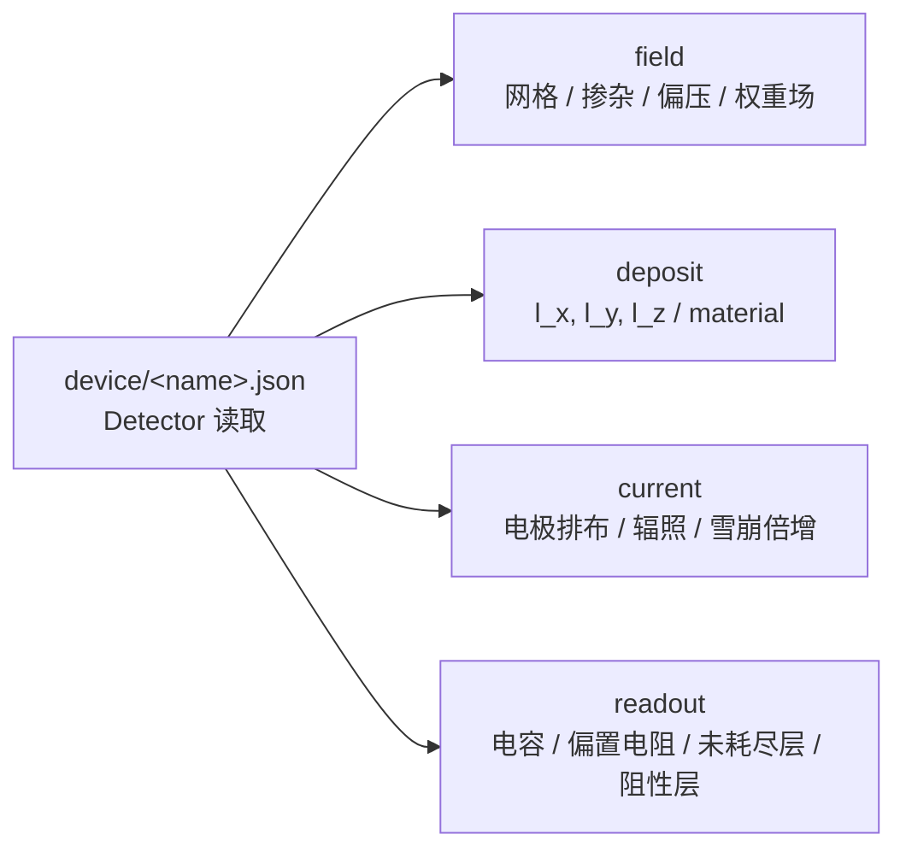
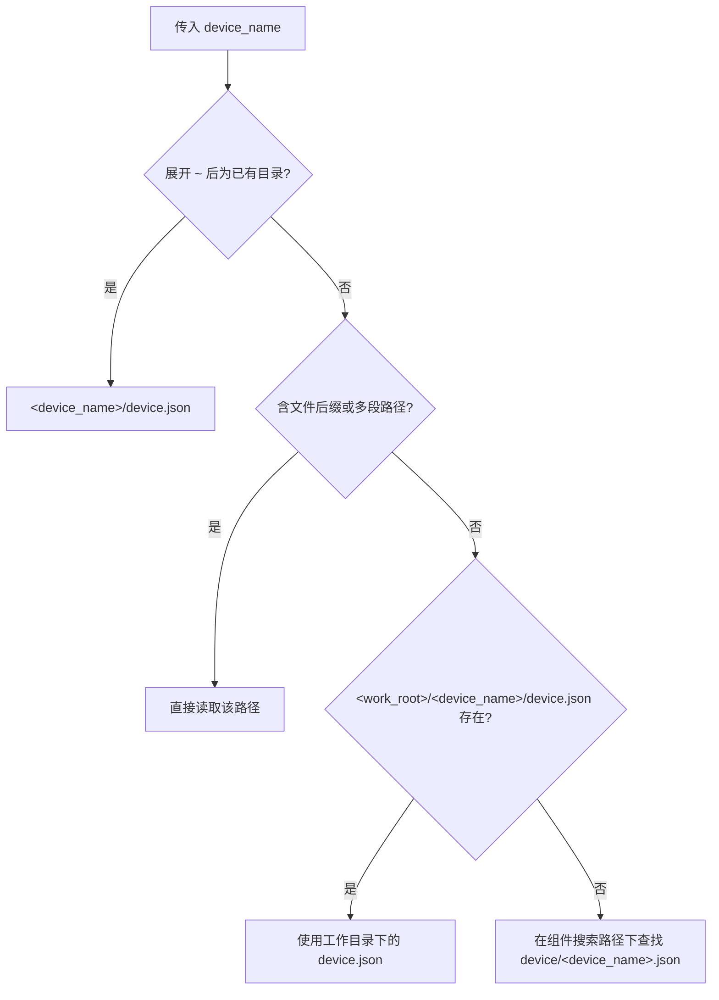

# 探测器组件（`components/device`）

`src/raser/components/device/` 存放探测器的 JSON 定义文件与 Gmsh 网格生成脚本。器件定义处在整条仿真链的最前端：工作流从器件名定位工作目录与运行快照，`field` 据此构造网格、掺杂、偏置与权重场，`deposit` 读取三维尺寸与材料构建灵敏体积，`current` 读取电极排布、辐照与雪崩倍增参数，`readout` 则据此组装结电容、偏置电阻、未耗尽层与阻性层等效电路。



## 查找顺序与文件格式

`Detector`（[`../core/device.md`](../core/device.md)）按以下顺序定位探测器 JSON 文件：



文件顶层必须是 JSON 对象，各键会成为 `Detector` 实例的同名属性，并完整写入实验目录的 `run.json["files"]["device"]`。通过 `--set` / `--scan` 传入 `device.<键路径>`（或顶层简写 `voltage` 映射到 `device.bias.voltage`）即可在运行期覆盖文件内的对应键。

### 示例器件文件：`HPK-Si-PiN.json`

在 [快速入门](../getting-started.md) 的示例 `raser signal HPK-Si-PiN --scan voltage=100,200 -s 2 -evt 200 --seed 1` 中，程序从 `src/raser/components/device/HPK-Si-PiN.json` 读取器件定义：

```json
{
    "det_name" : "HPK-Si-PiN",
    "det_model" : "planar",
    "material" : "Si",

    "l_x" : 1300,
    "l_y" : 1300,
    "l_z" : 50,

    "doping":{
        "Acceptors" : "5e12*(step((50e-4)-x)-step(1e-4-x)) + 1.0e18*(step((151e-4)-x)-step((50e-4)-x))",
        "Donors" : "1.0e19*step(1e-4-x)"
    },

    "bias" : {
        "electrode" : "top",
        "voltage" : 200.0
    },

    "temperature" : 300.0,
    "capacitance_pF" : 3.44162280284,
    "field_source" : "devsim",
    "field_dimension" : 1,

    "area_factor" : 0.0169,
    "default_dimension" : 1,
    "read_out_contact" : [{"x_span":0, "y_span":0, "name":"top"}],
    "field_shift_x" : 0,

    "mesh" : {
        "1D_mesh" : {
            "mesh_line" : [
                {"pos" : 0,      "ps" : 1e-4, "tag" : "top"},
                {"pos" : 0.5e-4, "ps" : 1e-5, "tag" : "jun_up"},
                {"pos" : 1e-4,   "ps" : 1e-5, "tag" : "mid"},
                {"pos" : 4e-4,   "ps" : 1e-5, "tag" : "jun_down"},
                {"pos" : 150e-4, "ps" : 1e-4, "tag" : "bot"}
            ],
            "region" : [
                {
                    "material" : "Silicon",
                    "region" : "HPK-Si-PiN",
                    "tag1" : "top",
                    "tag2" : "bot"
                }
            ],
            "contact" : [
                {"name" : "top", "tag" : "top", "material" : "metal"},
                {"name" : "bot", "tag" : "bot", "material" : "metal"}
            ]
        }
    }
}
```

这次运行直接用到了文件中的几处定义：

- **`bias.voltage` 为 `200.0` V**：扫描 `voltage=100,200` 时，`200 V` 与器件默认值一致，结果落在 `work/HPK-Si-PiN/signal/seed_1/`，`100 V` 则落在 `work/HPK-Si-PiN/signal/voltage_100/seed_1/`。
- **`l_x`、`l_y`、`l_z` 与 `material`**：`1300 × 1300 × 50 um` 的 `"Si"` 灵敏体区送入 Geant4 与 `current` 漂移。
- **`read_out_contact` 与 `capacitance_pF`**：读出接触仅为 `"top"`（`electrodes` 缺省取 `"pad"`），`readout_0.h5` 的属性写出 `electrodes=['top']`，并直接取用 `capacitance_pF = 3.44162280284` 记入 `device_circuit`（`"farad": 3.44162280284e-12, "from": "device file"`）。
- **`default_dimension = 1` 与 `mesh.1D_mesh`**：`field` 沿 `z` 轴建立 1D DEVSIM 网格（`top`、`jun_up`、`mid`、`jun_down`、`bot`），按 `area_factor = 0.0169` cm$^2$ 换算 IV/CV 曲线并写出 `100.0V.undepleted.json`、`200.0V.undepleted.json`。

### 几何、材料与电极布局键

| 键名 | 默认值 | 单位 | 含义 |
| --- | --- | --- | --- |
| `det_name` | JSON 文件名词干 | 无 | 探测器名称，同时作为 DEVSIM 的 `device` 与默认 `region` 名称 |
| `det_model` | 无（无 `capacitance_pF` 且未提供场解电容而读取电容时，以及计算电流时必填） | 无 | 探测器模型标识（如 `"planar"`、`"lgad"`、`"ilgad_planar"`、`"strip"`、`"lgadstrip"`、`"pixel"`、`"lgad_pixel"`、`"lgadpixel"`、`"3D_pixel"`、`"3D_column_series"`）；读取电容时用于判断是否含 `"3d"`（不区分大小写） |
| `material` | 无（平行板电容估算、求解场或计算电流时必填） | 无 | 探测器半导体材料（`Material` 支持 `"Si"`、`"SiC"`、`"Diamond"`；库中器件使用 `"Si"`、`"SiC"` 与 `"GaN"`，其中 `"GaN"` 见 `AlGaN_GaN_HEMT_TRANSPORT_V1`） |
| `l_x`, `l_y`, `l_z` | 无（必填） | `um` | 探测器在 x、y、z 三个方向的全尺寸（z 为厚度方向） |
| `default_dimension` | 无（必填） | 无 | 默认场求解维度（`1`、`2` 或 `3`） |
| `field_dimension` | 取 `default_dimension` | 无 | 覆盖 `default_dimension` 的场求解维度 |
| `area_factor` | `1.0` | 1D 为 `cm^2`，2D 为 `cm`，3D 无量纲 | 将 DEVSIM 求解的 IV 电流、CV 电容、网格比电容或未耗尽层比阻抗换算为器件总值的面积或长度因子 |
| `electrodes` | `"pad"` | 无 | 读出电极排布方式，取 `"pad"`、`"strip"` 或 `"pixel"` |
| `read_ele_num` | `"pad"` 下为 `1`，`"pixel"` 下为 `x_ele_num * y_ele_num` | 个 | 读出电极总数（`electrodes` 为 `"strip"` 时写入 JSON） |
| `x_ele_num`, `y_ele_num` | `"pad"` 下为 `1, 1`，`"strip"` 下为 `read_ele_num, 1` | 个 | x、y 方向的读出电极数（`electrodes` 为 `"pixel"` 时写入 JSON） |
| `p_x` | `"pad"` 下取 `l_x` | `um` | x 方向读出电极间距（`electrodes` 为 `"strip"` 或 `"pixel"` 时写入 JSON） |
| `p_y` | `"pad"` 与 `"strip"` 下取 `l_y` | `um` | y 方向读出电极间距（`electrodes` 为 `"pixel"` 时写入 JSON） |
| `read_out_contact` | 无（必填） | 无 | 读出接触电极列表，每项为含 `"name"` 及可选 `"x_span"`（读取权重场时缺少 `cells_either_side` 的 x 方向备用扩展单元数）、`"y_span"`（y 方向权重场向两侧扩展的邻近单元数）的对象；当只列 1 个接触且 `read_ele_num > 1` 时，各读出电极名自动成为 `<name>1..<name><read_ele_num>`（DEVSIM 求解单一重复读出接触的 x 方向扩展数由 `cells_either_side` 决定） |
| `e_width_x`, `e_width_y` | 无（可选） | `um` | 像素探测器无场扩散模型中每个像素中心的电荷收集区宽度 |
| `comment` | 无（可选） | 无 | 器件说明文本 |

### 偏压、掺杂、辐照与倍增键

| 键名 | 默认值 | 单位 | 含义 |
| --- | --- | --- | --- |
| `bias` | 无（必填） | 无 | 偏置对象，含 `"electrode"`（加偏压电极名）与 `"voltage"`（偏置电压，单位 `V`） |
| `temperature` | 无（必填） | `K` | 探测器工作温度 |
| `doping` | 无（DEVSIM 求解时必填） | `cm^-3` | 掺杂对象，含 `"Acceptors"` 与 `"Donors"`（DEVSIM 表达式或数值字符串），可选 `"Acceptors_ir"`、`"Donors_ir"`（`create_mesh.py` 按此首字母大写键名读取；`NJU-PiN`、`NJU-PiN-bmos`、`AlGaN_GaN_HEMT_TRANSPORT_V1` 中写为小写 `"donors_ir": "0"`），以及由 HEMT 输运求解器读取的按区域掺杂 `"by_region"` |
| `irradiation` | 整个对象缺省时 `irradiation_model` 为 `None`、`irradiation_flux` 为 `0` | 无 | 辐照对象；给出时 `"irradiation_model"`（可取 `"XingChen"`、`"Perugia"`、`"Schwandt"`、`"CommonDefect"`）与 `"irradiation_flux"`（单位 `neq/cm^2`）均必填 |
| `avalanche_model` | `None` | 无 | 碰撞电离模型名称；载流子漂移倍增支持 `"vanOverstraeten"`、`"Okuto"`、`"Hatakeyama"`（其余值报 `Unsupported avalanche model`） |
| `enable_gain` | `false` | 无 | 是否启用载流子倍增；为 `true` 时必须提供 `avalanche_model` |
| `gain_pair_threshold` | `0.05` | 对 | 局域路径倍增发射新载流子簇的对数阈值 |
| `gain_max_carriers` | `50000` | 簇 | 局域路径倍增允许生成的最大载流子簇数；取正值时，下一次发射将超过上限时抛出 `ValueError`；取 `0` 或负值时关闭此限制 |
| `local_gain_emit_slices` | `1` | 段 | 局域路径倍增每次发射生成的载流子簇数；单步生长时沿该步均分，跨步累积时各簇均位于按新增对数加权的中心位置与时刻 |
| `local_gain_integration_steps` | `3` | 步 | 局域路径倍增在单个漂移步内的电离系数积分采样点数 |
| `U_const` | `0` | `cm^-3 s^-1` | DEVSIM 中加到 SRH 复合率 `USRH` 上的常数项（库中器件取值为 `-5e10`） |
| `parameter` | 无（可选） | 依参数而定 | 写入 DEVSIM 区域参数的对象，读取其中的 `"name"` 与 `"value"` |

### 等效电路与阻性层键

| 键名 | 默认值 | 单位 | 含义 |
| --- | --- | --- | --- |
| `capacitance_pF` | 无（可选） | `pF` | 单个读出电极的结电容；未给定时优先取调用方传入的场解值（阻性层读出直接从器件或估算获取），再尝试平行板估算；`det_model` 含 `"3d"`（不区分大小写）时仅在提供显式值或场解值时有效，否则电路构造抛出 `ValueError` |
| `depletion_depth` | 取 `l_z` | `um` | 平行板结电容估算使用的耗尽层深度 |
| `bias_resistance_ohm` | `None` | `Ohm` | 单个读出电极的偏置电阻 |
| `coupling_capacitance_pF` | `None` | `pF` | 单个读出电极的交流耦合电容（未使用 `resistive_layer` 的读出电路中，给出时必须同时提供 `bias_resistance_ohm`，否则报 `ValueError`） |
| `undepleted_resistance_ohm`, `undepleted_capacitance_pF` | `None` | `Ohm`, `pF` | 未使用 `resistive_layer` 的读出电路中的未耗尽体区电阻与电容，必须同时给出或同时省略；采用条形行（row of strips）电路且存在未耗尽层时抛出 `ValueError` |
| `frequency` | 优先取 `field.solver.ac.frequency`，两者均未设置时为 `1000.0` | `Hz` | DEVSIM 交流电容求解频率 |
| `resistive_layer` | 无（可选） | 无 | 阻性层定义对象：未通过读出选项指定方阻时须含 `"sheet_resistance"`（`Ohm`）或注入铝参数 `"implanted"`（`cm^-2`）、`"thickness"`（`um`）、`"anneal"`（`C`），以及 `"strips"` 或 `"pads"` 单元跨度字典、可选 `"grounded"` 和 `"coupling"`（含 `"thickness"` 单位 `um` 与 `"permittivity"`） |

### 场求解与网格键

| 键名 | 默认值 | 单位 | 含义 |
| --- | --- | --- | --- |
| `field` | 无（可选） | 无 | 场配置对象，可含 `"solver"`（覆盖 `SOLVER` 的求解步长、容差与保存间隔 `saved_voltage_interval`）；`field` 下的任何改动都会使已求解的场被判为过期 |
| `field_interpolation_bins` | 需重新分箱的三维点云下每轴 `30`（`{"x": 30, "y": 30, "z": 30}`） | 无 | 对非常量且非完整规则网格的三维点云进行插值重分箱时的分箱数对象 `{"x": nx, "y": ny, "z": nz}`；进入该重分箱分支时，含未知轴名或任一轴分箱数小于 `2` 抛出 `ValueError` |
| `mesh` | 无（DEVSIM 求解时必填） | 无 | 网格配置对象，含可选 `"plugin"`（布尔值，默认 `false`，2D 网格是否位于横向 x-y 平面）、`"mesher"`（`"sde"` 时 3D 轴顺序为 `("x", "y", "z")`，否则为 `("z", "x", "y")`），以及 `"1D_mesh"`、`"2D_mesh"` 或 `"gmsh_mesh"`（TCAD 场通过 `raser field -ext` 导入） |
| `hemt_physics` | 无（可选） | 无 | AlGaN/GaN HEMT 物理与偏压扫描配置，`"transport_model"` 为 `"drift_diffusion_v1"` 时启用 2D 电子输运求解器 |

在 `mesh.1D_mesh` 与 `mesh.2D_mesh` 中，`"mesh_line"` 的位置 `"pos"`、步长 `"ps"` 以及 `"region"`、`"contact"` 的边界 `"xl"`、`"xh"`、`"yl"`、`"yh"` 均以 `cm` 为单位；`mesh.2D_mesh` 还可包含交流权重场求解（`ac-weightfield`）读取的 `"ac_contact"` 与 `"interface"`（HEMT 输运求解器亦读取 `"interface"`）。掺杂表达式中的空间坐标 `x`、`y`、`z` 对应 DEVSIM 网格坐标（单位 `cm`）。`mesh.gmsh_mesh.file` 指定的 `.msh` 文件由 `Detector.file(name)` 从探测器 JSON 所在目录（或绝对路径）查找；`TAICHU3.json` 中 `mesh.gmsh_mesh.region` 的 `"tag1"`、`"tag2"` 会传入 `devsim.add_gmsh_region(**region)`。部分器件 JSON 中还保留了 `"field_shift_x"`、`"field_shift_y"`、`"field_source"`、`"electrode_width_um"`、`mesh.tcad_mesh`、`mesh.gmsh_mesh.axes_um` 以及 `field.source`、`field.dimension` 等配置留存字段（随文件快照写入 `run.json`）。

## 库中组件

`src/raser/components/device/` 包含以下 23 个探测器 JSON 组件（同目录下的 `CMOS_strip.py` 与 `__main__.py` 用于生成 `CMOS_strip.msh`）：

| 组件名 | 组件名 | 组件名 | 组件名 |
| --- | --- | --- | --- |
| `3D-LGAD` | `3d_column_series` | `3d_pixel` | `AlGaN_GaN_HEMT_TRANSPORT_V1` |
| `CMOS_strip` | `CMOS_strip_tcad` | `DJLGAD_Ayyoub_1D_with_coefficient` | `DJLGAD_Ayyoub_Table1_1D` |
| `general_pixel` | `general_strip` | `HPK-Si-LGAD` | `HPK-Si-PiN` |
| `iLGAD` | `ITk-md8` | `ITk-Si-strip` | `NJU-PiN` |
| `NJU-PiN-bmos` | `pixel_ayyouby` | `SICAR-1` | `SICAR-1-PiN` |
| `SiC_LGAD_strip` | `strip_ayyouby` | `TAICHU3` | |

## 常见报错

| 报错信息 | 触发条件 |
| --- | --- |
| `ValueError: `electrodes` must be pad, strip or pixel, not <value>` | `electrodes` 取值不在 `"pad"`、`"strip"`、`"pixel"` 之中 |
| `ValueError: <path>: `electrodes` is <layout>, which takes the keys [...]; missing [...], keys of another layout [...]` | 缺少当前 `electrodes` 布局所需的键，或混入了其他布局的专属键 |
| `ValueError: gain is enabled but `avalanche_model` is missing in detector settings` | `enable_gain` 为 `true` 但未设置 `avalanche_model` |
| `ValueError: depletion_depth must be positive` | 进入平行板电容估算（未提供 `capacitance_pF` 与场解电容，且为非 3D 器件模型）时，`depletion_depth`（或未设置时的 `l_z`）小于或等于 0 |
| `FileNotFoundError: Cannot find <path>, named by <definition_path>` | `Detector.file` 找不到器件 JSON 引用的外部网格文件 |
| `ValueError: <det_name> gives <key> alone: the undepleted layer has both undepleted_resistance_ohm and undepleted_capacitance_pF` | 未使用 `resistive_layer` 的读出电路中，只给出了未耗尽层电阻与电容中的一个 |
| `ValueError: A coupling capacitance needs a bias resistance: without it the electrode has no DC potential` | 未使用 `resistive_layer` 的读出电路中，给出了 `coupling_capacitance_pF` 但未同时提供 `bias_resistance_ohm` |
| `ValueError: <det_name> is a row of strips and has an undepleted layer, from the <source>: the circuit of a row has none` | 未使用 `resistive_layer`、采用条形行电路的单一读出电极重复排列条形器件存在未耗尽层 |

## 相关页面

- [快速入门](../getting-started.md)
- [`../core/device.md`](../core/device.md)
- [`../core/field.md`](../core/field.md)
- [`../core/current.md`](../core/current.md)
- [`../core/readout.md`](../core/readout.md)
- [`../supports/README.md`](../supports/README.md)
