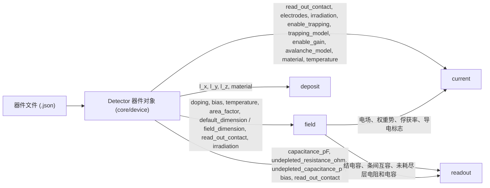

# 探测器组件（`components/device`）

器件组件文件（`components/device/<器件名>.json` 或项目文件夹下的 `device.json`）由 [`core/device`](../core/device.md) 的 `device_file` 与 `Detector` 定位并读入内存，定义探测器的三维尺寸、半导体材料、读出电极排布、掺杂分布、偏置电压、工作温度、辐照缺陷、雪崩倍增模型及器件等效电路参数，交给 [`field`](../stages/field.md)（[`core/field`](../core/field.md)）、[`deposit`](../stages/deposit.md)（[`core/deposit`](../core/deposit.md)）、[`current`](../stages/current.md)（[`core/current`](../core/current.md)）和 [`readout`](../stages/readout.md)（[`core/readout`](../core/readout.md)）四个环节使用。按 [架构总纲](../architecture.md#组件)，几何与网格分离，网格归属 [`field`](../stages/field.md)。



查找组件时，project 文件夹里自己的组件优先，找不到再到组件库按名字找。

## 组件文件原文

下面是库里的 `components/device/HPK-Si-PiN.json`。器件文件里没有 `mesh` 段：几何（各层厚度、材料、电极在哪一面）是器件的固有性质，用哪一套网格由 [`field`](../stages/field.md) 段的设置指定。

```json
{
    "det_name" : "HPK-Si-PiN",
    "det_model" : "planar",
    "material" : "Si",

    "l_x" : 1300,
    "l_y" : 1300,
    "l_z" : 50,

    "doping":{
        "Acceptors" : "5e12*(step((50e-4)-x)-step(1e-4-x)) + 1.0e18*(step((151e-4)-x)-step((50e-4)-x))",
        "Donors" : "1.0e19*step(1e-4-x)"
    },

    "bias" : {
        "electrode" : "top",
        "voltage" : 200.0
    },

    "temperature" : 300.0,
    "capacitance_pF" : 3.44162280284,
    "field_source" : "devsim",
    "field_dimension" : 1,

    "area_factor" : 0.0169,
    "default_dimension" : 1,
    "read_out_contact" : [{"x_span":0, "y_span":0, "name":"top"}],
    "field_shift_x" : 0
}
```

## 键的含义

使用者在器件 JSON 文件中能设的只有下表列出的键。

### 几何、材料与电极

| 键名 | 默认值 | 单位 | 含义 |
| --- | --- | --- | --- |
| `det_name` | JSON 文件名词干（`path.stem`） | 无 | 探测器名称，同时赋给 `Detector` 的 `det_name`、`device`、`region` 属性 |
| `det_model` | 无（必填） | 无 | 探测器结构模型标识，库中取 `"planar"`、`"lgad"`、`"ilgad_planar"`、`"strip"`、`"lgadstrip"`、`"pixel"`、`"lgad_pixel"`、`"lgadpixel"`、`"3D_pixel"`、`"3D_column_series"` 之一；转小写后含 `"3d"` 时不做平行板结电容估算 |
| `material` | 无（必填） | 无 | 半导体材料名，取 `"Si"`、`"SiC"`、`"Diamond"`（传入 [`core/model`](../core/model.md) 的 `Material` 及 [`core/deposit`](../core/deposit.md)）或 `"GaN"`（HEMT 输运分支） |
| `l_x`, `l_y`, `l_z` | 无（必填） | `um` | 探测器沿 $x$、$y$、$z$ 方向的全尺寸，$z$ 为厚度方向 |
| `electrodes` | `"pad"` | 无 | 读出电极排布方式，取 `"pad"`、`"strip"` 或 `"pixel"`，由 `LAYOUT_KEYS` 校验专属键 |
| `read_ele_num` | `"pad"` 为 `1`，`"pixel"` 为 `x_ele_num * y_ele_num` | 个 | 读出电极总数，`"strip"` 布局必填 |
| `x_ele_num`, `y_ele_num` | `"pad"` 为 `1, 1`，`"strip"` 为 `read_ele_num, 1` | 个 | $x$、$y$ 方向的读出电极数，`"pixel"` 布局必填 |
| `p_x` | `"pad"` 取 `l_x` | `um` | $x$ 方向读出电极间距，`"strip"` 或 `"pixel"` 布局必填 |
| `p_y` | `"pad"`、`"strip"` 取 `l_y` | `um` | $y$ 方向读出电极间距，`"pixel"` 布局必填 |
| `e_width_x`, `e_width_y` | 无（`collect_by_diffusion` 必填） | `um` | 无场像素纯扩散收集模式下每个像素中心矩形收集区的 $x$、$y$ 尺寸 |
| `read_out_contact` | 无（必填） | `x_span`、`y_span` 为个 | 读出接触电极字典列表，每项含 `"name"` 及单电极重复排布时的可选邻近扩展晶胞数 `"x_span"`（默认 `0`）、`"y_span"`（默认 `0`） |
| `comment` | 无（可选） | 无 | 器件说明文本 |

### 偏压、掺杂、辐照与倍增

| 键名 | 默认值 | 单位 | 含义 |
| --- | --- | --- | --- |
| `bias` | 无（必填） | `voltage` 为 `V` | 偏置对象，含施加偏压的电极名 `"electrode"` 和偏置电压 `"voltage"` |
| `temperature` | 无（必填） | `K` | 探测器工作温度 $T$ |
| `doping` | 无（场求解与纯扩散收集必填） | `cm^-3` | 掺杂对象，场求解读取沿深度（网格坐标单位 `cm`）的 `"Acceptors"`、`"Donors"` 表达式及可选辐照附加项 `"Acceptors_ir"`、`"Donors_ir"`；纯扩散收集读取数值型 `"Donors"`、`"Acceptors"` |
| `irradiation` | 缺省时 `irradiation_model` 为 `None`、`irradiation_flux` 为 `0` | `irradiation_flux` 为 `neq/cm^2` | 辐照对象，给出时须同时含缺陷模型 `"irradiation_model"`（`"XingChen"`、`"Perugia"`、`"Schwandt"`、`"CommonDefect"`）和辐照注量 `"irradiation_flux"` |
| `enable_trapping` | 缺省时按 `irradiation_model` 是否非 `None` | 无 | 为真时载流子按场里的俘获率被俘获，写了就与 `irradiation_model` 无关 |
| `enable_lifetime_decay` | `False` | 无 | 为真时载流子按 `electron_lifetime`、`hole_lifetime` 作有限寿命衰减 |
| `electron_lifetime`, `hole_lifetime` | 无（`enable_lifetime_decay` 为真时必填） | `s` | 电子、空穴的寿命，大于 `0` |
| `trapping_model` | 缺省时确定性模式、不释放、俘获率倍率 `1`、无空间涨落 | 见 [current.md](../core/current.md#器件文件读取的键) | 俘获模型块，含 `mode`（`"deterministic"`、`"stochastic"`）、`electron_release_time`、`hole_release_time`（`s`）、`trapping_rate_scale`（`electron`、`hole`）与 `spatial_variation`；各键含义、缺省与待拟合的数值见 [current.md](../core/current.md#俘获) |
| `avalanche_model` | `None` | 无 | 碰撞电离倍增模型名称，取 `"vanOverstraeten"`、`"Okuto"` 或 `"Hatakeyama"`（DEVSIM 场求解另支持 `"NoAvalanche"`、`"CustomAvalanche"`、`"Fine_exponential_models"`、`"Tunnel"`） |
| `enable_gain` | `False` | 无 | 是否启用载流子雪崩倍增，为 `true` 时必须同时提供 `avalanche_model` |
| `gain_pair_threshold` | `0.05` | 对 | 多维场 `"local_path"` 倍增模式下触发发射新增益团簇的最小累积对数（负值截断为 `0.0`） |
| `gain_max_carriers` | `50000` | 团簇 | 多维场 `"local_path"` 倍增模式下单事例允许生成的最大增益团簇数；$\le 0$ 时不设上限 |
| `local_gain_emit_slices` | `1` | 团簇 | 多维场 `"local_path"` 倍增模式下每次发射沿步段等分生成的子团簇数（至少为 `1`） |
| `local_gain_integration_steps` | `3` | 步 | 多维场 `"local_path"` 倍增模式下单漂移步内积分碰撞电离系数的中点采样点数（至少为 `1`） |
| `U_const` | `0` | `cm^-3 s^-1` | 场求解中附加到 SRH 复合率上的常数或节点表达式；碳化硅中同时与场增强因子构成 `R_TAT` |
| `parameter` | 无（可选） | 依参数而定 | 向 DEVSIM 求解区域写入的参数字典 `{"name": <str>, "value": <float>}`（如碳化硅陷阱辅助隧穿饱和场强 `"F_sat"`，默认 `1e5 V/cm`） |

### 器件电路

| 键名 | 默认值 | 单位 | 含义 |
| --- | --- | --- | --- |
| `capacitance_pF` | 无（可选） | `pF` | 单个读出电极的结电容；未给定时依次取场求解结果或平行板公式估算值 |
| `depletion_depth` | 取 `l_z` | `um` | 平行板结电容估算使用的耗尽层深度（须大于 `0`） |
| `bias_resistance_ohm` | `None` | `Ohm` | 单个读出电极到信号地的偏置电阻 |
| `coupling_capacitance_pF` | `None` | `pF` | 单个读出电极到放大器输入端的交流耦合电容，给出时须同时提供 `bias_resistance_ohm` |
| `undepleted_resistance_ohm`, `undepleted_capacitance_pF` | `None` | `Ohm`, `pF` | 偏压未耗尽体区的等效并联电阻与电容；未给定时由一维 `field` 按运行时偏压从场解算出，两个键须同时给出或同时省略 |
| `resistive_layer` | 无（可选） | `sheet_resistance` 为 `Ohm`，`implanted` 为 `cm^-2`，`thickness` 为 `um`，`anneal` 为 `°C` | 阻性电荷共享层定义对象，含方阻 `"sheet_resistance"`（或铝注入参数 `"implanted"`、`"thickness"`、`"anneal"`）、RC 格点跨度（`"strips"` 或 `"pads"`）、层所在的网格接触名 `"contact"` 及可选接地接触 `"grounded"`、介电耦合层 `"coupling"`（含 `"thickness"` [`um`] 与无量纲 `"permittivity"`） |

### 物理模型与求解维度

| 键名 | 默认值 | 单位 | 含义 |
| --- | --- | --- | --- |
| `default_dimension` | 无（必填） | 无 | 默认场求解维度，取 `1`、`2` 或 `3` |
| `field_dimension` | 取 `default_dimension` | 无 | 覆盖 `default_dimension` 的场求解维度 |
| `area_factor` | `1.0` | 1D 为 `cm^2`，2D 为 `cm`，3D 无量纲 | 将一维或二维求解的比电流、比电容与未耗尽层比阻抗换算为整块器件总值的面积或长度因子 |
| `frequency` | `field.solver.ac.frequency`（`1000.0`） | `Hz` | 覆盖场求解中小信号交流电容与噪声分析的频率 |
| `field.solver` | `SOLVER`（见 [`../core/field.md`](../core/field.md)） | 电压 `V`、频率 `Hz`、次数为次 | 深度合并覆盖 DEVSIM 默认求解器参数 `SOLVER` |
| `field_interpolation_bins` | `None`（3D 插值默认 `{"x": 30, "y": 30, "z": 30}`） | 个 | `DevsimField` 将三维非结构化点云插值到规则网格时的各轴箱数 |
| `hemt_physics` | 无（可选） | 迁移率 `cm^2/(V s)`、电压 `V`、长度 `nm` | `hemt_physics.transport_model == "drift_diffusion_v1"` 时启用二维 AlGaN/GaN HEMT 直流转移特性求解器 |

物理模型按名字注册，器件文件按名字选用；每种材料有缺省选用的模型（见 [`core/model`](../core/model.md)）。其余与器件物理和等效电路相关的参数（真空介电常数、各材料缺省选用的迁移率模型、导电区判定阈值、权重场导电边介电常数放大倍数、铝注入碳化硅阻性层拟合参数）均写死在代码里，器件文件中没有对应的键：

| 常数名或固定项 | 值 | 单位 | 定义位置与含义 |
| --- | --- | --- | --- |
| `EPSILON_0_F_PER_M` / `VACUUM_PERMITTIVITY_F_M` | `8.8541878128e-12` | `F/m` | `src/raser/core/device/build_device.py:20`、`src/raser/core/field/circuit_parameters.py:17`，平行板结电容与阻性层介电耦合电容计算使用的真空介电常数 |
| 缺省迁移率模型 | `"Si"`: `"Selberherr"`；`"SiC"`: `"Das"`；`"Diamond"`: `"Pernegger"` | 无 | `src/raser/core/model/material.py:46`、`:53`、`:59`、`src/raser/core/current/cal_current.py:313`，各材料缺省选用的迁移率模型 |
| `ELEMENTARY_CHARGE` / `ELEMENTARY_CHARGE_C` | `1.602176634e-19` | `C` | `src/raser/core/field/conductive.py:9`、`src/raser/core/field/implanted_aluminium.py:15`，电导率与阻性层方阻换算使用的元电荷 |
| `RESISTIVITY` | `10.0` | `Ohm cm` | `src/raser/core/field/conductive.py:10`，判定网格节点为高导电区的电阻率上限 |
| `UNDEPLETED` | `0.5` | 无量纲 | `src/raser/core/field/conductive.py:11`，判定有净掺杂节点尚未耗尽的载流子浓度与净掺杂浓度之比下限 |
| `CONDUCTOR_PERMITTIVITY` | `1e10` | 无量纲 | `src/raser/core/field/weighting.py:15`，求解权重场时两个导电节点之间边的介电常数放大倍数 |
| `TAT_SATURATION_FIELD` | `1e5` | `V/cm` | `src/raser/core/model/recombination.py:34`、`src/raser/core/field/create_parameter.py:124`，碳化硅陷阱辅助隧穿默认饱和场强 `F_sat` |
| `BOLTZMANN_EV_K` | `8.617333262e-5` | `eV/K` | `src/raser/core/field/implanted_aluminium.py:16`，铝注入碳化硅激活率 Arrhenius 拟合使用的玻尔兹曼常数 |
| `IMPLANTED_CM3`, `THICKNESS_CM`, `MEASURED_K`, `ZERO_CELSIUS_K` | `1e20`, `300e-7`, `300.0`, `273.15` | `cm^-3`, `cm`, `K`, `K` | `src/raser/core/field/implanted_aluminium.py:19-30`，铝注入 4H-SiC 阻性层方阻实验标定基准参数 |

## 读进程序以后怎么用

### 定位文件与构造 `Detector`（`core/device/build_device.py`）

1. **解析文件路径（`device_file`）**：
   - 若输入路径是已存在的文件夹，返回该文件夹下的 `device.json`；
   - 若输入带文件后缀或含多段路径，直接返回该路径；
   - 若 `<work_root>/<device_name>/device.json` 存在，返回该项目自定义的器件文件；
   - 否则调用 `component_file_path("device", str(device_name))` 在组件搜索路径下返回 `device/<device_name>.json`。
2. **校验布局与生成派生属性（`Detector.__init__`）**：
   - 将 JSON 字典深拷贝为 `device_dict`，把所有顶层键写入 `Detector` 同名属性，并提取 `voltage = float(device_dict["bias"]["voltage"])`（单位 `V`）与 `dimension = device_dict.get("field_dimension", device_dict["default_dimension"])`。
   - 校验 `electrodes` 必须属于 `("pad", "strip", "pixel")`，且 `device_dict` 必须完整包含 `LAYOUT_KEYS[electrodes]` 中的键、不得包含其他布局的专属键，否则抛出 `ValueError`。
   - 计算雪崩标志 `has_avalanche = (avalanche_model is not None) and bool(enable_gain)`；若 `enable_gain` 为真而 `avalanche_model` 为 `None`，抛出 `ValueError`。

### `field` 环节（`stages/field`、`core/field`）

1. **读取追踪与掺杂求值（`reading.py`、`create_mesh.py`）**：`solver_section.main` 用 `Reading(Detector(...))` 包装器件对象，自动记录求解期间访问的器件属性与 JSON 键并写入场节点 `<器件 project>/field/<节点号>/node.json` 的 `"read"` 字段。`DevsimMesh.setDoping` 在网格节点上对 `doping` 里的 `Acceptors`、`Donors`（以及可选的辐照附加项 `Acceptors_ir`、`Donors_ir`）求值，计算净掺杂浓度：
   $$N_{\text{net}}(x) = N_D(x) - N_A(x) \tag{1}$$
   其中：
   - $N_{\text{net}}(x)$：网格节点处的净掺杂浓度，$\text{cm}^{-3}$；
   - $N_D(x)$、$N_A(x)$：节点处的施主与受主浓度（含可选 `_ir` 项），$\text{cm}^{-3}$；
   - $x$：沿深度方向的 DEVSIM 一维网格坐标，$\text{cm}$，对应 `deposit` 和 `current` 中的 $z$ 坐标（单位 `um`）；表达式中 `step(a)` 在 $a > 0$ 时取 $1$、$a < 0$ 时取 $0$，两个 `step` 相减表示一段掺杂区间。
2. **求解电势、电场、权重势与俘获率（`create_parameter.py`、`solver_section.py`、`loop_section.py`）**：`bias` 和 `temperature` 定出接触边界条件与半导体参数（热电压、禁带宽度、本征载流子浓度），在 `dimension` 维网格上求出电势和电场，并按 `read_out_contact` 求出各读出电极的权重势；给定 `irradiation` 时同时求出缺陷空间电荷与电子、空穴俘获率。`area_factor` 将一维（乘以面积 $l_x l_y$，单位 `cm^2`）或二维（乘以垂直于求解平面的长度，单位 `cm`）网格求出的比电流、比电容换算为整块器件的 IV、CV 值。
3. **未耗尽体区阻抗提取（`conductive.py`、`save_milestone.py`）**：一维 DEVSIM 求解在偏压未耗尽整块器件时，将满足 $|N_{\text{net}}| > 0$、$n + p > 0.5|N_{\text{net}}|$ 且电阻率 $\rho = [e(\mu_n n + \mu_p p)]^{-1} \ge 10.0\ \Omega\cdot\text{cm}$ 的相邻节点区间积分为未耗尽层厚度 $w_{\text{undep}}$（`cm`）、比电阻 $r_{\text{undep}} = \sum \bar{\rho}\,\Delta x$（`Ohm cm^2`）和比电容 $c_{\text{undep}} = 10^{12}\varepsilon / w_{\text{undep}}$（`pF/cm^2`），其中 $e$ 为元电荷（C），$\mu_n$、$\mu_p$ 为电子、空穴迁移率（$\text{cm}^2/(\text{V}\cdot\text{s})$），$n$、$p$ 为电子、空穴浓度（$\text{cm}^{-3}$），$\varepsilon$ 为材料介电常数（F/cm），存入 `<V>V.undepleted.json`，并在读出环节通过 `area_factor` 换算为整块器件的未耗尽层电阻和电容。


`HPK-Si-PiN` 沿深度分布的三段掺杂：表面 `0–1 um` 为 `Donors` 的 $1.0\times 10^{19}\ \text{cm}^{-3}$ $n^+$ 层，`1–50 um` 为 `Acceptors` 的 $5\times 10^{12}\ \text{cm}^{-3}$ 灵敏体区，`50–151 um` 为 $1.0\times 10^{18}\ \text{cm}^{-3}$ $p^+$ 衬底（`l_z = 50` `um` 为灵敏层厚度，`field` 网格延伸到衬底底部的背电极）。

### `deposit` 环节（`stages/deposit`、`core/deposit`）

`GeneralDetectorConstruction`（`detector_construction.py`）读取 `l_x`、`l_y`、`l_z`（单位 `um`）和 `material`（支持 `"Si"`、`"SiC"`、`"Diamond"`），在 Geant4 世界中心构建名为 `"Device"` 的长方体实体，占据 $x \in [-l_x/2, l_x/2]$、$y \in [-l_y/2, l_y/2]$、$z \in [0, l_z]$，原点位于顶面中心（细节见 [`deposit.md`](deposit.md)）。直线最小电离径迹（`mip_deposits`）、激光注入（`LaserInjection`）与电离对转化（`ionized_pairs`）同样读取这四个键，确定器件空间边界、材料平均电离能、Fano 因子与带间吸收系数表。

### `current` 环节（`stages/current`、`core/current`）

1. **通道命名与权重势平移（`cal_current.py`）**：`electrode_names(read_out_contact, read_ele_num)` 在 `len(read_out_contact) == read_ele_num` 时直接取各项 `"name"`，在 `len(read_out_contact) == 1` 时生成 `"<name>1"` 至 `"<name><read_ele_num>"`。配合 `electrodes`（`"pad"`、`"strip"` 或 `"pixel"`）及 `x_ele_num`、`y_ele_num`、`p_x`、`p_y`（`um`）定出居中电极阵列范围。`read_out_contact` 列出全部电极时，每个通道用各自的权重势计算 Shockley-Ramo 感应电荷；只列 1 个电极并重复排布时，`electrodes_near` 按载流子轨迹起点所在电极编号 $(i_x, i_y)$，把第 `0` 号权重势平移到 $i \in [\max(i_x - s_x, 0),\, \min(i_x + s_x, N_x - 1)]$、$j \in [\max(i_y - s_y, 0),\, \min(i_y + s_y, N_y - 1)]$ 的近邻电极（其中 $s_x$ 取场对象 `cells_either_side` 或 `x_span`，$s_y$ 取 `y_span`）。
2. **漂移、俘获与雪崩倍增（`drift.py`、`cal_current.py`、`diffusion.py`）**：单步漂移读取 `material` 与 `temperature`（`K`）求取迁移率和热扩散步长标准差。`surviving` 沿漂移路径积分场中的电子或空穴俘获率，按指数衰减扣除被俘获的载流子；`enable_trapping`（缺省为 `irradiation_model is not None`）为真时计入俘获，`enable_lifetime_decay` 为真时另计有限寿命衰减，`trapping_model.mode` 为 `"stochastic"` 时改为逐个载流子随机俘获、释放与湮灭。当 `has_avalanche` 为真时，`CalCurrentGain` 在原生载流子漂移后计算倍增载流子并叠回总电流：一维场（`len(my_f.axes) == 1`）走 `"planar_integral"` 沿深度积分碰撞电离系数并在峰值场强区间中心深度释放倍增对；多维场走 `"local_path"` 沿每条轨迹按 `local_gain_integration_steps` 采样积分碰撞电离系数，待发射对数达到 `gain_pair_threshold` 时按 `local_gain_emit_slices` 切分发射新增益团簇（总数超过 `gain_max_carriers` 时抛出 `ValueError`）。无场像素纯扩散收集 `collect_by_diffusion` 则读取 `e_width_x`、`e_width_y`（`um`）与数值型 `doping.Donors`、`doping.Acceptors`（`cm^-3`）。

### `readout` 环节（`stages/readout`、`core/field`、`core/readout`）

1. **单电极结电容优先级（`circuit_parameters.junction_capacitance`、`build_device.Detector.capacitance`）**：
   - 若器件文件给定 `capacitance_pF`，直接取 `float(capacitance_pF) * 1e-12`（单位 `F`，来源记为 `"device file"`，该值固定不随偏压变化；若需结电容随偏压变化，应省略该键）；
   - 否则若 `field` 在当前偏压下求解了电容（`<voltage>V.cv.json` 或条形行互容总和），取场求解电容（单位 `F`，来源记为 `"field"`）；
   - 否则当 `det_model`（小写）不含 `"3d"` 时，由 `Detector.capacitance` 按平行板公式估算单电极结电容（3D 器件返回 `None` 并抛出 `ValueError`）：
     $$C_{\text{est}} = \varepsilon_0\,\varepsilon_r\,\frac{A \times 10^{-12}}{d \times 10^{-6}} \times 10^{12} \tag{2}$$
     其中：
     - $C_{\text{est}}$：单电极平行板估算结电容，`pF`（`junction_capacitance` 再乘以 $10^{-12}$ 转为 `F`，来源记为 `"parallel plate"`）；
     - $\varepsilon_0$：真空介电常数，`8.8541878128e-12` `F/m`；
     - $\varepsilon_r$：`Material(material).permittivity` 给出的材料相对介电常数（无量纲）；
     - $A$：单电极读出面积，`um^2`，`"strip"` 或 `"pixel"` 布局取 $p_x p_y$，`"pad"` 布局取 $l_x l_y$；
     - $d$：耗尽层深度 `depletion_depth`（缺省取 `l_z`），`um`。
2. **未耗尽层与附加器件电路（`circuit_parameters.py`、`device_circuit.py`、`pulse_edge.py`）**：未耗尽层并联电阻与电容优先取器件文件成对给出的 `undepleted_resistance_ohm`（`Ohm`）和 `undepleted_capacitance_pF`（`pF`）；未给定时取 `field` 解出的 `<V>V.undepleted.json`（比电阻除以器件面积、比电容乘以器件面积，一维取 `area_factor`，二维、三维取 `l_x`×`l_y`；参见 W. Riegler, *Nucl. Instrum. Methods Phys. Res. A* 940 (2019) 453, doi:10.1016/j.nima.2019.06.056），全耗尽时无此层。若器件文件还配置了 `bias_resistance_ohm`、`coupling_capacitance_pF` 或 `resistive_layer`（由 `device_row` 或 `device_grid` 构建阻性网格电路，铝注入碳化硅方阻模型来自 M. Spera et al., *Materials* 12 (2019) 3468, doi:10.3390/ma12213468 / `arXiv:2001.08021`），一并接在放大器链前面（网表结构见 [`readout.md`](readout.md#读进程序以后怎么用)）。`pulse_edges` 根据 `bias.electrode`、`bias.voltage` 与 `read_out_contact` 判定读出电极收集电子还是空穴，确定输出脉冲边沿是 `"rising"` 还是 `"falling"`。

`bias.electrode` 和 `read_out_contact` 里的 `name` 须与 `field` 网格中的接触名一致；示例文件中保留的 `field_source`、`field_shift_x`、`field_shift_y` 键现不被代码读取，编写新器件文件时可省略。

## 库里有哪些组件

`components/device/` 包含以下 24 个探测器组件：

| 组件名 | 说明 | 出处 | 适用的器件或实验 |
| --- | --- | --- | --- |
| `3D-LGAD` | Si `lgad_pixel` 器件（$35 \times 35 \times 30\ \mu\text{m}$，3D） | 未注明 | |
| `3d_column_series` | Si `3D_column_series` 器件（$50 \times 50 \times 100\ \mu\text{m}$，柱半径 $3\ \mu\text{m}$） | 未注明 | |
| `3d_pixel` | Si `3D_pixel` 器件（$1000 \times 1000 \times 150\ \mu\text{m}$，$40 \times 40$ 像素） | 未注明 | |
| `AlGaN_GaN_HEMT_TRANSPORT_V1` | GaN `planar` 器件（二维 AlGaN/GaN HEMT 直流转移特性模型） | `hemt_physics.model_provenance`：`Exploratory electron-only 2D drift-diffusion branch; no paper calibration` | `raser field`（HEMT `drift_diffusion_v1` 直流扫描） |
| `CMOS_strip` | Si `strip` 器件（$3200 \times 2800 \times 150\ \mu\text{m}$，$40$ 条，间距 $75.5\ \mu\text{m}$，Gmsh 网格） | 未注明 | |
| `CMOS_strip_tcad` | Si `strip` 器件（$3200 \times 2800 \times 180\ \mu\text{m}$，$40$ 条，间距 $75.5\ \mu\text{m}$，TCAD 网格） | 未注明 | |
| `DJLGAD_Ayyoub_1D_with_coefficient` | Si `lgad` 器件，一维 Ayyoub DJ-LGAD 系数版本（增益层高斯指数含 `1/2`，峰值 $3.0\times 10^{16}\ \text{cm}^{-3}$，标准差 $0.17\ \mu\text{m}$） | `comment`：一维 Ayyoub DJ-LGAD 系数变体（源自 `DJLGAD_Ayyoub_1D`） | |
| `DJLGAD_Ayyoub_Table1_1D` | Si `lgad` 器件，一维 Ayyoub Table 1 文献复现版 DJ-LGAD 近似模型 | `comment`：Ayyoub Table 1 文献复现版一维 DJ-LGAD 近似模型 | |
| `general_pixel` | Si `pixel` 器件（$900 \times 900 \times 300\ \mu\text{m}$，$3 \times 3$ 像素，间距 $300\ \mu\text{m}$） | 未注明 | |
| `general_strip` | Si `strip` 器件（$1000 \times 1000 \times 180\ \mu\text{m}$，$40$ 条，间距 $25\ \mu\text{m}$） | 未注明 | |
| `HPK-Si-LGAD` | Si `lgad` 器件（$1300 \times 1300 \times 50\ \mu\text{m}$，1D） | HPK（Hamamatsu Photonics）硅 LGAD（组件型号 `HPK-Si-LGAD`） | |
| `HPK-Si-PiN` | Si `planar` 器件（$1300 \times 1300 \times 50\ \mu\text{m}$，1D） | HPK（Hamamatsu Photonics）硅 PiN（组件型号 `HPK-Si-PiN`） | [快速入门](../getting-started.md) 与 `examples/HPK-Si-PiN/`（[`signal`](../bench/signal.md) 等示例默认器件） |
| `iLGAD` | Si `ilgad_planar` 器件（$10000 \times 10000 \times 285\ \mu\text{m}$，1D） | 未注明 | |
| `ITk-md8` | Si `planar` 器件（$8000 \times 8000 \times 50\ \mu\text{m}$，1D，配 `"Schwandt"` 辐照模型） | ATLAS ITk MD8 硅平面二极管（组件型号 `ITk-md8`） | |
| `ITk-Si-strip` | Si `strip` 器件（$96791 \times 48000 \times 305\ \mu\text{m}$，$1282$ 条，间距 $75.5\ \mu\text{m}$，配 `"XingChen"` 辐照模型） | ATLAS ITk 硅微条探测器（组件型号 `ITk-Si-strip`） | |
| `LBNL-SiC-AC-LGAD` | SiC `lgad_pixel` 器件（$1000 \times 1000 \times 75.8\ \mu\text{m}$，1D 场；阻性层切成 $20 \times 20$ 个 $50\ \mu\text{m}$ 的 RC 格点，4 个 $100\ \mu\text{m}$ 电极经 $0.3\ \mu\text{m}$ 氧化层交流耦合，间距 $500\ \mu\text{m}$，外圈接地） | T. Yang et al., `arXiv:2610.27535`；层结构见 IEEE Electron Device Lett. 46 (2025) 845, doi:10.1109/LED.2025.3548509；阻性层方阻 $630\ \Omega$ 为按掺杂估算，未有实测 | [`signal`](../bench/signal.md)：`raser signal LBNL-SiC-AC-LGAD`，电流按 RC 格点给出，读出在四个电极上 |
| `NJU-PiN` | SiC `planar` 器件（$5000 \times 5000 \times 100\ \mu\text{m}$，1D/2D） | 南京大学（NJU）4H-SiC PiN（组件型号 `NJU-PiN`） | [`signal`](../bench/signal.md)、[`tct`](../bench/tct.md) 碳化硅示例器件 |
| `NJU-PiN-bmos` | SiC `planar` 器件（$5000 \times 5000 \times 100\ \mu\text{m}$，1D/2D） | 南京大学（NJU）4H-SiC PiN（组件型号 `NJU-PiN-bmos`） | [`bmos`](../apps/bmos.md) |
| `MIM-Diamond` | Diamond `planar` 器件（$4500 \times 4500 \times 500\ \mu\text{m}$，2D，金属–本征金刚石–金属，顶电极 $+300\ \text{V}$，配 `"CommonDefect"` 本底缺陷） | peiyao 的 MIM 金刚石探测器（他的 `MIM-Diamond.json`） | [`signal`](../bench/signal.md)，装置 `mim_diamond_gold` |
| `pixel_ayyouby` | Si `lgadpixel` 器件，3×3 阵列 Ayyoub 风格 DJ-LGAD 像素（间距 $20 \times 20\ \mu\text{m}$） | `comment`：Ayyoub 风格 3×3 DJ-LGAD 像素模型 | |
| `SICAR-1` | SiC `lgad` 器件（$1000 \times 1000 \times 32.5\ \mu\text{m}$，1D） | SICAR-1 4H-SiC LGAD（组件型号 `SICAR-1`） | |
| `SICAR-1-PiN` | SiC `planar` 器件（$1000 \times 1000 \times 50\ \mu\text{m}$，1D） | SICAR-1 4H-SiC PiN（组件型号 `SICAR-1-PiN`） | |
| `SiC_LGAD_strip` | SiC `lgadstrip` 器件（$420 \times 420 \times 67.3\ \mu\text{m}$，$3$ 条，间距 $120\ \mu\text{m}$） | 未注明 | |
| `strip_ayyouby` | Si `lgadstrip` 器件，三通道 Ayyoub 风格 DJ-LGAD 条形探测器（间距 $20\ \mu\text{m}$） | `comment`：Ayyoub 风格三通道 DJ-LGAD 条形模型 | |
| `TAICHU3` | Si `pixel` 器件（$1500 \times 1500 \times 20\ \mu\text{m}$，$60 \times 60$ 像素，间距 $25 \times 25\ \mu\text{m}$） | TAICHU3（太初 3 号）CMOS 像素传感器（组件型号 `TAICHU3` / `Taichu3`） | [`telescope`](../bench/telescope.md)（`taichu_v1` 默认传感器） |
