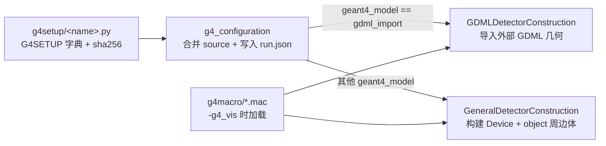

# Geant4 几何环境组件（`components/g4setup`）

`src/raser/components/g4setup/` 及各测试台子目录下的 `components/g4setup/` 存放描述探测器周围 Geant4 几何体、探测器内最大步长限制与信号源空间放置的 Python 脚本组件（`<name>.py`）。`g4setup` 组件作用于仿真链起点的 [`deposit`](../stages/deposit.md) 切片：通过 `--g4setup` 选项指定（默认 `"device_alone"`；`cce` 默认 `"charge_collection"`，`timeres` 默认 `"time_resolution"`），脚本中定义的 `G4SETUP` 字典连同脚本字节的 SHA-256 摘要一并写入 `run.json`，脚本内容发生改动会自动使依赖它的运行判为过期。



## 查找顺序与文件格式

`read_g4setup(selector)` 在组件搜索路径中查找 `g4setup/<selector>.py`（或读取显式给出的 `.py` 文件路径），在独立模块命名空间中执行后提取顶层字典 `G4SETUP`，返回 `{**G4SETUP, "file": str(selector), "sha256": <摘要>}`。

Geant4 世界坐标系原点 `(0, 0, 0)` 位于探测器顶面（`z = 0`）的中心。探测器实体 `"Device"` 占据 `x in [-l_x/2, l_x/2]`、`y in [-l_y/2, l_y/2]`、`z in [0, l_z]`，顶面上方为 `z < 0`；`GeneralDetectorConstruction` 在器件材料为 `"Si"`、`"Diamond"` 或 `"SiC"` 时构建 `"Device"`（其他材料在设置步长限制处触发 `KeyError`），`GDMLDetectorConstruction`（`"gdml_import"`）在材料为 `"Si"` 时构建 `"Device"`（材料为 `"SiC"` 或构造外部 `binary_compounds` 时会因构造器直接调用 Geant4 基类初始化而缺少 `compound_materials` 属性，调用 `create_binary_compounds` 时触发 `AttributeError`）。

### 示例环境脚本：`device_alone.py`

在 [快速入门](../getting-started.md) 的示例 `raser signal HPK-Si-PiN --scan voltage=100,200 -s 2 -evt 200 --seed 1` 中，命令行沿用默认 `g4setup = "device_alone"`，对应 `src/raser/components/g4setup/device_alone.py`：

```python
G4SETUP = {
    "name": "device_alone",
    "description": "The device alone in vacuum",
    "geant4_model": "device",
    "object": {},
    "source": {"at": [0, 0, -17000], "towards": [0, 0, 0], "angle": 0},
    "world": "G4_Galactic",
    "maxstep": 2,
    "g4_vis": False,
}
```

在该示例中：

- **源位置与环境**：`"world": "G4_Galactic"` 与 `"object": {}` 将 `HPK-Si-PiN` 裸置于真空中，`"source"` 把 `decay/Sr90` 放在探测器顶面上方 `17 mm`（`z = -17000 um`）处垂直瞄准顶面中心 `[0, 0, 0]`，Geant4 步长上限 `maxstep = 2 um`。
- **运行快照记录**：`work/HPK-Si-PiN/signal/seed_1/run.json` 的 `"files.g4setup"` 完整保存了 `G4SETUP` 各键及 `"file": "device_alone"`、`"sha256": "7fd37c9e44d82bbf2280687067320d0e94fc587e9bec870d760f3c608a3869d1"`。

### `G4SETUP` 顶层键

| 键名 | 默认值 | 单位 | 含义 |
| --- | --- | --- | --- |
| `name` | 无（可选） | 无 | 环境组件名称 |
| `description` | 无（可选） | 无 | 环境几何文字说明 |
| `geant4_model` | 无（Geant4 源必填；`toy_mip` 仅读取 `maxstep`） | 无 | Geant4 几何模型标识；取 `"gdml_import"` 时使用 `GDMLDetectorConstruction` 导入外部 GDML，其余值使用 `GeneralDetectorConstruction` |
| `world` | 无（Geant4 源非包装世界模式必填） | 无 | Geant4 世界体积的 NIST 材料名（如 `"G4_Galactic"`、`"G4_AIR"`）；世界立方体半边长由 `world_half_side` 计算（最小为 `25000 um`，若探测器、周边物体或源起点加 `par_radius` 超出则取最大延伸坐标的 2 倍）。当 GDML 文件文本含 `RASER_GDML_WRAPPER_WORLD` 时，直接使用 GDML 世界体积而忽略 `world` 与算出的半边长 |
| `maxstep` | 无（必填） | `um` | 探测器 `"Device"` 逻辑体积内的 Geant4 最大步长限制（`toy_mip` 源未配置 `packets` 时亦用该值切分径迹） |
| `source` | 无（Geant4 源必填） | `um`, `degree` | 源放置对象 `{"at": [x, y, z], "towards": [x, y, z], "angle": a}`：`at` 为源起点（写入 `par_in`），`towards` 为瞄准点（写入 `par_out`），`angle`（默认 `0`）为入射角（写入 `par_angle`，绕 `par_in -> par_out` 与探测器表面 `z = 0` 或 `z = l_z` 交点处平行于 y 轴的轴线旋转源及全部粒子的 `par_in`、`par_out`） |
| `object` | 无（Geant4 源必填） | 无 | 周边几何体字典，无周边几何体时为 `{}`；可包含 `"elemental"` 与 `"binary_compounds"` 两类子字典 |

库中 5 个脚本的 `G4SETUP` 均保留 `"g4_vis": False` 留存字段；运行期 Geant4 几何可视化由命令行选项 `-g4_vis` 与 `--g4-vis-driver` 控制（见 [`../stages/deposit.md`](../stages/deposit.md)）。

### `object.elemental` 与 `object.binary_compounds` 几何体键

`object["elemental"]` 下每个键值对应一个单质或 NIST 材料长方体，`object["binary_compounds"]` 下每个键值对应一个二元化合物长方体：

| 键名 | 适用分类 | 单位 | 含义 |
| --- | --- | --- | --- |
| `name` | 两者 | 无 | 逻辑体积与物理体积名称 |
| `material` | `elemental` | 无 | Geant4 NIST 材料名（如 `"G4_Al"`、`"G4_Ni"`、`"G4_Ti"`、`"G4_Si"`、`"G4_BRASS"`） |
| `material_1`, `material_2` | `binary_compounds` | 无 | 组成二元化合物的两种元素符号（如 `"Si"`、`"C"`、`"N"`、`"O"`） |
| `compound_name` | `binary_compounds` | 无 | 化合物材料名称（`GeneralDetectorConstruction` 中同名化合物的 `material_1`、`material_2`、`density`、`natoms_1`、`natoms_2` 必须逐项相等） |
| `density` | `binary_compounds` | `g/cm^3` | 化合物密度 |
| `natoms_1`, `natoms_2` | `binary_compounds` | 无 | 两种元素的原子数份额（按原子量加权换算为质量分数传入 Geant4） |
| `side_x`, `side_y`, `side_z` | 两者 | `um` | 长方体在 x、y、z 方向的全尺寸 |
| `position_x`, `position_y`, `position_z` | 两者 | `um` | 长方体中心在 Geant4 世界坐标系中的位置 |
| `colour` | 两者 | 无 | 可视化 RGB 颜色列表 `[r, g, b]` |
| `tub` | `elemental` 可选，`binary_compounds` 必填（无孔时传 `{}`） | `um` | 从长方体中心沿 z 轴减去的圆柱体，含 `"tub_radius"`（圆柱半径）与 `"tub_depth"`（圆柱半长；`tub_depth >= side_z / 2` 时贯穿厚度） |

### `"gdml_import"` 附加键

当 `geant4_model` 为 `"gdml_import"` 时，`GDMLDetectorConstruction` 还读取以下键：

| 键名 | 默认值 | 单位 | 含义 |
| --- | --- | --- | --- |
| `world_half_size_um` | 无（可选） | `um` | 非包装世界模式下覆盖 Geant4 世界立方体的半边长 |
| `gdml.file` | 无（必填） | 无 | GDML 文件路径，依次按已存在的绝对路径、`<组件根>/<file>`、`<组件根>/g4experiment/<file>`、`src/raser/<file>` 查找 |
| `gdml.top_volume` | `None` | 无 | 导入的顶层逻辑体积名；当 GDML 文件文本含 `RASER_GDML_WRAPPER_WORLD` 时直接将导入的世界体积作为 Geant4 世界体积，其余情况下当文件中存在精确的 `name="<top_volume>"` 或 `name='<top_volume>'` 属性且 `parser.GetVolume` 返回有效逻辑体积时使用该体积，否则取 GDML 的世界体积 |
| `gdml.validate` | `False` | 无 | `G4GDMLParser.Read` 是否校验 GDML schema |
| `gdml.auto_center` | `True` | 无 | 是否根据 GDML 内 `<position>` 标签估算几何中心并自动平移居中（包装世界模式下跳过） |
| `gdml.position_um` | `[0.0, 0.0, 0.0]` | `um` | 导入几何体的平移向量 `[x, y, z]`（包装世界模式下跳过） |
| `gdml.rotation_xyz` | `[0.0, 0.0, 0.0]` | `degree` | 导入几何体绕 X、Y、Z 轴的旋转角（包装世界模式下跳过） |
| `gdml.placement_name` | `"ImportedGDML"` | 无 | 导入几何体的物理体积名称（包装世界模式下跳过） |
| `visualization` | `{}` | 无 | 可视化样式字典，可含 `"imported_visible"`、`"imported_force_wireframe"`、`"imported_force_solid"`、`"imported_colour_rgba"`、`"device_visible"`、`"hide_device"`、`"device_force_wireframe"`、`"device_force_solid"`、`"device_colour_rgba"` |

## 库中组件

| 所属目录 | 组件名称 | 说明 |
| --- | --- | --- |
| 全局 `src/raser/components/g4setup/` | `device_alone` | 器件裸置于真空，源在顶面上方 `17 mm` |
| `src/raser/bench/cce/components/g4setup/` | `charge_collection` | `raser cce` 默认环境（[`../bench/cce.md`](../bench/cce.md)） |
| `src/raser/bench/signal/components/g4setup/` | `Sr90_collimator`、`pcb_readout_gdml` | `raser signal` 挂载环境（[`../bench/signal.md`](../bench/signal.md)）；`pcb_readout_gdml` 引用的 `pcb_readout.gdml` 需事先生成，缺省时报错 `Cannot find GDML file` |
| `src/raser/bench/timeres/components/g4setup/` | `time_resolution` | `raser timeres` 默认环境（[`../bench/timeres.md`](../bench/timeres.md)） |

`charge_collection`、`time_resolution` 与 `pcb_readout_gdml` 的 `G4SETUP` 中还带有 `"total_events"` 或粒子键 `"par_type"`、`"par_energy"`、`"par_randx"`、`"par_randy"`：运行时 `total_events` 总会被 `g4_configuration` 替换；粒子键在源 JSON 给出同名键时被覆盖（例如 `pcb_readout_gdml` 配 `decay/Am241` 时，`par_randx`、`par_randy = 300` 仍生效）。

配套 Geant4 可视化宏文件位于 `g4macro/` 下（`-g4_vis` 开启时查找）：

- `init_vis.mac`、`vis.mac`（`src/raser/components/g4macro/`）
- `vis_pcb.mac`（`src/raser/bench/signal/components/g4macro/`，`geant4_model == "gdml_import"` 时使用）

## 常见报错

| 报错信息 | 触发条件 |
| --- | --- |
| `ValueError: <path>: a g4setup is a script now; write it as <name>.py with its keys in G4SETUP` | 传入了 `.json` 后缀的 `g4setup`，或在命中的组件根目录下存在同名 `.json` 文件 |
| `FileNotFoundError: Cannot find RASER component g4setup/<name>.py` | 组件搜索路径中找不到指定的 `g4setup` 脚本 |
| `ValueError: the g4setup <name> does not place the source: give it source = {at, towards, angle}` | Geant4 源配置下 `G4SETUP` 字典缺少 `"source"` 键 |
| `ValueError: the source runs from z = <z0> um to z = <z1> um and enters neither face of the device (z = 0 and z = <l_z> um): there is no point to turn it about by par_angle = <angle>` | 设置了非零入射角 `angle`，但源起点位于探测器厚度范围内或连线平行于表面 |
| `ValueError: Conflicting Geant4 material definition for <compound_name>` | `GeneralDetectorConstruction` 中多个 `binary_compounds` 几何体（或 `"SiC"` 器件与外部几何体）使用了相同 `compound_name`，但 `material_1`、`material_2`、`density`、`natoms_1`、`natoms_2` 未逐项相等 |
| `ValueError: g4experiment json is missing gdml.file` | `geant4_model` 为 `"gdml_import"` 时 `gdml.file` 为空 |
| `FileNotFoundError: Cannot find GDML file: <path>` | 找不到 `gdml.file` 指定的 GDML 文件（附搜过的路径列表） |

## 相关页面

- [快速入门](../getting-started.md)
- [`source.md`](source.md)
- [`../stages/deposit.md`](../stages/deposit.md)
- [`../bench/cce.md`](../bench/cce.md)
- [`../bench/signal.md`](../bench/signal.md)
- [`../bench/timeres.md`](../bench/timeres.md)
- [`../supports/README.md`](../supports/README.md)
