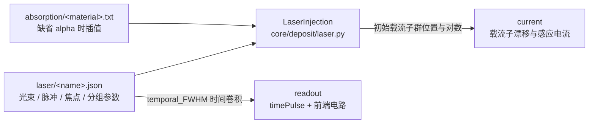

# 激光组件（`components/laser`）

`src/raser/components/laser/` 存放瞬态电流技术（TCT）激光脉冲的 JSON 定义文件与材料本征带间吸收系数表。激光组件仅在 `raser tct` 工作流中使用，该工作流跳过 `deposit` 切片，直接从激光脉冲参数与材料吸收特性计算探测器内的初始电离载流子群并驱动后续 `current` 与 `readout` 切片（通用粒子信号仿真示例见 [快速入门](../getting-started.md)）。



## 查找顺序与文件格式

`raser tct`（[`../bench/tct.md`](../bench/tct.md)）通过组件搜索路径查找 `laser/<selector>.json` 或读取显式文件路径，将 JSON 对象直接传入 `LaserInjection`（[`../core/deposit.md`](../core/deposit.md)）。以下以单光子红外激光组件 `src/raser/components/laser/LA01IR_top_Si.json` 为例说明 JSON 格式：

```json
{
    "description" : "Particulars LA-01 IR FC, 1064 nm: pulse <350 ps to 4 ns, spot at focus <11 um FWHM, few to 100 MIP in 300 um Si (https://www.particulars.si/products.php?prod=scanTCT.html); pulse_energy is about 10 MIP in 300 um Si",
    "tech" : "SPA",
    "direction" : "top",

    "refractionIndex" : 3.51,

    "wavelength" : 1064,
    "temporal_FWHM" : 350e-12,
    "pulse_energy" : 1.8e-13,
    "spacial_FWHM" : 11,
    "central_time" : 1e-9,

    "pairs_per_group" : 1000,
    "groups" : 3200,

    "fx_rel" : 0.25,
    "fy_rel" : 0.5,
    "fz_rel" : 0.0
}
```

### 激光 JSON 键

| 键名 | 默认值 | 单位 | 含义 |
| --- | --- | --- | --- |
| `description` | 无（可选） | 无 | 激光器型号与实验参数说明 |
| `tech` | 无（必填） | 无 | 吸收机制，取 `"SPA"`（单光子吸收）或 `"TPA"`（双光子吸收）；`"TPA"` 且 `alpha != 0` 时同时产生单光子载流子群，`alpha = 0` 时仅产生双光子载流子群 |
| `direction` | 无（必填） | 无 | 激光束入射方向：`"top"`（从 `z = 0` 沿 `+z` 入射）、`"bottom"`（从 `z = l_z` 沿 `-z` 入射）或 `"edge"`（从 `x = 0` 沿 `+x` 入射） |
| `refractionIndex` | 无（必填） | 无 | 探测器材料在该激光波长下的折射率（必填，未提供 `l_Rayleigh` 时用于计算瑞利长度） |
| `wavelength` | 无（必填） | `nm` | 激光波长 |
| `alpha` | 由吸收系数表插值 | `1/m` | 线性吸收系数；未给定时调用 `absorption_coefficient` 从 `components/laser/absorption/<material>.txt` 插值计算 |
| `beta_2` | 无（`"TPA"` 时必填） | `m/W` | 双光子吸收系数 |
| `temporal_FWHM` | 无（必填） | `s` | 高斯激光脉冲的时间半高全宽；`raser tct` 使用 `timePulse` 按 `temporal_FWHM` 对整条感应电流做时间卷积（两种吸收机制使用同一宽度），逐群记录的 `time_FWHM`（单光子为 `temporal_FWHM`，双光子为 `temporal_FWHM / sqrt(2)`）供核心层激光沉积接口 `laser_deposits` 读取 |
| `pulse_energy` | 无（必填） | `J` | 单次激光脉冲能量 |
| `spacial_FWHM` | 无（必填） | `um` | 焦点处高斯光斑的空间半高全宽（对应束腰半径 $w_0 = \text{spacial\_FWHM} / \sqrt{2\ln 2}$） |
| `l_Rayleigh` | $\pi w_0^2 \cdot \text{refractionIndex} / (\text{wavelength} \times 10^{-3})$ | `um` | 介质内的瑞利长度 |
| `central_time` | 无（必填） | `s` | 激光脉冲中心到达时刻 |
| `pairs_per_group` | 无（必填） | 对 | 单个载流子群包含的电子-空穴对数上限 |
| `groups` | 无（必填） | 群 | 每种吸收机制划分的最少载流子群数（光束横截面划分为 4 个等份额环 × 8 个扇区，沿光路划分为 `ceil(max(total / pairs_per_group, groups) / 32)` 层，落在探测器边界内的载流子群保留用于漂移） |
| `fx_rel`, `fy_rel`, `fz_rel` | 无（必填） | 无 | 激光焦点在探测器坐标系中的归一化坐标，焦点绝对位置为 `(fx_rel * l_x, fy_rel * l_y, fz_rel * l_z)` |

### 吸收系数表格式（`absorption/<material>.txt`）

`components/laser/absorption/<material>.txt` 为空白分隔的两列数值文本文件，`#` 开头为注释行：

- 第一列：波长，单位 `nm`。
- 第二列：300 K 下的本征带间吸收系数，单位 `1/cm`。

`absorption_coefficient(material, wavelength)` 在相邻波长行之间对吸收系数的自然对数做线性插值，并乘以 `100.0` 换算为 `1/m`。当激光波长大于表中最大波长时返回 `0.0`。

## 库中组件

`src/raser/components/laser/` 包含以下 8 个激光 JSON 组件与 1 个材料吸收系数表：

| 类别 | 组件名称 | 吸收机制 / 范围 |
| --- | --- | --- |
| 单光子硅（`Si`） | `LA01IR_edge_Si`、`LA01IR_top_Si`、`LA01R_bottom_Si`、`LA01R_top_Si` | `"SPA"` |
| 单光子碳化硅（`SiC`） | `PIL037_edge_SiC`、`PIL037_top_SiC` | `"SPA"` |
| 双光子硅（`Si`） | `TPA1550_edge_Si`、`TPA1550_top_Si` | `"TPA"` |
| 吸收系数表（`absorption/`） | `Si.txt` | 波长 `250 nm` 至 `1450 nm` |

## 常见报错

| 报错信息 | 触发条件 |
| --- | --- |
| `FileNotFoundError: Cannot find RASER component laser/<name>.json` | 组件搜索路径中找不到指定的激光文件 |
| `ValueError: no absorption table of <material>: give alpha [1/m] in the laser file` | 激光文件未给出 `alpha`，且 `components/laser/absorption/<material>.txt` 不存在 |
| `ValueError: the absorption table of <material> starts at <min> nm, the laser has <wavelength> nm: give alpha [1/m] in the laser file` | 激光波长短于吸收系数表起始波长且未显式指定 `alpha` |
| `NameError: <tech>` | `tech` 不是 `"SPA"` 或 `"TPA"` |
| `NameError: <direction>` | 生成载流子群（`alpha != 0` 或 `tech == "TPA"`）时，`direction` 不是 `"top"`、`"bottom"` 或 `"edge"`（`tech == "SPA"` 且 `alpha == 0` 时跳过载流子群生成，直接返回空群列表） |

## 相关页面

- [快速入门](../getting-started.md)
- [`../bench/tct.md`](../bench/tct.md)
- [`../core/deposit.md`](../core/deposit.md)
- [`../core/current.md`](../core/current.md)
- [`../supports/README.md`](../supports/README.md)
