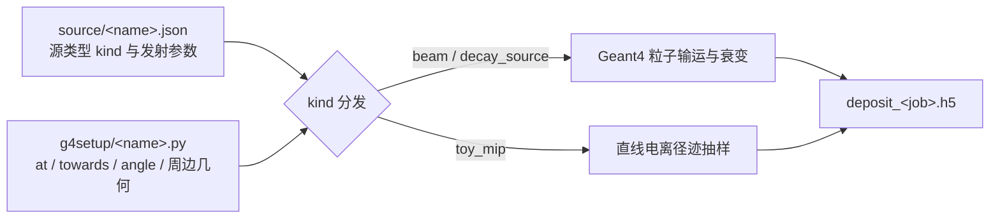

# 信号源组件（`components/source`）

`src/raser/components/source/` 存放粒子束流、放射性核素衰变源与直线最小电离粒子（toy MIP）的 JSON 定义文件。信号源组件作用于仿真链起点的 [`deposit`](../stages/deposit.md) 切片：命令行通过位置参数 `source`（默认 `"decay/Sr90"`；`bmos` 应用默认 `"bunch"`）选择源组件，加载后与 `g4setup` 一起送入能量沉积计算，生成 `deposit_<job>.h5`。



## 查找顺序与文件格式

工作流按组件搜索优先级（见 [`../supports/README.md`](../supports/README.md)）查找 `source/<selector>.json` 或读取显式给出的 JSON 文件路径，要求顶层为 JSON 对象，由沉积阶段 `simulate_deposits`（[`../core/deposit.md`](../core/deposit.md)）按 `"kind"` 分发执行。

### 示例源组件：`decay/Sr90.json`

在 [快速入门](../getting-started.md) 的示例 `raser signal HPK-Si-PiN --scan voltage=100,200 -s 2 -evt 200 --seed 1` 中，命令行省略了位置参数 `source`，因此默认使用 `src/raser/components/source/decay/Sr90.json`：

```json
{
    "name" : "Sr90",
    "kind" : "decay_source",
    "description" : "Sr-90 beta source: every event is one decay, of Sr-90 or of its daughter Y-90 with the same chance, on a disk 5 mm across; what the decay emits goes isotropically within 15 degrees of the axis",
    "nuclides" : [[38, 90], [39, 90]],
    "par_radius" : 2500,
    "par_cone" : 15
}
```

结合默认 `device_alone` 几何，该源在示例中表现出以下行为：

- **双核素等概率衰变**：每事例在 $^{90}\text{Sr}$（`[38, 90]`）与子体 $^{90}\text{Y}$（`[39, 90]`）之间等概率抽取一种发生一次静止衰变，衰变位置在垂直于 `par_in -> par_out` 轴线、半径 `par_radius = 2500 um`（直径 `5 mm`）的圆盘上均匀抽样。
- **发射立体角与记录效率**：衰变产物限制在围绕轴线半顶角 `par_cone = 15°` 的圆锥内各向同性出射，`deposit_0.h5` 的属性 `generated_fraction = 0.017037086855465844` 正对应立体角份额 $(1 - \cos 15^\circ) / 2$；为收集 `-evt 200` 个在 `HPK-Si-PiN` 内产生有效能量沉积的事例，作业 `0` 共由 Geant4 生成了 `generated_events = 7359` 个事例。

### 公共键

| 键名 | 默认值 | 单位 | 含义 |
| --- | --- | --- | --- |
| `name` | 无（可选） | 无 | 信号源名称（传入 Geant4 前移除） |
| `kind` | 无（必填） | 无 | 信号源类型，取 `"beam"`、`"decay_source"` 或 `"toy_mip"`（传入 Geant4 前移除） |
| `description` | 无（可选） | 无 | 信号源文字说明（传入 Geant4 前移除） |

### `"beam"` 与 `"decay_source"` 源键

当 `kind` 为 `"beam"` 或 `"decay_source"` 时，`g4_configuration` 从 `g4setup` 组件（[`g4setup.md`](g4setup.md)；缺省时取内置 `DEVICE_ALONE`）提取 `"source"` 块作为位置 `par_in`、瞄准点 `par_out` 与入射角 `par_angle`，再合并源 JSON 中的键传入 Geant4（源中给出的键覆盖 `g4setup` 同名键，其余 `par_*` 键沿用 `g4setup` 中的设置）：

| 键名 | 默认值 | 单位 | 含义 |
| --- | --- | --- | --- |
| `par_type` | 无（普通粒子枪发射项最终须提供；可来自 `g4setup` 或 `particles` 各项） | 无 | Geant4 粒子名称（如 `"e-"`、`"mu-"`、`"pi-"`、`"proton"`、`"alpha"`、`"gamma"`），或粒子名称列表（与 `par_energy` 等长，每事例等概率抽样其中一种发射） |
| `par_energy` | 无（普通粒子枪发射项最终须提供；可来自 `g4setup` 或 `particles` 各项） | `MeV` | 粒子动能，或与 `par_type` 对应的动能列表 |
| `par_randx`, `par_randy` | `0`, `0` | `um` | 出射方向向量 `par_out - par_in` 在 x、y 分量上的均匀随机偏移半宽 |
| `particles` | 无（可选） | 无 | 束团多粒子列表；未启用 `nuclides` 时，每事例同时发射列表中的所有粒子；每项可含 `"offset"`（`[dx, dy, dz]`，默认 `[0, 0, 0]`，单位 `um`，平移该粒子的起点与瞄准点）以及覆盖源顶层的 `"par_type"`、`"par_energy"`、`"par_randx"`、`"par_randy"` |
| `nuclides` | 无（可选） | 无 | 静止放射性核素 `[Z, A]`（原子序数、质量数）列表（如 `[[38, 90], [39, 90]]`）；给出时启用 `G4RadioactiveDecayPhysics` 与 `NuclideGeneratorAction`，每事例等概率抽取一种核素发生一次衰变，次级原子核终止且衰变产物时间归零 |
| `par_radius` | `0` | `um` | 核素源在垂直于 `par_in -> par_out` 轴线的圆盘上均匀抽样衰变位置的半径 |
| `par_cone` | `None` | `degree` | 核素衰变产物围绕 `par_in -> par_out` 轴线各向同性出射的圆锥半顶角（Geant4 从合并后的配置读取）；仅当源 JSON 自身同时含 `nuclides` 与非 `None` 的 `par_cone` 时，才将立体角份额 $(1 - \cos(\text{par\_cone})) / 2$ 记入沉积文件的 `generated_fraction`（否则记录 `1.0`） |

### `"toy_mip"` 源键

当 `kind` 为 `"toy_mip"` 时，`mip_deposits` 沿 `start` 到 `end` 的整条线段生成直线沉积径迹（默认从中心沿 z 轴贯穿 `[l_x / 2, l_y / 2, 0.0]` 至 `[l_x / 2, l_y / 2, l_z]`，自定义线段或抽样斜率时按完整线段计算能损并均标为 `"Device"`），所有沉积发生在时刻 `0.0 s`。硅（`"Si"`）的平均电离率为 `80.0` 对/`um`、Landau 宽度为 `2.0e-5 MeV/um`；碳化硅（`"SiC"`）的平均电离率为 `55.0` 对/`um`、Landau 宽度为 `3.2e-5 MeV/um`。

| 键名 | 默认值 | 单位 | 含义 |
| --- | --- | --- | --- |
| `landau_sampling` | 无（必填） | 无 | 布尔值，每段沉积能量是否按 Landau 分布抽样（抽到负值时取 `0.0`；为 `false` 时取固定平均能损） |
| `start` | `[l_x / 2, l_y / 2, 0.0]` | `um` | 径迹在探测器坐标系中的起点 `[x, y, z]` |
| `end` | `[l_x / 2, l_y / 2, l_z]` | `um` | 径迹在探测器坐标系中的终点 `[x, y, z]` |
| `position_range_um` | 无（可选） | `um` | 起点横向均匀抽样范围 `{"x": [lo, hi], "y": [lo, hi]}` |
| `direction_sigma_mrad` | 无（可选） | `mrad` | 径迹斜率 `dx/dz`、`dy/dz` 围绕 `0` 的高斯抽样标准差 `{"x": sigma_x, "y": sigma_y}`；给出 `position_range_um` 或非零斜率时，终点横向坐标由起点与斜率决定 |
| `packets` | `ceil(length / max_step)` | 段 | 单条径迹切分的沉积段数；未给定时按 `g4setup` 的 `maxstep`（单位 `um`）切分 |

## 库中组件

`src/raser/components/source/` 包含以下 11 个信号源组件：

| 分类 | 组件名称 | 说明 |
| --- | --- | --- |
| 粒子束流（`beam`） | `beam/electron`、`beam/muon`、`beam/pion`、`beam/proton`、`beam/proton_3GeV_spread` | 单粒子束流源定义 |
| 放射源（`decay`） | `decay/Am241`、`decay/Sr90` | 放射性核素衰变源定义 |
| 直线 MIP（`toy`） | `toy/MIP`、`toy/MIP_pixel_edge`、`toy/MIP_pixel_edge_fast`、`toy/MIP_strip_edge` | 直线最小电离径迹定义 |

此外，`src/raser/apps/bmos/components/source/` 提供束团源组件 `bunch`（在 `raser bmos` 命令下自动挂载，见 [`../apps/bmos.md`](../apps/bmos.md)）。

## 常见报错

| 报错信息 | 触发条件 |
| --- | --- |
| `TypeError: Component definition must be a JSON object: <path>` | 源 JSON 文件顶层不是 JSON 对象 |
| `FileNotFoundError: Cannot find RASER component source/<name>.json` | 组件搜索路径中找不到指定源名称 |
| `FileNotFoundError: Cannot find RASER source file: <path>` / `IsADirectoryError: RASER source input must be a file: <path>` | 传入显式文件路径不存在，或传入路径为目录 |
| `ValueError: no simulation of deposits for a source of kind <kind>; known: ['toy_mip', 'beam', 'decay_source']` | `kind` 取值不在已知列表中 |
| `ValueError: the source <name> gives [...]: where a source sits and where it aims are of the g4setup, in its key source = {at, towards, angle}` | `"beam"` 或 `"decay_source"` 源的 JSON 或其 `particles` 项中含有 `"par_in"`、`"par_out"` 或 `"par_angle"`（`"toy_mip"` 源出现这些键时触发下一行的未知键 `ValueError`） |
| `ValueError: keys [...] of the toy MIP source are not read; known: [...]` | `toy_mip` 源含有未识别的键 |
| `ValueError: the toy MIP source must say landau_sampling: true or false` | `toy_mip` 源缺少 `landau_sampling` 键 |
| `ValueError: no toy MIP energy loss for the material <material>; known: ['Si', 'SiC']` | `toy_mip` 遇到除 `"Si"`、`"SiC"` 之外的探测器材料 |
| `ValueError: par_type has <N> particles and par_energy <M>` | `par_type` 与 `par_energy` 的列表长度不一致 |

## 相关页面

- [快速入门](../getting-started.md)
- [`g4setup.md`](g4setup.md)
- [`../core/deposit.md`](../core/deposit.md)
- [`../stages/deposit.md`](../stages/deposit.md)
- [`../apps/bmos.md`](../apps/bmos.md)
- [`../supports/README.md`](../supports/README.md)
