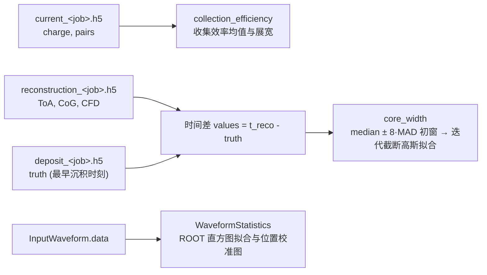

# 统计分析（`core/analysis`）

`src/raser/core/analysis/` 处于仿真链末端，提供电荷收集效率计算（`collection.py`）、截断高斯最大似然迭代拟合求时间分辨（`resolution.py`）以及面向单事例字典的 ROOT 波形统计绘图类 `WaveformStatistics`（`waveform_stats.py`）。命令行对整个实验的多扫描点汇总流程见 [../stages/analysis.md](../stages/analysis.md)。

## 电荷收集效率与时间分辨算法

### 电荷收集效率（`collection.py`）

`collection_efficiency(charge, pairs)` 接收各读出电极净感应电荷 `charge`（形状 `(events, electrodes)`，单位 `C`）与初始电子-空穴对数 `pairs`（形状 `(events,)`），对每个事例计算所有电极净电荷代数和的绝对值与初始电离总电荷之比：

$$\eta = \frac{\left|\sum_{j} Q_{j}\right|}{N_{\text{pairs}} \cdot e}$$

其中基本电荷 `ELEMENTARY_CHARGE = 1.602176634e-19` C。

### 截断高斯拟合与核心宽度迭代（`resolution.py`）

- **`truncated_gaussian(values, low, high)`**：对落在窗口 `[low, high]` 内的样本，使用 `scipy.optimize.minimize`（`method="L-BFGS-B"`，均值边界 `[low, high]`）最小化窗口内归一化截断高斯分布的负对数似然函数，并通过步长 `step = 1e-4` 的二阶中心差分海森矩阵求逆得到参数标准误，返回 `(mean, mean_error, sigma, sigma_error)`（与输入同单位）。
- **`core_width(values, window=None)`**：要求样本数不少于 `MINIMUM_EVENTS = 20`。未显式传入 `window` 时取 `median ± 8 * MAD`（`MAD` 为中位绝对偏差）作为初始窗口；随后每轮调用 `truncated_gaussian` 并将窗口更新为 `[mean - 2 * sigma, mean + 2 * sigma]`，最多迭代 `ROUNDS = 6` 轮（当 `abs(sigma - previous_sigma) <= 5e-3 * previous_sigma`、新边界超出当前窗口、窗口宽度缩减比例 $\le 10^{-3}$ 或后续轮次窗口内样本数不足 `20` 时停止并返回上一轮拟合结果；首轮窗口内样本数不足 `20` 则抛出 `TooFewValues`）。返回字典包含：

| 键名 | 单位 | 含义 |
| --- | --- | --- |
| `"events"` | 个 | 输入样本总数 |
| `"window"` | 与输入同单位 | 最终拟合窗口 `[low, high]` |
| `"window_events"` | 个 | 最终窗口内的样本数 |
| `"rounds"` | 轮 | 实际执行的迭代轮数 |
| `"mean"`, `"mean_error"` | 与输入同单位 | 截断高斯拟合均值及标准误 |
| `"sigma"`, `"sigma_error"` | 与输入同单位 | 截断高斯拟合核心宽度 $\sigma$ 及标准误 |
| `"sigma68"` | 与输入同单位 | 窗口内样本 `16%` 与 `84%` 分位数间距的一半 |

## 波形统计绘图类（`waveform_stats.py`）

`WaveformStatistics(my_d, threshold, amplitude_threshold)` 供用户在 Python 中直接调用，接收器件对象 `my_d`（`det_model` 需匹配 `'planar'`、`'lgad'`、`'strip'` 或 `'pixel'`，读取 `l_x`、`l_y`、`p_x`、`p_y`、`read_ele_num`、`x_ele_num`、`y_ele_num`）与阈值参数，通过 `fill_data(data)` 收集来自 `InputWaveform.data`（见 [reconstruction.md](reconstruction.md)）的事例字典，并调用 `draw(output_path, tag, vis=False)` 使用 ROOT 输出直方图与拟合脚本：

| 输出文件（`.pdf` 与 `.C`） | 拟合或直方图类型 | 单位 / 分箱说明 |
| --- | --- | --- |
| `<tag>_ToA`, `<tag>_CFD50` | `TH1F` 高斯拟合 `gaus` | 横轴单位 `s`，图注将 $\sigma$ 与误差乘 `1e12` 换算为 `ps` |
| `<tag>_charge`, `<tag>_amplitude`, `<tag>_ToT` | `TH1F` 朗道拟合 `landau` | 100 箱；横轴与图注标为 `a.u.`（其中 `ToT` 填入数值的单位为 `s`） |
| `<tag>_gravity_center_ToT`, `..._amplitude`, `..._charge` | `TH1F` 一维分布 | 400 箱（有有效数据时生成） |
| `<tag>_cluster_size_ToT`, `..._amplitude`, `..._charge` | `TH1I` 整型直方图 | `[0, 11)` 区间 11 箱 |
| `<tag>_gravity_center_ToT_error`, `..._amplitude_error`, `..._charge_error` | `TH1F` 高斯拟合 `gaus` | 围绕 `sorted(data)[len(data) // 2] ± 1` 区间 100 箱（有有效数据时生成） |
| `<tag>_ita_calibration_ToT`, `..._amplitude`, `..._charge` | `TH2F` 二维校准图 | `original_x / pitch_x - round(...)` 对重建重心 `值 - round(值)`，`20 x 20` 箱（X 轴传入 `[-0.5, 0.5]`，Y 轴传入 `[0.5, -0.5]`） |

## 示例中的分析计算（`HPK-Si-PiN`）

在 [快速入门](../getting-started.md) 的示例中，运行 `raser analysis work/HPK-Si-PiN/signal` 对 `100 V` 与 `200 V` 两个偏压点各 `400` 个记录事例调用 `collection_efficiency` 与 `core_width`，并将结果写入 `result.json`（及对比文件 `points.json`）：

- **电荷收集效率（`collection`）**：`200 V` 下 `400` 个事例的 `mean = 0.9348`（`mean_error = 0.007225`，`spread = 0.1445`）；`100 V` 下 `mean = 0.9195`。
- **时间分辨（`timing`）**：`200 V` 下选中 `276` 个超出 `10 mV` 幅度阈值的事例（`polarity = -1.0`），以 `core_width` 对相对最早沉积时刻 `truth` 的时间差迭代拟合——其中 `ToA` 经 `5` 轮迭代在窗口内保留 `241` 个事例，得 `sigma = 123.99 ps`、`sigma68 = 123.69 ps`；`CoG` 经 `4` 轮得 `sigma = 87.49 ps`、`sigma68 = 78.01 ps`；`CFD10` 经 `4` 轮得 `sigma = 46.19 ps`、`sigma68 = 39.89 ps`；`CFD20` 经 `5` 轮得 `sigma = 37.54 ps`。

## 常见报错

| 异常类型 | 报错信息 | 触发条件 |
| --- | --- | --- |
| `ValueError` | `charge has shape <shape> and pairs <shape>, expected (events, electrodes) and (events,)` / `events <indices> have no pairs` | `collection_efficiency` 数组维度不匹配或存在 `pairs <= 0` 的事例 |
| `TooFewValues(ValueError)` | `<len> values, fewer than 20` / `<inside> of <len> values are inside [<low>, <high>], fewer than 20` | `core_width` 输入样本或窗口内样本数少于 `20` |
| `ValueError` | `all values in the window are equal` / `the window [<low>, <high>] is empty` / `values have shape <shape>, expected (events,)` | 窗口上下界非递增、窗口内样本全相等或输入数组非一维 |
| `ArithmeticError` | `the fit in [<low>, <high>] did not converge: <message>` | `truncated_gaussian` 截断高斯拟合未收敛 |
| `ValueError` | `Unsupported detector model for waveform statistics: <det_model>` / `Waveform statistics output tag must be explicit` | `WaveformStatistics` 遇到未知 `det_model` 或 `draw` 传入 `tag=None` |

## 相关页面

- [快速入门](../getting-started.md)
- [../stages/analysis.md](../stages/analysis.md)
- [device.md](device.md)
- [current.md](current.md)
- [reconstruction.md](reconstruction.md)
