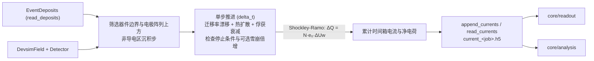

# 载流子输运与感应电流（`core/current`）

`src/raser/core/current/` 处于仿真链中部，承接 [能量沉积](deposit.md) 生成的电子-空穴对与 [器件场](field.md) 提供的电场和权重场，模拟载流子团簇的电场漂移、热扩散、辐照缺陷俘获与雪崩倍增，依据 Shockley-Ramo 定理计算各读出电极上的感应电流。模块向 [电子学读出](readout.md) 输出 `current_<job>.h5` 切片，向 [统计分析](analysis.md) 提供净感应电荷与初始对数，并另外提供激光脉冲电流写入与纯扩散随机游走收集接口。命令行与切片选项见 [../stages/current.md](../stages/current.md)。

## 输入与可调模型参数

`CalCurrent` / `CalCurrentGain`（`cal_current.py`）与 `drift`（`drift.py`）结合 `read_deposits` 读入的 `EventDeposits`（`event`、`detector`、`x`/`y`/`z` [$\mu\text{m}$]、`t` [s]、`e` [MeV]、`pairs`）、`DevsimField`（提供电场、掺杂、权重势、导电标志、俘获率及 1D 平面增益接口）以及 `Detector` 配置的输运、电极阵列与雪崩参数：

| 键或属性名 | 默认值 | 单位 | 含义 |
| --- | --- | --- | --- |
| `dimension`, `is_plugin()` | 见 [device.md](device.md) | 无 | 决定时间窗与漂移步长档位（1D 或 `is_plugin() == True` 用 1D 档位，其余用 2D/3D 档位） |
| `l_x`, `l_y`, `l_z`, `bound` | 无（必选） | $\mu\text{m}$ | 器件边界 $[0, l_x] \times [0, l_y] \times [0, l_z]$ |
| `p_x`, `p_y`, `x_ele_num`, `y_ele_num`, `read_ele_num` | 见 [device.md](device.md) | $\mu\text{m}$ / 个 | 居中排列的读出电极阵列间距与数量 |
| `read_out_contact` | 无（必选） | 无 | 读出电极列表；长度为 `read_ele_num` 时取各项 `"name"`，长度为 `1` 时生成 `"<name>1"` 至 `"<name><read_ele_num>"`；单接触下感应电流仅计算起点所在电极两侧（`x` 向 `my_f.cells_either_side` 个，`y` 向 `read_out_contact[0]["y_span"]` 默认 `0` 个）的电极 |
| `material`, `temperature` | 无（必选） | 无, K | 材料名（传入 [model.md](model.md) 的 `Material`）与温度 $T$ |
| `voltage`, `irradiation_model`, `irradiation_flux` | 见 [device.md](device.md) | V, 无, $\text{cm}^{-2}$ | 偏置电压、辐照模型（非 `None` 时开启俘获衰减）与默认辐照注量 |
| `field_interpolation_bins` | `None` | 个 | 传给 `DevsimField` 的 3D 场插值箱数字典 |
| `has_avalanche`, `avalanche_model` | 见 [device.md](device.md) | 无 | `has_avalanche` 为真时调用 `CalCurrentGain`（1D 场用 `"planar_integral"`，多维场用 `"local_path"`；`"local_path"` 下 `avalanche_model` 须为 `"vanOverstraeten"`、`"Okuto"` 或 `"Hatakeyama"`） |
| `gain_pair_threshold` | `0.05` | 对 | `"local_path"` 雪崩模式下触发发射新增益团簇的最小累积电子-空穴对数 |
| `gain_max_carriers` | `50000` | 团簇 | `"local_path"` 雪崩模式下单事例允许生成的最大增益团簇数；取值 $\le 0$ 时不设上限 |
| `local_gain_emit_slices` | `1` | 团簇 | `"local_path"` 雪崩模式下每次发射沿步长等分生成的子团簇数 |
| `local_gain_integration_steps` | `3` | 步 | `"local_path"` 雪崩模式下单个漂移步内积分碰撞电离系数的采样点数（单步指数上限 `50.0`） |
| `e_width_x`, `e_width_y` | 无（`collect_by_diffusion` 必选） | $\mu\text{m}$ | 纯扩散收集模式下每个像素中心的矩形收集区尺寸 |
| `doping.Donors`, `doping.Acceptors` | 无（`collect_by_diffusion` 必选） | $\text{cm}^{-3}$ | 纯扩散收集模式下用于计算零场电子迁移率的施主与受主浓度数值 |

## 漂移、扩散、俘获与雪崩计算

### 时间窗、步长与输运常数

`CalCurrent` 与 `drift` 按器件维度档位采用以下内置参数：

| 参数名 | 1D（或 `is_plugin() == True`） | 2D / 3D | 单位 | 含义 |
| --- | --- | --- | --- | --- |
| `t_bin` | `5e-12` | `50e-12` | s | 输出感应电流时间箱宽度 `dt` |
| `t_start`（相对值） | `-1.25e-9` | `-12.5e-9` | s | 相对于事例最早沉积产生时间的起始偏移（`-0.25 * t_end`） |
| `t_end`（相对值） | `5e-9` | `50e-9` | s | 相对于事例最晚沉积产生时间的最小结束偏移 |
| `delta_t` | `2e-12` | `20e-12` | s | 载流子团簇单步漂移时间步长 |
| `min_intensity` | `1` | `1` | V/cm | 停止漂移的最低电场强度阈值（`"low_field"`） |
| `max_drift_time` | `100e-9` | `100e-9` | s | 单个团簇最大漂移持续时间上限（`"time_out"`） |
| `kboltz` | `8.617385e-5` | `8.617385e-5` | eV/K | 热扩散步长标准差 $\sigma = \sqrt{2 k_B T \mu \Delta t}\times 10^4\ [\mu\text{m}]$ 使用的玻尔兹曼常数 |
| `e0` | `1.60217733e-19` | `1.60217733e-19` | C | Shockley-Ramo 感应电荷 $\Delta Q = N e_0 \Delta U_w$ 使用的元电荷 |

### 物理过程要点

- **空间筛选与热扩散**：位于器件边界外或电极阵列投影区域外的沉积步不参与漂移（仍计入总 `pairs`）。每个团簇按单载流子从 `stream("drift")` 抽取高斯热扩散步长，若开启辐照模型则按俘获率指数衰减载流子数。
- **单步停止条件**：团簇在推进中达到最大漂移时间记为 `"time_out"`，进入导电区（`get_conductive` 为真）记为 `"collected"`，查询电场失败（`get_e_field_cached` 抛 `ValueError`）记为 `"no_field"`（作业结束时报告首个无场停止点），场强模长 $\le$ `min_intensity` 记为 `"low_field"`，穿出器件表面则按比例截断至边界并记为 `"left_device"`。
- **雪崩倍增（`CalCurrentGain`）**：1D 场（`len(axes) == 1`）采用 `"planar_integral"`，直接调用 `DevsimField` 的平面增益函数计算倍增；多维场采用 `"local_path"`，沿每个漂移步对电离系数积分并在累积对数超过 `gain_pair_threshold` 时发射子团簇。

## `current_<job>.h5` 文件格式与读写函数

`src/raser/core/current/currents.py` 提供 `append_currents`（逐事例追加写入）与 `read_currents`（读取时将未存储的零电流电极还原为 `0.0`）：

### 文件属性（Attributes）

| 属性名 | 类型 | 单位 | 含义 |
| --- | --- | --- | --- |
| `electrodes` | 字符串数组 | 无 | 读出电极名称列表，顺序与 `charge` 列顺序一致 |
| `dt` | `float64` | s | 时间箱宽度（等于 `t_bin`） |

### 数据集（Datasets）

| 数据集名 | 形状与类型 | 单位 | 含义 |
| --- | --- | --- | --- |
| `event` | `(events,)`, `int64` | 无 | 记录事例的编号 |
| `t0` | `(events,)`, `float64` | s | 该事例第一个时间箱的左边界时间（等于 `t_start`） |
| `count` | `(events,)`, `int64` | 箱 | 该事例的时间箱数（等于 `n_bin`） |
| `pairs` | `(events,)`, `float64` | 对 | 该事例输入的电子-空穴对总数（雪崩倍增前） |
| `sensitive_pairs` | `(events,)`, `float64`（可选） | 对 | 器件内且电极阵列上方、出生在非导电区的电子-空穴对数（在求解场中漂移写出时存在） |
| `carriers_without_field` | `(events,)`, `float64`（可选） | 个 | 该事例中因 `"no_field"` 停止的团簇（含倍增团簇）在停止时尚未被俘获的载流子总数（在求解场中漂移写出时存在） |
| `charge` | `(events, len(electrodes))`, `float64`（gzip） | C | 每个读出电极在该事例中的带符号净感应电荷（含时间窗前后的欠流箱与溢流箱） |
| `stored` | `(events,)`, `int64` | 个 | 该事例中电流数组非全零而被存入 `current` 的电极数 |
| `index` | `(sum(stored),)`, `int64` | 无 | 每个被存储电极在 `electrodes` 中的下标（从 `0` 起），由 `stored` 切分到各事例 |
| `current` | `(sum(stored * count),)`, `float64`（gzip） | A | 每个被存储电极在 `count` 个时间箱内的平均感应电流，按事例与存储电极顺序首尾拼接 |

## 漂移轨迹、电流绘图与专用接口

在绘图目录（如 `<point>/<seed>/plots/job_<job>/event_<event>/` 或多位置下的 `job_<job>_<position>/event_<event>/`）下生成的图像清单如下：

| 文件名 | 内容 | 单位 |
| --- | --- | --- |
| `<det_model>_drift_path.pdf`, `.root` | 上半图为三维器件边界框与沉积点（黑）、空穴（红）、电子（蓝）、增益空穴（洋红）、增益电子（浅蓝）路径；下半图为 $x$-$z$ 平面投影图 | 空间轴 $\mu\text{m}$ |
| `No_<k>electrode_basic_infor.pdf`, `.root` | 第 $k$ 号非零电流电极（从 `1` 起）的 `electron`、`hole`、`total`（及雪崩下的 `electron gain`、`hole gain`）感应电流波形 | `Time [s]`, `Current [A]` |
| `cce.pdf`, `.root` | `is_strip` 为真时绘制各条形收集电荷图（`TGraph`）；`is_pixel` 为真时绘制二维像素收集电荷分布（`TH2I`）；标题 `Charge Collection Efficiency`，数值为电子数（`charge / 1.6e-19`），纵轴（像素图为 $z$ 轴）标 `charge[Coulomb]` | 电子数 |

模块另外包含两类专用电流计算接口：

- **激光脉冲接口（`cal_current.py`）**：`CalCurrentLaser`（默认 `diffusion=True`）与 `write_laser_currents(currents_path, my_d, my_f, my_l, plot_path=None)`（以 `diffusion=False` 漂移 `LaserInjection` 产生的载流子组），通过 `pulse_in_bins` 将电极感应电流与激光时间脉冲形状 `my_l.timePulse` 卷积后作为事例 `0` 写入 `currents_path`；提供 `plot_path` 时同步绘制电流图。
- **纯扩散收集接口（`diffusion.py`）**：`collect_by_diffusion(my_d, pairs, positions, window, step)`（由 `raser telescope` 调用，见 [../bench/telescope.md](../bench/telescope.md)）针对像素探测器（`is_pixel == True`），在时长 `window`（s）内以步长 `step`（s）从 `stream("diffusion")` 对电子做横向二维高斯随机游走，返回 `(t0, current, charge)`（s, A, C）。

## 示例中的感应电流（`HPK-Si-PiN`）

在 [快速入门](../getting-started.md) 的示例中，1D `HPK-Si-PiN` 在 `200 V` 下运行 `current` 切片后写出 `work/HPK-Si-PiN/signal/seed_1/batch/current_0.h5`：属性记录 `dt = 5e-12` s 与 `electrodes = ['top']`；`200` 个记录事例中 `196` 个存在非零感应电流（`index` 长度 `196`），`current` 共存有 `245196` 个时间箱，同时记录 `charge` `(200, 1)`、`sensitive_pairs` 与 `carriers_without_field`；前 `100` 个事例的 `planar_drift_path.pdf`/`.root` 与 `No_1electrode_basic_infor.pdf`/`.root` 保存在 `plots/job_0/event_<事例号>/`。

## 常见报错

| 异常类型 | 报错信息 | 触发条件 |
| --- | --- | --- |
| `ValueError` | `Unsupported avalanche model: <avalanche_model>` | `"local_path"` 雪崩下 `avalanche_model` 不在 `vanOverstraeten`、`Okuto`、`Hatakeyama` 中 |
| `ValueError` | `<k> readout contacts cannot name <n> electrodes` | `len(read_out_contact)` 既不等于 `1` 也不等于 `read_ele_num` |
| `ValueError` | `<deposits_path> holds no event: there is no current to write` | 输入沉积文件中记录事例为空 |
| `ValueError` | `<deposits_path> holds no deposit in the detector <detector>: there is no current to write` | 指定 `detector` 名称筛选后无任何沉积步 |
| `ValueError` | `the field at x, y, z = ... um is ... V/cm: a carrier cannot drift in it` | 漂移过程中 `get_e_field_cached` 返回的电场分量包含 `NaN` 或 `Inf` |
| `ValueError` | `the gain of <det_name> makes more than gain_max_carriers = <max> clusters of carriers: raise it in the device file` | `"local_path"` 雪崩倍增生成的增益团簇数超过 `gain_max_carriers` |
| `ValueError` | `<det_name> is not a pixel device` / `the device file of <det_name> has no e_width_x [um]` | 调用 `collect_by_diffusion` 时器件非像素布局或缺少 `e_width_x`、`e_width_y` |
| `ValueError` | `current has shape ..., expected (...)` / `charge has shape ..., expected (...)` | `append_currents` 传入的 `current` 或 `charge` 数组维度与 `electrodes` 数量不匹配 |
| `ValueError` | `<path> holds currents of electrodes ... with dt ... s, not of ...` / `<path> holds sensitive_pairs, the event ... has none` | 向已有 `.h5` 文件追加事例时，`electrodes`、`dt` 或可选数据集与文件已有记录不一致 |

## 相关页面

- [快速入门](../getting-started.md)
- [../stages/current.md](../stages/current.md)
- [device.md](device.md)
- [model.md](model.md)
- [field.md](field.md)
- [deposit.md](deposit.md)
- [readout.md](readout.md)
- [analysis.md](analysis.md)
- [../bench/telescope.md](../bench/telescope.md)
- [../supports/README.md](../supports/README.md)
