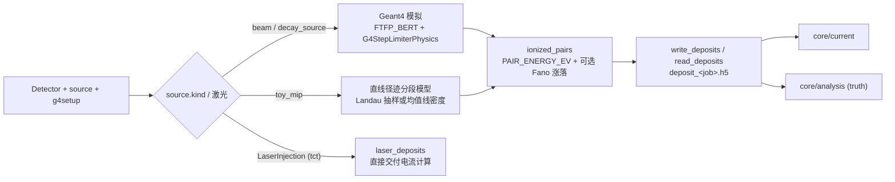

# 能量沉积与电离（`core/deposit`）

`src/raser/core/deposit/` 处于仿真链前端，依据器件尺寸与材料、信号源配置及 Geant4 环境脚本计算粒子在器件中产生的能量沉积步与电子-空穴对，向 [载流子输运](current.md) 输出 `deposit_<job>.h5` 切片，并为 [统计分析](analysis.md) 提供最早沉积时刻 `truth`。模块同时提供 `Deposits` 读写函数 `write_deposits` / `read_deposits`、激光脉冲沉积接口 `LaserInjection` / `laser_deposits` 及 Geant4 几何可视化函数 `view_geometry`。命令行与切片选项见 [../stages/deposit.md](../stages/deposit.md)。

## 模拟分支与参数

### 器件与信号源配置

通过 `Detector(det_name, files["device"])`（见 [device.md](device.md)）读取器件尺寸 `l_x`、`l_y`、`l_z`（$\mu\text{m}$）与材料 `material`（`"Si"`、`"SiC"` 或 `"Diamond"`）。在 Geant4 坐标系中，器件占据 $x \in [-l_x/2, l_x/2]$、$y \in [-l_y/2, l_y/2]$、$z \in [0, l_z]$（输出切片中存为探测器局部坐标）。

信号源来自组件 JSON（见 [../components/source.md](../components/source.md)），按 `kind` 分为三类模拟分支：

| 适用 `kind` | 键名 | 默认值 | 单位 | 含义 |
| --- | --- | --- | --- | --- |
| 全部 | `kind` | 无（必选） | 无 | `"toy_mip"`、`"beam"` 或 `"decay_source"` |
| `"toy_mip"` | `landau_sampling` | 无（必选） | 无 | 为 `True` 时每段沉积能量按 Landau 分布抽样（随机流 `stream("toy_mip")`，下限截为 `0.0`），为 `False` 时取固定均值（平均线密度 `PAIRS_PER_UM`：`"Si": 80.0` $\mu\text{m}^{-1}$，`"SiC": 55.0` $\mu\text{m}^{-1}$；Landau 宽度 `LANDAU_WIDTH_MEV_PER_UM`：`"Si": 2.0e-5` $\text{MeV}/\mu\text{m}$，`"SiC": 3.2e-5` $\text{MeV}/\mu\text{m}$） |
| `"toy_mip"` | `start`, `end` | `[l_x/2, l_y/2, 0.0]`, `[l_x/2, l_y/2, l_z]` | $\mu\text{m}$ | 直线径迹在器件坐标系中的起点与终点（沉积步时间均为 `0.0` s） |
| `"toy_mip"` | `position_range_um` | 无（可选） | $\mu\text{m}$ | `{"x": [lo, hi], "y": [lo, hi]}`，在区间内均匀抽取起点横坐标（两键均须给出）；无 `direction_sigma_mrad` 时终点 `x`、`y` 跟随起点 |
| `"toy_mip"` | `direction_sigma_mrad` | 无（可选） | mrad | `{"x": sigma, "y": sigma}`，围绕 `0` 高斯抽取斜率 $dx/dz$、$dy/dz$，由 `start + slope * (end[2] - start[2])` 计算终点横坐标 |
| `"toy_mip"` | `packets` | `ceil(length / max_step)` | 段 | 每条径迹等分的沉积段数 |
| `"beam"` | `par_type` | 无（必选） | 无 | Geant4 粒子名称字符串或等长列表（列表下每事例等概率抽取一种） |
| `"beam"` | `par_energy` | 无（必选） | MeV | 粒子动能或与 `par_type` 等长的列表 |
| `"beam"` | `par_randx`, `par_randy` | `0`, `0` | $\mu\text{m}$ | 加在方向向量 `par_out - par_in`（$\mu\text{m}$）的 $x$、$y$ 分量上的均匀偏移半宽（随机流 `stream("source")`），即瞄准点的横向展宽 |
| `"beam"` | `particles` | 无（可选） | 见下 | 多粒子字典列表，每事例同时发射所有粒子；每项可覆盖 `par_type`、`par_energy`、`par_randx`、`par_randy`，并通过 `offset: [dx, dy, dz]`（默认 `[0, 0, 0]` $\mu\text{m}$）平移发射点与瞄准点 |
| `"decay_source"` | `nuclides` | 无（必选） | 无 | `[[Z, A], ...]` 静止核素列表，启用 `G4RadioactiveDecayPhysics`（时间阈值 `1.0e60` 年）；`DecayStackingAction` 将衰变产物起始时间设为 `0.0` s 并截断子核（`fKill`） |
| `"decay_source"` | `par_radius` | `0` | $\mu\text{m}$ | 垂直于发射轴的圆形平面源半径 |
| `"decay_source"` | `par_cone` | `None` | 度 | 衰变产物围绕发射轴的各向同性发射半锥角；对应立体角占比 `generated_fraction = (1 - cos(par_cone)) / 2` |

### Geant4 环境配置（`g4setup`）

Geant4 物理表采用 `FTFP_BERT` 加 `G4StepLimiterPhysics`，随机引擎为 `RanecuEngine`（使用作业 `seed`）。环境字典 `G4SETUP` 来自 `g4setup` Python 组件（见 [../components/g4setup.md](../components/g4setup.md)），未指定时使用内置默认 `DEVICE_ALONE`：

| 键名 | `DEVICE_ALONE` 默认值 | 单位 | 含义 |
| --- | --- | --- | --- |
| `geant4_model` | `"device"` | 无 | 几何模型标识（`"gdml_import"` 时启用 `GDMLDetectorConstruction`） |
| `world` | `"G4_Galactic"` | 无 | Geant4 世界体 NIST 材料名；世界体半边长由 `world_half_side` 取 `WORLD_HALF_SIDE = 25000` $\mu\text{m}$（若器件、物体或源超出该范围，取最大跨度的 `2` 倍） |
| `maxstep` | `2` | $\mu\text{m}$ | 器件逻辑体 `"Device"` 的最大步长限制（`toy_mip` 未指定 `packets` 时也读取该值） |
| `source.at` | `[0, 0, -17000]` | $\mu\text{m}$ | Geant4 坐标系中的源位置 `par_in` |
| `source.towards` | `[0, 0, 0]` | $\mu\text{m}$ | Geant4 坐标系中的源瞄准点 `par_out` |
| `source.angle` | `0` | 度 | 入射倾角 `par_angle`；非零时 `tilted` 绕源连线与器件表面（$z=0$ 或 $z=l_z$）交点处的 $y$ 轴旋转 `par_in` 与 `par_out` |
| `object` | `{}` | $\mu\text{m}$, $\text{g/cm}^3$ | 周围物体字典，支持 `"elemental"`（单质体）与 `"binary_compounds"`（二元化合物，按原子数比例 `natoms_1`、`natoms_2` 与原子量换算质量分数），圆孔参数 `tub: {"tub_radius", "tub_depth"}`（`tub_depth` 为孔半长）在 `"elemental"` 下可省、在 `"binary_compounds"` 下必给（可为空字典） |
| `gdml` | 无（`"gdml_import"` 下读取） | $\mu\text{m}$, 度 | 含 `file`（必选 GDML 路径，依次按绝对路径、组件根、组件根下 `g4experiment/<file>`、`src/raser/` 包目录查找）、`validate`（默认 `False`）、`top_volume`、`position_um`（默认 `[0, 0, 0]`）、`rotation_xyz`（默认 `[0, 0, 0]`）、`auto_center`（默认 `True`）、`placement_name`（默认 `"ImportedGDML"`）；`g4setup` 顶层还可设 `world_half_size_um`（$\mu\text{m}$） |
| `visualization` | 无（可选） | 无 | `"gdml_import"` 下的可视化样式配置（`imported_visible`、`imported_force_wireframe`、`imported_colour_rgba`、`device_visible`、`hide_device`、`device_colour_rgba` 等） |

## 电离转化与激光沉积

### 电子-空穴对转化（`ionization.py`）

`ionized_pairs(event, material, fano=True)` 按材料平均电离能将每步沉积能量 $E$（MeV）转化为电子-空穴对数 $\bar{N} = E / (\text{PAIR\_ENERGY\_EV} \times 10^{-6})$：

| 材料 | `PAIR_ENERGY_EV`（eV） | `FANO_FACTOR`（无量纲） |
| --- | --- | --- |
| `"Si"` | `3.6` | `0.115` |
| `"SiC"` | `8.4` | `0.128` |
| `"Diamond"` | `13.1` | `0.382` |

当 `fano=True` 时，事例 `event.event` 从独立随机数流 `stream(f"ionization/{event.event}")` 按高斯分布 $\mathcal{N}(\bar{N}, F\bar{N})$ 抽取对数并对 `0.0` 取下限；当 `fano=False` 时直接取均值 $\bar{N}$。

### 激光沉积（`laser.py`）

`LaserInjection` 与 `laser_deposits` 读取激光组件字典（见 [../components/laser.md](../components/laser.md)），为 `raser tct` 直接提供载流子分布（见 [../bench/tct.md](../bench/tct.md)）：

- **读取键**：`tech`（`"SPA"` 或 `"TPA"`）、`direction`（`"top"`、`"bottom"` 或 `"edge"`）、`refractionIndex`、`wavelength`（输入 nm，内部乘 `1e-3` 转为 $\mu\text{m}$）、`alpha`（可选，单位 $\text{m}^{-1}$；缺省时由 `absorption_coefficient` 从 `components/laser/absorption/<material>.txt` 对数插值获取，波长大于表上限时取 `0.0`）、`beta_2`（`"TPA"` 下必选，单位 $\text{m/W}$）、`temporal_FWHM`（s）、`pulse_energy`（J）、`spacial_FWHM`（$\mu\text{m}$）、`central_time`（s）、`l_Rayleigh`（可选，单位 $\mu\text{m}$，缺省为 $\pi w_0^2 n / \lambda$）、`fx_rel`、`fy_rel`、`fz_rel`、`pairs_per_group`、`groups`。
- **空间与时间分布**：光束横截面划分为 4 环 $\times$ 8 扇区；单光子吸收时间展宽为 `temporal_FWHM`，双光子吸收为 `temporal_FWHM / sqrt(2)`；`laser_deposits` 返回的 `Deposits` 中沉积能量按 `pairs * PAIR_ENERGY_EV[material] * 1e-6` 计算。

## `deposit_<job>.h5` 文件格式与读写函数

`src/raser/core/deposit/deposits.py` 提供 `write_deposits` 与 `read_deposits`，读写 HDF5 沉积切片文件（跳过逻辑体 `"Device"` 内能量为 `0` 的步及无剩余步的事例，并按 `edep_min`/`edep_max` 筛选事例）：

### 文件属性（Attributes）

| 属性名 | 类型 | 单位 | 含义 |
| --- | --- | --- | --- |
| `generated_events` | `int` | 个 | 源生成的总事例数 |
| `recorded_events` | `int` | 个 | 满足器件内非零沉积与能量窗口的事例数 |
| `generated_fraction` | `float` | 无量纲 | 源发射方向中被模拟生成的部分占比（带 `par_cone` 的核素源为 `(1 - cos(par_cone)) / 2`，其余为 `1.0`） |
| `edep_min`, `edep_max` | `float` | MeV | 器件总沉积能量窗口下限与上限（仅在设置对应阈值时写入） |

### 数据集（Datasets）

| 数据集名 | 形状与类型 | 单位 | 含义 |
| --- | --- | --- | --- |
| `event` | `(recorded_events,)`, `int64` | 无 | 记录事例的编号 |
| `count` | `(recorded_events,)`, `int64` | 步 | 每个记录事例包含的沉积步数 |
| `detector` | `(sum(count),)`, 变长 `str` | 无 | 每个沉积步所在的探测器名称（单器件下为 `"Device"`） |
| `x`, `y`, `z` | `(sum(count),)`, `float64` | $\mu\text{m}$ | 探测器局部坐标系中每个沉积步中点的位置 |
| `t` | `(sum(count),)`, `float64` | s | 自初级粒子产生起的全局时间 |
| `e` | `(sum(count),)`, `float64` | MeV | 该步沉积能量 |
| `pairs` | `(sum(count),)`, `float64` | 对 | 该步产生的电子-空穴对数 |
| `x_start`, `y_start`, `z_start` | `(sum(count),)`, `float64`（可选） | $\mu\text{m}$ | 该沉积步的起点位置（所有记录事例均含起点时写入；步终点为 `2 * (x, y, z) - start`） |
| `t_fwhm` | `(sum(count),)`, `float64`（可选） | s | 该沉积步产生时间围绕 `t` 的高斯展宽 FWHM（所有记录事例均含 `t_fwhm` 时写入，如 `laser_deposits`） |

## Geant4 几何可视化（`view_geometry`）

`view_geometry` 打开指定可视化驱动并执行 `components/g4macro/init_vis.mac` 与 `vis.mac`（`"gdml_import"` 下改为执行 `bench/signal/components/g4macro/vis_pcb.mac`，路径不在组件搜索路径时抛 `FileNotFoundError`）。给定导出路径时，驱动名（不区分大小写）为 `"TSG"`、`"TSG_FILE"`、`"TSG_OFFSCREEN"` 时写出 `.png`，以 `"OGL"` 开头时写出矢量图文件，其余驱动给定导出路径时抛 `ValueError`；带窗口的驱动开启交互会话，关窗后返回。

## 示例中的沉积结果（`HPK-Si-PiN`）

在 [快速入门](../getting-started.md) 的示例中，运行 `raser signal HPK-Si-PiN --scan voltage=100,200 -s 2 -evt 200 --seed 1` 使用 `decay/Sr90` 放射源与 `device_alone` 几何，并开启 `fano=true`。在 `work/HPK-Si-PiN/signal/seed_1/batch/deposit_0.h5` 中，Geant4 生成 `generated_events = 7359` 个事例，记录 `recorded_events = 200` 个有效沉积事例（`generated_fraction = 0.017037086855465844`），共写入 `5476` 条沉积步（含起点 `(x_start, y_start, z_start)` 与电离对数 `pairs`）。

## 常见报错

| 异常类型 | 报错信息 | 触发条件 |
| --- | --- | --- |
| `ValueError` | `events_per_job (...) and generated_per_job (...): a job records a number of events or generates one, so exactly one of them is set` / `either the recorded events (...) or the generated events (...) are asked for, not both and not neither` | 同时给定了 `events_per_job` 与 `generated_per_job`，或两者均为 `None` |
| `ValueError` | `the <name> asked for are <number>: at least 1` | `events`、`generated` 或 `generated_limit` 小于 `1` |
| `RuntimeError` | `<recorded> of the <events> events asked for were recorded when the limit of <generated> generated events was reached ...` | 生成事例数达到 `generated_limit` 时记录的事例数仍少于 `events` |
| `ValueError` | `<stale>: a g4setup is a script now; write it as <name>.py with its keys in G4SETUP` | `g4setup` 指向了 `.json` 文件或组件目录中存在同名 `.json` |
| `ValueError` | `the source <name> gives ['par_in', ...]: where a source sits and where it aims are of the g4setup ...` | 源定义中包含 `par_in`、`par_out` 或 `par_angle` |
| `ValueError` | `the g4setup <name> does not place the source: give it source = {at, towards, angle}` | `g4setup` 缺少 `"source"` 字典 |
| `ValueError` | `the source runs from z = <z0> um to z = <z1> um and enters neither face of the device ...` | `par_angle` 非零但源起点位于 $0 \le z_0 \le l_z$ 内或 $z_1 = z_0$ |
| `ValueError` | `par_type has <n> particles and par_energy <m>` | 束流源的 `par_type` 与 `par_energy` 列表长度不一致 |
| `ValueError` | `Conflicting Geant4 material definition for <compound_name>` | 同一 `compound_name` 的二元化合物在 `object.binary_compounds` 中定义了不同的组分或密度 |
| `ValueError` | `no simulation of deposits for a source of kind <kind>; known: ['toy_mip', 'beam', 'decay_source']` | `source["kind"]` 不在支持列表中 |
| `ValueError` | `keys <unknown> of the toy MIP source are not read ...` / `the toy MIP source must say landau_sampling: true or false` / `no toy MIP energy loss for the material <material> ...` | `toy_mip` 源含未知键、缺少 `landau_sampling` 或材料不在 `["Si", "SiC"]` 中 |
| `ValueError` | `no pair energy for the material <material> ...` / `no Fano factor for the material <material> ...` | `ionized_pairs` 遇到未知材料 |
| `ValueError` | `some events have <name> and some do not` / `event <n> has no electron-hole pairs ...` / `event <n> has <k> deposits and <m> values of <name>` | `write_deposits` 校验发现可选列不统一、`pairs` 为 `None` 或列长度不一致 |
| `ValueError` | `no absorption table of <material>: give alpha [1/m] in the laser file` / `the absorption table of <material> starts at <nm> nm, the laser has <wl> nm ...` | 激光组件未给 `alpha` 且材料无吸收表或波长短于吸收表下限 |
| `NameError` | `<tech>` / `<direction>` | `LaserInjection` 的 `tech` 不在 `("SPA", "TPA")` 中，或 `direction` 不在 `("top", "bottom", "edge")` 中 |
| `ValueError` / `RuntimeError` | `the driver <driver> writes no picture to a given path ...` / `Geant4 refused the command <text> (status <status>)` | `view_geometry` 驱动与图片输出不匹配或 Geant4 UI 命令执行失败 |
| `ValueError` | `a source of kind <kind> has no par_in and par_out to turn by par_angle = <angle>` | 源的 `par_angle` 非零而该 `kind` 的源没有可转动的 `par_in`、`par_out` |
| `MissingDependency` | `Geant4's Python bindings, g4ppyy, are not installed in this Python` | 导入 Geant4 运行时缺少 `g4ppyy` |

## 相关页面

- [快速入门](../getting-started.md)
- [../stages/deposit.md](../stages/deposit.md)
- [device.md](device.md)
- [current.md](current.md)
- [analysis.md](analysis.md)
- [../components/device.md](../components/device.md)
- [../components/source.md](../components/source.md)
- [../components/laser.md](../components/laser.md)
- [../components/g4setup.md](../components/g4setup.md)
- [../bench/tct.md](../bench/tct.md)
- [../supports/README.md](../supports/README.md)
