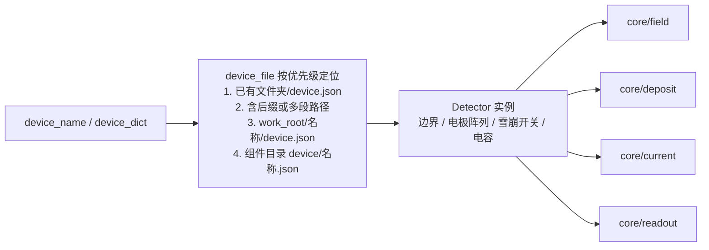

# 器件模型（`core/device`）

`src/raser/core/device/build_device.py` 位于材料模型之上，负责定位并读取器件 JSON 定义文件，校验电极布局与雪崩模型设置，并构造统一的 `Detector` 实例供 [场求解](field.md)、[能量沉积](deposit.md)、[载流子输运](current.md) 与 [电子学读出](readout.md) 各环节查询器件尺寸、偏压、电极阵列与平行板电容估算。器件 JSON 的编写规范见 [../components/device.md](../components/device.md)。

## 器件文件查找与 `Detector` 构造

- **`device_file(device_name)`**：依次按“已有文件夹下的 `device.json` → 带文件后缀或多段路径 → `<work_root>/<device_name>/device.json`（`work_root` 见 [../supports/README.md](../supports/README.md)）→ 组件目录 `device/<device_name>.json`”的顺序解析器件 JSON 绝对路径。
- **`Detector(device_name, device_dict=None)`**：当 `device_dict` 为 `None` 时调用 `device_json(device_name)` 从磁盘读取 JSON；传入字典时对其做深拷贝。JSON 的顶层键会映射为 `Detector` 的同名属性（类型随 JSON，`voltage` 转为 `float`），随后被派生字段（`det_name`、`device`、`region`、`irradiation_model`、`irradiation_flux`、`dimension`、`electrodes`、`x_ele_num`、`y_ele_num`、`read_ele_num`、`p_x`、`p_y`、`avalanche_model`）覆盖。

`Detector` 从器件 JSON 读取的配置键清单如下：

| 键名 | 默认值 | 单位 | 含义 |
| --- | --- | --- | --- |
| `det_name` | JSON 文件名词干（`path.stem`） | 无 | 探测器名称，同时赋给 `det_name`、`device`、`region` |
| `material` | 无（`capacitance` 平行板分支必选） | 无 | 半导体材料名（传入 [model.md](model.md) 的 `Material`） |
| `det_model` | 无（未给 `capacitance_pF` 时访问 `capacitance` 必选） | 无 | 器件模型标识字符串 |
| `l_x`, `l_y`, `l_z` | 无（必选） | $\mu\text{m}$ | 器件在 $x$、$y$、$z$ 方向的尺寸 |
| `default_dimension` | 无（必选） | 无 | 默认场维度（`1`、`2` 或 `3`） |
| `field_dimension` | `default_dimension` | 无 | 覆盖 `default_dimension` 的场维度 |
| `bias.voltage` | 无（必选） | V | 偏置电压 |
| `irradiation.irradiation_model` | 无 `irradiation` 块时为 `None`（有该块时必选） | 无 | 辐照缺陷模型名称 |
| `irradiation.irradiation_flux` | 无 `irradiation` 块时为 `0`（有该块时必选） | $\text{cm}^{-2}$ | 辐照注量 |
| `mesh.mesher` | `None` | 无 | 网格生成器标识（如 `"sde"`） |
| `mesh.plugin` | `False` | 无 | 二维网格是否位于横向 $x$-$y$ 平面 |
| `electrodes` | `"pad"` | 无 | 读出电极布局，取值为 `"pad"`、`"strip"` 或 `"pixel"` |
| `read_ele_num` | `"pad"` 下为 `1`；`"pixel"` 下为 `x_ele_num * y_ele_num` | 个 | 读出电极总数（`"strip"` 布局下由 JSON 必选提供） |
| `x_ele_num`, `y_ele_num` | `"pad"` 下为 `1, 1`；`"strip"` 下为 `read_ele_num, 1` | 个 | $x$、$y$ 方向电极数（`"pixel"` 布局下由 JSON 必选提供） |
| `p_x` | `"pad"` 下为 `l_x` | $\mu\text{m}$ | $x$ 方向电极间距（`"strip"` 或 `"pixel"` 布局下由 JSON 必选提供） |
| `p_y` | `"pad"` 或 `"strip"` 下为 `l_y` | $\mu\text{m}$ | $y$ 方向电极间距（`"pixel"` 布局下由 JSON 必选提供） |
| `avalanche_model` | `None` | 无 | 雪崩电离模型名称 |
| `enable_gain` | `False` | 无 | 是否开启雪崩增益层 |
| `capacitance_pF` | 无（可选） | pF | 直接指定的器件电容 |
| `depletion_depth` | `l_z` | $\mu\text{m}$ | 计算平行板电容时使用的耗尽层厚度 |

## 派生属性、布局校验与电容计算

`Detector` 对外提供以下派生属性与方法（内存对象）：

- **电极布局校验（`LAYOUT_KEYS`）**：`electrodes` 只能为 `"pad"`、`"strip"` 或 `"pixel"`，且对应布局所需键必须完整、不能混入其他布局的专属键。
- **雪崩开关 `has_avalanche`**：仅当 `avalanche_model is not None and bool(enable_gain)` 时为 `True`；若 `enable_gain` 为真但缺少 `avalanche_model` 则直接报错。
- **平行板电容估算 `capacitance`（pF）**：若 JSON 已给定 `capacitance_pF` 则直接返回该值；若 `det_model`（小写）含 `"3d"` 则返回 `None`；否则按平行板电容公式 $\varepsilon_0 \varepsilon_r (A \times 10^{-12}) / (d \times 10^{-6}) \times 10^{12}$ 计算，其中 $\varepsilon_0 = 8.8541878128\times 10^{-12}\ \text{F/m}$，$\varepsilon_r$ 取自 `Material(material).permittivity`，单电极面积 $A = p_x \cdot p_y$（$\mu\text{m}^2$），$d = \text{depletion\_depth}$（$\mu\text{m}$）。

| 属性或方法 | 类型 | 单位 | 含义 |
| --- | --- | --- | --- |
| `device_dict` | `dict` | 无 | 器件 JSON 内容的深拷贝 |
| `definition_path` | `Path` | 无 | `device_file(device_name)` 解析出的器件 JSON 绝对路径 |
| `det_name`, `device`, `region` | `str` | 无 | 器件名称 |
| `dimension` | `int` | 无 | 器件场维度 |
| `voltage` | `float` | V | 偏置电压 `float(device_dict["bias"]["voltage"])` |
| `irradiation_model` | `str \| None` | 无 | 辐照模型名称 |
| `irradiation_flux` | `float \| int` | $\text{cm}^{-2}$ | 辐照注量 |
| `mesher` | `str \| None` | 无 | 网格生成器标识 |
| `bound` | `dict` | $\mu\text{m}$ | 器件坐标范围 `{'x': (0, l_x), 'y': (0, l_y), 'z': (0, l_z)}` |
| `electrodes` | `str` | 无 | 电极布局（`"pad"`、`"strip"` 或 `"pixel"`） |
| `is_strip`, `is_pixel` | `bool` | 无 | 是否为 `"strip"` 或 `"pixel"` 布局 |
| `x_ele_num`, `y_ele_num`, `read_ele_num` | 随 JSON | 个 | $x$ 方向、$y$ 方向及总读出电极数 |
| `p_x`, `p_y` | 随 JSON | $\mu\text{m}$ | 单个读出电极在 $x$、$y$ 方向的尺寸或间距 |
| `avalanche_model` | `str \| None` | 无 | 雪崩模型名称 |
| `has_avalanche` | `bool` | 无 | 是否同时启用了雪崩增益与雪崩模型 |
| `capacitance` | `float \| None` | pF | 直接指定、平行板估算电容，或 3D 模型返回 `None` |
| `file(name)` | `Path` | 无 | 解析器件 JSON 引用的外部文件路径（相对路径相对于 `definition_path.parent`） |
| `is_plugin()` | `bool` | 无 | 返回 `bool(device_dict.get("mesh", {}).get("plugin", False))` |

## 示例中的 `Detector`（`HPK-Si-PiN`）

在 [快速入门](../getting-started.md) 的示例中，运行 `raser signal HPK-Si-PiN --scan voltage=100,200 -s 2 -evt 200 --seed 1` 时，`work/HPK-Si-PiN/field/run.json` 记录了完整的器件定义：`"det_model": "planar"`、`"material": "Si"`、三维尺寸 `l_x = 1300`、`l_y = 1300`、`l_z = 50` $\mu\text{m}$、默认维度 `dimension = 1`、默认偏压 `bias.voltage = 200.0` V（扫描点 `voltage_100` 将其覆盖为 `100` V）。由于 JSON 未显式写 `electrodes`，器件按 `"pad"` 布局展开为 `read_ele_num = 1`、`p_x = p_y = 1300` $\mu\text{m}$，并直接从 `capacitance_pF = 3.44162280284` 读取结电容 `3.44162280284 pF`。

## 常见报错

| 异常类型 | 报错信息 | 触发条件 |
| --- | --- | --- |
| `ValueError` | `` `electrodes` must be pad, strip or pixel, not ... `` | `electrodes` 的值不在 `("pad", "strip", "pixel")` 中 |
| `ValueError` | `` <path>: `electrodes` is ..., which takes the keys ...; missing ..., keys of another layout ... `` | 缺少当前 `electrodes` 布局在 `LAYOUT_KEYS` 中的必选键，或混入了其他布局的专属键 |
| `ValueError` | ``gain is enabled but `avalanche_model` is missing in detector settings`` | `enable_gain` 为真但 `avalanche_model` 为 `None` |
| `ValueError` | `depletion_depth must be positive` | 计算平行板电容时 `depletion_depth <= 0` |
| `KeyError` | `bias`、`default_dimension` | JSON 缺少该键 |
| `AttributeError` | `l_x`、`l_y`、`l_z` | JSON 缺少该键 |
| `FileNotFoundError` | `Cannot find RASER component device/<name>.json:` 及搜索路径列表 | 按名字查找的器件不在 `work/<name>/device.json` 也不在器件组件目录 |
| `FileNotFoundError` / `IsADirectoryError` | 系统打开文件的报错 | `device_name` 带后缀或多段路径时，该路径不是已有文件 |
| `FileNotFoundError` | `Cannot find <path>, named by <definition_path>` | `Detector.file(name)` 解析后的路径不是已有文件 |

## 相关页面

- [快速入门](../getting-started.md)
- [../components/device.md](../components/device.md)
- [model.md](model.md)
- [field.md](field.md)
- [deposit.md](deposit.md)
- [current.md](current.md)
- [readout.md](readout.md)
- [../supports/README.md](../supports/README.md)
