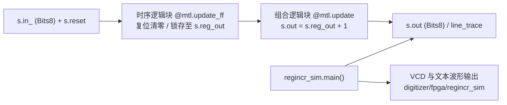

# 数字化器（`core/digitizer`）

`src/raser/core/digitizer/` 在模块分层中位于 [电子学读出](readout.md) 与 [事件重建](reconstruction.md) 之间（见 [../architecture.md](../architecture.md)），包含基于 `pymtl3` 构建的 8 位寄存器自增器硬件模型 `RegIncr`（`regincr.py`）及其仿真运行入口 `regincr_sim.main()`（`regincr_sim.py`）。用户可通过 Python 直接导入并运行该模块进行数字逻辑仿真与波形导出。

## 硬件组件与仿真入口

### `RegIncr` 硬件组件（`regincr.py`）

`RegIncr` 继承自 `pymtl3.Component`，内部包含以下端口与逻辑块：

- **`s.in_`**：8 位无符号输入端口 `pymtl3.InPort(pymtl3.Bits8)`。
- **`s.reset`**：`pymtl3.Component` 内置复位端口；在时序块 `block1`（`@mtl.update_ff`）中，当 `s.reset` 为真时将内部 8 位连线 `s.reg_out` 置 `0`，否则将 `s.in_` 锁存至 `s.reg_out`。
- **`s.out`**：8 位无符号输出端口 `pymtl3.OutPort(pymtl3.Bits8)`，在组合逻辑块 `block2`（`@mtl.update`）中计算 `s.out @= s.reg_out + 1`。
- **`line_trace(s)`**：返回 `"{}({}){}".format(s.in_, s.reg_out, s.out)` 格式的行追踪字符串。

### `regincr_sim.main()` 仿真入口（`regincr_sim.py`）

在 Python 中导入并执行 `raser.core.digitizer.regincr_sim.main()`：

- **输入序列**：将 `[0x01, 0x13, 0x25, 0x37]` 末尾追加 3 个 `0`（即 `[0x01, 0x13, 0x25, 0x37, 0, 0, 0]`），在每个时钟周期依次写入 `model.in_`。
- **VCD 波形输出**：调用 `raser.supports.output.output(__file__, "fpga")`（见 [../supports/README.md](../supports/README.md)）创建目录 `<project_root>/digitizer/fpga`，并将 `vcd_path = os.path.join(path, "regincr_sim")`（无后缀）传给 `mtl.DefaultPassGroup(textwave=True, linetrace=True, vcdwave=vcd_path)` 生成 VCD 波形。
- **标准输出**：打印输入列表、VCD 保存路径提示 `vcd file has been saved in <vcd_path>`、每个周期的 `cycle = <sim_cycle_count>: in = <in_>, out = <out>`，并在结束时调用 `model.print_textwave()` 打印文本波形。

## 相关页面

- [../architecture.md](../architecture.md)
- [readout.md](readout.md)
- [reconstruction.md](reconstruction.md)
- [../supports/README.md](../supports/README.md)
