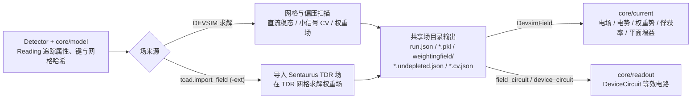
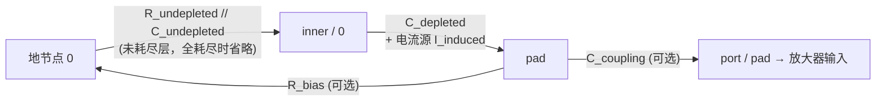

# 场求解与加载（`core/field`）

`src/raser/core/field/` 位于 [器件定义](device.md) 与 [材料模型](model.md) 之上，负责用 DEVSIM 求解（或从 Sentaurus TDR 文件导入）器件在给定偏压与辐照注量下的电势、电场、载流子浓度、俘获率、导电标志、读出电极权重场及 IV/CV/噪声曲线，并向 [载流子输运](current.md) 提供插值场查询与平面雪崩增益接口 `DevsimField`，向 [电子学读出](readout.md) 提供器件等效 SPICE 电路 `DeviceCircuit`。命令行入口、参数选项与共享场调度见 [../stages/field.md](../stages/field.md)。

## 器件求解配置与物理模型输入

### 1. 器件定义读取与追踪（`reading.py`）

求解过程通过 `Reading(Detector(...))` 包装器件对象（见 [device.md](device.md) 与 [../components/device.md](../components/device.md)），自动记录求解期间实际读取的器件属性、JSON 键及外部网格文件 SHA-256 哈希并写入 `run.json` 的 `"read"` 字段，用于后续切片复用与过期检查。求解读取的器件配置键清单如下：

| 键名 | 默认值 | 单位 | 含义 |
| --- | --- | --- | --- |
| `det_name`, `default_dimension`, `field_dimension` | 见 [device.md](device.md) | 无 | 器件名称与维度（`1`、`2` 或 `3`） |
| `l_x`, `l_y`, `l_z` | 无（必选） | $\mu\text{m}$ | 器件尺寸 |
| `p_x`, `p_y` | 见 [device.md](device.md) | $\mu\text{m}$ | 读出电极间距 |
| `electrodes`, `read_ele_num`, `x_ele_num`, `y_ele_num` | 见 [device.md](device.md) | 无 / 个 | 电极布局与数量 |
| `area_factor` | `1.0` | 1D $\text{cm}^2$，2D cm，3D `1` | 将网格比电流/比电容换算为器件值的面积或长度因子 |
| `temperature` | 无（必选） | K | 器件温度 $T$ |
| `material` | 无（必选） | 无 | 器件半导体材料名（如 `"Si"`、`"SiC"`、`"Diamond"`） |
| `bias.electrode` | 无（必选） | 无 | 施加偏置电压的电极名称 |
| `bias.voltage` | 无（必选） | V | 默认目标偏置电压 |
| `read_out_contact` | 无（必选） | 无 | 读出电极字典列表，每项含 `name`，可选 `x_span`、`y_span`（晶胞跨度） |
| `doping.Acceptors`, `doping.Donors` | 无（必选） | $\text{cm}^{-3}$ | 受主与施主掺杂浓度 DEVSIM 表达式 |
| `doping.Acceptors_ir`, `doping.Donors_ir` | 无（可选） | $\text{cm}^{-3}$ | 叠加到 `Acceptors`、`Donors` 上的附加掺杂表达式 |
| `mesh.plugin` | `False` | 无 | 为真时 2D 网格坐标轴对应器件 `("x", "y")`，否则对应 `("z", "x")` |
| `mesh.mesher` | `None` | 无 | 为 `"sde"` 时 3D 网格坐标轴对应 `("x", "y", "z")`，否则对应 `("z", "x", "y")` |
| `mesh.1D_mesh` | 无（1D 必选） | cm | 含 `mesh_line`、`region`、`contact` 列表 |
| `mesh.2D_mesh` | 无（2D 内置网格必选） | cm | 含 `mesh_line`、`region`、`contact` 列表；HEMT `drift_diffusion_v1` 分支必选 `interface`；权重场阶段非空 `ac_contact` 替代 `read_out_contact` 指定读出电极名 |
| `mesh.gmsh_mesh` | 无（2D/3D Gmsh 网格必选） | cm | 含 `file`（`.msh` 路径，通过 `Detector.file` 解析）、`region`、`contact` |
| `irradiation.irradiation_model` | 无 `irradiation` 块时为 `None`（有该块时必选） | 无 | 缺陷模型：`"XingChen"`、`"Perugia"`、`"Schwandt"` 或 `"CommonDefect"`；其余非 `None` 名字落入默认空字典的自定义缺陷分支（零缺陷）；缺陷字典须含有效 `"type"`（`"donor"` 或 `"acceptor"`） |
| `irradiation.irradiation_flux` | 无 `irradiation` 块时为 `0`（有该块时必选） | $\text{cm}^{-2}$ | 默认辐照注量 |
| `avalanche_model`, `enable_gain` | `None`, `False` | 无 | `has_avalanche` 为真时在 DEVSIM 启用碰撞电离项：`"NoAvalanche"` 置电离率为 `'0'`，`"CustomAvalanche"` 读取 `custom_ion_n/p`（默认 `'0'`），`"Fine_exponential_models"` 用于 `SiliconCarbide`，`"Tunnel"` 附加隧穿项；其余名字下 `Silicon` 用 van Overstraeten、`SiliconCarbide` 用 Hatakeyama、其他材料用 `custom_ion_n/p`（默认 `'0'`）。同一 `avalanche_model` 在平面增益计算与 [current.md](current.md) 中传给 [model.md](model.md) 的 `Material.cal_coefficient`（仅接受 `"vanOverstraeten"`、`"Okuto"`、`"Hatakeyama"`） |
| `parameter` | 无（可选） | 依参数而定 | `{"name": <str>, "value": <float>}`，向 DEVSIM 区域写入参数（如 `"F_sat"`，默认 `1e5` V/cm） |
| `U_const` | `0` | $\text{cm}^{-3}\cdot\text{s}^{-1}$ | 附加复合率节点模型（数值或 DEVSIM 表达式），与 SRH 复合率相加：`Gn = -ElectronCharge * (USRH + U_const)`、`Gp = +ElectronCharge * (USRH + U_const)`；碳化硅启用雪崩项时还与 `TAT_FIELD_ENHANCEMENT` 构成场增强项 `R_TAT = (TAT_FIELD_ENHANCEMENT)*(U_const@n1)` |
| `frequency` | `field.solver.ac.frequency`（`1000.0`） | Hz | 覆盖小信号 AC 电容与噪声求解频率 |
| `field.solver` | `SOLVER`（见下表） | 见下表 | 深度合并覆盖默认求解器配置 `SOLVER` |
| `hemt_physics` | 无（可选） | 无 | 当 `hemt_physics.transport_model == "drift_diffusion_v1"` 时启用 2D AlGaN/GaN HEMT 直流转移特性求解器 |
| `field_interpolation_bins` | `None`（默认 `{"x": 30, "y": 30, "z": 30}`） | 个 | `DevsimField` 对非结构化 3D 点云做反距离加权（IDW）规则网格化时的各轴箱数 |
| `capacitance_pF` | 无（可选） | pF | `circuit_parameters` 优先采用的实测单电极结电容 |
| `bias_resistance_ohm` | `None` | $\Omega$ | 单电极偏置电阻 |
| `coupling_capacitance_pF` | `None` | pF | 单电极交流耦合电容（需同时配置 `bias_resistance_ohm`） |
| `undepleted_resistance_ohm`, `undepleted_capacitance_pF` | `None` | $\Omega$, pF | 手动指定的未耗尽层并联电阻与电容（必须成对给出） |
| `resistive_layer` | 无（可选） | 见右 | 阻性电荷共享层配置：含 `sheet_resistance`（$\Omega/\square$）或铝注入参数 `implanted`（$\text{cm}^{-2}$）、`thickness`（$\mu\text{m}$）、`anneal`（$^\circ\text{C}$），以及 `strips`、`pads`、可选 `grounded`、可选电介质耦合层 `coupling: {"thickness" [um], "permittivity"}` |

### 2. 默认求解器参数 `SOLVER`（`solver_section.py`）

器件 JSON 可通过 `field.solver` 深度合并覆盖以下默认设置：

| 键路径 | 默认值 | 单位 | 含义 |
| --- | --- | --- | --- |
| `initial.absolute_error` | `1e10` | 无 | 初始零偏压求解绝对误差容限 |
| `initial.relative_error` | `1e-4` | 无 | 初始零偏压求解相对误差容限 |
| `initial.maximum_iterations` | `100` | 次 | 初始零偏压求解最大迭代次数 |
| `voltage_step.absolute_error` | `1e20` | 无 | 偏压步进求解绝对误差容限 |
| `voltage_step.relative_error` | `1e-4` | 无 | 偏压步进求解相对误差容限 |
| `voltage_step.maximum_iterations` | `100` | 次 | 偏压步进求解最大迭代次数 |
| `voltage_step.initial` | `1.0` | V | 偏压扫描初始步长 |
| `voltage_step.increase_factor` | `2.0` | 无 | 收敛成功后步长放大倍数 |
| `voltage_step.decrease_factor` | `0.5` | 无 | 收敛失败后步长缩减倍数 |
| `saved_voltage_interval` | `100.0` | V | 保存场里程碑文件（`.pkl`、`.devsim`、`.dd`）的偏压间隔 |
| `curve_voltage_interval` | `10.0` | V | 计算并记录 IV/CV/噪声曲线点的偏压间隔 |
| `ac.real`, `ac.imaginary` | `1.0`, `0.0` | V | 小信号 AC 激励实部与虚部 |
| `ac.frequency` | `1000.0` | Hz | 小信号 AC 求解频率 |
| `weighting_tolerance` | `5e-2` | 无 | 单晶胞条形电极拼接权重场在行两端晶胞允许残留的最大权重电势 |
| `crosstalk_tolerance` | `5e-2` | 无 | 判定相邻条形电极存在电容耦合的互容占总电容最小比例 |

### 3. 外部 TCAD 文件导入（`tcad.import_field`）

通过 `-ext <TCAD_FILE>`（见 [../stages/field.md](../stages/field.md)）指定 Sentaurus TDR（HDF5）文件时，`tcad.import_field` 读取 `/collection/geometry_0`：

- **偏压校验**：读取 `ContactExternalVoltage`（V）获取 `bias.electrode` 的偏压（TDR 无此数据集时使用 `-bias` 指定值）。
- **网格与数据集映射**：节点坐标由 $\mu\text{m}$ 乘 `1e-4` 转为 cm；导入 `ElectrostaticPotential`（`Potential`）、`DopingConcentration`（`NetDoping`）、`eDensity`（`Electrons`）、`hDensity`（`Holes`）、`eGapStatesRecombination`（`TrappingRate_n`）、`hGapStatesRecombination`（`TrappingRate_p`），并结合 `eMobility`、`hMobility` 判定 `Conductive`；读取 `ElectricField_0`（3D 时取三分量平方和的平方根）用于绘图。
- **权重场求解**：在导入的 TDR 网格上用 DEVSIM 求解各读出电极的权重场，支持材料介电常数 `"Silicon": 11.9`、`"SiliconCarbide": 9.76`、`"Oxide": 3.9`、`"Nitride": 7.5` 及金属 `"Aluminum"`。

## 磁盘输出文件

输出文件写入场运行目录 `<project>/field`（或辐照扫描子目录）。其中 `.pkl` 与 `Capacitance_<V>V.json` 使用 `voltage_label` 将整数偏压格式化为无小数点形式（如 `Potential_200V.pkl`）；非零偏的 `.devsim`、`.dd` 与全部 `.undepleted.json`、`.cv.json` 使用浮点数格式（如 `200.0V.undepleted.json`）；零偏状态文件为 `0V.devsim`、`0V.dd`。

| 文件名 | 内容与结构 | 单位 |
| --- | --- | --- |
| `run.json` | 运行元数据、`axes`（网格轴名列表，如 `["z"]`、`["z", "x"]`）、`read`（`Reading` 记录的 `attributes`、`keys`、`files`）与 `solved`（`"potential"`、`"weighting"`、`"capacitance"`、`"undepleted"` 已求解偏压列表） | 偏压为 V |
| `Potential_<V>V.pkl` | pickle 字典 `{"points", "values", "metadata": {"voltage", "dimension"}}`，网格节点电势 | `points`: cm；`values`: V |
| `TrappingRate_p_<V>V.pkl`, `TrappingRate_n_<V>V.pkl` | 同结构，空穴与电子俘获率 | `points`: cm；`values`: $\text{s}^{-1}$ |
| `Electrons_<V>V.pkl`, `Holes_<V>V.pkl` | 同结构，电子与空穴浓度 | `points`: cm；`values`: $\text{cm}^{-3}$ |
| `Conductive_<V>V.pkl` | 同结构，节点导电标志（`1.0` 或 `0.0`；电阻率 $< 10.0\ \Omega\cdot\text{cm}$ 或有净掺杂且 $n + p > 0.5|N_{\text{net}}|$ 时为 `1.0`） | `points`: cm；`values`: 无量纲 |
| `NetDoping_0V.pkl`（TCAD 下 `NetDoping_<V>V.pkl`） | 同结构，净掺杂浓度 `Donors - Acceptors` | `points`: cm；`values`: $\text{cm}^{-3}$ |
| `<V>V.undepleted.json` | 1D DEVSIM 求解写出的未耗尽体区参数：`voltage_V`、`undepleted_width_um`、`specific_resistance_ohm_cm2`、`specific_capacitance_pF`（全耗尽时为 `null`）、`per`（`"cm^2"`） | V, $\mu\text{m}$, $\Omega\cdot\text{cm}^2$, $\text{pF/cm}^2$ |
| `<V>V.cv.json` | 小信号电容文件：`voltage_V`、`specific_capacitance_pF`、`per`（1D `"cm^2"`，2D `"cm"`，3D `"device"`）、`area_factor`、`frequency_Hz` | V, pF/单位, 无, Hz |
| `<V>V.devsim`, `<V>V.dd`, `<det_name>.dat`, `weightingfield/weightingfield.dat`, `converted.devsim` | DEVSIM 状态归档（非零偏的 `<V>V.devsim`，如 `200.0V.devsim`，供 `-cv` 重载）与 Tecplot 网格/场数据（收敛失败时写出 `last_solvable.dd`） | DEVSIM 内部单位（cm, V） |
| `weightingfield/<contact>/Potential_<V>V.pkl` | 读出电极 `<contact>` 的无量纲权重电势（导电区边介电常数放大 `CONDUCTOR_PERMITTIVITY = 1e10` 倍使其与电极等势）；2D 单晶胞拼接 `metadata` 含 `"cells_either_side"`，3D 含 `"contact_name"` | `points`: cm；`values`: 无量纲 |
| `weightingfield/<contact>/Capacitance_<V>V.json` | 单晶胞周期性条形电极拼接（`cells_either_side > 0`）写出的单位条长互容：`{"unit": "F/cm", "of", "total", "to": {"neighbour1": ...}, "neighbours_coupled"}` | F/cm |
| `<det_name>_iv.png`, `simIV<min>to<max>.root/.pdf` | 偏压扫描 IV 曲线图与 ROOT 文件（TTree `SicarTestIV`，分支 `voltage`、`Current`） | V, A |
| `<det_name>_cv.png`, `<det_name>_c^-2v.png`, `simCV<min>to<max>.root/.pdf` | 偏压扫描 CV 与 $1/C^2$-V 曲线图及 ROOT 文件（TTree `SicarTestCV`，分支 `voltage`、`CAP`） | V, pF |
| `<det_name>_noise.png`, `simnoise<min>to<max>.root/.pdf` | 噪声电流扫描曲线图与 ROOT 文件（TTree `SicarTestnoise`，分支 `voltage`、`Current`） | V, A |
| `Doping.png` 及 1D/2D/3D 场分布图 | 1D 掺杂图 `Doping.png`；各保存偏压 `<v>` 下：1D 生成 `<title><v>_1d.png`，2D 生成 `<title><v>_2d.pdf/.root` 与 `<title><v>_1d.pdf/.root`，3D 生成 `<title>_<v>_3d_1d.pdf/.root`、`_XY`、`_YZ`、`_XZ`（主目录 `<title>` 为 `Potential` / `Potential Distribution `、`Electric Field`、`Electron Trapping Rate`、`Hole Trapping Rate`；权重场目录下为 `Weighting Potential`、`Weighting Field`） | 轴 $\mu\text{m}$，电势 V，场强 V/cm（权重场 $1/\text{cm}$），俘获率 $\text{s}^{-1}$ |
| `HEMT_TRANSPORT_*` | `drift_diffusion_v1` 分支写出的 `HEMT_TRANSPORT_IdVg.csv`、`HEMT_TRANSPORT_final_profile.csv`、`HEMT_TRANSPORT_final.devsim`、`HEMT_TRANSPORT_IdVg.png/.pdf`、`HEMT_TRANSPORT_summary.json` | V, mA/mm, $\text{cm}^{-3}$ |

## 下游内存接口

### 1. 插值场查询 `DevsimField`（`devsim_field.py`）

`DevsimField` 加载场目录下的 `.pkl` 与 `run.json`，分别通过 1D（`interp1d`）、2D（`LinearNDInterpolator`）或 3D（`RegularGridInterpolator`）插值并按网格分辨率缓存（默认 1D `z: 0.05` $\mu\text{m}$；2D `z: 0.1, x: 0.5` $\mu\text{m}$；2D plugin `x: 0.1, y: 0.1` $\mu\text{m}$；3D `z: 0.5, x: 1, y: 1` $\mu\text{m}$），向 [current.md](current.md) 提供输入位置为 $\mu\text{m}$ 的查询方法：

- **单电极晶胞折回**：当仅列一个读出电极且器件横向尺寸大于电势网格跨度时，自动将查询坐标折回网格的一个晶胞（多晶胞网格下取中间晶胞）。
- **`get_e_field_cached(x, y, z)` 与 `get_potential(x, y, z)`**：返回电场 `(Ex, Ey, Ez)`（V/cm，由电势在步长 `STEP = 1.0e-5` cm 上的中心差分负梯度求得）与电势（V）。
- **`get_doping_cached`、`get_trap_e_cached`、`get_trap_h_cached`**：返回净掺杂（$\text{cm}^{-3}$）及电子/空穴俘获率（$\text{s}^{-1}$）；查询异常时记录警告并返回 `0.0`。
- **`get_w_p(x, y, z, i)` 与 `get_w_p_cached(x, y, z, i)`**：返回第 `i` 个读出电极的无量纲权重势；`get_w_p` 将 `< 0` 或 `NaN` 裁为 `0`、`> 1` 裁为 `1`，`get_w_p_cached` 查询失败时抛出 `RuntimeError`。
- **`get_conductive(x, y, z)`**：所在网格单元的所有顶点均导电时返回 `True`；位置在网格外时返回最近网格节点的导电值。
- **平面雪崩增益计算**：`planar_gain(my_d)`、`planar_gain_at(my_d, z)`、`planar_gain_depth(my_d)`、`planar_gain_carrier(my_d)` 沿器件中心线 $x = 0.5 l_x, y = 0.5 l_y$ 对碰撞电离系数积分，适用于 `axes` 含 `"z"` 的任意维度场。

### 2. 等效电路构造（`circuit_parameters.py`, `device_circuit.py`）

`DeviceCircuit(lines, sources, outputs, alike)` 描述整个器件在 SPICE 网表中的等效电路拓扑、`sources` 感应电流源节点对、`outputs` 前端输入节点以及共享噪声谱的对称通道分组 `alike`。以单电极平面器件为例，其典型等效电路拓扑如下：

- **`field_circuit(folder, my_d)`**：从场目录提取 `(row, capacitance, undepleted)`；单接触多条形器件读取 `weightingfield/<electrode>/Capacitance_<bias>V.json` 中的 `"F/cm"` 互容，常规器件依次从 `capacitance_pF`、`<voltage>V.cv.json` 或平行板估算确定结电容，1D 器件同时读取 `<voltage>V.undepleted.json`。
- **`device_circuit`、`device_row`、`device_grid` 与 `part_of_row`**：分别组装单器件、条形行、阻性网格与局部自适应行电路，供 [readout.md](readout.md) 生成 SPICE 网表。

## 示例中的场求解（`HPK-Si-PiN`）

在 [快速入门](../getting-started.md) 的示例中，运行 `raser signal HPK-Si-PiN --scan voltage=100,200 -s 2 -evt 200 --seed 1` 自动在 `work/HPK-Si-PiN/field/` 求解了 `100 V` 与 `200 V` 的场：

- `run.json` 中记录 `axes: ["z"]`、`solved.potential` 与 `solved.undepleted` 为 `[0.0, 100.0, 200.0]`、`solved.weighting` 为 `[100.0, 200.0]`。
- `100.0V.undepleted.json` 与 `200.0V.undepleted.json` 中 `undepleted_width_um` 均为 `0.0`（全耗尽，`specific_capacitance_pF` 为 `null`）。
- 下游 `DevsimField` 加载该 1D 场时使用缓存分辨率 `{'z': 0.05, 'x': 10000.0, 'y': 10000.0}` $\mu\text{m}$。

## 常见报错

| 异常类型 | 报错信息 | 触发条件 |
| --- | --- | --- |
| `FileNotFoundError` | `no <mode> field of <det_name> at the irradiation flux <flux> in <root> ...` | `solved_field` 未找到匹配辐照注量与模式的场记录 |
| `ValueError` | `the field in <folder> was solved for another device (<differing>); solve it again with ...` | 器件当前属性、JSON 键或网格文件与 `run.json` 中 `read` 记录不一致 |
| `FileNotFoundError` | `the field in <folder> is not solved at <voltage> V ...` / `has no weighting field at <voltage> V ...` / `has no capacitance at <voltage> V ...` / `has no undepleted bulk at <voltage> V ...` | `run.json` 的 `solved` 中缺少目标偏压下的对应资产 |
| `FileNotFoundError` | `no field saved at <voltage> V in <folder>: <have>` | 运行 `-cv` 时目录中不存在 `<voltage>V.devsim` |
| `FileNotFoundError` | `the weighting field at <v_goal> V needs the field solved at that bias: <conductive_file> is missing ...` | 运行 `-wf` 时缺少 `Conductive_<v_goal>V.pkl` |
| `ValueError` | `<k> of the <n> nodes of <region> are not in <conductive_file>, the first at <coords> cm: the field was solved on another mesh` | 求解权重场时当前区域网格节点不在 `Conductive_<v_goal>V.pkl` 中 |
| `ValueError` | ``the defect <name> must have "type": "donor" or "acceptor", it has ...`` | 辐照缺陷字典缺少有效的 `type`（`"donor"` 或 `"acceptor"`） |
| `RuntimeError` | `Step size too small (less than 1e-7). Exiting loop.` | DEVSIM 偏压扫描因收敛失败将步长缩减至小于 `1e-7` V |
| `ValueError` | `<det_name>: cells are laid side by side only along x on a mesh of depth and x so far` / `the mesh of <det_name> is <width> um wide, not one pitch of <pitch> um ...` / `the cells of <det_name> do not fit side by side ...` | 单晶胞条形电极拼接权重场时网格非非 `plugin` 2D 网格、晶胞宽度不等于 `p_x` 或左右边界节点不对称 |
| `ValueError` | `the weighting potential of <contact> of <simname> at <v_goal> V does not fall off along the row ...` | 单晶胞拼接扩展超过初始跨度的 2 倍后两端残留权重电势仍大于 `weighting_tolerance` 或末端电极仍耦合 |
| `ValueError` | `<tdr> holds no electrode voltages: give its bias with -bias` / `<tdr> has no electrode <electrode> ...` / `<tdr> was solved with <V> V on <electrode>, not at <asked> V` | TCAD TDR 文件偏置电极或偏压校验失败 |
| `ValueError` | `the region <region> of the TCAD file holds no ...` / `is of <material>, whose permittivity is not known here ...` / `the TCAD file has no electrode <electrode> to read out ...` | TDR 半导体区域缺少载流子/掺杂/迁移率数据集、包含未知介电常数材料或缺少指定读出电极 |
| `FileNotFoundError` | `<record> is missing: solve the field again ...` / `the <what> of <name> at <voltage> V is not solved: <file> is missing` | `DevsimField` 加载场时缺少 `run.json` 或对应的 `.pkl` 文件 |
| `ValueError` | `the <what> in <file> has <d1> dimensions, the field has <d2>` | `DevsimField` 加载的 `.pkl` 文件维度小于场 `axes` 的维数 |
| `ValueError` | `Unknown interpolation axes: ...` / `3D interpolation requires at least two bins per axis` / `3D interpolation points must have shape N x 3` / `3D interpolation values must match the point count` / `3D interpolation requires finite points and values` / `3D interpolation point cloud must span every axis` / `Gradient step must be positive` | `interpolation.py` 中 3D 插值输入数据、轴箱数或梯度步长校验失败 |
| `ValueError` | `<point> is outside the mesh, which runs from <low> to <high>` | `gradient` 计算电场时查询点超出网格坐标范围 |
| `RuntimeError` | `failed when getting w_p cache (<x>, <y>, <z>, <n>)` | `DevsimField.get_w_p_cached` 查询权重电势失败 |
| `ValueError` | `the field of <name> is stored along <axes>, without the depth z: it has no planar gain` / `Unsupported avalanche model: <avalanche_model>` / `<name> breaks down at <voltage> V: the breakdown integral is <det>, not below 1` | `DevsimField` 计算平面雪崩增益时场轴不含 `"z"`、雪崩模型不支持或击穿积分 $\ge 1$ |
| `FileNotFoundError` | `the field in <folder> has no capacitances between the strips of <det_name> at <V> V: <path> is missing ...` | 单接触条形探测器读出时缺少 `Capacitance_<V>V.json` |
| `ValueError` | `<det_name> has no capacitance ...` / `A depleted width of <w> m leaves no undepleted layer in a device <t> m thick` / `<det_name> gives <key> alone: the undepleted layer has both ...` / `<det_name> is not a row of strips ...` / `<det_name> is a row of strips and has an undepleted layer ...` / `The capacitances of the row are in <unit>` / `<electrode> of <det_name> has <farad> F in all ... and <to_others> F to the other strips ...` / `A coupling capacitance needs a bias resistance ...` | `circuit_parameters` 与 `device_circuit` 构造等效电路时未耗尽层、条形阵列互容或偏置耦合参数校验失败 |
| `ValueError` / `NotImplementedError` / `RuntimeError` | `HEMT transport requires a configured mesh interface` / `HEMT_TRANSPORT_V1 requires a 2D device` / `HEMT_TRANSPORT_V1 supports DC transfer sweeps only` / `HEMT_TRANSPORT_V1 currently assumes a Ga-face pseudomorphic barrier` / `Initial HEMT_TRANSPORT_V1 calibration is restricted to 300 K` / `HEMT_TRANSPORT_V1 requires mesh.2D_mesh` / `Use bias=0 for the RASER launcher...` / `Transport config must contain AlGaN_barrier and GaN_buffer` / `Transport config is missing contact ...` / `For this simplified branch, source and drain must contact GaN_buffer` / `Gate must contact AlGaN_barrier` / `Initial model requires n-type GaN...` / `Electron mobilities must be positive` / `polarization_spread_nm must be >= 1 nm...` / `Invalid gate sweep range/step` / `Initial transport branch restricts drain_bias_V to 0..0.2 V` / `Gate sweep must include Vg=0...` / `HEMT_TRANSPORT_V1 solve failed during ...` | HEMT `drift_diffusion_v1` 分支的网格、区域、电极、掺杂、迁移率、扫描范围校验失败或 DEVSIM 求解报错 |

## 相关页面

- [快速入门](../getting-started.md)
- [../stages/field.md](../stages/field.md)
- [device.md](device.md)
- [model.md](model.md)
- [../components/device.md](../components/device.md)
- [current.md](current.md)
- [readout.md](readout.md)
- [../supports/README.md](../supports/README.md)
