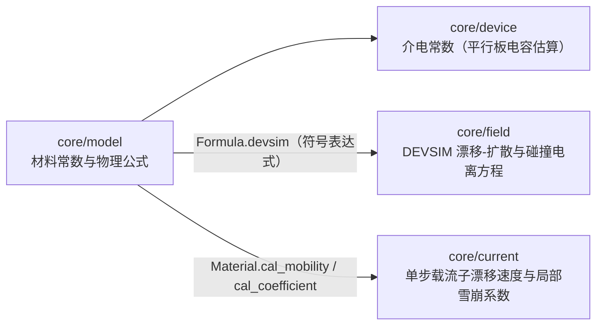

# 材料与物理模型（`core/model`）

`src/raser/core/model/` 处于仿真链的最底层，定义半导体材料常数、能带结构、掺杂剂电离、复合率、迁移率与碰撞电离系数。模块一方面通过 `Formula` 为 [器件场求解](field.md) 生成 DEVSIM 符号表达式，另一方面为 [器件定义](device.md) 与 [载流子输运](current.md) 提供材料介电常数、迁移率和碰撞电离率的 Python 数值计算；在 [快速入门](../getting-started.md) 的 `HPK-Si-PiN` 示例中，器件选用 `"Si"` 材料、温度 `300.0 K`，介电常数取 `11.9`，载流子输运采用 `"Selberherr"` 迁移率模型。

## 公式求值器（`formula.py`）

`Formula(text, variables, **parameters)` 将使用 `abs`、`exp`、`log`、`pow`、`sqrt`、`tanh`、`ifelse(cond, a, b)` 与幂运算符 `^` 编写的公式文本封装为同时支持数值求值与 DEVSIM 表达式生成的对象：

- **`Formula.value(**variables)`**：在 Python 中对给定自变量求浮点数值，其中 `ifelse(cond, a, b)` 仅求值命中的分支。
- **`Formula.devsim(in_conditions=None, **variables)`**：展开具名常数或子表达式（可引用排在后面的参数），返回 DEVSIM 符号表达式字符串；传入 `in_conditions` 时，先仅在 `ifelse` 的条件表达式中替换对应变量，再在全式中替换 `variables`。

## 材料数据库与输运、雪崩接口（`material.py`）

`Material(mat_name, mobility_model=None, avalanche_model=None)` 按材料名称初始化基础物性并允许覆盖默认的迁移率或雪崩模型（电子静止质量 $m_e = 9.109\times 10^{-31}\ \text{kg}$）：

| 材料名（`mat_name`） | 相对介电常数（`RELATIVE_PERMITTIVITY`） | 电子有效质量 `electron_mass`（kg） | 空穴有效质量 `hole_mass`（kg） | 默认 `mobility_model` | 默认 `avalanche_model` |
| --- | --- | --- | --- | --- | --- |
| `"Si"` | `11.9` | `0.26 * m_e` | `0.386 * m_e` | `"Selberherr"` | `"vanOverstraeten"` |
| `"SiC"` | `9.76` | `0.29 * m_e` | `1.0 * m_e` | `"Das"` | `"Hatakeyama"` |
| `"Diamond"` | `5.7` | 未设置 | 未设置 | `"Reggiani_diamond"` | `None` |

- **迁移率计算 `Material.cal_mobility(temperature, input_doping, charge, electric_field)`**：返回载流子迁移率（单位 $\text{cm}^2/(\text{V}\cdot\text{s})$，温度单位 K，有效掺杂 `input_doping` 单位 $\text{cm}^{-3}$，电场强度单位 V/cm，`charge > 0` 为空穴、`<= 0` 为电子）。`"Si"` 支持 `"Selberherr"` 与 `"Reggiani"`（`"Reggiani"` 按 `input_doping` 符号区分施主 $\ge 0$ 与受主 $< 0$，其余模型均取绝对值），`"SiC"` 支持 `"Das"`，`"Diamond"` 支持 `"Reggiani_diamond"`。
- **碰撞电离系数 `Material.cal_coefficient(electric_field, charges, temperature)`**：返回碰撞电离系数（单位 $\text{cm}^{-1}$），支持 `"vanOverstraeten"`、`"Okuto"`（阈值 $E > 1.0\times 10^5\ \text{V/cm}$）与 `"Hatakeyama"` 模型（`charges < 0` 为电子、`> 0` 为空穴）。
- **漂移速度绘图 `Material.draw_velocity(temperature, Neff)`**：在给定温度（K）与有效掺杂浓度（$\text{cm}^{-3}$）下绘制电子与空穴漂移速度曲线，保存至 `<output_dir>/<mat_name>Mobility<mobility_model>.png`（横轴 `ElectricField  [V/cm]`，纵轴 `Velocity [cm/s]`，输出路径由 [../supports/README.md](../supports/README.md) 的 `output(__file__, "model")` 生成）。

## 能带结构、掺杂剂电离与复合模型

### 能带结构（`band_structure.py`）

`BAND_STRUCTURE[material]` 提供关于温度 `T`（K）的导带有效状态密度 `N_c`、价带有效状态密度 `N_v`、禁带宽度 `E_g` 及本征载流子浓度 `n_i`（$\sqrt{N_c N_v}\exp(-E_g / (2kT))$，玻尔兹曼常数 $k = 1.3806503\times 10^{-23}\ \text{J/K}$）四个 `Formula`：

| 材料 | `N_c`（$\text{cm}^{-3}$） | `N_v`（$\text{cm}^{-3}$） | `E_g`（J） |
| --- | --- | --- | --- |
| `"Si"` | `2.82e19*pow(T/300, 1.5)` | `1.83e19*pow(T/300, 1.5)` | `1.12*1.6e-19` |
| `"SiC"` | `3.25e15*pow(T, 1.5)` | `4.8e15*pow(T, 1.5)` | `3.26*1.6*1e-19` |
| `"Diamond"` | `1.8e19*pow(T/300, 1.5)` | `1.5e19*pow(T/300, 1.5)` | `5.47*1.6e-19` |

### 掺杂剂与不完全电离（`dopants.py`, `incomplete_ionization.py`）

`DOPANTS[material][element]` 存储各掺杂元素 `Dopant(kind, levels, degeneracy, fall_ev_cm)` 参数：

| 材料 | 元素 | `kind` | `levels`（电离能 [eV], 占比） | `degeneracy` | `fall_ev_cm`（$\text{eV}\cdot\text{cm}$） |
| --- | --- | --- | --- | --- | --- |
| `"Si"` | `"P"` | `"donor"` | `((0.046, 1.0),)` | `2.0` | `0.0` |
| `"Si"` | `"As"` | `"donor"` | `((0.054, 1.0),)` | `2.0` | `0.0` |
| `"Si"` | `"Sb"` | `"donor"` | `((0.043, 1.0),)` | `2.0` | `0.0` |
| `"Si"` | `"B"` | `"acceptor"` | `((0.044, 1.0),)` | `4.0` | `0.0` |
| `"SiC"` | `"N"` | `"donor"` | `((0.0533, 0.5), (0.0996, 0.5))` | `2.0` | `0.0` |
| `"SiC"` | `"P"` | `"donor"` | `((0.057, 0.5), (0.113, 0.5))` | `2.0` | `0.0` |
| `"SiC"` | `"Al"` | `"acceptor"` | `((0.216, 1.0),)` | `4.0` | `3e-8` |
| `"SiC"` | `"B"` | `"acceptor"` | `((0.311, 1.0),)` | `4.0` | `0.0` |
| `"Diamond"` | `"B"` | `"acceptor"` | `((0.3685, 1.0),)` | `4.0` | `0.0` |
| `"Diamond"` | `"N"` | `"donor"` | `((1.7, 1.0),)` | `2.0` | `0.0` |
| `"Diamond"` | `"P"` | `"donor"` | `((0.60, 1.0),)` | `2.0` | `0.0` |

- **`ionized_fraction(material, element, concentration_cm3=0.0)`**：按玻尔兹曼统计返回自变量为 `("carriers", "N_band", "T")`（$\text{cm}^{-3}$、$\text{cm}^{-3}$、K）的无量纲电离比例 `Formula`，第 $i$ 个能级电离能随掺杂浓度降低：$E_i = E_{0,i} - \text{fall\_ev\_cm}\cdot N^{1/3}$（$k = 8.617333262\times 10^{-5}\ \text{eV/K}$）。
- **`free_holes(material, element, acceptors_cm3, donors_cm3, temperature_k)`**：对单能级受主与全电离补偿施主求解电中性方程，返回自由空穴浓度（$\text{cm}^{-3}$）。

### 复合与碰撞电离模型（`recombination.py`, `impact_ionization.py`）

- **`SRH` 与 `SRH_LIFETIME`**：Shockley-Read-Hall 复合率 `Formula`（自变量 `("n", "p", "n_i", "n1", "p1", "tau_n", "tau_p")`，单位 $\text{cm}^{-3}\cdot\text{s}^{-1}$）；默认载流子寿命：`"Si"` 为 `tau_n = 7e-3` s、`tau_p = 7e-3` s，`"SiC"` 为 `tau_n = 2.5e-6` s、`tau_p = 0.5e-6` s，`"Diamond"` 为 `tau_n = 5.6e-7` s、`tau_p = 2.4e-7` s。
- **`TAT_FIELD_ENHANCEMENT`**：陷阱辅助隧穿无量纲场增强因子 `Formula`（自变量 `("E", "F_sat")`，单位 V/cm；默认饱和场强 `TAT_SATURATION_FIELD = 1e5` V/cm，特征场强 `F_gamma = 3.9e4` V/cm）。
- **`VAN_OVERSTRAETEN`**：含 `"electron"` 与 `"hole"` 两项 `Formula`（自变量 `("E", "T")`，单位 V/cm 与 K，返回单位 $\text{cm}^{-1}$），在 $E \ge 1.75\times 10^5\ \text{V/cm}$ 时启用 Chynoweth 定律（高低场分界 $E_0 = 4.0\times 10^5\ \text{V/cm}$，声子能量 $\hbar\omega = 0.063\ \text{eV}$，参考温度 $T_0 = 293.0\ \text{K}$）。
- **`hatakeyama(carrier, angle_deg=4.0)`**：4H-SiC 碰撞电离系数 `Formula`（`carrier` 为 `"electron"` 或 `"hole"`，`angle_deg` 默认取 `OFF_AXIS_DEG = 4.0` 度，即相对 `<0001>` 偏向 `<11-20>` 的晶向偏角；自变量 `("E", "T")`，在 $E > 10^4\ \text{V/cm}$ 时启用，$\hbar\omega = 0.19\ \text{eV}$，$T_0 = 300.0\ \text{K}$）。

## 常见报错

| 异常类型 | 报错信息 | 触发条件 |
| --- | --- | --- |
| `ValueError` | `unbalanced parentheses in ...` | `Formula` 表达式括号不匹配 |
| `ValueError` | `ifelse takes three arguments in ...` | `Formula` 中的 `ifelse(...)` 参数个数不为 3 |
| `ValueError` | `the formula takes ..., not ...` | 调用 `Formula.value` 或 `Formula.devsim` 时传入的自变量名集合与定义不一致 |
| `ValueError` | `<element> in <material> is not an acceptor of one level` | `free_holes` 指定的掺杂剂不是单能级受主 |
| `ValueError` | `Unsupported avalanche model: <avalanche_model>` | `Material.cal_coefficient` 的 `avalanche_model` 不在 `('vanOverstraeten', 'Okuto', 'Hatakeyama')` 中 |
| `RuntimeError` | `matplotlib is required for draw_velocity` | 调用 `Material.draw_velocity` 时环境未安装 `matplotlib` |

## 相关页面

- [快速入门](../getting-started.md)
- [device.md](device.md)
- [field.md](field.md)
- [current.md](current.md)
- [../supports/README.md](../supports/README.md)
