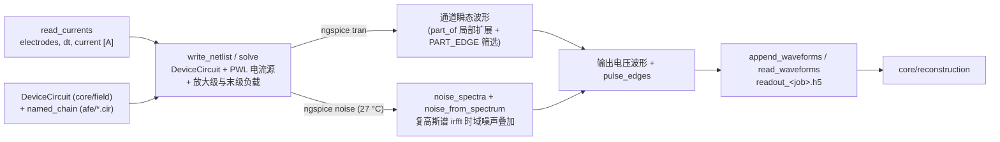

# 电子学读出（`core/readout`）

`src/raser/core/readout/` 承接 [载流子输运](current.md) 生成的电极感应电流与 [器件场](field.md) 提供的等效电路 `DeviceCircuit`，调用 `ngspice` 求解器件电路与前端放大器链的瞬态电压响应及频域噪声谱，并合成时域热噪声与脉冲边沿方向，向 [事件重建](reconstruction.md) 输出 `readout_<job>.h5`。模块同时提供 `append_waveforms` / `read_waveforms` / `read_circuit_values` 读写接口、短路电流计算及放大级原理图绘制函数。命令行与切片选项见 [../stages/readout.md](../stages/readout.md)。

## 输入与前端放大器链解析

- **上游数据与电路对象**：接收 `read_currents` 返回的 `electrodes`、`dt`（s）和各事例的 `event`、`t0`（s）、`current`（形状 `(electrodes, bins)`，单位 A），以及 `Detector`（见 [device.md](device.md)）、`DeviceCircuit`（见 [field.md](field.md)）和用于叠加频域抽样热噪声的整数 `noise_seed`。
- **前端放大器链（`circuit.py`）**：`named_chain(name)` 按 `"+"` 拆分 `amplifier` 名称并通过 `component_path("afe", f"{part}.cir")`（见 [../components/afe.md](../components/afe.md) 与 [../supports/README.md](../supports/README.md)）加载 SPICE 子电路，交由 `read_chain(paths)` 组装：
  - 序列末项为单端口负载 `load`（`.subckt <name> <in>`），其余各项按从器件到负载的顺序作为双端口放大级 `stages`（`.subckt <name> <in> <out>`）；同一放大级在链中重复出现时，从 `2` 起追加数字后缀（如 `Gali52`、`Gali52_2`）。
  - `read_subcircuit(path)` 支持的 SPICE 元件与参数如下（`.subckt` 外的非注释行存入 `"models"`）；`spice_number` 支持词头 `t`（`1e12`）、`g`（`1e9`）、`meg`（`1e6`）、`k`（`1e3`）、`m`（`1e-3`）、`u`（`1e-6`）、`n`（`1e-9`）、`p`（`1e-12`）、`f`（`1e-15`）：

| 元件类型 | 识别字典键 | 单位 | 说明 |
| --- | --- | --- | --- |
| 电阻 `R` | `"between"`, `"ohm"`, 可选 `"noiseless": True` | $\Omega$ | 行尾带 `noisy=0` 时标记为无噪声 |
| 电容 `C` | `"between"`, `"farad"` | F | 两端连接节点与电容值 |
| 电感 `L` | `"between"`, `"henry"` | H | 两端连接节点与电感值 |
| 直流电压源 `V` | `"between"`, `"volt"` | V | 两端节点与直流电压 |
| 压控电压源 `E` | `"between"`, `"follows"`, `"gain"` | 无 | 控制节点对与电压增益 |
| 子电路实例 `X` | `"model"`, `"nodes"` | 无 | 外部器件或模型子电路调用 |

## 瞬态求解、局部扩展、噪声与脉冲边沿

- **瞬态网表求解（`spice.py`）**：`write_netlist` 与 `solve` 为每个输出通道复制放大级与负载，将感应电流写入分段线性源 `I<k> <from> <to> PWL(...)`。网表在首个时间箱前补 1 个零电流箱使电路从静止起算（第 `m` 箱中心位于 `(m + 1.5) * dt`），调用 `ngspice -b` 运行 `tran <dt> <dt * (bins + 1)>`，导出电压（有放大级时读 `out<k>`，仅负载时读器件输出节点）并插值回感应电流时间箱中心，返回 `(outputs, bins)` 数组（单位 V）。
- **条形行局部电路扩展与有效通道筛选（`job.py`）**：当给出 `part_of` 时，围绕有感应电流的受击电极从两侧 `margin = 1` 起逐次倍增扩展局部电路，直至摆幅达到最大通道摆幅 `PART_EDGE = 1e-3` 倍的通道在新旧两次求解间的最大电压差 `< 1e-3 * largest` 或局部电路覆盖整行；每个事例仅存储最大绝对电压摆幅 `>= PART_EDGE * largest`（且 `largest > 0`）的通道。
- **频域噪声分析与时域合成（`spice.py`, `job.py`, `spectral_noise.py`）**：当 `noise_seed` 为整数时，`noise_spectra` 在 `LOWEST_NOISE_HZ = 1e3` Hz 至 `0.5 / dt` Hz 频段按每十倍频程 `PER_DECADE = 50` 个点运行 `ngspice` `noise` 分析（27 °C），获取单边电压噪声谱密度（$\text{V}/\sqrt{\text{Hz}}$）；同一 `circuit.alike` 组内的通道复用中间通道 `group[len(group) // 2]` 的噪声谱。`noise_from_spectrum` 以 `np.random.default_rng([noise_seed, event.event, place[name]])` 在 `RECORD = 256` 倍波形长度的频域网格上由 `band_power` 计算频带功率并抽样复高斯谱，经 `np.fft.irfft` 截取前 `bins` 个点叠加到输出波形。
- **脉冲边沿极性判定（`pulse_edge.py`）**：`collected_charge_sign(my_d, electrode)` 依据 `bias.electrode` 与 `bias.voltage` 判定收集电子（`-1`）或空穴（`+1`）；`chain_sign(chain)` 在 `1 pF` 平板电路上注入 `1 fC` 电荷（`dt = 10e-12` s，共 `2000` 箱，电流位于第 `5` 箱）求解放大器链响应，相对初始静态电压 `voltage[0]` 的最大摆动向上返回 `+1`、向下返回 `-1`；`pulse_edges` 将两者相乘，大于 `0` 记为 `"rising"`，小于 `0` 记为 `"falling"`。

## `readout_<job>.h5` 文件格式与独立接口

`src/raser/core/readout/waveforms.py` 中的 `append_waveforms`、`read_waveforms` 与 `read_circuit_values` 读写 HDF5 波形文件：

### 文件属性（Attributes）

| 属性名 | 类型 | 单位 | 含义 |
| --- | --- | --- | --- |
| `electrodes` | `string[]` | 无 | 电路全部读出输出通道的名称列表 |
| `dt` | `float64` | s | 时间箱宽度 |
| `pulse_edge` | `string[]` | 无 | 与 `electrodes` 顺序对应的脉冲边沿方向，`"rising"` 或 `"falling"` |
| `device_circuit` | `string` (JSON) | F, $\Omega$, $\text{F/m}^2$ | 器件等效电路参数及其来源字典（由 `read_circuit_values` 解析返回） |

### 数据集（Datasets）

| 数据集名 | 形状与类型 | 单位 | 含义 |
| --- | --- | --- | --- |
| `event` | `(events,)`, `int64` | 无 | Geant4 事例号 |
| `t0` | `(events,)`, `float64` | s | 事例首个时间箱的左边界 |
| `count` | `(events,)`, `int64` | 箱 | 事例中每条保存波形的时间箱数 |
| `stored` | `(events,)`, `int64` | 个 | 事例中保存波形的读出通道数（无信号事例为 `0`） |
| `index` | `(sum(stored),)`, `int64` | 无 | 每个保存通道在 `electrodes` 属性中的下标（从 `0` 起） |
| `voltage` | `(sum(stored * count),)`, `float64`（gzip） | V | 按事例和保存通道依次拼接的时间箱中心输出电压 |

### Python 独立辅助函数

- **短路电流（`spice.py`）**：`short_circuit_currents(electrodes, dt, currents, circuit)` 与 `write_short_circuit_netlist` 将器件输出端对地短路（`Vshort<k> <output> 0 0`），返回形状 `(outputs, bins)` 的短路电流数组（A）。
- **放大级原理图绘制（`schematic.py`）**：`draw(path, figure_path)` 解析 SPICE 子电路行尾 `;` 后的布局提示（方向 `right`/`left`/`up`/`down` 与步数 [缺省 2 步]、偏移 `shift <way> <steps>`、三极管 `npn`、放大器 `amp`），通过 `read_hints`、`arrange` 与 `layout` 排布网格坐标并保存原理图至 `figure_path`（`dpi=160`）。

## 示例中的读出波形（`HPK-Si-PiN`）

在 [快速入门](../getting-started.md) 的示例中，`HPK-Si-PiN` 在 `200 V` 下使用默认前端链 `SantaCruz+Gali52+Termination50` 写出 `work/HPK-Si-PiN/signal/seed_1/batch/readout_0.h5`：属性记录 `electrodes = ['top']`、`dt = 5e-12` s、`pulse_edge = ['falling']`，`device_circuit` 记录 `"junction_capacitance": {"farad": 3.44162280284e-12, "from": "device file"}`（其余电路项为 `null`）；`200` 个事例中共有 `196` 条非空波形（`index` 长度 `196`，`voltage` 长度 `245196`）。

## 常见报错

| 异常类型 | 报错信息 | 触发条件 |
| --- | --- | --- |
| `MissingDependency` | `ngspice is not installed. Install it with conda install -c conda-forge ngspice on x86 Linux, or with env/install-ngspice.sh on macOS arm64 and Linux aarch64` | `PATH` 中找不到 `ngspice`（`spice.py`） |
| `ValueError` | `<text> is not a SPICE number` / `Cannot read the element <line> of <path>` / `<path> has to hold .subckt <name> with the nodes in, or in and out` | SPICE 文件语法或端口定义不符合要求（`circuit.py`） |
| `ValueError` | `<path> has no output: it can only be the load, the last of the chain, not its part <place> of <len>` / `<load_path> is the last of the chain and has to be a load, with the node in alone` | 放大级缺少 `out` 端口，或末级负载包含 `out` 端口（`circuit.py`） |
| `ValueError` | `The stage <name> has the node <in> as input and as output; give the output a node of its own` / `Element <designator> of <name> has to carry one of ['ohm', 'farad', 'henry', 'volt'], a gain or a model, not ...` / `Element <designator> of <name> is noiseless: only a resistor can be` | 子电路字典结构不合法（`circuit.py`） |
| `ValueError` | `<electrode> of <det_name> and its other electrode are at one potential` / `The chain moves its output by <largest> V for 1 fC: it does not answer, so the way its pulses go is not known` / `<det_name> lists the read-out electrodes <contacts>, not one for each of the outputs <outputs>` | 偏置电压为 `0`、放大器链输出摆幅 `< 1e-9 V` 或读出接触数与输出数不一致（`pulse_edge.py`） |
| `ValueError` | `A noise spectrum needs at least two increasing frequencies` | 频率数组长度 `< 2` 或存在非递增步长（`spectral_noise.py`） |
| `ValueError` | `The bin width must be positive, not <dt> s` / `<len(currents)> currents for <len(electrodes)> electrodes` / `The currents are of the electrodes <electrodes>; the device has current sources for <sources>` / `A stage cannot be named "load"` | 网表生成参数校验失败（`spice.py`） |
| `ValueError` | `<path> is a readout file of an older layout ...: run the readout again` / `<path> has no pulse_edge: the readout of this version did not write it; run the readout again` / `the event <event> has traces of <names>, not each once of the electrodes <electrodes>` / `voltage has shape <shape>, expected (<len>, bins)` / `pulse_edge <pulse_edge> is not one of rising and falling for each of the electrodes <electrodes>` / `<path> holds waveforms of electrodes <in_file> with dt <dt> s, not of <electrodes> with dt <dt> s` | 波形文件读写或格式校验失败（`waveforms.py`） |
| `ValueError` | 布局提示语法错误、元件未连通至输入端、输入至输出无通路、子电路实例未标注 `; npn` 或分支无空闲网格位置 | 原理图网格排布校验失败（`schematic.py`） |

## 相关页面

- [快速入门](../getting-started.md)
- [../stages/readout.md](../stages/readout.md)
- [device.md](device.md)
- [field.md](field.md)
- [current.md](current.md)
- [digitizer.md](digitizer.md)
- [reconstruction.md](reconstruction.md)
- [../components/afe.md](../components/afe.md)
- [../supports/README.md](../supports/README.md)
