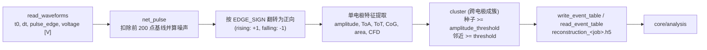

# 事件重建（`core/reconstruction`）

`src/raser/core/reconstruction/` 处于 [电子学读出](readout.md) 之后、[统计分析](analysis.md) 之前，从各读出电极的输出电压波形中扣除基线、估计噪声，并提取脉冲幅度、过阈到达时间（`ToA`）、过阈持续时间（`ToT`）、时间重心（`CoG`）、主瓣面积（`area`）、恒比定时（`CFD`）及多电极团簇（cluster）特征，将事件汇总表 `EventTable` 写入 `reconstruction_<job>.h5` 供下游分析使用。命令行与重建选项见 [../stages/reconstruction.md](../stages/reconstruction.md)。

## 输入与可调重建参数

核心函数 `event_table` 接收 `read_waveforms`（见 [readout.md](readout.md)）返回的 `Waveforms`（含文件属性 `electrodes`、`dt`（s）、`pulse_edge`（`"rising"` 或 `"falling"`）及每个事例的 `event`、`t0`（s）和保存电极波形 `voltage`（形状 `(保存电极数, bins)`，单位 V）），以及以下参数（[../stages/reconstruction.md](../stages/reconstruction.md) 中的环节函数 `reconstruct` 接收的 `threshold` 与 `amplitude_threshold` 单位为 `mV`，乘以 `1e-3` 后传入 `event_table`）：

- **`threshold`（V）**：计算 `ToA`、`ToT`、`CoG`、邻近电极入簇判定的过阈阈值。
- **`amplitude_threshold`（V）**：判定事例选中（`selected`）及团簇种子电极的脉冲幅度阈值。
- **`fractions`（浮点数元组）**：恒比甄别比例，每个元素须位于 `(0, 1)` 开区间内。
- **`edges`（各电极边沿方向列表）**：由 `chosen_edges(given, derived, electrodes)` 生成；当 `given` 为 `None` 时沿用 `readout` 写出的 `pulse_edge`，若传入与 `pulse_edge` 不同的 `"rising"` 或 `"falling"`，`chosen_edges` 生成提示并由环节函数 `reconstruct` 打印警告。

## 脉冲特征提取与团簇算法（`event.py`, `event_table.py`）

- **时间箱中心与基线噪声（`net_pulse`）**：第 `i` 个采样箱中心时刻为 `times[i] = t0 + (i + 0.5) * dt`（s）。取波形开头 `BASELINE_POINTS = 200` 个点的算术平均值作为 `baseline`（V）、总体标准差（`.std()`）作为 `noise`（V），返回净波形 `samples - baseline`，再按 `EDGE_SIGN`（`"rising"` 为 `+1.0`，`"falling"` 为 `-1.0`）翻转为正向脉冲。
- **峰值幅度（`get_amplitude`）**：取最大采样值 `amplitude = samples[peak]`（V，`peak = int(np.argmax(samples))`），当 `amplitude < threshold` 时记 `above = False`，其余情形记 `above = True`（`NaN` 亦进入 `True` 分支）。
- **过阈时间 `ToA`（`get_ToA`）与 `ToT`（`get_ToT`）**：从 `peak` 向前定位首次降至 `threshold` 以下的位置并在相邻两箱间线性插值得到 `ToA`（s）；从 `peak` 向后定位首次降至 `threshold` 以下的位置线性插值并减去 `ToA` 得到 `ToT`（s；记录结束前未降到阈值以下或无 `ToA` 时返回 `0.0`）。
- **恒比定时 `CFD`（`get_CFD50`）**：对给定比例 `fraction`，取目标高度 `target = samples[peak] * fraction`（要求 `samples[peak] > 0`），从 `peak` 向前在满足 `samples[i - 1] <= target <= samples[i]` 的相邻箱之间线性插值求过阈时刻（s）。
- **时间重心 `CoG`（`get_CoG`）与主瓣面积 `area`（`lobe_area`）**：`CoG` 从 `peak` 向左右扩展连续满足 `samples >= threshold` 的区间并求采样值加权时间平均（s）；`area` 向左右扩展连续满足 `samples > 0` 的区间并求积分面积 `sum * dt`（$\text{V}\cdot\text{s}$）。
- **多电极团簇（`cluster`）**：以 `amplitude >= amplitude_threshold` 的电极下标为种子 `seeds`，合并每个种子 `k` 及其左右紧邻（`k - 1`、`k + 1`）中满足 `amplitude >= threshold` 的电极构成团簇成员 `members`，计算 `cluster_size = len(members)` 与幅度加权中心 `cluster_center`（从 `0` 起的电极下标；`seeds` 为空时返回 `(0, NaN)`）。`cluster_size > 0` 时记 `selected = True`。

## `reconstruction_<job>.h5` 文件格式与读写函数

`write_event_table` 与 `read_event_table`（`event_table.py`）读写 `EventTable` 对应的 HDF5 文件：

### 文件属性（Attributes）

| 属性名 | 类型 | 单位 | 含义 |
| --- | --- | --- | --- |
| `electrodes` | `string[]` | 无 | 电极名称列表，与各二维/三维数据集的电极列顺序一致 |
| `threshold` | `float64` | V | 过阈时间与面积的阈值（基线以上） |
| `amplitude_threshold` | `float64` | V | 选中事例与团簇种子的幅度阈值（基线以上） |
| `fractions` | `float64[]` | 无 | 常数分数数组，形状 `(fractions,)` |
| `edge` | `string[]` | 无 | 各电极使用的脉冲边沿方向，`"rising"` 或 `"falling"` |

### 数据集（Datasets）

| 数据集名 | 形状与类型 | 单位 | 含义 |
| --- | --- | --- | --- |
| `event` | `(events,)`, `int64` | 无 | Geant4 事例号 |
| `selected` | `(events,)`, `bool` | 无 | 事例是否含有团簇（至少一个电极 `amplitude >= amplitude_threshold`） |
| `cluster_size` | `(events,)`, `int64` | 个 | 团簇包含的电极数（无团簇时为 `0`） |
| `cluster_center` | `(events,)`, `float64` | 电极下标（从 `0` 起） | 团簇的幅度加权中心位置（无团簇时为 `NaN`） |
| `traced` | `(events, electrodes)`, `bool` | 无 | `readout` 文件在该事例中是否存有该电极波形（为 `False` 时数值列为 `NaN`、`above` 为 `False`） |
| `baseline` | `(events, electrodes)`, `float64` | V | 波形开头 `200` 个采样点的均值 |
| `noise` | `(events, electrodes)`, `float64` | V | 波形开头 `200` 个采样点的总体标准差（`.std()`） |
| `amplitude` | `(events, electrodes)`, `float64` | V | 基线以上的最大采样值 |
| `above` | `(events, electrodes)`, `bool` | 无 | 无波形时为 `False`；有波形时 `amplitude < threshold` 为 `False`，其余为 `True`（当前实现中 `NaN` 亦进入 `True` 分支；为 `False` 时时间与面积列均为 `NaN`） |
| `ToA` | `(events, electrodes)`, `float64` | s | 上升沿越过 `threshold` 的时刻（未找到时为 `NaN`） |
| `ToT` | `(events, electrodes)`, `float64` | s | 从 `ToA` 到下降沿越过 `threshold` 的时间差（未回落时为 `0`） |
| `CoG` | `(events, electrodes)`, `float64` | s | 包含峰值、采样值连续不低于 `threshold` 的区间内按采样值加权的时间重心 |
| `area` | `(events, electrodes)`, `float64` | $\text{V}\cdot\text{s}$ | 包含峰值的正向脉冲主瓣积分面积 |
| `CFD` | `(events, electrodes, fractions)`, `float64` | s | 上升沿越过各 `fractions * amplitude` 的时刻（未找到时为 `NaN`） |

## 单事例波形类 `InputWaveform`（Python 独立构造）

`InputWaveform(voltage, t0, dt, original_x, threshold, amplitude_threshold, pitch_x, pitch_y, CFD=0.5)` 供用户在 Python 中直接构造单事例重建对象（`voltage` 为 `(electrodes, bins)` 基线以上正向脉冲，`original_x` 与 `pitch_x` 同单位，默认 `CFD_LABEL = "CFD50"`）：

- 对每个电极计算 `amplitude`（未达 `threshold` 时将 `amplitude`、`ToT`、`charge` 置 `0`，`ToA`、`CFD50` 置 `None`；`charge` 为 `np.sum(np.abs(samples))`），并在 `self.data` 中汇总 `"ToA"`、`"ToT"`、`"amplitude"`、`"charge"`、`"CFD50"`、`"gravity_center_ToT"`、`"gravity_center_amplitude"`、`"gravity_center_charge"`、`"cluster_size_ToT"`、`"cluster_size_amplitude"`、`"cluster_charge"`、`"gravity_center_ToT_error"`、`"gravity_center_amplitude_error"`、`"gravity_center_charge_error"` 与 `"original_x"`。
- 当最大幅度低于 `amplitude_threshold` 时三个团簇大小均为 `0`（其余为 `None`）；单电极（`read_ele_num == 1`）时重心及重心误差取 `0`、团簇大小取 `1`；多电极时由幅度最大有效电极给出 `ToA` 与 `CFD50`，并分别以 `10e-9`、`amplitude_threshold`、`0.0` 为种子阈值汇总相邻大于 `0` 的通道，重心与 `original_x / pitch_x` 之差记为位置误差，可传入 [analysis.md](analysis.md) 的 `WaveformStatistics`。

## 示例中的重建表（`HPK-Si-PiN`）

在 [快速入门](../getting-started.md) 的示例中，`200 V` 点的 `work/HPK-Si-PiN/signal/seed_1/batch/reconstruction_0.h5` 记录属性 `threshold = 0.01` V、`amplitude_threshold = 0.01` V、`edge = ['falling']`、`electrodes = ['top']`、`fractions = [0.1, ..., 0.9]`；数据集包含 `200` 个事例（其中 `196` 个在 `traced` 中为 `True`），`CFD` 形状 `(200, 1, 9)`，`selected`、`ToA`、`CoG` 等写入供下游 `analysis` 读取。

## 常见报错

| 异常类型 | 报错信息 | 触发条件 |
| --- | --- | --- |
| `ValueError` | `<len(samples)> samples, not more than the 200 of the baseline` | 波形采样点数 `<= 200`（`event.py`） |
| `ValueError` | `edge <given>: the thresholds are set on a rising (positive pulses) or a falling (negative pulses) edge` | `edge` 传入了除 `"rising"`、`"falling"`、`None` 之外的值（`event_table.py`） |
| `ValueError` | `edges <edges>: one of rising or falling for each of <electrodes>` | `edges` 列表长度与电极数不一致或元素非法（`event_table.py`） |
| `ValueError` | `fractions <wrong>: a constant fraction lies between 0 and 1` | `fractions` 含有 `<= 0` 或 `>= 1` 的数值（`event_table.py`） |
| `ValueError` | `the readout holds no event` | 输入的 `Waveforms.events` 为空列表（`event_table.py`） |

## 相关页面

- [快速入门](../getting-started.md)
- [../stages/reconstruction.md](../stages/reconstruction.md)
- [readout.md](readout.md)
- [digitizer.md](digitizer.md)
- [analysis.md](analysis.md)
