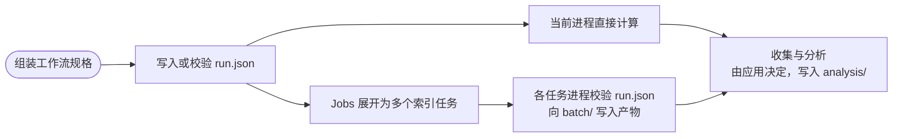

# 运行记录

_位于 `src/raser/supports/runs.py` 的运行标识、记录与选择_

---

## 运行

运行（Run）是一次应用工作流的执行，对应 `<project>/<workflow>/<run_id>/` 下的一个目录，目录中保存一份运行记录 `run.json` 和该次执行的产物。

运行解决三个问题：

1. **产物溯源**：将输出产物绑定到产生它的输入——所引用的各个 Device 及其各自的工作状态、Field 配置与数据哈希，所选组件、计算阶段、任务划分及代码版本。
2. **多任务归属**：将一次执行展开出的多个索引任务归入同一运行目录，各任务校对同一份运行记录并向同一目录写入产物。
3. **后续分析定位**：汇总分析阶段按运行标识、最新运行选择器或明确路径找到对应运行的产物。

## 职责与封装

| 参与方 | 职责 | 暴露与读写边界 |
| --- | --- | --- |
| 应用 | 解析所引用的一个或多个 Device、各自的 Field 以及组件，组装工作流规格；决定执行方式，以及是否在执行后或按单独请求触发收集与分析 | 定义规格内容并交给激活步骤；收集时调用 Runs 定位运行目录，在 `analysis/` 下写出汇总结果 |
| Runs | 读取可选的运行配置；分配运行标识；创建运行目录与 `batch/` 并写入 `run.json`；按标识或条件定位运行目录 | 向应用暴露配置加载、标识分配、记录写入和运行查找接口 |
| Jobs | 将一次运行展开为带同一运行标识与从零开始的索引的命令，在本地并发执行或提交至集群 | 接收应用传入的命令、运行标识与任务数，启动或提交任务进程；详见 [Jobs](jobs.md) |
| 任务进程 | 携带分配的运行标识与任务索引启动，执行单个索引任务并写出批处理产物 | 读取运行目录中已有的 `run.json`，采用记录中的总任务数，校验自身规格与记录一致后向 `batch/` 写入产物 |

## 记录内容

`run.json` 在激活工作流规格时写入，记录四类信息：

- **身份与版本**：所属工作流、运行标识、记录写入时间及代码仓库的提交状态，用于区分运行并追溯软件版本。
- **物理与器件输入**：所引用的每个 Device 及其工作状态、Field 配置与场数据哈希，以及所选各类组件及其完整参数，用于锁定物理输入并在查找最新运行时筛选兼容运行。
- **阶段与输出位置**：工作流声明的计算阶段序列与输出父目录，用于界定工作流结构与产物归属。
- **工作分配**：任务数、随机种子及适用时的单任务事件规模，用于多任务切分与随机数复现。

当目标运行目录下已有 `run.json` 时，激活步骤将当前规格与已有记录比对；任务进程在比对前采用记录中的总任务数。规格一致时复用该运行目录。

## 目录与运行选择

运行目录位于 `<project>/<workflow>/<run_id>/`（产物归属见 [Output](output.md)）：

```text
<project>/<workflow>/<run_id>/
├── run.json
├── batch/
└── analysis/
```

创建运行目录时一同建立 `run.json` 与 `batch/`；包含汇总分析的应用在收集阶段建立 `analysis/`。

定位已有运行目录有三种方式：

- **运行标识**：指定单次运行的标识，定位到所属工作流下的对应运行目录。
- **最新运行选择器**：在所属工作流下扫描已有记录，筛选与目标规格或指定条件一致的运行，选出时间最新且唯一匹配的运行目录；仅用于读取已有运行；创建新运行而未指定标识时分配新标识。
- **明确路径**：直接给出目标运行目录的路径。

## 生命周期



1. **组装与激活**：应用解析所引用的各个 Device 及其 Field、组件与工作分配，生成工作流规格。激活步骤在运行目录下写入新的 `run.json`，或校验已有记录与当前规格一致。
2. **任务执行**：应用根据工作流与调用方式，在当前进程直接完成计算并写出产物，或交由 Jobs 展开为携带同一运行标识的多个索引任务，在本地或集群上执行并向 `batch/` 写入产物。
3. **收集与分析**：包含汇总阶段的应用在本地任务完成后自动收集，或在集群任务完成后按单独请求定位运行目录，读取 `batch/` 产物并在 `analysis/` 下生成分析结果。

## 失败

- 规格组装或参数校验未通过时，在创建运行目录前终止。
- 复用已有运行目录而规格与已记录内容不一致时拒绝执行。
- 查找最新运行无匹配结果或存在多个同时间戳匹配项时报错。
- 运行目录与 `run.json` 一旦创建，后续执行、提交或收集阶段失败时保留已生成的目录与记录。
