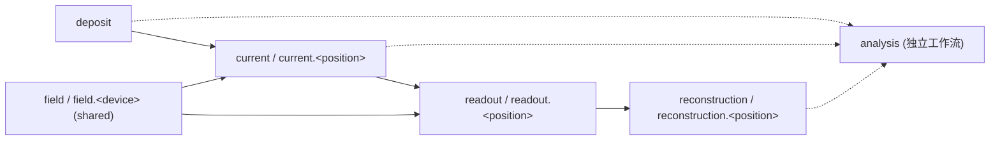

# 仿真链与环节入口（`stages`）

`src/raser/stages/` 位于顶层实验工作流（`bench`、`apps`）和底层物理算法（`core`）之间，将 `core` 的物理计算封装为生命周期切片（`deposit`、`field`、`current`、`readout`、`reconstruction`）、独立工作流（`field`、`analysis`）及环节命令行入口（`raser dep|cur|rdo|reco`）。本页说明切片链的依赖展开、各环节交接的 HDF5 数据文件、环节命令与公共链选项。

## 作业切片链顺序与依赖

`src/raser/stages/chain.py` 的 `expand(devices, deposit)` 构建实验作业的切片序列 `SLICES`。单器件单位置时依次包含 5 个 `Slice`；当 `Workflow.devices` 定义了多个器件时按器件展开 `field.<device>`，当位置总数大于 1 时（单器件多位置仍共用 `field`）按位置展开 `current.<position>`、`readout.<position>` 与 `reconstruction.<position>`：

各切片在 `src/raser/stages/chain.py` 中的定义如下：

| 顺序 | 切片名称（`Slice.name`） | 前置切片（`needs`） | 切片读取的选项键（`keys`） | 组件文件种类（`kinds`） | `new_events` | `shared` |
| --- | --- | --- | --- | --- | --- | --- |
| 1 | `deposit` | `()` | `("source", "g4setup", "events_per_job", "generated_per_job", "generated_limit", "edep_min", "edep_max", "fano")` | `("source", "g4setup")` | `True` | `None` |
| 2 | `field`（多器件为 `field.<device>`） | `()` | `("voltage", "irradiation")`（多器件带 `<device>.` 前缀） | `()` | `True` | `field.SHARED`（多器件为各自器件的共享场接口） |
| 3 | `current`（多位置为 `current.<position>`） | `("deposit", "field")`（多器件时为 `("deposit", "field.<device>")`） | `("plots",)` | `()` | `True` | `None` |
| 4 | `readout`（多位置为 `readout.<position>`） | `("current", "field")`（单器件多位置为 `("current.<position>", "field")`，多器件时场片为 `field.<device>`） | `("amplifier", "sheet_resistance")` | `()` | `False` | `None` |
| 5 | `reconstruction`（多位置为 `reconstruction.<position>`） | `("readout",)`（或 `("readout.<position>",)`） | `("threshold", "amplitude_threshold", "fractions", "edge")` | `()` | `False` | `None` |

## 作业切片数据文件路径与格式

在持有该片的扫描点目录的 `batch/` 下（有种子工作流为 `<持有点>/<种子目录>/batch/`，无种子工作流为 `<持有点>/batch/`；路径由 `src/raser/stages/files.py` 的 `output(kwargs, name)` 生成，未传 `job_index` 时 `<job>` 取 `0`），作业 `<job>`（整数索引，从 `0` 开始）的各切片读写以下文件：

| 文件名 | 写入切片 | 读取环节 | HDF5 属性（`attrs`）与单位 | HDF5 数据集（`datasets`）与单位 |
| --- | --- | --- | --- | --- |
| `deposit_<job>.h5` | [`deposit`](deposit.md) | [`current`](current.md)、[`analysis`](analysis.md)（`timing.py` 读取最早沉积时间作为 `truth`） | `generated_events`、`recorded_events`、`generated_fraction`、`edep_min` [MeV]（若设置）、`edep_max` [MeV]（若设置） | 按事例（长度 `recorded_events`）：`event`（int64）、`count`（int64）；按沉积步（长度 `sum(count)`）：`detector`（string）、`x`、`y`、`z` [um]（标准 Geant4 链为步中点局部坐标，`cflm` 为步起点局部坐标）、`x_start`、`y_start`、`z_start` [um]（步起点，若有）、`t` [s]、`t_fwhm` [s]（若有）、`e` [MeV]、`pairs`（float64，电子-空穴对数） |
| `current_<job>.h5`（多位置为 `current.<position>_<job>.h5`） | [`current`](current.md) | [`readout`](readout.md)、[`analysis`](analysis.md)（仅读取无位置后缀的 `current_<job>.h5`，`collection.py` 读取 `charge` 与 `pairs` 计算电荷收集效率） | `electrodes`（string 数组，电极名列表）、`dt` [s]（时间步宽） | 按事例：`event`（int64）、`t0` [s]（首个时间 bin 左边界）、`count`（int64，时间 bin 数）、`pairs`（倍增前电子-空穴对数）、`sensitive_pairs`（非导电区产生的可漂移对数，场漂移时写出）、`carriers_without_field`（停在无场区的载流子数，场漂移时写出）、`charge` [C]（形状 `(events, electrodes)`，各电极净感应电荷）、`stored`（int64，非零电流电极数）；按存储电极：`index`（int64，从 `0` 开始的电极列号）；按时间 bin：`current` [A]（一维展平数组，每个存储电极连续 `count` 个点） |
| `readout_<job>.h5`（多位置为 `readout.<position>_<job>.h5`） | [`readout`](readout.md) | [`reconstruction`](reconstruction.md) | `electrodes`（string 数组，全部可能输出的电极名）、`dt` [s]（时间步宽）、`pulse_edge`（string 数组，每个电极为 `"rising"` 或 `"falling"`）、`device_circuit`（JSON 字符串，器件等效电路元件值及来源） | 按事例：`event`（int64）、`t0` [s]、`count`（int64，每条波形采样点数）、`stored`（int64，该事例存储的电极数）；按存储电极：`index`（int64，电极下标）；按采样点：`voltage` [V]（一维展平数组，每个存储电极连续 `count` 个时间 bin 中心电压） |
| `reconstruction_<job>.h5`（多位置为 `reconstruction.<position>_<job>.h5`） | [`reconstruction`](reconstruction.md) | [`analysis`](analysis.md)（仅读取无位置后缀的 `reconstruction_<job>.h5`） | `electrodes`（string 数组）、`threshold` [V]（时间与面积阈值）、`amplitude_threshold` [V]（事例选中阈值）、`fractions`（float64 数组，CFD 分数）、`edge`（string 数组，各电极定时沿 `"rising"` 或 `"falling"`） | 按事例（一维）：`event`（int64）、`selected`（bool）、`cluster_size`（int64）、`cluster_center`（float64，以电极序号为单位）；按事例与电极（二维 `(events, electrodes)`）：`traced`（bool）、`baseline` [V]、`noise` [V]、`amplitude` [V]、`above`（bool）、`ToA` [s]、`ToT` [s]、`CoG` [s]、`area` [V s]；按事例、电极与恒比分数（三维 `(events, electrodes, fractions)`）：`CFD` [s] |

## 示例中的切片链路（`HPK-Si-PiN`）

在 [快速入门](../getting-started.md) 的示例中，运行 `raser signal HPK-Si-PiN --scan voltage=100,200 -s 2 -evt 200 --seed 1` 后，每个扫描点的 `0`、`1` 两个作业依次跑通上述 5 个切片：

1. **共享场补算**：程序检测到 `100 V` 与 `200 V` 的场未就绪，先行调用 `raser field HPK-Si-PiN -bias 100.0` 与 `200.0` 求解电势、权重场、IV/CV 与一维未耗尽层参数，写入 `work/HPK-Si-PiN/field/`。
2. **切片数据交接（以 `200 V` 默认点 `seed_1/batch/` 作业 `0` 为例）**：
   - [`deposit_0.h5`](deposit.md)：Geant4 生成 `7359` 个事例、记录 `200` 个有效事例（`5476` 条沉积步）。
   - [`current_0.h5`](current.md)：`dt = 5e-12 s`、`electrodes = ['top']`，对 `200` 个事例写出 `charge` `(200, 1)` 与 `current` `(245196,)`，并为前 `100` 个事例绘图。
   - [`readout_0.h5`](readout.md)：采用器件电容 `3.44162280284e-12 F` 与 `SantaCruz+Gali52+Termination50` 链写出 `pulse_edge = ['falling']` 及 `voltage` `(245196,)`。
   - [`reconstruction_0.h5`](reconstruction.md)：按 `threshold = 0.01 V`、`amplitude_threshold = 0.01 V` 写出 `200` 个事例的特征表与 9 通道 `CFD` `(200, 1, 9)`。
3. **汇总分析**：随后运行 `raser analysis work/HPK-Si-PiN/signal`，跨 `100 V` 与 `200 V` 汇总所有已完成作业的 `deposit`、`current`、`reconstruction` 文件，写出 `work/HPK-Si-PiN/signal/analysis/result.json` 与 `points.json`。

## 环节命令（`raser dep|cur|rdo|reco`）

`raser deposit|current|readout|reconstruction <target>`（短命令 `dep|cur|rdo|reco`，定义于 `src/raser/stages/stage_commands.py`）：

- 当 `<target>` 是含 `config.json` 的实验文件夹时，读取其中的 `workflow` 与 `device`，切换至该实验所属的工程根目录与工作流对应的组件搜索路径，传入 `until=<stage>` 执行，仅运行该环节切片及其通过 `Slice.needs` 传递依赖的前置切片。对于含多位置的实验（如 `cflm`），指定 `current` 会运行 `deposit`、`field` 以及全部 24 个 `current.<pad>` 切片。
- 当 `<target>` 是器件名时，自动以 `work/<device>/signal`（`workflow="signal"`）作为目标实验目录运行到指定环节；若该实验目录尚不存在则以默认参数创建。

| 选项 | 默认值 | 单位 | 含义 |
| --- | --- | --- | --- |
| `target`（位置参数） | 必填 | 无 | 实验文件夹路径（读取其 `config.json`），或器件名（对应 `work/<device>/signal`） |

## 仿真链公共选项

`signal`、`cce`、`timeres`、`bmos` 挂载全部 4 组命令行选项；`deposit`（`dep`）、`current`（`cur`）、`readout`（`rdo`）、`reconstruction`（`reco`）按阶段依次累积挂载从 `deposit` 到自身阶段的选项；`cflm` 挂载其中的 `--plots`、`-vol`、`-irr`、`-amp`、`--sheet-resistance` 与重建选项。其中 `fano` 与 `fractions` 两个链选项键无独立命令行参数（`fano` 可在 `config.json` 的 `"set"` 中配置或通过 `--set` / `--scan` 指定；`fractions` 可在 `config.json` 的 `"set"` 中配置数值列表，命令行 `--set` / `--scan` 仅支持单个标量文件夹名字符或逗号分隔扫描值）：

| 所属阶段 | 选项 / 键名 | 默认值（`chain.DEFAULTS` 或 CLI 解析器） | 实验覆盖默认值 | 单位 | 含义 |
| --- | --- | --- | --- | --- | --- |
| `deposit` | `source`（可选位置参数） | `"decay/Sr90"` | `bmos`: `"bunch"` | 无 | 粒子源或束流组件名称（或 JSON 路径） |
| `deposit` | `--g4setup` | `"device_alone"` | `cce`: `"charge_collection"`；`timeres`: `"time_resolution"` | 无 | Geant4 几何环境脚本名称（或 `.py` 路径） |
| `deposit` | `-evt`, `--events-per-job` | `1` | `cce`: `10000`；`timeres`: `10000` | 事例数 | 每个作业记录的有效沉积事例数（与 `-gen` 互斥） |
| `deposit` | `-gen`, `--generated-per-job` | `None` | 无 | 事例数 | 每个作业由粒子源产生的总事例数（替代 `-evt`） |
| `deposit` | `--generated-limit` | `None`（运行时取 `10000000`） | 无 | 事例数 | 为记录 `-evt` 个有效事例，单个作业最多产生的源事例数上限 |
| `deposit` | `--edep-min` | `None` | 无 | MeV | 器件内记录事例所需的最小总沉积能量 |
| `deposit` | `--edep-max` | `None` | 无 | MeV | 器件内记录事例所需的最大总沉积能量 |
| `deposit` | `fano`（无独立 CLI 参数，经 `config.json` `"set"` 或 `--set` / `--scan`） | `True` | 无 | 无 | 电离产生电子-空穴对数是否开启 Fano 涨落抽样 |
| `deposit` | `-g4_vis` | `False`（CLI 默认值） | 无 | 无 | 开启 Geant4 几何与径迹可视化，绘制后直接结束作业 |
| `deposit` | `--g4-vis-driver` | `"OGL"`（CLI 默认值） | 无 | 无 | `-g4_vis` 使用的 Geant4 可视化驱动（为 `TSG`、`TSG_FILE`、`TSG_OFFSCREEN`（忽略大小写）或以 `OGL` 开头时写出 `g4_geometry` 图像） |
| `current` | `--plots` | `100` | `cce`、`timeres`、`bmos`、`cflm`: `0` | 事例数 | 绘制每个作业前 N 个记录事例的载流子漂移路径与电极电流图 |
| `current` | `-vol`, `--voltage` | `None`（取 `device.bias.voltage`） | 无 | V | 器件偏置电压（映射至 `device.bias.voltage`） |
| `current` | `-irr`, `--irradiation` | `None`（取器件 `irradiation.irradiation_flux`，无则为 `0`） | 无 | n$_{\text{eq}}$/cm$^2$ | 辐照注量 |
| `readout` | `-amp`, `--amplifier` | `"SantaCruz+Gali52+Termination50"` | 无 | 无 | 读出放大器与端接电路链名称（以 `+` 连接） |
| `readout` | `--sheet-resistance` | `None` | 无 | Ohm | 阻性层方阻（替代器件文件中的值；仅含 `resistive_layer` 的器件可用） |
| `reconstruction` | `-threshold` | `10.0` | 无 | mV | 到达时间（`ToA`）、过阈时间（`ToT`）、重心时间（`CoG`）及邻近电极入簇的脉冲过阈阈值 |
| `reconstruction` | `-amplitude_threshold` | `10.0` | 无 | mV | 事例选中（`selected`）及种子电极入簇的脉冲幅度阈值 |
| `reconstruction` | `fractions`（无独立 CLI 参数，经 `config.json` `"set"` 配置列表） | `[0.1, 0.2, 0.3, 0.4, 0.5, 0.6, 0.7, 0.8, 0.9]` | 无 | 无 | 恒比定时（`CFD`）的幅度比例列表 |
| `reconstruction` | `--edge` | `None`（取 `readout` 写入的 `pulse_edge`） | 无 | 无 | 阈值作用的脉冲沿，可选 `"rising"` 或 `"falling"` |

## 常见报错

| 报错信息 | 触发条件 |
| --- | --- |
| ``FileNotFoundError: no field of <det_name> ready for this run: solve it with `raser field <det_name>` `` | 作业执行 `field` 切片时未找到满足当前偏压与辐照注量的已求解场 |
| `SystemExit: <target>: neither an experiment folder (a folder with a config.json) nor a device; give one of them, e.g. work/<device>/cce or HPK-Si-PiN` | 传给 `raser dep|cur|rdo|reco` 的 `target` 既非含 `config.json` 的实验文件夹，也未能找到对应器件文件（仅捕获 `FileNotFoundError`；若目标存在但不是可读器件文件，原异常继续抛出） |
| `SystemExit: <folder>: the experiment <workflow> has no <stage> slice; its slices: <names>` | 在某个实验目录上调用了该实验工作流未包含的环节命令（例如在只有 `current` 和 `readout` 切片的 `tct` 实验上运行 `raser deposit`） |

## 相关页面

- [快速入门](../getting-started.md)
- [../architecture.md](../architecture.md)
- [../cli.md](../cli.md)
- [../lifecycle/experiments.md](../lifecycle/experiments.md)
- [../lifecycle/slices.md](../lifecycle/slices.md)
- [field.md](field.md)
- [deposit.md](deposit.md)
- [current.md](current.md)
- [readout.md](readout.md)
- [reconstruction.md](reconstruction.md)
- [analysis.md](analysis.md)
- [../supports/README.md](../supports/README.md)
