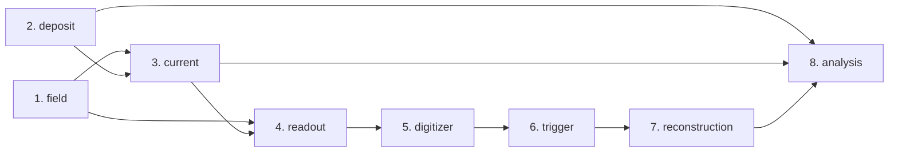

# 仿真链与环节入口（`stages`）

`src/raser/stages/` 承接[命令行接口（`raser`）](../cli.md)分发的环节命令，以及测试、应用的整链运行。仿真链由八个环节组成，依次是 `field`、`deposit`、`current`、`readout`、`digitizer`、`trigger`、`reconstruction`、`analysis`，地位相同。每个环节本身是完整的工作流，可以单独跑，也可以从后往前拼起来跑。本包把链组装起来，为每个环节注册命令和选项，把环节命令的路径解析成实验文件夹，并把运行截到目标环节。每个环节在一组输入下算出的结果是一个节点，存在实验文件夹的 `nodes/<环节>/<节点号>/` 下，由视图 `points/<点名>/<环节>/<作业号>` 指向（`deposit` 到 `reconstruction` 每个作业一个节点，`field`、`analysis` 每个扫描点一个）；器件的场节点存在 `<器件 project>/field/<节点号>/` 下，被这块器件的各个实验共用。节点、参数表 `points.json` 与复用交给[片与重跑](../lifecycle/slices.md)，配置与扫描点交给[实验、扫描点与种子](../lifecycle/experiments.md)，作业交给[作业与集群](../lifecycle/jobs.md)。各环节分别是[场求解环节（`stages/field`）](field.md)、[能量沉积环节（`stages/deposit`）](deposit.md)、[载流子输运与感应电流环节（`stages/current`）](current.md)、[电子学读出环节（`stages/readout`）](readout.md)、[数字化环节（`stages/digitizer`）](digitizer.md)、[触发环节（`stages/trigger`）](trigger.md)、[事件重建环节（`stages/reconstruction`）](reconstruction.md)和[统计分析环节（`stages/analysis`）](analysis.md)。

## 行为

### 链



| 环节 | 命令 | 读哪几个环节的节点 | 做什么 |
| --- | --- | --- | --- |
| `field` | `raser field`（`fld`） | 无 | 算器件里的电场、权重场、IV/CV |
| `deposit` | `raser deposit`（`dep`） | 无 | 用 Geant4 算粒子沉积的能量 |
| `current` | `raser current`（`cur`） | `field`、`deposit` | 让载流子在场中漂移，算电极上的感应电流 |
| `readout` | `raser readout`（`rdo`） | `field`、`current` | 把电流送进器件等效电路和前端放大器，得到波形 |
| `digitizer` | `raser digitizer`（`digi`） | `readout` | 按示波器或数字化板的采样和量化把波形变成数字波形 |
| `trigger` | `raser trigger`（`trig`） | `digitizer` | 按真实触发设备的条件决定记录哪些事例 |
| `reconstruction` | `raser reconstruction`（`reco`） | `trigger` | 从波形里取击中时间和幅度，束流测试里做径迹拟合 |
| `analysis` | `raser analysis`（`ana`） | `deposit`、`current`、`reconstruction` | 统计效率、时间分辨，在 `<实验>/analysis/` 下出趋势图 |

`readout` 从 `field` 取器件的等效电路。`analysis` 对整个实验的结果负责：每个扫描点有自己的结果，跨点的统计和趋势图直接放在 `<实验>/analysis/` 下。其余每个环节的图放在这个环节自己的节点里。

实验有多个器件时，每个器件各有自己的场；实验有多个位置时（例如 `cflm` 的 `1` 个器件 `24` 个位置），每个位置各跑一遍 `current` 及其下游，读的是同一份沉积和对应器件的场。`deposit` 只跑一份（`cflm` 用自己的沉积计算替换它）。

### 整链运行

在 `HPK-Si-PiN`（默认偏压 `200 V`）上扫两个偏压，每点跑 `2` 个作业，每个作业记录 `200` 个事例：

```bash
raser signal HPK-Si-PiN --scan field.voltage=100,200 -s 2 --set deposit.events_per_job=200 --seed 1
```

`work/` 下没有 `HPK-Si-PiN` 时，命令在示例 project `examples/HPK-Si-PiN/` 上就地运行。它先补算 `100 V` 和 `200 V` 的场，存进 `examples/HPK-Si-PiN/field/`；再在 `points/voltage_100/` 和 `points/voltage_200/` 两个扫描点上按链的顺序跑各环节，每个作业在每个环节的节点写进 `examples/HPK-Si-PiN/signal/nodes/<环节>/<节点号>/`。`200 V` 点作业 `0` 的结果：

- **`deposit`**：Geant4 生成 `7359` 个事例，记录 `200` 个有效事例（`5476` 条沉积步）。
- **`current`**：`dt = 5e-12 s`，`electrodes = ['top']`；`200` 个事例的 `charge` 形状 `(200, 1)`，`current` 形状 `(245196,)`；前 `100` 个事例画图。
- **`readout`**：用器件电容 `3.44162280284e-12 F` 与 `SantaCruz+Gali52+Termination50`，写出 `pulse_edge = ['falling']` 和 `voltage`，形状 `(245196,)`。
- **`digitizer`**：按 `MXR608A` 的采样率、带宽和量程把 `200` 个事例的波形采样、量化，写出 `digitizer.h5`。
- **`trigger`**：按幅度阈值判断，把越过阈值的事例号写进 `trigger.h5`，只有它们进入 `reconstruction`。
- **`reconstruction`**：按 `threshold = 0.01 V`、`amplitude_threshold = 0.01 V` 写出被记录事例的特征表，`CFD` 形状 `(<被记录事例数>, 1, 9)`（`9` 档恒比分数）。
- **`analysis`**：汇总两个扫描点全部已完成的作业，每个点写一个 `analysis` 节点（内有 `result.json`），在 `examples/HPK-Si-PiN/signal/analysis/` 下写出跨点的统计和趋势图。

换偏压是重新测，两个点的 `deposit`、`current` 各测各的；下游各环节的指纹含上游节点号，也各有各的节点。

### 环节命令

每个环节命令都在当前文件夹或给定路径的实验上跑到这个环节，缺的上游自动补上：

```bash
raser <环节> [路径]
```

不给路径就是当前文件夹，给了就是相对或绝对路径。命令读实验文件夹的 `config.json`，找到这个实验属于哪个测试或应用、用哪块器件，再在该实验的 project 和组件搜索路径下运行。例如在已有实验上只跑到 `readout`：

```bash
raser readout examples/HPK-Si-PiN/signal
```

运行只包含目标环节和它直接、间接读到的上游环节。上游节点指纹相同就复用，不管它是在哪个点、哪次运行里算出来的；缺的按链的顺序先算，所需的场在作业开始前补算。多位置实验上，环节命令跑完这一环节的全部位置：例如在 `cflm` 上运行 `raser current`，会跑完 `deposit`、`field` 和全部 `24` 个位置的 `current`。实验类里没有这个环节时，命令报错退出，并列出这个实验有哪些环节。

`field` 没有上游，`raser field [路径]` 就是只算这个实验各器件、各扫描点要用的场。`raser <环节> --draw <对象>` 画本环节的对象，例如 `readout` 画原理图和冲击响应，`field` 画网格和网格节点上的掺杂。

### 节点、视图与复用

每个环节节点的输入有四样：本环节用到的设置值、组件文件里它用到的那一部分、上游各节点的节点号、测量环节（`deposit`、`current`）的种子，以及 `readout`（NGspice 噪声）、`digitizer`（时钟相位、孔径抖动）自己的种子。指纹由这些输入算出，指纹就是节点号。节点文件夹里有本环节写出的文件和 `node.json`；`node.json` 把输入原样记下来，另记代码版本、运行环境和运行状态。

- **复用**：指纹相同就复用。扫描只影响下游的设置时，上游节点在各点之间共用。节点只增不减：把设置改回去，视图重新指回原来的节点，直接复用。
- **过期**：代码版本和节点记录的不一致时，只给一条提示，结果照常复用。
- **加锁**：每个节点单独加锁。写到一半的节点带 `.part` 后缀，写完才改成正式的名字。

## 规则

### 环节命令的执行

`chain.py` 按以下步骤运行一个环节命令：

1. **解析实验**：读实验文件夹的 `config.json`，取出实验名和器件名。
2. **校验环节**：实验里没有目标环节时报错退出，并列出实验有哪些环节。
3. **截断运行**：把目标环节交给执行器，执行器只运行目标环节和它的全部上游。
4. **进入实验**：按实验所属命令设好 project 根目录和组件搜索路径（见[公共基础设施（`supports`）](../supports/README.md)的 `project_root_context`），切到实验文件夹下运行，结束后切回原目录。
5. **集群续跑**：命令行里的实验路径改写成绝对路径。集群上的作业从实验文件夹重新运行原命令时，按这个绝对路径找到同一个实验。

### 环节的运行回调

每个环节一个模块，`field` 是第 1 个环节，和其余七个一样注册命令、提供运行回调。回调在运行时才导入对应模块，Geant4、ROOT 等重依赖到环节运行时才载入：

| 环节 | 模块 | 作业里做什么 |
| --- | --- | --- |
| `field` | `raser.stages.field` | 取这个点要用的场节点；缺的场在作业开始前已经补算好 |
| `deposit` | `raser.stages.deposit` | 写这个作业的沉积节点 |
| `current` | `raser.stages.current` | 写这个作业的电流节点 |
| `readout` | `raser.stages.readout` | 写这个作业的波形节点 |
| `digitizer` | `raser.stages.digitizer` | 写这个作业的数字波形节点 |
| `trigger` | `raser.stages.trigger` | 写这个作业被记录的事例 |
| `reconstruction` | `raser.stages.reconstruction` | 写这个作业的特征表 |
| `analysis` | `raser.stages.analysis` | 汇总这个点各作业的节点，写这个点的 `analysis` 节点 |

开启 `-g4_vis` 时，`chain.job_command` 把 `-g4_vis` 和 `--g4-vis-driver <驱动>` 加到每个作业的命令里，子进程照样打开 Geant4 可视化。

## 软件实现

### 源文件分工

- `src/raser/stages/__init__.py`：`raser.stages` 包入口。
- `src/raser/stages/chain.py`：把八个环节组装成链，组件种类映射，环节命令共用的实验解析与截断运行，以及 `-g4_vis` 的转发 `job_command`。
- 各环节的模块与子包：`field/`、`deposit.py`、`current.py`、`readout.py`、`digitizer.py`、`trigger.py`、`reconstruction.py`、`analysis/`。每个模块注册自己的命令和选项，并提供运行回调。

## 接口

### 设置

`config.json` 按八个环节分段，链上的设置按下表归段。用 `--set <段>.<键>=<值>` 改一个设置，用 `--scan <段>.<键>=<值1>,<值2>` 扫描（只有 `field`、`deposit`、`current`、`readout` 四段的设置能扫描，其余四段是分析参数，只用 `--set` 改）；公共运行参数（`-s`、`--seed`、`--same-seeds`、`--set`、`--scan`、`--dry-run`）见[命令行接口（`raser`）](../cli.md)。`digitizer`、`trigger` 段的设置见各自的页面。代码不留默认值：表里“示例里的值”是 `examples/HPK-Si-PiN/signal/config.json` 写的值，括号里是别的示例写的不同值；`config.json` 缺了要用的键时报错，指出缺的“段.键”，例如 `ValueError: examples/HPK-Si-PiN/signal/config.json has no deposit.generated_limit`；用不到的键（例如 `deposit.generated_per_job` 为 `null` 时）缺了不报错。

| 段.键 | 示例里的值 | 单位 | 含义 |
| --- | --- | --- | --- |
| `field.voltage` | `200.0`（写 `null` 时取器件文件里的偏压） | $\text{V}$ | 器件偏置电压，决定所用的场 |
| `field.irradiation_flux` | `null`（取器件文件里的辐照注量，器件文件没有辐照块时为 `0`） | $\text{cm}^{-2}$ | 器件辐照注量（$1\ \text{MeV}$ 中子等效注量），决定所用的场 |
| `deposit.g4setup` | `"device_alone"`（`timeres` 示例为 `"time_resolution"`） | 无 | Geant4 装置组件名；装置的 `source` 块写明它用的源 |
| `deposit.g4setup.source` | `"decay/Sr90"`（`bmos` 示例为 `"bunch"`） | 无 | 整套换源：放射源、束流或直线 MIP 组件名；装置里的 `angle` 沿用 |
| `deposit.events_per_job` | `200`（`timeres` 示例为 `10000`，`telescope` 示例为 `1000`） | 事例/作业 | 每个作业要记录的有效沉积事例数 |
| `deposit.generated_per_job` | `null`（不用） | 事例/作业 | 每个作业固定生成的初级事例数，代替按记录事例数生成 |
| `deposit.generated_limit` | `10000000` | 事例/作业 | 按记录事例数生成时，单作业最多生成的初级事例数 |
| `deposit.edep_min` | `null`（不设下限） | $\text{MeV}$ | 单事例在器件内总沉积能量的记录下限 |
| `deposit.edep_max` | `null`（不设上限） | $\text{MeV}$ | 单事例在器件内总沉积能量的记录上限 |
| `deposit.fano` | `true` | 无 | 电离产生电子-空穴对时是否做 Fano 涨落抽样 |
| `deposit.plots` | `100`（`timeres`、`bmos`、`cflm` 示例为 `0`） | 事例/作业 | 每个作业 `deposit` 画 Geant4 几何和前若干个记录事例的径迹（$\le 0$ 不画） |
| `current.plots` | `100`（`timeres`、`bmos`、`cflm` 示例为 `0`） | 事例/作业 | 每个作业 `current` 画前若干个记录事例的漂移路径和电流图（$\le 0$ 不画） |
| `readout.amplifier` | `"SantaCruz+Gali52+Termination50"` | 无 | 用 `+` 串起的前端放大器级与末级负载 SPICE 组件名 |
| `readout.sheet_resistance` | `null`（取器件文件里阻性层的方块电阻） | $\Omega$ | 覆写阻性层（AC-LGAD）方块电阻；器件没有阻性层时给非 `null` 值抛 `ValueError` |
| `reconstruction.threshold` | `10.0` | $\text{mV}$ | 取过阈时间（`ToA`、`ToT`、`CoG`）、主瓣面积（`area`）和团簇邻近通道的阈值 |
| `reconstruction.amplitude_threshold` | `10.0` | $\text{mV}$ | 团簇种子通道的幅度阈值；被 `trigger` 记录的事例里找到种子的记为选中（`selected`），`analysis` 的时间统计用选中事例 |
| `reconstruction.fractions` | `[0.1, 0.2, 0.3, 0.4, 0.5, 0.6, 0.7, 0.8, 0.9]` | 无 | 恒比定时（`CFD`）的幅度比例 |
| `reconstruction.edge` | `null`（沿用 `readout` 写出的 `pulse_edge`） | 无 | 阈值所在的脉冲边沿，取 `"rising"` 或 `"falling"` |

两个命令行开关只在命令行给出：`-g4_vis` 打开 Geant4 几何与径迹可视化（或离屏导出几何图）后退出作业，默认关；`--g4-vis-driver` 是它用的可视化驱动，默认 `"TSG_QT_GLES"`。

### 读写的文件

- **`<实验>/config.json`**：这次运行用的全部设置，按八个环节分段，由环节命令读取。
- **`<实验>/points.json`**：参数表，一行一个扫描点，写着各扫描轴的取值和每个环节用的节点号，每次运行时从 `config.json` 算出。
- **`<实验>/nodes/<环节>/<节点号>/`**：一个环节节点，内有这一环节写出的文件和 `node.json`。
- **`<实验>/points/<点名>/<环节>/<作业号>`**：指向这个作业在这一环节的节点的软链接；`points/<点名>/field`、`points/<点名>/analysis` 各是一个软链接。点名按扫描轴的取值起，例如 `voltage_100`。
- **`work/<器件>/field/<节点号>/`**：器件的场节点，格式见[场求解与加载（`core/field`）](../core/field.md)。
- **`deposit` 节点的沉积文件 `deposit.h5`**：能量沉积步与电子-空穴对；记录事例数为 `0` 时仍写出，并抛出 `Ended` 结束作业。属性有 `generated_events`、`recorded_events`、`emission_probability`（没有出射分布的源为 `1.0`），以及可选的 `edep_min`、`edep_max`（$\text{MeV}$）；数据集按事例存 `event`、`count`，按沉积步存 `detector`、`x`/`y`/`z`（$\mu\text{m}$，可选起点 `x_start`/`y_start`/`z_start`）、`t`（$\text{s}$，可选 `t_fwhm`）、`e`（$\text{MeV}$）、`pairs`（对）。形状、类型和单位见[能量沉积与电离（`core/deposit`）](../core/deposit.md)。
- **`current` 节点的电流文件 `current.h5`**：各读出电极的时域感应电流与净感应电荷；多位置实验里每个位置一个文件 `current.<位置>.h5`，放在同一个作业的节点里，某位置有沉积时才写。属性有 `electrodes`、`dt`（$\text{s}$）；数据集按事例存 `event`、`t0`（$\text{s}$）、`count`、`pairs`（对）、场漂移时另存 `sensitive_pairs`（对）与 `carriers_without_field`（个）、`charge`（$\text{C}$）、`stored`，按存储电极存 `index`，按时间箱展平存非零电流电极的 `current`（$\text{A}$）。见[载流子漂移与感应电流（`core/current`）](../core/current.md)。
- **`readout` 节点的波形文件 `readout.h5`**：经器件等效电路和前端放大器链求解后的输出电压波形；多位置实验里是 `readout.<位置>.h5`，有对应电流文件时才写。属性有 `electrodes`、`dt`（$\text{s}$）、`pulse_edge`（各电极 `"rising"` 或 `"falling"`）、`device_circuit`（JSON 字符串）；数据集按事例存 `event`、`t0`（$\text{s}$）、`count`、`stored`，按存储电极存 `index`，按采样点展平存 `voltage`（$\text{V}$）。见[电子学读出（`core/readout`）](../core/readout.md)。
- **`digitizer`、`trigger` 节点**：数字波形与被记录的事例，见[数字化环节（`stages/digitizer`）](digitizer.md)和[触发环节（`stages/trigger`）](trigger.md)。
- **`reconstruction` 节点的特征表 `reconstruction.h5`**：逐事例波形特征；多位置实验里是 `reconstruction.<位置>.h5`，有对应输入时才写。属性有 `electrodes`、`threshold`（$\text{V}$）、`amplitude_threshold`（$\text{V}$）、`fractions`、`edge`；数据集按事例存 `event`、`selected`、`cluster_size`、`cluster_center`，按事例与电极存 `traced`、`baseline`（$\text{V}$）、`noise`（$\text{V}$）、`amplitude`（$\text{V}$）、`above`、`ToA`（$\text{s}$）、`ToT`（$\text{s}$）、`CoG`（$\text{s}$）、`area`（$\text{V}\cdot\text{s}$），按事例、电极与恒比分数存 `CFD`（$\text{s}$）。见[事件重建（`core/reconstruction`）](../core/reconstruction.md)。
- **各环节的图**：`plots > 0` 时，`deposit` 和 `current` 把图写进各自的节点。
- **`analysis` 节点**：每个扫描点一个，内有 `result.json`、`events.h5` 和单点的图，见[统计分析环节（`stages/analysis`）](analysis.md)。
- **`<实验>/analysis/`**：`analysis` 写出的跨点统计和趋势图。
