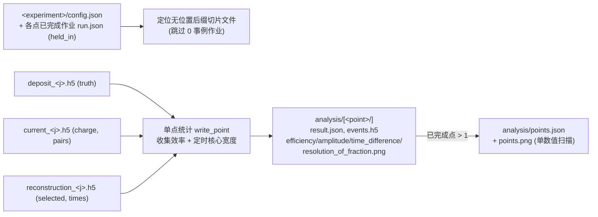

# 统计分析环节（`stages/analysis`）

`src/raser/stages/analysis/` 是独立于作业切片链之外的单作业统计分析工作流，命令行入口为 `raser analysis <experiment>`（短别名 `raser ana <experiment>`）。它读取被分析实验各扫描点已完成作业的 [`deposit`](deposit.md)、[`current`](current.md) 与 [`reconstruction`](reconstruction.md) 文件，调用 [../core/analysis.md](../core/analysis.md) 计算电荷收集效率与脉冲时间分辨，并将单点汇总和跨扫描点对比结果写入 `<experiment>/analysis/`。



## 输入（读什么）

- **实验配置与已完成作业清单**：从 `<experiment>/config.json` 读取原实验工作流（用于绑定对应的组件搜索路径与工程根目录），收集各扫描点中未过期且存在 `batch/job_<index>.done` 的全部作业，再依据各运行目录 `run.json` 中的 `"held_in"` 定位各切片实际所在的目录（记录事例数为 `0` 的作业自动跳过）。
- **三类切片 HDF5 文件**（仅汇总无位置后缀的单位置文件）：
  - **`batch/reconstruction_<index>.h5`**（见 [reconstruction.md](reconstruction.md)）：读取属性 `threshold`、`amplitude_threshold`、`fractions`、`edge`（同一扫描点内所有作业的重建参数须一致）以及各事例的 `event`、`selected`、`ToA`、`ToT`、`CoG`、`CFD`、`amplitude`、`baseline`、`noise`。
  - **`batch/current_<index>.h5`**（见 [current.md](current.md)）：读取各事例的 `event`、`charge`（各电极净感应电荷，单位 `C`）与 `pairs`（初始电子-空穴对数），并与重建表核对事例号集合完全一致。
  - **`batch/deposit_<index>.h5`**（见 [deposit.md](deposit.md)）：读取每个事例全部沉积步的时刻数组 `t`（`s`），取最早沉积时刻作为时间分辨参考真值 `truth`（`s`）。

## 输出（写什么）

### 示例中的输出（`HPK-Si-PiN`）

在 [快速入门](../getting-started.md) 的示例中，运行 `raser analysis work/HPK-Si-PiN/signal` 后，命令汇总了 `100 V` 与 `200 V` 两个偏压点（每点 `2` 个作业、共 `400` 个记录事例）：

1. **目录落点**：与信号仿真目录采用相同的扫描点命名规则，器件默认偏压 `200 V` 的分析结果直接写入 `work/HPK-Si-PiN/signal/analysis/` 根下，`100 V` 写入 `work/HPK-Si-PiN/signal/analysis/voltage_100/`；多点对比文件 `points.json` 与 `points.png` 写入 `analysis/` 根目录。
2. **单点统计结果 `result.json`**：
   - **`200 V`（`analysis/result.json`）**：全部 `400` 个事例的电荷收集效率 `mean = 0.9348`（`0.9347645480767679`、`mean_error = 0.007225`、`spread = 0.1445`）；超出 `10 mV` 幅度阈值的选中事例共 `276` 个（`polarity = -1.0`），其中 `ToA` 经 `5` 轮迭代在窗口内保留 `241` 个事例得 `sigma = 123.99 ps`（`1.2399e-10 s`）、`sigma68 = 123.69 ps`，`CFD30` 得 `sigma = 33.35 ps`、`sigma68 = 31.66 ps`。
   - **`100 V`（`analysis/voltage_100/result.json`）**：`400` 个事例的收集效率 `mean = 0.9195`（`0.9194852059626839`、`mean_error = 0.008746`、`spread = 0.1749`），选中事例 `257` 个（`CFD30` 的 `sigma = 43.58 ps`、`sigma68 = 38.87 ps`）。
3. **多点对比文件 `analysis/points.json`（节选）**：

   ```json
   [
    {
     "point": "voltage_100",
     "voltage": 100,
     "events": 400,
     "efficiency": 0.9194852059626839,
     "efficiency_error": 0.00874583566620318,
     "selected": 257,
     "ToA": {
      "sigma68": 1.4373747887851763e-10,
      "sigma": 1.4600067149809272e-10,
      "sigma_error": 1.0200597423600211e-11
     }
    },
    {
     "point": "",
     "voltage": 200,
     "events": 400,
     "efficiency": 0.9347645480767679,
     "efficiency_error": 0.007224687825783201,
     "selected": 276,
     "ToA": {
      "sigma68": 1.2368887903341034e-10,
      "sigma": 1.2399174526244709e-10,
      "sigma_error": 9.047206914503263e-12
     }
    }
   ]
   ```


`200 V` 下 `400` 个记录事例的电荷收集效率分布直方图，虚线标出平均收集效率 `0.9348`。


`200 V` 下幅度达到或超过 `10 mV` 阈值的 `276` 个选中事例脉冲幅度分布直方图，虚线标出幅度阈值。


`200 V` 下 `ToA`、`CoG` 与 `CFD10`–`CFD90` 相对 `truth` 的时间差分布、拟合窗口阴影与截断高斯拟合曲线。


`100 V` 与 `200 V` 两个偏压点的电荷收集效率（左）与各 `CFD` 通道时间分辨（右）对比图。

### 输出文件与数据字段清单

每个扫描点目录 `<experiment>/analysis/[<point>/]` 写出以下文件：

- **`result.json`**：
  - `reconstruction`（有记录事例时写入）：`threshold`（`mV`）、`amplitude_threshold`（`mV`）、`fractions`（浮点数列表）、`edge`（边沿方向列表）。
  - `collection`：总事例数 `events`、`mean`、`mean_error`、`spread`（无量纲；事例数 `< 2` 时写入 `events` 与 `collection.error`）。
  - `timing`：`events`、`selected`（选中事例数）；有记录事例时写入 `polarity`（`+1.0` 或 `-1.0`），全部时间量完成迭代拟合时写入 `times`（键为 `"ToA"`、`"CoG"` 及 `"CFD<percent>"`，每项含 `events`、`window`、`window_events`、`rounds`、`mean`、`mean_error`、`sigma`、`sigma_error`、`sigma68`（`s`）与 `missing`）；零事例或任一时间量有效值 `< 20` 时写入 `timing.error`。
- **`events.h5`**（有记录事例时生成，包含全部 `selected` 个选中事例的一维数据集）：

| 数据集名 | 类型 | 单位 | 含义 |
| --- | --- | --- | --- |
| `job` | `int64` | 无 | 事例所在作业在扫描点已完成作业列表中的下标（从 `0` 起） |
| `event` | `int64` | 无 | 事例在所属作业中的 Geant4 编号 |
| `ToA` | `float64` | `s` | 过阈到达时间 |
| `ToT` | `float64` | `s` | 过阈持续时间 |
| `amplitude` | `float64` | `V` | 基线以上最大幅度 |
| `baseline` | `float64` | `V` | 基线均值 |
| `noise` | `float64` | `V` | 基线总体标准差 |
| `truth` | `float64` | `s` | 事例最早能量沉积步时刻 |
| `CoG` | `float64` | `s` | 过阈区间的时间重心 |
| `CFD<percent>` | `float64` | `s` | 按 `round(100 * part)` 取整命名的常数分数甄别时刻（同名比例数据会拼接） |

- **单点分布图**：`efficiency.png`（$\ge 2$ 记录事例时生成）、`amplitude.png`（有记录事例时生成）、`time_difference.png`（生成 `timing.times` 时生成，最多 `3 × 4` 子图展示 `ToA`、`CoG` 与前 `10` 个 `CFD*` 通道相对 `truth` 的时间差，单位 `ps`）与 `resolution_of_fraction.png`（生成 `timing.times` 时生成）。

当已完成分析的扫描点数 $> 1$ 时，在 `<experiment>/analysis/` 根目录另生成：

- **`points.json`**：数组对象，每行含 `"point"`、扫描参数键值、`"events"`、`"efficiency"`、`"efficiency_error"`、`"selected"` 及各时间量的 `{"sigma68", "sigma", "sigma_error"}`（单位 `s`；缺省效率或时间分辨时分别记 `null` 或省略时间键）。
- **`points.png`**：当且仅当有单个数值型（非布尔）扫描变量时生成，左侧绘制收集效率、右侧绘制各 `CFD*` 通道的 `sigma`（`ps`）随扫描变量的变化。

电荷收集效率公式与截断高斯迭代拟合细节见 [../core/analysis.md](../core/analysis.md)。

## 选项表

`raser analysis <experiment>` 接收位置参数 `experiment` 并挂载公共生命周期运行选项（详见 [../cli.md](../cli.md) 与 [../lifecycle/experiments.md](../lifecycle/experiments.md)；本工作流无组件文件与可寻址键）：

| 选项键名 | 命令行参数 | 默认值 | 单位 | 含义 |
| --- | --- | --- | --- | --- |
| `experiment` | `<experiment>`（位置参数） | 必填 | 无 | 被分析的实验目录路径（如 `work/<device>/<command>`） |
| `batch` | `-b`, `--batch` | `False` | 无 | 将分析作业提交至集群队列 |
| `mem` | `-mem` | `1` | `8000 MB` | 集群作业申请内存档位 |
| `dry_run` | `--dry-run` | `False` | 无 | 仅打印待运行的分析作业状态 |
| `scan` | `--scan` | `[]` | 无 | 公共扫描选项列表 |
| `set` | `--set` | `[]` | 无 | 公共单值设置列表 |

## 常见报错

| 异常类型 | 报错信息 | 触发条件 |
| --- | --- | --- |
| `SystemExit` | `<len(failed)> of <len(points)> points are not complete:\n  <experiment>/<point>: no finished job` | 实验存在尚无已完成作业的扫描点（对其余已完成点写完结果并在点数 $> 1$ 时写出 `points.json` 后退出） |
| `FileNotFoundError` | `<path>: job <index> recorded <recorded> events but left no <name> file` | 作业在 `deposit_<index>.h5` 中记录了事例，但对应的 `current` 或 `reconstruction` 文件缺失 |
| `ValueError` | `<path>: events <list> are in the currents or in the reconstruction of the job, not in both` | 同一作业的 `current_<index>.h5` 与 `reconstruction_<index>.h5` 事例号集合不一致 |
| `ValueError` | `the jobs of the point were reconstructed with different settings: <settings>` | 同一扫描点不同作业采用了不同的重建参数 |
| `NotImplementedError` | `<len> electrodes; the time of an event with several electrodes is not settled` | 对多电极重建表调用时间分辨提取 |
| `ValueError` | `<deposits>: event <number> is not among the deposits of the job` | 重建表中的事例号未出现在该作业的 `deposit_<index>.h5` 中 |
| `TooFewValues(ValueError)` | `<count> events in the point, a mean and a spread need at least 2` | 收集效率事例数不足 `2` 时写入 `collection.error`；零事例或时间量拟合有效样本不足 `20` 时写入 `timing.error` |

效率计算、截断高斯拟合与 `WaveformStatistics` 报错见 [../core/analysis.md](../core/analysis.md)。

## 相关页面

- [快速入门](../getting-started.md)
- [核心物理与数值计算：`core/analysis`](../core/analysis.md)
- [仿真链总览](README.md)
- [沉积环节](deposit.md)
- [电流环节](current.md)
- [重建环节](reconstruction.md)
- [命令行总览](../cli.md)
- [实验与扫描点](../lifecycle/experiments.md)
- [切片与状态查看](../lifecycle/slices.md)
- [路径与运行支撑](../supports/README.md)
