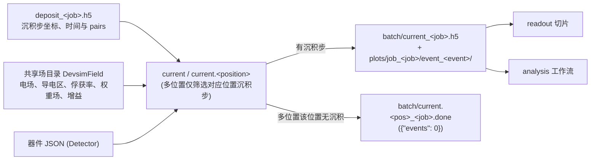

# 载流子输运与感应电流环节（`stages/current`）

`src/raser/stages/current.py` 将 [../core/current.md](../core/current.md) 的载流子漂移、热扩散、缺陷俘获与 Shockley-Ramo 感应电流计算封装为切片 `current`（多位置或多器件实验按位置展开为 `current.<position>`），并提供环节命令行入口 `raser current <target>`（短别名 `raser cur <target>`）。`current` 位于 [`deposit`](deposit.md) 与 [`field`](field.md) 之后、[`readout`](readout.md) 之前，负责将沉积步中的电子-空穴对在已求解电场与权重场中推进为各电极上的时域感应电流 `current_<job>.h5`，同时向末端 [`analysis`](analysis.md) 提供净感应电荷与初始对数。

## 输入（读什么）

- **沉积切片文件 `batch/deposit_<job>.h5`**：经 `read_deposits`（见 [deposit.md](deposit.md) 与 [../core/deposit.md](../core/deposit.md)）读入每个记录事例的 `event`、`detector`、沉积步坐标 `x`/`y`/`z`（$\mu\text{m}$）、全局时间 `t`（`s`）、沉积能量 `e`（`MeV`）及电子-空穴对数 `pairs`。在多位置展开的 `current.<position>` 切片中，仅筛选 `detector` 名称含 `<position>` 的沉积步；若该作业在该位置无沉积步，直接写出 `{"events": 0}` 标记并结束当前位置切片。
- **已求解的共享器件场 `DevsimField`**：依据器件偏压 `my_d.voltage` 与运行辐照注量（选项 `irradiation` 优先，缺省取器件 `irradiation_flux`）定位共享场目录（见 [field.md](field.md)），构造 `DevsimField` 提供插值电场、净掺杂、导电区域标志、俘获率、读出电极权重场及 1D 平面雪崩增益接口（见 [../core/field.md](../core/field.md)）。
- **器件定义 `files["device"]`**：通过 `Detector` 读取器件边界、读出电极布局、输运及雪崩参数（见 [../core/device.md](../core/device.md)），连同 `--plots` 绘图上限传给 `CalCurrent` / `CalCurrentGain`。

## 输出（写什么）

- **感应电流切片文件 `batch/current_<job>.h5`**（多位置为 `batch/current.<position>_<job>.h5`）：写在持有该切片的扫描点种子目录 `batch/` 下，先删后写并逐事例追加；完成后写出 `batch/current_<job>.done`（多位置无沉积时写 `{"events": 0}`，不生成 `.h5`）。
- **漂移路径与感应电流图**：为每个作业的前 `plots` 个记录事例，在 `<point>/<seed>/plots/job_<job>/event_<event>/`（多位置为 `job_<job>_<position>/event_<event>/`）下绘制漂移轨迹与电极电流波形图。

### 示例中的输出（`HPK-Si-PiN`）

在 [快速入门](../getting-started.md) 的示例中，运行 `raser signal HPK-Si-PiN --scan voltage=100,200 -s 2 -evt 200 --seed 1` 时，`current` 切片读取 `deposit_0.h5` 的 `200` 个事例与 `work/HPK-Si-PiN/field/` 中对应偏压的电场和 `top` 电极权重场，写出 `work/HPK-Si-PiN/signal/seed_1/batch/current_0.h5` 与空标记 `current_0.done`，并在 `plots/job_0/event_<事例号>/` 下为前 `100` 个记录事例生成 `planar_drift_path.pdf`/`.root` 与 `No_1electrode_basic_infor.pdf`/`.root`。

以 `work/HPK-Si-PiN/signal/seed_1/batch/current_0.h5` 为例：

- **文件属性（`attrs`）**：
  - `dt = 5e-12`（时间箱宽度，单位 `s`）
  - `electrodes = ['top']`（读出电极名列表）

- **数据集（`datasets`）清单**：

| 数据集名 | 示例形状 | 类型 | 单位 | 含义 |
| --- | --- | --- | --- | --- |
| `event` | `(200,)` | `int64` | 无 | 记录事例的 Geant4 编号 |
| `t0` | `(200,)` | `float64` | `s` | 首个时间箱左边界时刻 |
| `count` | `(200,)` | `int64` | 箱 | 每个事例的时间箱数 |
| `pairs` | `(200,)` | `float64` | 对 | 倍增前的输入电子-空穴对总数 |
| `sensitive_pairs` | `(200,)` | `float64` | 对 | 器件内且电极阵列上方非导电区产生、实际参与漂移的对数 |
| `carriers_without_field` | `(200,)` | `float64` | 个 | 因遇到无场区（`"no_field"`）停止的未俘获载流子总数 |
| `charge` | `(200, 1)` | `float64` | `C` | 各电极净感应电荷 |
| `stored` | `(200,)` | `int64` | 个 | 每个事例中存储的非零电流电极数 |
| `index` | `(196,)` | `int64` | 无 | 被存储电极在 `electrodes` 中的下标（`200` 个事例中有 `196` 个产生非零电流） |
| `current` | `(245196,)` | `float64` | `A` | 所有存储电极按时间箱展开拼接的一维感应电流波形 |

`HPK-Si-PiN` 单个事例的载流子漂移路径图（上方为器件三维体区轨迹，下方为局部平面内的沉积点、电子与空穴轨迹）。

`HPK-Si-PiN` 单个事例的感应电流图，分别绘出电子、空穴分量及总感应电流随时间的变化。

漂移步长、热扩散、俘获、雪崩倍增及全部图像类型说明见 [../core/current.md](../core/current.md)。

## 选项表

`raser current` 挂载 `deposit` 与 `current` 阶段选项（[deposit.md](deposit.md) 与 [../cli.md](../cli.md)）：

| 选项 | 默认值 | 单位 | 含义 |
| --- | --- | --- | --- |
| `--plots` | `100`（`cce`/`timeres`/`bmos`/`cflm` 默认 `0`） | 事例 | 每个作业绘制漂移路径与电极电流图的前 N 个记录事例上限（`current` 切片键） |
| `-vol`, `--voltage` | `None`（取器件 `bias.voltage`） | V | 器件偏置电压（归属 `field` 切片，见 [field.md](field.md)） |
| `-irr`, `--irradiation` | `None`（取器件 `irradiation.irradiation_flux`，无则为 `0`） | $\text{cm}^{-2}$ | 辐照注量（归属 `field` 切片，见 [field.md](field.md)） |

## 常见报错

载流子漂移、雪崩倍增、无场停止点及 `current_<job>.h5` 读写报错见 [../core/current.md](../core/current.md)；环节命令入口报错见 [README.md](README.md)。

## 相关页面

- [快速入门](../getting-started.md)
- [核心物理与数值计算：`core/current`](../core/current.md)
- [仿真链总览](README.md)
- [器件定义](../core/device.md)
- [材料模型](../core/model.md)
- [场求解环节](field.md)
- [沉积环节](deposit.md)
- [读出环节](readout.md)
- [分析环节](analysis.md)
- [命令行总览](../cli.md)
- [实验与扫描点](../lifecycle/experiments.md)
- [切片与状态查看](../lifecycle/slices.md)
- [路径与运行支撑](../supports/README.md)
