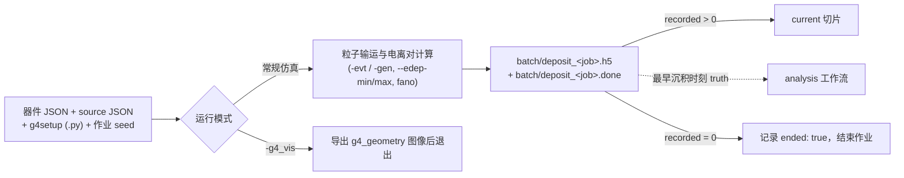

# 能量沉积环节（`stages/deposit`）

`src/raser/stages/deposit.py` 将 [../core/deposit.md](../core/deposit.md) 的粒子源模拟与电离对转化封装为仿真链的起点切片 `deposit`，并提供环节命令行入口 `raser deposit <target>`（短别名 `raser dep <target>`）。`deposit` 在仿真链中无前置切片依赖，负责为每个作业生成能量沉积步与电子-空穴对数据 `deposit_<job>.h5`，交付 [`current`](current.md) 切片做载流子漂移，同时为末端 [`analysis`](analysis.md) 切片提供事例最早沉积时刻 `truth`。若单个作业最终记录的有效事例数为 `0`，写出 `deposit_<job>.h5` 后即结束该作业的后续切片；若开启 `-g4_vis`，则在导出 Geant4 几何图后结束作业。

## 输入（读什么）

- **目标参数 `<target>`**：含 `config.json` 的实验文件夹路径，或器件名（自动对应 `work/<device>/signal` 实验目录）。
- **器件与组件配置**：
  - `files["device"]`：通过 `Detector` 读取器件几何尺寸与材料（见 [../core/device.md](../core/device.md) 与 [../components/device.md](../components/device.md)）。
  - `files["source"]`：粒子源或束流组件 JSON（见 [../components/source.md](../components/source.md)）。
  - `files.get("g4setup")`：Geant4 环境脚本导出的 `G4SETUP` 字典，缺省采用内置 `DEVICE_ALONE`（见 [../components/g4setup.md](../components/g4setup.md)）。
- **作业种子与切片选项**：生命周期注入的作业随机种子 `seed`，以及沉积数目（`events_per_job` 与 `generated_per_job` 互斥且须给定其一）、生成上限 `generated_limit`、总沉积能量窗 `edep_min`/`edep_max`、Fano 涨落开关 `fano` 与可视化开关 `g4_vis`/`g4_vis_driver`。

## 输出（写什么）

- **沉积切片文件 `batch/deposit_<job>.h5` 与完成标记 `batch/deposit_<job>.done`**：写在持有 `deposit` 切片的扫描点种子目录 `batch/` 下。若单个作业记录的事例数为 `0`，`deposit_<job>.done` 写入 `{"ended": true}` 并跳过该作业下游所有切片。
- **Geant4 几何可视化图（`-g4_vis`）**：当 `--g4-vis-driver`（不区分大小写）为 `"TSG"`、`"TSG_FILE"`、`"TSG_OFFSCREEN"` 时在种子或扫描点文件夹下导出 `g4_geometry.png`，以 `"OGL"` 开头时导出矢量图 `g4_geometry`，随后退出作业；其它以 `"TSG"` 开头的驱动名触发 `ValueError`。

### 示例中的输出（`HPK-Si-PiN`）

在 [快速入门](../getting-started.md) 的示例中，运行 `raser signal HPK-Si-PiN --scan voltage=100,200 -s 2 -evt 200 --seed 1` 时，`deposit` 切片使用 `decay/Sr90` 放射源、`device_alone` 几何与 `fano = true`，为两个偏压点的作业 `0`、`1` 各收集 `200` 个有效沉积事例，并写出空的 `deposit_<job>.done` 标记。以 `work/HPK-Si-PiN/signal/seed_1/batch/deposit_0.h5` 为例：

- **文件属性（`attrs`）**：
  - `generated_events = 7359`（Geant4 总生成事例数）
  - `recorded_events = 200`（满足器件内非零沉积的有效记录事例数）
  - `generated_fraction = 0.017037086855465844`（源发射方向中被模拟的立体角占比；若配置了 `--edep-min` 或 `--edep-max`，另写出对应属性，单位 `MeV`）

- **数据集（`datasets`）清单**：

| 数据集名 | 示例形状 | 类型 | 单位 | 含义 |
| --- | --- | --- | --- | --- |
| `event` | `(200,)` | `int64` | 无 | 记录事例的 Geant4 编号 |
| `count` | `(200,)` | `int64` | 步 | 每个记录事例包含的沉积步数 |
| `detector` | `(5476,)` | `object`（变长字符串） | 无 | 沉积步所在探测器逻辑体名 |
| `x`, `y`, `z` | `(5476,)` | `float64` | $\mu\text{m}$ | 沉积步中点局部坐标（`cflm` 下为起点坐标） |
| `x_start`, `y_start`, `z_start` | `(5476,)` | `float64` | $\mu\text{m}$ | 沉积步起点局部坐标（可选列） |
| `t` | `(5476,)` | `float64` | `s` | 沉积步全局时间 |
| `e` | `(5476,)` | `float64` | `MeV` | 沉积能量 |
| `pairs` | `(5476,)` | `float64` | 对 | 转化的电子-空穴对数 |

物理分支（Geant4、`toy_mip`、激光沉积）、电离转换常量及 `t_fwhm` 等完整格式细节见 [../core/deposit.md](../core/deposit.md)。

## 选项表

`raser deposit` 及仿真链 `deposit` 阶段的选项如下（部分工作流的默认覆盖值见 [README.md](README.md)，公共运行选项见 [../cli.md](../cli.md)）：

| 选项 / 键名 | 默认值 | 单位 | 含义 |
| --- | --- | --- | --- |
| `source` | `"decay/Sr90"` | 无 | 信号源或束流组件名称/路径（位置参数） |
| `--g4setup` | `"device_alone"` | 无 | Geant4 环境脚本名称/路径 |
| `-evt`, `--events-per-job` | `1` | 事例 | 每个作业需记录的有效事例数（与 `-gen` 互斥） |
| `-gen`, `--generated-per-job` | `None` | 事例 | 每个作业由粒子源产生的总事例数（替代 `-evt`） |
| `--generated-limit` | `None`（运行时取 `10_000_000`） | 事例 | 为收集 `-evt` 个记录事例最多生成的总事例数上限 |
| `--edep-min` | `None` | MeV | 器件内记录事例所需的最小总沉积能量 |
| `--edep-max` | `None` | MeV | 器件内记录事例所需的最大总沉积能量 |
| `fano` | `True` | 无 | 电离对数是否开启 Fano 涨落抽样（经 `config.json` `"set"` 或 `--set`/`--scan` 设置） |
| `-g4_vis` | `False` | 无 | 开启 Geant4 几何与径迹可视化，导出图像后结束作业 |
| `--g4-vis-driver` | `"OGL"` | 无 | `-g4_vis` 使用的 Geant4 可视化驱动名 |

## 常见报错

| 异常类型 | 报错信息 | 触发条件 |
| --- | --- | --- |
| `ValueError` | `events_per_job (...) and generated_per_job (...): a job records a number of events or generates one, so exactly one of them is set` | 同时给出或同时缺少 `events_per_job` 与 `generated_per_job` |
| `SystemExit` | `<target>: neither an experiment folder ...` / `<folder>: the experiment <workflow> has no deposit slice; its slices: ...` | 目标既非含 `config.json` 的实验目录也非有效器件，或该工作流无 `deposit` 切片（详见 [README.md](README.md)） |

Geant4 模拟、激光沉积、可视化驱动与 `deposit_<job>.h5` 读写报错见 [../core/deposit.md](../core/deposit.md)。

## 相关页面

- [快速入门](../getting-started.md)
- [核心物理与数值计算：`core/deposit`](../core/deposit.md)
- [仿真链总览](README.md)
- [器件定义](../core/device.md)
- [器件组件库](../components/device.md)
- [信号源组件库](../components/source.md)
- [激光组件库](../components/laser.md)
- [Geant4 环境组件库](../components/g4setup.md)
- [电流环节](current.md)
- [分析环节](analysis.md)
- [命令行总览](../cli.md)
- [实验与扫描点](../lifecycle/experiments.md)
- [切片与状态查看](../lifecycle/slices.md)
- [路径与运行支撑](../supports/README.md)
