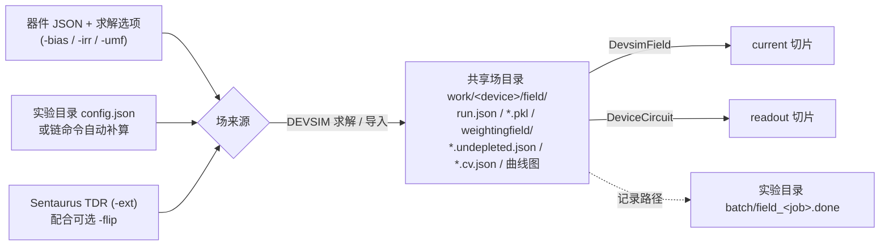

# 场求解环节（`stages/field`）

`src/raser/stages/field/__init__.py` 封装 [../core/field.md](../core/field.md) 的器件物理场求解与外部 TCAD 场导入，提供独立命令行入口 `raser field <det_name>`（别名 `raser fld <det_name>`）以及仿真链中的跨实验共享切片 `field`（多器件实验按器件展开为 `field.<device>`）。在仿真链中，`field` 处于最前端且无上游切片依赖，求解结果存入共享场目录，供 [`current`](current.md) 切片漂移载流子、供 [`readout`](readout.md) 切片组装器件等效电路；当链命令启动时所需偏压或辐照注量的场尚未就绪，主命令会自动先行调用 `raser field` 完成求解。

## 输入（读什么）

- **位置参数 `det_name`**：可为器件名或器件路径，也可为含 `config.json` 的实验文件夹路径。传入器件时直接通过 `Detector` 读取器件定义（见 [../core/device.md](../core/device.md) 与 [../components/device.md](../components/device.md)）；传入实验目录时读取其 `config.json` 中的 `workflow` 与 `device`，为该实验所有扫描点依次准备所需共享场。
- **偏压、辐照与求解器覆盖配置**：目标偏压取 `-bias`（链命令中为 `-vol`），缺省取器件 JSON 的 `bias.voltage`；辐照注量取 `-irr`（`irradiation_flux`），缺省取器件 JSON 的 `irradiation.irradiation_flux`（无则为 `0`）；器件 JSON 中的 `"field": {"solver": ...}` 会深度覆盖默认求解器配置 `SOLVER`。当器件设置 `hemt_physics.transport_model == "drift_diffusion_v1"` 时，转入 HEMT 直流转移特性求解路径（提示并丢弃 `-cv`、`-wf`、`-noise`）。
- **外部 TCAD 文件（`-ext` / `--extract`）**：指定 Sentaurus TDR 文件路径，导入其中已求解的场并在该网格上求解各读出电极的权重场；传入 `-flip` 时反转导入节点的坐标列序（2D 绘图同步交换 `x` 与 `y` 轴）。
- **已有共享场记录 `<field_dir>/run.json`**：启动求解前读取其中的 `options`、`files.device["field"]`、`read`（已追踪的器件属性、键及网格哈希）和 `solved`（已完成的 `"potential"`、`"weighting"`、`"capacitance"`、`"undepleted"` 偏压列表）。已记录完成的偏压阶段直接跳过；若辐照注量、模式、器件 `"field"` 配置或器件被读取参数发生变化，则整目录判定过期并重新求解。

## 输出（写什么）

场求解的输出写入共享场目录 `work/<device>/field/`（当对 `irradiation_flux` 或器件字段做扫描时，写入该目录下的对应子目录）；在实验仿真链的作业目录中，仅写出记录该共享目录路径的完成标记 `batch/field_<job>.done`。各磁盘资产的格式、单位与物理建模见 [../core/field.md](../core/field.md)。

### 示例中的输出（`HPK-Si-PiN`）

在 [快速入门](../getting-started.md) 的示例中，运行 `raser signal HPK-Si-PiN --scan voltage=100,200 -s 2 -evt 200 --seed 1` 时，`work/HPK-Si-PiN/field/` 尚未预先求解：

1. **自动补算与切片标记**：主命令在启动信号作业前先后打印 `the field is not ready: raser field HPK-Si-PiN -bias 100.0` 与 `the field is not ready: raser field HPK-Si-PiN -bias 200.0`，分别启动单作业进程求解 `100 V` 与 `200 V` 的场，并将两个偏压点共用同一个目录 `work/HPK-Si-PiN/field/`。各信号作业随后在 `batch/field_0.done`、`batch/field_1.done` 中写入 `{"field": ".../work/HPK-Si-PiN/field"}`（`seed_1/run.json` 中 `field` 及其下游切片记录同一共享摘要 `"23679e6b10596a26"`，见 [../lifecycle/slices.md](../lifecycle/slices.md)）。
2. **共享场目录实际写出的文件**：
   - **元数据记录 `run.json`**：记录 `"axes": ["z"]`、`"options": {"irradiation_flux": null, "mode": "full"}`、`"settings": {"umf": false, "imported": null}`，以及 `"solved"` 中 `"potential"` 与 `"undepleted"` 为 `[0.0, 100.0, 200.0]`、`"weighting"` 为 `[100.0, 200.0]`。
   - **体区场与未耗尽层文件**：`Potential_0V.pkl` / `100V.pkl` / `200V.pkl`、`Electrons_0V/100V/200V.pkl`、`Holes_0V/100V/200V.pkl`、`NetDoping_0V.pkl`、`TrappingRate_n_0V/100V/200V.pkl`、`TrappingRate_p_0V/100V/200V.pkl`、`Conductive_0V/100V/200V.pkl`、DEVSIM 状态归档 `0V.devsim`/`0V.dd`、`100.0V.devsim`/`100.0V.dd`、`200.0V.devsim`/`200.0V.dd`、`HPK-Si-PiN.dat`，以及一维未耗尽体区参数 `0.0V.undepleted.json`、`100.0V.undepleted.json`、`200.0V.undepleted.json`（`100.0 V` 与 `200.0 V` 下均全耗尽：`undepleted_width_um` 与 `specific_resistance_ohm_cm2` 均为 `0.0`，`specific_capacitance_pF` 为 `null`）。
   - **权重场**：`weightingfield/top/Potential_100V.pkl`、`Potential_200V.pkl` 及对应的权重电势与权重场分布图。
   - **特性曲线与一维分布图**：`HPK-Si-PiN_iv.png`、`HPK-Si-PiN_cv.png`、`HPK-Si-PiN_c^-2v.png`、`Doping.png`、`simIV0to100.0.root`/`.pdf`、`simIV0to200.0.root`/`.pdf`、`simCV0to100.0.root`/`.pdf`、`simCV0to200.0.root`/`.pdf`、`Electric Field0/100.0/200.0_1d.png`、`Potential0/100.0/200.0_1d.png`、`Electron Trapping Rate0/100.0/200.0_1d.png`、`Hole Trapping Rate0/100.0/200.0_1d.png`。

`HPK-Si-PiN` 反向偏压扫描得到的暗电流（IV）曲线。

`HPK-Si-PiN` 电容随反向偏压变化的 CV 曲线。

`200 V` 偏压下 `HPK-Si-PiN` 沿深度方向的一维电场分布。

### 其余运行模式写出文件

- **小信号电容 `-cv [V]`**：从指定偏压（省略数值时取目标偏压）的 `.devsim` 归档计算小信号电容，写入 `<V>V.cv.json`（含 `voltage_V`、`specific_capacitance_pF`、`per`［1D `"cm^2"`、2D `"cm"`、3D `"device"`］、`area_factor`、`frequency_Hz`）并在 `run.json` 的 `"capacitance"` 列表记录该偏压。
- **默认组合执行**：当 `-iv`、`-cv`、`-wf` 均未指定时，依次执行含 CV 的偏压扫描与权重场求解（两阶段之间清空 DEVSIM 设备并保留线性求解器设置）。

## 选项

### `raser field` 命令行选项

公共运行与扫描选项见 [../cli.md](../cli.md) 与 [../lifecycle/experiments.md](../lifecycle/experiments.md)：

| 选项 | 默认值 | 单位 | 含义 |
| --- | --- | --- | --- |
| `det_name` | 必填（位置参数） | 无 | 器件名/路径，或待求解共享场的实验文件夹路径 |
| `-iv` | `False` | 无 | 求解电势/电场直到目标偏压并生成 IV 曲线 |
| `-cv [V]` | `None`（仅传 `-cv` 时为目标偏压） | V | 从已保存偏压的 `.devsim` 归档求解小信号电容并写入 `<V>V.cv.json` |
| `-wf` | `False` | 无 | 求解目标偏压下各读出电极的权重场 |
| `-irr`, `--irradiation_flux` | `None`（取器件 `irradiation.irradiation_flux`，无则为 `0`） | $\text{cm}^{-2}$ | 辐照注量（对应工作流选项键 `irradiation_flux`） |
| `--mode` | 已装 `devsim` 时 `"full"`，否则 `"fast"` | 无 | 场获取模式，可选 `"full"`、`"semi_fast"`、`"fast"` |
| `-bias` | `None`（取器件 `bias.voltage`） | V | 目标偏置电压 |
| `-noise` | `False` | 无 | 在偏压扫描过程中求解并绘制器件噪声电流 |
| `-umf` | `False` | 无 | 加载 `devsim.umfpack.umfshim` 作为 DEVSIM 线性求解器 |
| `-ext`, `--extract` | `None` | 无 | 从指定的 Sentaurus TDR 文件导入场并求解权重场 |
| `-flip` | `False` | 无 | 导入 TCAD 场时反序节点坐标列（2D 绘图时同步交换 `x` 与 `y` 坐标） |

### 仿真链中归属 `field` 切片的选项

在实验链命令（如 `raser current`、`raser signal`）中，以下选项归属于 `field`（多器件实验带 `<device>.` 前缀）：

| 选项 | 默认值 | 单位 | 含义 |
| --- | --- | --- | --- |
| `-vol`, `--voltage` | `None`（映射至 `device.bias.voltage`） | V | 器件偏置电压 |
| `-irr`, `--irradiation` | `None`（取器件 `irradiation.irradiation_flux`，无则为 `0`） | $\text{cm}^{-2}$ | 辐照注量 |

## 常见报错

| 异常类型 | 报错信息 | 触发条件 |
| --- | --- | --- |
| `SystemExit` | `<folder>: this is the field itself; give its device, raser field <device>` | 将 `field` 自身的目录作为实验文件夹传给 `raser field` |
| `NotImplementedError` | ``the <mode> mode of a field is not there yet: only `--mode full` is`` | `--mode` 为 `"semi_fast"` 或 `"fast"` |
| `ValueError` | ``<address> = <value>: a value with a comma cannot be handed to `raser field --scan` ...`` | 链命令自动启动 `raser field` 时，实验修改的 `device.*` 键值序列化后含逗号 |
| `FileNotFoundError` | ``no field of <det_name> ready for this run: solve it with `raser field <det_name>` `` | 作业执行 `field` 切片时未找到满足当前偏压与辐照注量的已就绪共享场 |

器件校验、网格构建、插值、等效电路与 HEMT 求解报错见 [../core/field.md](../core/field.md)。

## 相关页面

- [快速入门](../getting-started.md)
- [核心物理与数值计算：`core/field`](../core/field.md)
- [仿真链总览](README.md)
- [器件定义](../core/device.md)
- [材料模型](../core/model.md)
- [器件组件库](../components/device.md)
- [电流环节](current.md)
- [读出环节](readout.md)
- [命令行总览](../cli.md)
- [实验与扫描点](../lifecycle/experiments.md)
- [切片与状态查看](../lifecycle/slices.md)
- [作业与集群提交](../lifecycle/jobs.md)
- [路径与运行支撑](../supports/README.md)
