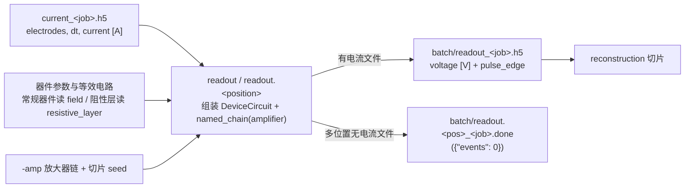

# 电子学读出环节（`stages/readout`）

`src/raser/stages/readout.py` 将 [../core/readout.md](../core/readout.md) 的器件等效电路求解、前端放大器链 SPICE 瞬态响应与频域抽样热噪声合成封装为切片 `readout`（多位置实验按位置展开为 `readout.<position>`），并提供环节命令行入口 `raser readout <target>`（短别名 `raser rdo <target>`）。`readout` 位于 [`current`](current.md) 之后、[`reconstruction`](reconstruction.md) 之前，依赖 `current` 与 `field` 切片且不改变生成事例（`new_events=False`），因此同一电流输入下扫描不同放大器链时可复用上游切片；输出的波形文件 `readout_<job>.h5` 直接交付下游做事件重建。

## 输入（读什么）

- **感应电流文件 `batch/current_<job>.h5`**（多位置为 `batch/current.<position>_<job>.h5`）：通过 `read_currents` 读取属性 `electrodes`、`dt`（`s`）以及每个事例的 `event`、`t0`（`s`）与 `current`（`A`）。在多位置实验下，若对应位置缺少电流文件，则返回 `{"events": 0}` 标记并跳过波形求解。
- **器件定义与等效电路（`Detector` 与 `DeviceCircuit`）**：读取器件 JSON（见 [../core/device.md](../core/device.md) 与 [../components/device.md](../components/device.md)），并按器件结构构建等效电路（见 [field.md](field.md) 与 [../core/field.md](../core/field.md)）：
  - **含 `resistive_layer` 的器件**：按 `is_pixel` 构建二维阻性网格电路或一维阻性行电路；指定 `--sheet-resistance`（单位 `Ohm`）时覆盖器件文件中的方阻值（普通器件设置 `--sheet-resistance` 会报错）。
  - **常规器件**：定位对应当前偏压与辐照注量的共享场目录 `work/<device>/field/`，组装 `DeviceCircuit`：
    - 单电极重复排列的条形行：读取 `weightingfield/<electrode>/Capacitance_<bias>V.json` 中的条间电容（单位 `F/cm`），并为每个事例沿行扩展受击条及其邻近耦合电极的局部电路。
    - 其余器件：结电容依次取自器件文件 `capacitance_pF`、场目录 `<V>V.cv.json`（需已在 `run.json` 中记录求解）或平板电容估计；1D 器件未耗尽层参数取自器件文件 `undepleted_resistance_ohm` 与 `undepleted_capacitance_pF` 或场目录 `<V>V.undepleted.json`；并读取器件文件中的 `bias_resistance_ohm` 与 `coupling_capacitance_pF`。
- **前端放大器链（`amplifier`）**：传给 `named_chain` 按 `"+"` 解析并加载 `afe/<part>.cir` SPICE 子电路链（见 [../core/readout.md](../core/readout.md) 与 [../components/afe.md](../components/afe.md)）。
- **切片随机种子（`seed`）**：生命周期注入的作业/切片派生种子（见 [../lifecycle/experiments.md](../lifecycle/experiments.md)），用于频域热噪声抽样；无种子运行时跳过噪声叠加。

## 输出（写什么）

- **读出波形切片文件 `batch/readout_<job>.h5`**（多位置为 `batch/readout.<position>_<job>.h5`）：写在持有该切片的扫描点种子目录 `batch/` 下，先删后写；完成后写出 `batch/readout_<job>.done`（多位置缺少电流文件时仅写出含 `{"events": 0}` 的 `.done` 标记）。

### 示例中的输出（`HPK-Si-PiN`）

在 [快速入门](../getting-started.md) 的示例中，运行 `raser signal HPK-Si-PiN --scan voltage=100,200 -s 2 -evt 200 --seed 1` 时，`HPK-Si-PiN` 为常规单电极平面器件，器件文件直接给出 `capacitance_pF = 3.44162280284`（`3.44162280284e-12 F`），结合默认放大器链 `SantaCruz+Gali52+Termination50` 写出 `work/HPK-Si-PiN/signal/seed_1/batch/readout_0.h5` 与空标记 `readout_0.done`。

以 `work/HPK-Si-PiN/signal/seed_1/batch/readout_0.h5` 为例：

- **文件属性（`attrs`）**：
  - `dt = 5e-12`（采样时间箱宽度，单位 `s`）
  - `electrodes = ['top']`（全部可能输出的电极名列表）
  - `pulse_edge = ['falling']`（与 `electrodes` 对应的脉冲前沿方向，`"rising"` 或 `"falling"`）
  - `device_circuit`（JSON 字符串）：`'{"junction_capacitance": {"farad": 3.44162280284e-12, "from": "device file"}, "between_electrodes": null, "bias_resistance": null, "coupling_capacitance": null, "undepleted_layer": null}'`

- **数据集（`datasets`）清单**：

| 数据集名 | 示例形状 | 类型 | 单位 | 含义 |
| --- | --- | --- | --- | --- |
| `event` | `(200,)` | `int64` | 无 | 记录事例的 Geant4 编号 |
| `t0` | `(200,)` | `float64` | `s` | 首个时间箱左边界时刻 |
| `count` | `(200,)` | `int64` | 箱 | 每个事例的波形采样点数 |
| `stored` | `(200,)` | `int64` | 个 | 每个事例中存储波形的电极数 |
| `index` | `(196,)` | `int64` | 无 | 被存储电极在 `electrodes` 中的下标 |
| `voltage` | `(245196,)` | `float64` | `V` | 按事例与存储电极依次拼接的时间箱中心输出电压 |

`ngspice` 瞬态求解、频域热噪声合成、条形行局部电路收敛及脉冲边沿极性判定算法见 [../core/readout.md](../core/readout.md)。

## 选项表

`raser readout` 挂载 `deposit`、`current` 与 `readout` 阶段选项（前序选项及公共选项见 [deposit.md](deposit.md)、[current.md](current.md) 与 [../cli.md](../cli.md)）：

| 选项键名 | 命令行参数 | 默认值 | 单位 | 含义 |
| --- | --- | --- | --- | --- |
| `amplifier` | `-amp`, `--amplifier` | `"SantaCruz+Gali52+Termination50"` | 无 | 以 `"+"` 连接的前端放大级与末级负载子电路链名称 |
| `sheet_resistance` | `--sheet-resistance` | `None` | $\Omega$ | 覆盖器件文件中的阻性层方阻（仅含 `resistive_layer` 的器件可用） |

## 常见报错

| 异常类型 | 报错信息 | 触发条件 |
| --- | --- | --- |
| `ValueError` | `<det_name> has no resistive layer to give a sheet resistance of <sheet_ohm> Ohm` | 对不含 `resistive_layer` 的器件设置了 `--sheet-resistance` |
| `FileNotFoundError` | `no <mode> field of <det_name> at the irradiation flux <flux> in <root> ...` | 找不到对应辐照注量与模式的已求解共享场 |
| `ValueError` | `the field in <folder> was solved for another device (<differing>); solve it again with ...` | 共享场目录与当前器件定义不一致 |
| `FileNotFoundError` | `the field in <folder> is not solved at <voltage> V ...` / `the field in <folder> has no weighting field at <voltage> V ...` | 共享场缺少目标偏压下的电势或权重场 |
| `FileNotFoundError` | `the field in <folder> has no capacitances between the strips of <det_name> at <voltage> V: <path> is missing ...` | 周期条形行器件缺少 `weightingfield/<electrode>/Capacitance_<bias>V.json` |
| `ValueError` | `The capacitances of the row are in <unit>` | 条形行电容 JSON 的单位不是 `"F/cm"` |
| `ValueError` | `<det_name> gives <key> alone: the undepleted layer has both undepleted_resistance_ohm and undepleted_capacitance_pF` | 器件文件只给出了未耗尽层电阻或电容两个键中的一个 |
| `ValueError` | `A coupling capacitance needs a bias resistance: without it the electrode has no DC potential` | 配置了 `coupling_capacitance_pF` 但缺少 `bias_resistance_ohm` |
| `ValueError` | `<det_name> has no capacitance: its device file gives none, its field was not asked for one, and the device has no estimate` | 器件既无实测电容、未求解场电容，也无平板估算电容 |

SPICE 网表生成、`ngspice` 缺失、噪声谱与 `readout_<job>.h5` 读写报错见 [../core/readout.md](../core/readout.md)；环节命令报错见 [README.md](README.md)。

## 相关页面

- [快速入门](../getting-started.md)
- [核心物理与数值计算：`core/readout`](../core/readout.md)
- [仿真链总览](README.md)
- [器件定义](../core/device.md)
- [场求解与等效电路：`core/field`](../core/field.md)
- [器件组件库](../components/device.md)
- [前端电子学组件库](../components/afe.md)
- [场求解环节](field.md)
- [电流环节](current.md)
- [重建环节](reconstruction.md)
- [命令行总览](../cli.md)
- [实验与扫描点](../lifecycle/experiments.md)
- [切片与状态查看](../lifecycle/slices.md)
- [路径与运行支撑](../supports/README.md)
