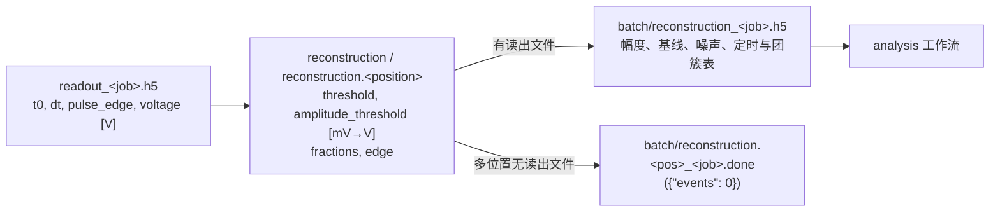

# 事件重建环节（`stages/reconstruction`）

`src/raser/stages/reconstruction.py` 将 [../core/reconstruction.md](../core/reconstruction.md) 的基线扣除、脉冲定时与多电极成簇封装为仿真链末端的切片 `reconstruction`（多位置实验按位置展开为 `reconstruction.<position>`），并提供环节命令行入口 `raser reconstruction <target>`（短别名 `raser reco <target>`）。`reconstruction` 紧接 [`readout`](readout.md) 之后且不改变上游事例（`new_events=False`），因此调整重建阈值或 CFD 比例列表时可复用已有的 `readout` 波形文件；输出的事件特征表 `reconstruction_<job>.h5` 交付末端 [`analysis`](analysis.md) 统计时间分辨。

## 输入（读什么）

- **读出波形文件 `batch/readout_<job>.h5`**（多位置为 `batch/readout.<position>_<job>.h5`）：通过 `read_waveforms`（见 [readout.md](readout.md) 与 [../core/readout.md](../core/readout.md)）读取属性 `electrodes`、`dt`（`s`）、`pulse_edge`（各电极 `"rising"` 或 `"falling"`）以及每个事例的 `event`、`t0`（`s`）与 `voltage`（`V`）。在多位置实验下，若对应位置缺少读出文件，则返回 `{"events": 0}` 标记并跳过重建。
- **重建选项参数**：
  - `threshold` 与 `amplitude_threshold`：命令行和配置均以 `mV` 传入，环节内换算为 `V`（乘 `1e-3`）交付 `event_table`。
  - `fractions`：`(0, 1)` 开区间内的常数分数甄别比例列表。
  - `edge`：`"rising"`、`"falling"` 或 `None`；为 `None` 时沿用 `readout` 写出的 `pulse_edge`，若显式指定的边沿与某电极的 `pulse_edge` 相反，终端会打印提示说明。

## 输出（写什么）

- **事件重建表文件 `batch/reconstruction_<job>.h5`**（多位置为 `batch/reconstruction.<position>_<job>.h5`）：由 `event_table` 与 `write_event_table` 写出至持有该切片的种子目录 `batch/` 下，并生成 `batch/reconstruction_<job>.done`（多位置缺少读出文件时写出 `{"events": 0}` 标记，不生成 `.h5`）。

### 示例中的输出（`HPK-Si-PiN`）

在 [快速入门](../getting-started.md) 的示例中，运行 `raser signal HPK-Si-PiN --scan voltage=100,200 -s 2 -evt 200 --seed 1` 时，`reconstruction` 使用默认阈值 `threshold = 10.0 mV`、`amplitude_threshold = 10.0 mV`、9 个 CFD 比例 `[0.1, ..., 0.9]` 并沿用 `readout_0.h5` 的 `pulse_edge = ['falling']`，写出 `work/HPK-Si-PiN/signal/seed_1/batch/reconstruction_0.h5` 与空标记 `reconstruction_0.done`。

以 `work/HPK-Si-PiN/signal/seed_1/batch/reconstruction_0.h5` 为例：

- **文件属性（`attrs`）**：
  - `threshold = 0.01`（过阈阈值，单位 `V`）
  - `amplitude_threshold = 0.01`（事例选中与成簇种子阈值，单位 `V`）
  - `edge = ['falling']`（各电极脉冲定时边沿）
  - `electrodes = ['top']`（全部电极名列表）
  - `fractions = [0.1, 0.2, 0.3, 0.4, 0.5, 0.6, 0.7, 0.8, 0.9]`（CFD 比例数组）

- **数据集（`datasets`）清单**：

| 数据集名 | 示例形状 | 类型 | 单位 | 含义 |
| --- | --- | --- | --- | --- |
| `event` | `(200,)` | `int64` | 无 | 记录事例的 Geant4 编号 |
| `selected` | `(200,)` | `bool` | 无 | 事例是否至少含有一个幅度 $\ge$ `amplitude_threshold` 的种子电极 |
| `cluster_size` | `(200,)` | `int64` | 个 | 团簇包含的电极数 |
| `cluster_center` | `(200,)` | `float64` | 电极下标（从 `0` 起） | 团簇的幅度加权中心位置（无团簇时为 `NaN`） |
| `traced` | `(200, 1)` | `bool` | 无 | `readout` 中该事例是否保存有该电极波形（`196` 个事例为 `True`） |
| `above` | `(200, 1)` | `bool` | 无 | 波形峰值是否达到 `threshold` |
| `baseline` | `(200, 1)` | `float64` | `V` | 波形前 `200` 点基线均值 |
| `noise` | `(200, 1)` | `float64` | `V` | 波形前 `200` 点基线总体标准差 |
| `amplitude` | `(200, 1)` | `float64` | `V` | 基线以上最大脉冲幅度 |
| `ToA` | `(200, 1)` | `float64` | `s` | 过阈到达时间 |
| `ToT` | `(200, 1)` | `float64` | `s` | 过阈持续时间 |
| `CoG` | `(200, 1)` | `float64` | `s` | 过阈区间的时间重心 |
| `area` | `(200, 1)` | `float64` | $\text{V}\cdot\text{s}$ | 正向脉冲主瓣积分面积 |
| `CFD` | `(200, 1, 9)` | `float64` | `s` | 各常数分数 `fractions` 对应的定时结果 |

基线估计、线性插值定时与多电极成簇算法细节见 [../core/reconstruction.md](../core/reconstruction.md)。

## 选项表

`raser reconstruction` 挂载全链前序阶段选项与公共选项（见 [README.md](README.md) 与 [../cli.md](../cli.md)），本环节自身选项如下：

| 选项键名 | 命令行参数 | 默认值 | 单位 | 含义 |
| --- | --- | --- | --- | --- |
| `threshold` | `-threshold` | `10.0` | mV | 计算 `ToA`、`ToT`、`CoG`、`area` 与邻近电极入簇的阈值 |
| `amplitude_threshold` | `-amplitude_threshold` | `10.0` | mV | 判定事例选中（`selected`）及团簇种子的幅度阈值 |
| `fractions` | （在 `config.json` 的 `"set"` 中配置列表） | `[0.1, 0.2, 0.3, 0.4, 0.5, 0.6, 0.7, 0.8, 0.9]` | 无 | 恒比定时（`CFD`）的幅度比例列表 |
| `edge` | `--edge` | `None`（沿用 `readout` 写出的 `pulse_edge`） | 无 | 阈值作用的脉冲沿方向，可选 `"rising"` 或 `"falling"` |

## 常见报错

基线点数不足、非法 `edge` / `fractions` 取值、`readout` 空文件及 `reconstruction_<job>.h5` 读写报错见 [../core/reconstruction.md](../core/reconstruction.md)；环节命令报错见 [README.md](README.md)。

## 相关页面

- [快速入门](../getting-started.md)
- [核心物理与数值计算：`core/reconstruction`](../core/reconstruction.md)
- [仿真链总览](README.md)
- [电子学读出：`core/readout`](../core/readout.md)
- [读出环节](readout.md)
- [分析环节](analysis.md)
- [命令行总览](../cli.md)
- [实验与扫描点](../lifecycle/experiments.md)
- [切片与状态查看](../lifecycle/slices.md)
- [路径与运行支撑](../supports/README.md)
