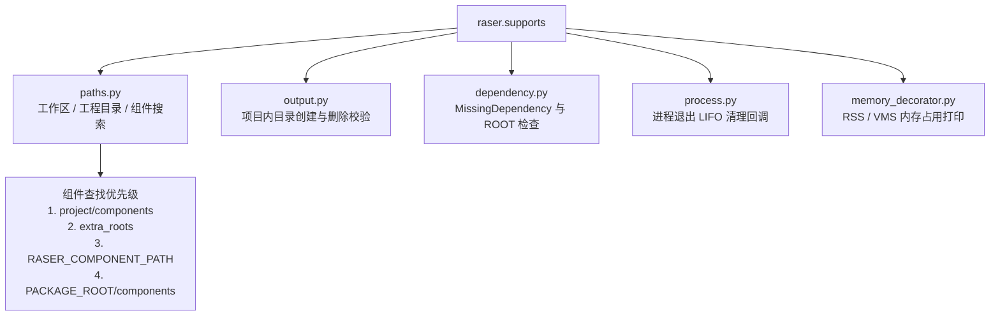
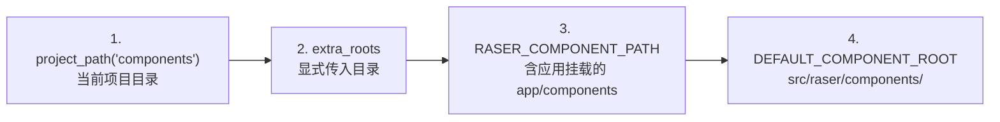

# 公共基础设施（`supports`）

`src/raser/supports/` 处于整个软件分层的最底层，为 `cli`、`lifecycle`、`stages`、`core`、`components`、`bench` 与 `apps` 提供工作区与组件路径解析（`paths.py`）、受控输出路径与文件操作（`output.py`）、缺失依赖报告（`dependency.py`）、进程退出清理回调（`process.py`）和函数内存占用诊断（`memory_decorator.py`）五项公共支撑。



## 路径解析与组件搜索（`supports/paths.py`）

### 环境变量

| 环境变量名 | 默认行为 | 含义 |
| --- | --- | --- |
| `RASER_WORK_PATH` | 源码树下为 `<REPO_ROOT>/work`，已安装包下为 `<cwd>/work` | 工作区根目录路径，由 `work_root()` 读取 |
| `RASER_PROJECT_PATH` | 当前工作目录 `Path.cwd()` | 当前项目目录路径，由 `project_root()` 读取 |
| `RASER_COMPONENT_PATH` | 空字符串 `""` | 以 `os.pathsep` 分隔的附加组件搜索根目录列表，由 `component_roots()` 读取 |

### 组件搜索优先级

`component_roots(extra_roots=None)` 按从高到低的顺序组合并去重以下 4 类根目录，`component_path(*parts)` 返回首个存在目标文件的路径：



### 公开路径接口

| 接口 | 参数 | 行为与返回值 |
| --- | --- | --- |
| `PACKAGE_ROOT` / `REPO_ROOT` / `DEFAULT_COMPONENT_ROOT` | 模块常量 | 包目录 `src/raser`（或安装后的 `raser`）；`source_tree(package_root=PACKAGE_ROOT)` 检测到 `src/raser` 旁有 `pyproject.toml` 时 `REPO_ROOT` 为仓库根，否则为 `None`；`DEFAULT_COMPONENT_ROOT` 为 `PACKAGE_ROOT / "components"` |
| `default_work_root(tree=REPO_ROOT, cwd=None)` | 仓库树、当前目录 | 源码树下返回 `<tree>/work`，包安装模式返回 `<cwd>/work` |
| `work_root()` / `project_root()` / `project_path(*parts)` | 相对路径片段 | 返回当前生效的工作区根目录、项目根目录或项目内子路径 `Path` |
| `infer_project_root(input_value)` | 目标名、路径或 `None` | `RASER_PROJECT_PATH` 非空或 `input_value is None` 时返回 `project_root()`；传入路径（含绝对路径、多级路径或后缀）时若路径含 `"components"` 且非首段则取其父路径，否则对目录取自身、对文件取父目录；传入纯器件名（如 `"HPK-Si-PiN"`）时返回 `work_root() / str(input_value)` |
| `project_root_context(project_path_value, component_apps=())` | 项目路径、应用相对路径元组 | 上下文管理期内临时覆盖 `RASER_PROJECT_PATH` 并把各 `PACKAGE_ROOT / <app> / "components"` 前置到 `RASER_COMPONENT_PATH`，退出上下文时恢复原环境变量 |
| `component_candidates(*parts, roots=None)` / `component_path` / `optional_component_path` | 相对路径片段、根目录列表 | 生成全部候选 `Path` 列表；`component_path` 返回首个存在的 `Path`（全缺失时抛 `FileNotFoundError`），`optional_component_path` 缺失时返回 `None` |
| `component_file_path(kind, name_or_path, suffix=".json")` | 组件类别、名称或路径、后缀 | 显式路径直接检查是否为存在的文件；纯名称调用 `component_path(kind, str(name_or_path) + suffix)` |
| `app_component_root(app_name)` / `app_component_roots(...)` / `app_file_path(app_name, filename)` | 应用目录（如 `"bench/telescope"`）、文件名 | 定位 `PACKAGE_ROOT / app_name / "components"` 或包内应用文件 |
| `module_work_name(current_file_path)` / `module_work_path(current_file_path, *labels)` | 模块 `__file__`、子目录标签 | 位于 `apps`、`bench`、`core` 下时取第二段路径（如 `"field"`、`"current"`），位于 `cli` 下取 `"cli"`，其余取文件名词干，并拼接至 `project_path` |

## 受控输出路径与文件操作（`supports/output.py`）

| 接口 | 参数 | 行为与约束 |
| --- | --- | --- |
| `owned_path(owner, *parts)` | 非空归属名、相对路径片段 | 校验 `owner` 非空且片段保持在项目内相对路径（禁止绝对路径或 `".."`），返回 `project_root().joinpath(owner, *parts)` |
| `create_path(path)` | 目标路径 | 执行 `Path(path).mkdir(parents=True, exist_ok=True)` 并返回该 `Path` |
| `output(current_file_path, *label)` | 调用模块 `__file__`、相对标签 | 校验标签为项目内相对路径，创建 `module_work_path(current_file_path, *label)` 并返回解析后的绝对路径字符串 |
| `delete_file(path)` | 目标文件路径 | 校验目标文件解析路径位于 `project_root().resolve()` 之内，若文件存在则删除 |

## 依赖检查、进程清理与内存诊断

- **缺失依赖报告（`supports/dependency.py`）**：
  - `MissingDependency(what, how)` 初始化异常消息 `f"{what}. {how}"` 并保存 `self.what` 与 `self.how`。`raser` CLI 在命令执行期间捕获该异常后向标准错误输出 `raser: <what>. <how>` 并以退出码 `1` 结束（见 [../cli.md](../cli.md)）。
  - `ROOT_MODULES = {"ROOT", "cppyy"}` 与 `ROOT_MISSING`：命令执行期间捕获 `ModuleNotFoundError` 且 `error.name` 属于 `ROOT_MODULES`（即 `"ROOT"` 或 `"cppyy"`）时，`raser` CLI 输出 `raser: ROOT's Python bindings are not available in this Python. Install them with conda install -c conda-forge root_base` 并以退出码 `1` 结束；其余 `ModuleNotFoundError` 原样重新抛出。
- **进程清理回调（`supports/process.py`）**：
  - `at_process_end(callback)` 去重注册无参清理回调 `callback: Callable[[], None]`；`close()` 由 `raser` CLI 在 `main()` 的 `finally` 块中调用，按后进先出（LIFO）顺序依次弹出并执行已注册回调；若有回调抛出异常，本次清理立即停止。
- **内存占用诊断（`supports/memory_decorator.py`）**：
  - `@memory_decorator` 在被装饰函数执行前后通过 `psutil.Process().memory_info()` 读取常驻集大小 `rss` 与虚拟内存大小 `vms`（按 $1024^2$ 换算为 `MB`），打印三行诊断信息并返回原函数结果：
    - `Memory usage before calling <func.__name__>: RSS = <rss_before:.2f> MB, VMS = <vms_before:.2f> MB`
    - `Memory usage after calling <func.__name__>: RSS = <rss_after:.2f> MB, VMS = <vms_after:.2f> MB`
    - `Memory increase: RSS = <rss_after - rss_before:.2f> MB, VMS = <vms_after - vms_before:.2f> MB`

## 示例中的支撑路径与内存诊断（`HPK-Si-PiN`）

在 [快速入门](../getting-started.md) 的示例 `raser signal HPK-Si-PiN --scan voltage=100,200 -s 2 -evt 200 --seed 1` 中，各项支撑模块按如下方式配合运行：

- **工程与组件路径解析**：`work_root()` 指向工作目录下的 `work/`，`infer_project_root("HPK-Si-PiN")` 将工程根目录解析为 `work/HPK-Si-PiN/`；组件查找器按优先级回退到内置 `DEFAULT_COMPONENT_ROOT`（`src/raser/components/`），依次定位 `device/HPK-Si-PiN.json`、`source/decay/Sr90.json`、`g4setup/device_alone.py` 以及 `afe/SantaCruz.cir`、`afe/Gali52.cir`、`afe/Termination50.cir`。
- **场求解内存诊断**：自动触发 `raser field HPK-Si-PiN -bias 100.0`（及 `200.0`）调用 `loop_solver` 迭代求解泊松与连续性方程时，`@memory_decorator` 在终端打印内存变化记录，例如：

```text
Memory usage before calling loop_solver: RSS = 357.12 MB, VMS = 402563.59 MB
...
Memory usage after calling loop_solver: RSS = 358.62 MB, VMS = 402563.59 MB
Memory increase: RSS = 1.50 MB, VMS = 0.00 MB
```

## 常见报错

| 异常与报错信息 | 触发条件 |
| --- | --- |
| `FileNotFoundError: Cannot find RASER app file: <path>` | `app_file_path` 指定的包内应用文件不存在 |
| `FileNotFoundError: Cannot find RASER component <parts>:\n  - <searched>` | `component_path` 在所有候选根目录中均未找到指定组件 |
| `FileNotFoundError: Cannot find RASER <kind> file: <path>` | `component_file_path` 收到不存在的显式文件路径 |
| `IsADirectoryError: RASER <kind> input must be a file: <path>` | `component_file_path` 收到的显式路径是目录 |
| `ValueError: Output label must remain inside the project: <value>` | `owned_path` 或 `output` 的路径片段为绝对路径或包含 `".."` |
| `ValueError: Output owner must be named` | `owned_path` 的 `owner` 为空字符串 |
| `ValueError: File removal must remain inside the project: <target>` | `delete_file` 的目标路径位于 `project_root()` 之外 |
| `MissingDependency: <what>. <how>` | 运行环境缺少外部程序或 Python 库时由各模块抛出 |

## 相关页面

- [快速入门](../getting-started.md)
- [../architecture.md](../architecture.md)
- [../cli.md](../cli.md)
- [../lifecycle/experiments.md](../lifecycle/experiments.md)
- [../stages/field.md](../stages/field.md)
- [../stages/deposit.md](../stages/deposit.md)
- [../stages/current.md](../stages/current.md)
- [../stages/readout.md](../stages/readout.md)
- [../core/digitizer.md](../core/digitizer.md)
- [../stages/analysis.md](../stages/analysis.md)
