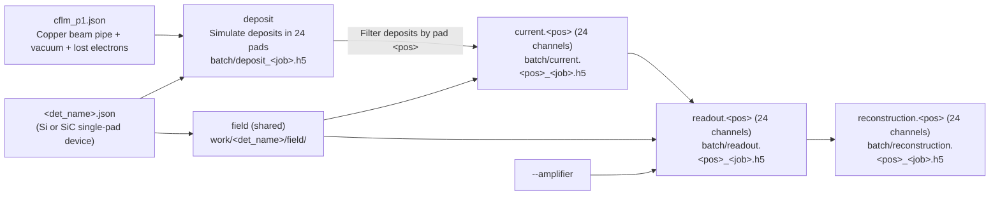

# CEPC Fast Luminosity Monitor Application (`apps/cflm`)

`raser cflm` runs the multi-position full-chain simulation for the CEPC Fast Luminosity Monitor. Using the multi-position expansion mechanism of [`stages/chain`](../stages/README.md), it first simulates energy deposition from lost bunch electrons hitting the copper beam pipe across 24 detector pads on both sides via a dedicated `deposit` slice, then shares one `field` slice while expanding `current.<pos>`, `readout.<pos>`, and `reconstruction.<pos>` across the 24 pad positions (74 slices in total), writing results to `work/<det_name>/cflm/`.



## Command

```bash
raser cflm <det_name> [options]
```

## Inputs

- **Single-pad device definition `<det_name>.json`** ([`../components/device.md`](../components/device.md)): reads dimensions `l_x`, `l_y`, `l_z` (`um`), material `material` (`"Si"` or `"SiC"`), bias `bias.voltage` (`V`), temperature `temperature` (`K`), and readout electrode. The device is placed at the 24 pad positions `PADS` (`<side>_<i>_<j>`, where `side` is `"I"` or `"II"`, `i` is `-3` to `2`, and `j` is `0` or `1`) on both sides of the beam pipe.
- **Beam pipe and lost-electron config `src/raser/apps/cflm/cflm_p1.json`**:
  - **World and beam pipe geometry**: world material `"world": "G4_AIR"` (half-side `2000 mm`); copper beam pipe `"pipe"` (`"material": "G4_Cu"`, inner radius `"Rmin": 28 mm`, outer radius `"Rmax": 31 mm`, full length `"Pipe_Z": 700 mm`, start angle `"PipeSphi": 0 deg`, span angle `"PipeDphi": 360 deg`, center `[0, 0, 250] mm`); vacuum cylinder inside pipe `"vacuum"` (material `G4_Galactic`, inner radius `"VACmin": 0 mm`, outer radius `"VACmax": 28 mm`, full length `"VAC_Z": 700 mm`, center `[0, 0, 250] mm`).
  - **24-pad layout**: `"pads_from_z_mm": 225` (`mm`) is the starting z coordinate along the beam direction; side `I` sits at `x = -Rmax` (`-31 mm`) and side `II` at `x = +Rmax` (`+31 mm`); each side has 6 rows along y (center `y = (i + 0.5) * l_x` `um`) and 2 columns along z (center `z = pads_from_z_mm * 1000 + (j + 0.5) * l_y` `um`).
  - **Bunch particle-gun parameters**: `"BeamOn": 1` (bunches simulated per job), `"NumofGun": 3` (particles emitted per bunch), `"par_type": "e-"`, `"par_energy": [21.906, 25.9726, 24.7832]` (`GeV`), `"par_in"` (origin `[x, y, z]` of the 3 particles in `mm`), `"par_direct"` (momentum direction vectors of the 3 particles), `"maxStep": 2` (maximum step size inside pads in `um`).
- **Analog front-end file `<part>.cir`**: specified by `--amplifier` ([`../components/afe.md`](../components/afe.md)).
- **Shared field directory `work/<det_name>/field/`**: If the field at the target bias and irradiation flux is not ready yet, the workflow automatically calls [`raser field`](../stages/field.md) before launching jobs.

### Standalone Helper Scripts

`src/raser/apps/cflm/` also contains a set of standalone helper programs (`cflm_spd.py` and `p1_sample.py` can be run directly as scripts, `spd_dis.py` must be run with `python -m raser.apps.cflm.spd_dis`, and `data_file.py` and `spd_plot.py` only expose `main()` for import):

| Script | Reads | Description |
| --- | --- | --- |
| `cflm_spd.py` | `cflm_spd.json` | Runs secondary-particle distribution statistics independently; reads keys `geant4_model`, `pipe`, `vacuum`, `world`, `BeamOn`, `NumofGun`, `par_type`, `par_energy`, `par_in`, `par_direct`, `maxStep`, `vis`, `PosBaseName` |
| `spd_dis.py`, `data_file.py`, `p1_sample.py` | `src/raser/apps/cflm/input/` (such as `datafile_p1.root`, directory not in repository) | Reads inputs relative to the current working directory; `spd_dis.py` rewrites `cflm_spd.json` and calls `cflm_spd.main()` |
| `spd_plot.py` | `SecondaryParticle_*` text files written by `cflm_spd` | Plots secondary particle distributions parallel and perpendicular to the beam |

## Outputs

The experiment directory is `work/<det_name>/cflm/`, with `config.json` at the top level and `run.json` and `batch/` under each scan point's seed directory `<point>/<seed_folder>/` ([`../lifecycle/experiments.md`](../lifecycle/experiments.md), [`../lifecycle/slices.md`](../lifecycle/slices.md)). `WORKFLOW.slices` expands via `chain.expand` into `deposit`, `field`, and `current.<pos>`, `readout.<pos>`, `reconstruction.<pos>` for 24 positions (74 slices total). Each job `<job>` writes in order under the point directory `batch/` holding the slices:

| Output Path | Written by Slice | Content and Notes |
| --- | --- | --- |
| `batch/deposit_<job>.h5` | `deposit` (`deposits.deposits`) | Runs `cflm_p1.simulate_bunches` once to record energy deposits across all 24 pads. Skips steps with energy `<= 0`, transforms remaining steps via `pad_frame` to each pad's local frame (`z` is depth into the pad from the beam pipe outer wall [`um`], time `t` is fixed to `0.0 s`), records `detector` as `<side>_<i>_<j>`, and samples `pairs` via `ionized_pairs` ([`../stages/deposit.md`](../stages/deposit.md)); ends the job with `Ended` when all pads have zero deposits |
| `batch/current.<pos>_<job>.h5` | [`current`](../stages/current.md) | `<pos>` runs from `I_-3_0` to `II_2_1`; when deposits exist for that pad, drifts carriers and writes induced current (`A`), `dt` (`s`), and integrated charge `charge` (`C`), plotting under `plots/job_<job>_<pos>/event_<number>/` when `--plots > 0`. Writes `{"events": 0}` to the slice `.done` file when that pad has no deposits |
| `batch/readout.<pos>_<job>.h5` | [`readout`](../stages/readout.md) | Output voltage waveform (`V`) for that pad after the front-end amplifier chain and noise. Writes `{"events": 0}` to the slice `.done` file when that pad has no current file |
| `batch/reconstruction.<pos>_<job>.h5` | [`reconstruction`](../stages/reconstruction.md) | Threshold-crossing time `ToA` on the selected edge (default `pulse_edge`), `ToT`, center of gravity `CoG`, constant fraction timing `CFD` (`s`), `amplitude` (`V`), `area` (`V s`), and cluster table for that pad. Writes `{"events": 0}` to the slice `.done` file when that pad has no readout file |

## Options

| Option | Default | Unit | Meaning |
| --- | --- | --- | --- |
| `det_name` | None (required positional argument) | None | Detector component name or path |
| `--plots` | `0` | bunches | First N recorded bunches per pad to plot drift paths and currents |
| `-vol`, `--voltage` | Taken from `device.bias.voltage` | `V` | Detector bias voltage (written to `device.bias.voltage`) |
| `-irr`, `--irradiation` | `None` (taken from device `irradiation_flux` when omitted; `0` if absent) | `neq/cm^2` | Irradiation fluence |
| `-amp`, `--amplifier` | `"SantaCruz+Gali52+Termination50"` | None | Front-end amplifier stages and termination load joined by `+` |
| `--sheet-resistance` | `None` | `Ohm` | Override sheet resistance of the resistive layer in the pad device file |
| `-threshold` | `10.0` | `mV` | Threshold for pulse timing and area calculation |
| `-amplitude_threshold` | `10.0` | `mV` | Amplitude threshold for event selection and cluster seed finding |
| `fractions` (set via `--set`/`--scan`) | `[0.1, 0.2, 0.3, 0.4, 0.5, 0.6, 0.7, 0.8, 0.9]` | None | Amplitude fraction list for Constant Fraction Discrimination (CFD) |
| `--edge` | `None` (uses `pulse_edge` exported by `readout`) | None | Trigger edge: `"rising"` or `"falling"` |
| `-s`, `--jobs` | `None` (single job) | jobs | Number of indexed jobs to run concurrently or submit |
| `--seed` | Randomly generated 31-bit integer | None | Master random seed |
| `--same-seeds` | `False` | None | Whether scan points share the same batch of random seeds |
| `-b`, `--batch` | `False` | None | Submit jobs to cluster queue |
| `-mem` | `1` | tier | Cluster job memory tier |
| `--dry-run` | `False` | None | Print points, slices, and job list to run and return immediately |
| `--scan` | `[]` | None | Scan parameter `address=value1,value2,...` (repeatable) |
| `--set` | `[]` | None | Fix single parameter `address=value` (repeatable) |

## Common Errors

| Error Message | Trigger Condition |
| --- | --- |
| `ValueError: the Geant4 of cflm builds pads of Si or SiC, not of <material>` | Detector `material` is neither `"Si"` nor `"SiC"` |
| `` FileNotFoundError: no field of <det_name> ready for this run: solve it with `raser field <det_name>` `` | No ready solved field is found when the field slice runs |
| `ValueError: <det_name> has no resistive layer to give a sheet resistance of <sheet_ohm> Ohm` | `--sheet-resistance` is passed for a detector without `resistive_layer` |

## Related Pages

- [`../getting-started.md`](../getting-started.md)
- [`../cli.md`](../cli.md)
- [`../lifecycle/experiments.md`](../lifecycle/experiments.md)
- [`../lifecycle/slices.md`](../lifecycle/slices.md)
- [`../components/device.md`](../components/device.md)
- [`../components/afe.md`](../components/afe.md)
- [`../stages/README.md`](../stages/README.md)
- [`../stages/deposit.md`](../stages/deposit.md)
- [`../stages/field.md`](../stages/field.md)
- [`../stages/current.md`](../stages/current.md)
- [`../stages/readout.md`](../stages/readout.md)
- [`../stages/reconstruction.md`](../stages/reconstruction.md)
