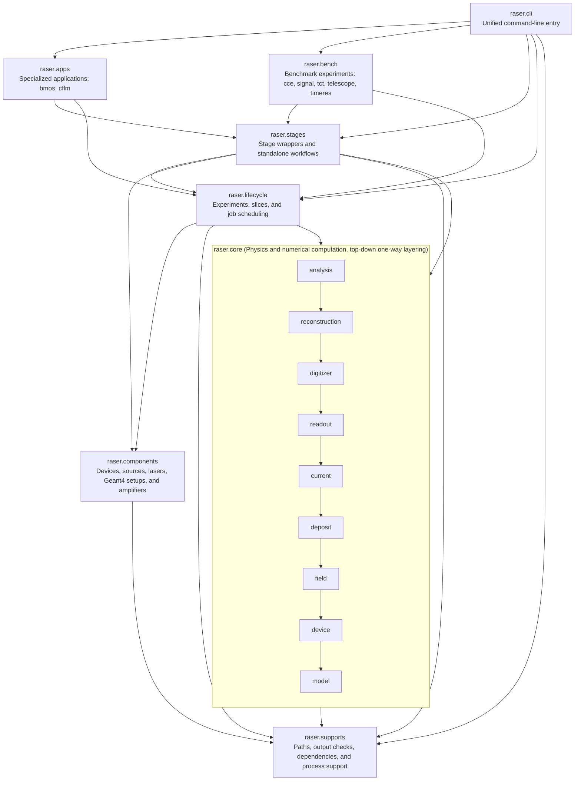
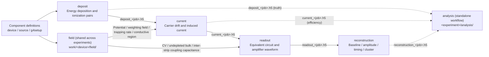
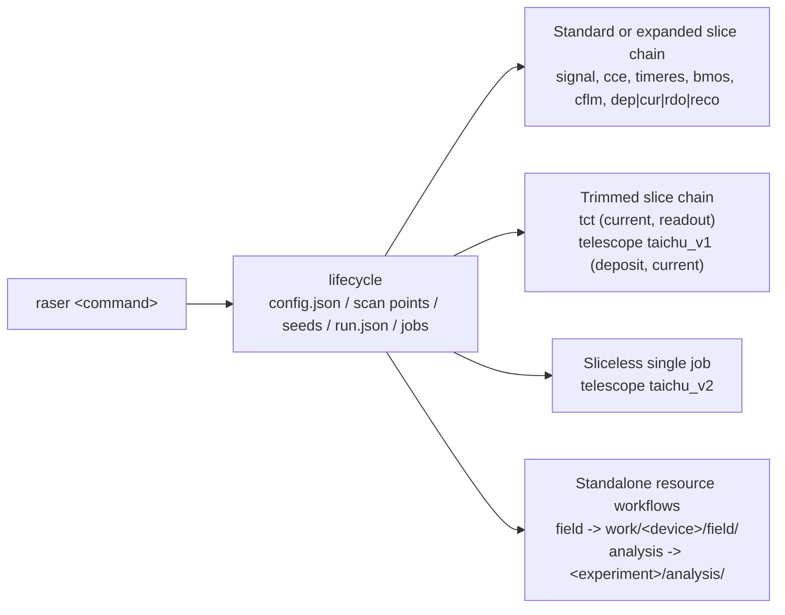

# Architecture Overview

This page summarizes RASER's source directory layers and module dependency directions, how simulation chain stages connect, what data and completion markers are handed off between slices, how experiment workflows assemble stages, and where each stage writes plot outputs. Parameter, option table, and interface details are in [lifecycle/](lifecycle/experiments.md), [stages/](stages/README.md), and the `core/` pages.

## Source Directory Layers and Dependency Direction

Under `src/raser/`, there are 8 subpackages. One-way dependencies between modules and independence between experiments are enforced during `make lint` by `importlinter` contracts in `pyproject.toml` (arrows indicate import and dependency direction):



Responsibilities and boundaries of each layer are as follows:

- **`raser.cli`** ([cli.md](cli.md)): Sole top-level CLI entry point. Parses global options, auto-completes commands in experiment directories, and dispatches arguments to the target module. Lower layers are called one-way from it.
- **`raser.bench` and `raser.apps`**: Benchmark experiments (`cce`, `signal`, `tct`, `telescope`, `timeres`) and specialized applications (`bmos`, `cflm`) remain independent of each other. Each assembles workflows from `stages` and `lifecycle`.
- **`raser.stages`** ([stages/README.md](stages/README.md)): Wraps physics calculations into composable lifecycle slices, stage commands (`dep`, `cur`, `rdo`, `reco`), and standalone workflows (`field`, `analysis`), independent of specific experiments.
- **`raser.lifecycle`** ([lifecycle/experiments.md](lifecycle/experiments.md), [lifecycle/slices.md](lifecycle/slices.md), [lifecycle/jobs.md](lifecycle/jobs.md)): Manages experiment directories, `config.json`, `run.json`, parameter scans, slice reuse, and local/cluster job scheduling.
- **`raser.core`**: Pure physics and numerical computation layer, decoupled from the CLI and scheduling layers. Its 9 stage subpackages form a strict one-way hierarchy: `model` → `device` → `field` → `deposit` → `current` → `readout` → `digitizer` → `reconstruction` → `analysis`. Upper subpackages may only import lower ones.
- **`raser.components` and `raser.supports`** ([supports/README.md](supports/README.md)): Provide built-in and external component lookup/loading, plus shared infrastructure for paths, output boundaries, dependency hints, and process cleanup.

## Simulation Chain: How Stages Connect

In a standard single-device, single-position simulation, each job passes sequentially through five slices: `deposit`, `field`, `current`, `readout`, and `reconstruction`. After all jobs finish, the standalone `analysis` workflow aggregates results across scan points:



Chain handoff and reuse follow these rules:

- **Field shared across experiments (`field`)**: Experiments on the same device share solved results in `work/<device>/field/`. Inputs that determine whether a field can be reused or must be recomputed include: experiment options `voltage` (mapped to `device.bias.voltage`) and `irradiation`, solver settings under `"field"` in the device definition plus attributes, JSON keys, and auxiliary mesh/doping files actually read by the solver, field solving options `irradiation_flux` and `mode`, linear solver setting `-umf`, and external TCAD import file `-ext`. `run.json` records these inputs, the full device snapshot, code version `commit`, and the list of solved biases for downstream `current` and `readout` checks (see [stages/field.md](stages/field.md)).
- **Multi-device and multi-position expansion**: When an experiment contains multiple devices, it expands per device into `field.<device>`. When the total number of positions exceeds `1` (for example, `cflm` has one device and 24 positions and still shares `field`), it expands per position into `current.<position>`, `readout.<position>`, and `reconstruction.<position>`, reading and writing position-suffixed slice files when deposition events exist at that position (see [stages/README.md](stages/README.md)).
- **Parameter scans and upstream slice reuse**: When `--scan` scans only downstream electronics or reconstruction parameters (such as `amplifier`, `threshold`, `amplitude_threshold`, `edge`), or when `--same-seeds` is enabled and upstream slices do not read the scanned parameter, scan points reuse upstream slice files from the baseline point and rerun only affected downstream slices (see [lifecycle/slices.md](lifecycle/slices.md)).
- **Cross-point statistical summary (`analysis`)**: `raser analysis <experiment>` aggregates `deposit_<job>.h5`, `current_<job>.h5`, and `reconstruction_<job>.h5` from finished jobs across all scan points, computes charge collection efficiency and time resolution, and writes results to `<experiment>/analysis/` (see [stages/analysis.md](stages/analysis.md)).

## Relationship Between Experiments and Stages

The CLI entry point uses `Workflow` to assemble lifecycle management (`config.json`, scan-point and seed directory expansion, job scheduling) with concrete stage slices or single-job functions:



All 10 registered `Workflow`s in the repository are assembled as follows (see each workflow's document for options and run details):

| Workflow name | Module | Assembled stages or execution mode | Page |
| --- | --- | --- | --- |
| `signal` | `raser.bench.signal` | 5 slices: `deposit`, `field`, `current`, `readout`, `reconstruction` | [bench/signal.md](bench/signal.md) |
| `cce` | `raser.bench.cce` | 5 slices (defaults: `g4setup="charge_collection"`, `events_per_job=10000`, `plots=0`) | [bench/cce.md](bench/cce.md) |
| `timeres` | `raser.bench.timeres` | 5 slices (defaults: `g4setup="time_resolution"`, `events_per_job=10000`, `plots=0`) | [bench/timeres.md](bench/timeres.md) |
| `bmos` | `raser.apps.bmos` | 5 slices (defaults: `source="bunch"`, `plots=0`) | [apps/bmos.md](apps/bmos.md) |
| `cflm` | `raser.apps.cflm` | `deposit`, `field`, and `current.<pad>`, `readout.<pad>`, `reconstruction.<pad>` for 24 pads (74 slices total) | [apps/cflm.md](apps/cflm.md) |
| `tct` | `raser.bench.tct` | 2 slices: `current`, `readout` (laser pulse directly produces initial current) | [bench/tct.md](bench/tct.md) |
| `telescope taichu_v1` | `raser.bench.telescope` | 2 slices: `deposit`, `current` (writes `current.Layer_0` through `Layer_5` across 6 chip layers) | [bench/telescope.md](bench/telescope.md) |
| `telescope taichu_v2` | `raser.bench.telescope` | Sliceless `job` mode (default 1 job, supports `-s N`): pixel pitch scan and spatial resolution fit | [bench/telescope.md](bench/telescope.md) |
| `field` | `raser.stages.field` | Single-job mode: solves electric field, weighting field, and IV/CV; with `-ext`, imports a single-bias TCAD field solution and solves weighting potential | [stages/field.md](stages/field.md) |
| `analysis` | `raser.stages.analysis` | Single-job mode: summarizes efficiency and time resolution across all scan points of an experiment and writes to `<experiment>/analysis` | [stages/analysis.md](stages/analysis.md) |

## Files Handed Off Between Slices

### Shared Field Directory (`work/<device>/field/`)

Irradiation fluence scan points reside in corresponding subdirectories under this directory. Writers, readers, and units of each file are listed below (full fields in [stages/field.md](stages/field.md) and [core/field.md](core/field.md)):

| File name | Writer | Reader | Content and units |
| --- | --- | --- | --- |
| `run.json` | `lifecycle`, `stages/field`, `core/field` | `stages/field`, `core/field` | `point`, `commit`, `options` (`irradiation_flux`, `mode`), `files.device`, `settings` (`umf`, `imported`), `read` (snapshot of device attributes and keys read by the solver), `axes`, `solved` (lists of solved biases [V] for `potential`, `weighting`, `undepleted`, `capacitance`) |
| `Potential_<V>V.pkl` | `core/field` | `current` | Mesh node potential `values` [V], coordinates `points` [cm], and `metadata` (`voltage` [V], `dimension`) at bias `<V>` [V] |
| `TrappingRate_n_<V>V.pkl`, `TrappingRate_p_<V>V.pkl` | `core/field` | `current` | Electron and hole trapping rates `values` [1/s] and coordinates `points` [cm] |
| `NetDoping_0V.pkl` (TCAD import writes `NetDoping_<V>V.pkl`) | `core/field` | `core/field` (`DevsimField`) | Net doping concentration `values` [cm$^{-3}$] and coordinates `points` [cm] |
| `Electrons_<V>V.pkl`, `Holes_<V>V.pkl` | `core/field` | — | Electron and hole concentrations `values` [cm$^{-3}$] and coordinates `points` [cm] |
| `Conductive_<V>V.pkl` | `core/field` | `stages/field`, `current` | Node conductive flag `values` (`1.0` or `0.0`) and coordinates `points` [cm] |
| `weightingfield/<contact>/Potential_<V>V.pkl` | `core/field` | `current` | Dimensionless weighting potential `values`, coordinates `points` [cm], and `metadata` for readout electrode `<contact>` at `<V>` [V] |
| `weightingfield/<contact>/Capacitance_<V>V.json` | `core/field` | `readout` | Strip inter-cell coupling capacitance: `unit` (`"F/cm"`), `of`, `total` [F/cm], `to` (capacitance to each neighbor [F/cm]), `neighbours_coupled` |
| `<V>V.cv.json` | `stages/field` (`-cv`) | `readout` | Capacitance at bias `<V>` [V]: `voltage_V` [V], `specific_capacitance_pF` (`pF/cm$^2$`, `pF/cm`, or `pF` for `per` = `"cm^2"`, `"cm"`, or `"device"`), `area_factor`, `frequency_Hz` [Hz] |
| `<V>V.undepleted.json` | `core/field` (1D devices) | `readout` | Undepleted bulk parameters for 1D planar devices: `voltage_V` [V], `undepleted_width_um` [um], `specific_resistance_ohm_cm2` [Ohm·cm$^2$], `specific_capacitance_pF` [pF/cm$^2$] (`null` when undepleted width is `0`), `per` (`"cm^2"`) |

### Job Slice Data and Completion Markers (`batch/`)

Under `batch/` in each scan-point seed directory, job `<job>` (0-based integer index) reads and writes the following slice files and markers (full layout in [stages/README.md](stages/README.md)):

| File name | Written by slice | Read by stage | HDF5 attributes (`attrs`), datasets (`datasets`), and units |
| --- | --- | --- | --- |
| `deposit_<job>.h5` | `deposit` | `current`, `analysis` | **attrs**: `generated_events`, `recorded_events`, `generated_fraction`, `edep_min` [MeV] (if set), `edep_max` [MeV] (if set)<br/>**datasets**: per event `event` (int64), `count` (int64); per deposition step `detector` (string), `x`/`y`/`z` [um] (local step midpoint coordinates), `x_start`/`y_start`/`z_start` [um] (if present), `t` [s], `t_fwhm` [s] (if present), `e` [MeV], `pairs` (float64) |
| `current_<job>.h5` (multi-position `current.<position>_<job>.h5`) | `current` | `readout`, `analysis` | **attrs**: `electrodes`, `dt` [s]<br/>**datasets**: per event `event` (int64), `t0` [s], `count` (int64), `pairs` (pre-multiplication pairs), `sensitive_pairs` and `carriers_without_field` (written during field drift, omitted in telescope layer files), `charge` [C] `(events, electrodes)`, `stored` (int64); per stored electrode `index` (int64); per time bin `current` [A] (1D flattened) |
| `readout_<job>.h5` (multi-position `readout.<position>_<job>.h5`) | `readout` | `reconstruction` | **attrs**: `electrodes`, `dt` [s], `pulse_edge` (`"rising"` / `"falling"` array), `device_circuit` (equivalent circuit JSON string)<br/>**datasets**: per event `event` (int64), `t0` [s], `count` (int64), `stored` (int64); per stored electrode `index` (int64); per sample point `voltage` [V] (1D flattened, bin-center voltage) |
| `reconstruction_<job>.h5` (multi-position `reconstruction.<position>_<job>.h5`) | `reconstruction` | `analysis` | **attrs**: `electrodes`, `threshold` [V], `amplitude_threshold` [V], `fractions`, `edge`<br/>**datasets**: per event `event` (int64), `selected` (bool), `cluster_size` (int64), `cluster_center` (float64); per event and electrode `(events, electrodes)`: `traced` (bool), `baseline` [V], `noise` [V], `amplitude` [V], `above` (bool), `ToA` [s], `ToT` [s], `CoG` [s], `area` [V s]; per event, electrode, and fraction `(events, electrodes, fractions)`: `CFD` [s] |
| `<slice>_<job>.done`, `job_<job>.done` | `lifecycle` | `lifecycle`, `analysis` | `job_<job>.done` is an empty file; `<slice>_<job>.done` is empty if the slice returns nothing, or JSON text if it returns a value (e.g., `field` records the field directory path; early exit with zero depositions records `{"ended": true}`) |

### Analysis Stage Summary Outputs (`analysis/`)

`raser analysis <experiment>` writes cross-job and cross-point summary files under `<experiment>/analysis/` (see [stages/analysis.md](stages/analysis.md)):

| File name | Location and condition | Content and units |
| --- | --- | --- |
| `result.json` | Each scan-point directory `<point>/` (directly under `analysis/` root when there is no scan or values equal defaults) | `reconstruction` (written when recorded events exist; threshold in mV), `collection` (dimensionless mean efficiency and spread when at least 2 events exist; otherwise `events` and `error`), `timing` (time resolutions for each timing quantity under `timing.times.<name>` [s] when samples are sufficient; otherwise `error`) |
| `events.h5` | Same as above (created when recorded events exist) | Selected event datasets: `job`, `event`, `ToA` [s], `ToT` [s], `truth` [s], `CoG` [s], `CFD<percent>` columns generated from actual `fractions` (such as default `CFD10`...`CFD90` [s]), `amplitude` [V], `baseline` [V], `noise` [V] |
| `points.json` | `<experiment>/analysis/` root directory (created when more than `1` scan point finishes) | Summary list of scan points, including scan parameters, efficiency, and time resolution (time resolution in s) |

## Abbreviated Example Experiment Folder Tree

After running `raser signal HPK-Si-PiN --scan voltage=100,200 -s 2 -evt 200 --seed 1` and `raser analysis work/HPK-Si-PiN/signal` in the [Getting Started](getting-started.md) example, the `200 V` (device default bias) point lands under `signal/seed_1/` and `analysis/` root, the `100 V` point lands under `voltage_100/`, and the shared field is in `work/HPK-Si-PiN/field/`:

```text
work/HPK-Si-PiN/
├── field/                                     # Written by field workflow (or auto field solve), shared across experiments
│   ├── config.json                            # lifecycle: field directory config
│   ├── run.json                               # lifecycle + stages/field + core/field: solve metadata and solved biases
│   ├── Potential_200V.pkl                     # core/field: electric potential (plus 0V, 100V and carrier/trapping/conductive .pkl)
│   ├── 200.0V.undepleted.json                 # core/field: 1D undepleted bulk parameters (plus 0.0V, 100.0V)
│   ├── HPK-Si-PiN_iv.png                      # core/field: IV curve (plus CV and field profile plots)
│   └── weightingfield/top/Potential_200V.pkl  # core/field: weighting potential node data at 200 V (plus 100V)
└── signal/                                    # Experiment root (also holds default bias 200 V point)
    ├── config.json                            # lifecycle: experiment settings and scan config
    ├── seed_1/                                # 200 V point (default bias point sits under experiment root)
    │   ├── run.json                           # lifecycle: run options, file snapshots, slice summary, and held_in
    │   ├── plots/job_0/event_4/...            # current: drift path and induced current plots for first 100 recorded events
    │   └── batch/
    │       ├── deposit_0.h5 ...               # deposit: job 0 energy deposition (plus deposit_1.h5)
    │       ├── current_0.h5 ...               # current: job 0 induced current (plus current_1.h5)
    │       ├── readout_0.h5 ...               # readout: job 0 readout waveforms (plus readout_1.h5)
    │       ├── reconstruction_0.h5 ...        # reconstruction: job 0 reconstruction table (plus reconstruction_1.h5)
    │       ├── deposit_0.done ...             # lifecycle: slice completion markers (field_0.done stores shared field path)
    │       ├── job_0.done, job_0.log          # lifecycle: job 0 completion marker and stdout log (plus job_1)
    ├── voltage_100/seed_1/                    # 100 V scan point (same internal structure as seed_1/)
    └── analysis/                              # Written by analysis workflow
        ├── config.json                        # lifecycle: analysis workflow config
        ├── run.json                           # lifecycle: analysis run record
        ├── batch/job_0.done, job_0.log        # lifecycle: analysis job marker and log
        ├── result.json                        # analysis: efficiency and time resolution summary for 200 V
        ├── events.h5                          # analysis: selected event table for 200 V
        ├── efficiency.png ...                 # analysis: 4 single-point distribution plots for 200 V
        ├── points.json                        # analysis: cross-point comparison table for 100 V and 200 V
        ├── points.png                         # analysis: efficiency and time resolution vs. bias plot
        └── voltage_100/                       # result.json, events.h5, and single-point plots for 100 V
```

## Plot Output Locations by Stage

Stages that produce plot outputs and their file locations are listed below:

| Stage | Plot location | Main plot files and formats |
| --- | --- | --- |
| `field` | `work/<device>/field/` (irradiation scans in subdirectories; weighting fields in `weightingfield/<contact>/`) | `<device>_iv.png`, `simIV*` (`.pdf` / `.root`), `<device>_cv.png`, `<device>_c^-2v.png`, `simCV*` (`.pdf` / `.root`), `<device>_noise.png`, `simnoise*` (with `-noise`), potential/field/carrier/trapping-rate/weighting-field distribution plots (`.png` / `.pdf` / `.root`) |
| `deposit` | Run directory (seed or scan-point folder) | When `-g4_vis` is enabled and `--g4-vis-driver` is `TSG`, `TSG_FILE`, `TSG_OFFSCREEN` (case-insensitive) or starts with `OGL`, writes `g4_geometry` image (`.png` for those three TSG drivers, vector image for `OGL`) |
| `current` | `<point>/<seed>/plots/job_<job>/event_<event>/` (multi-position: `job_<job>_<position>`) | For the first `--plots` recorded events per job: carrier drift path (`<det_model>_drift_path.pdf`, `.root`), electrode induced current for electrodes with non-zero current components (`No_<N>electrode_basic_infor.pdf`, `.root`), and charge collection plot for strip/pixel devices (`cce.pdf`, `.root`) |
| `analysis` | `<experiment>/analysis/<point>/` (under `<experiment>/analysis/` when there is no scan or values equal defaults) | `amplitude.png` when recorded events exist, `efficiency.png` when at least 2 efficiency values exist, `time_difference.png` and `resolution_of_fraction.png` when timing samples are sufficient; `points.png` in `<experiment>/analysis/` root when multiple scan points vary a single numeric scan variable |

## Related Pages

- [README.md](README.md)
- [getting-started.md](getting-started.md)
- [cli.md](cli.md)
- [lifecycle/experiments.md](lifecycle/experiments.md)
- [lifecycle/slices.md](lifecycle/slices.md)
- [lifecycle/jobs.md](lifecycle/jobs.md)
- [stages/README.md](stages/README.md)
- [stages/field.md](stages/field.md)
- [stages/deposit.md](stages/deposit.md)
- [stages/current.md](stages/current.md)
- [stages/readout.md](stages/readout.md)
- [stages/reconstruction.md](stages/reconstruction.md)
- [stages/analysis.md](stages/analysis.md)
- [core/model.md](core/model.md)
- [core/device.md](core/device.md)
- [core/field.md](core/field.md)
- [core/deposit.md](core/deposit.md)
- [core/current.md](core/current.md)
- [core/readout.md](core/readout.md)
- [core/digitizer.md](core/digitizer.md)
- [core/reconstruction.md](core/reconstruction.md)
- [core/analysis.md](core/analysis.md)
- [supports/README.md](supports/README.md)
