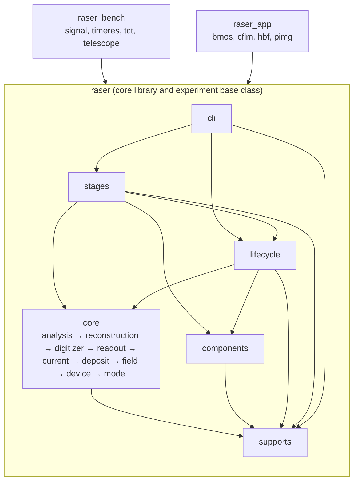
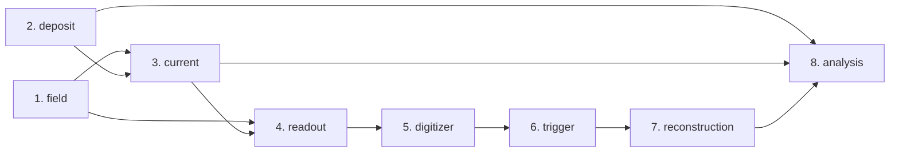

# Architecture Overview

This page describes RASER's source layout, experiment class mechanism, projects and configuration, how results are stored, the eight-stage simulation chain, components and physical models, and where assets live. Details of file formats, fields, units, and options are in [stages/README.md](stages/README.md), [lifecycle/experiments.md](lifecycle/experiments.md), [core/model.md](core/model.md), [components/device.md](components/device.md), and their respective pages.

## Layout

```text
src/
├── raser/        # core library: core, stages, lifecycle, components, cli, supports, and the experiment base class to inherit from
├── raser_bench/  # benchmark classes: signal, timeres, tct, telescope
└── raser_app/    # application classes: bmos, cflm, hbf, pimg
examples/         # configured example projects, in the repository only, alongside work/
work/             # user projects
```



- **Single distribution**: `pip install raser` installs all three packages `raser`, `raser_bench`, and `raser_app` together.
- **One-way dependency**: `raser_bench` and `raser_app` import `raser`; `raser` contains only the library and mechanisms, while concrete benchmarks and applications live in the two parallel packages. Layering is checked by the `import-linter` contracts in `pyproject.toml`.
- **Full names of benchmarks and applications**: Among benchmark classes, `timeres` is Time Resolution and `tct` is Transient Current Technique; among application classes, `bmos` is Beam Monitor Online System, `cflm` is CEPC Fast Luminosity Monitor, `hbf` is Hydrogen–Boron Fusion (p–¹¹B), and `pimg` is Proton Imaging.

## Experiments Are Python Classes

- **Inheriting the experiment base class**: Each benchmark or application is a Python class inheriting from the `raser` experiment base class. The class declares which stages it consists of, which devices it has, what role each device plays (for example, device under test or reference device), and default values.
- **Device under test as the subject**: The device given on the command line replaces the device under test. For example, `telescope` uses TAICHU as the reference by default, and the command line swaps the device under test placed in the middle.
- **Benchmark class outputs**: Placed under the device's project, i.e., `work/<device>/<bench>/`, keeping all benchmark results for the same device together.
- **Application class outputs**: Placed under `work/<app>/`; the device can be a scan axis (multiple device axes are supported) to compare the results obtained with different devices installed.
- **Custom experiment registration**: A user's own benchmark or application is written as such a class, placed in the user's own package (registered via entry points) or inside the user's project folder (auto-discovered), and registered by name; the official `raser_bench` and `raser_app` use the exact same mechanism.

## project

- **project**: A device folder or an application folder under `work/`.
- **examples**: Each example under `examples/` is a project, such as `examples/HPK-Si-PiN/` (containing `signal/`, `timeres/`, etc., each with a complete `config.json`) and `examples/bmos/`.
- **Sectioned configuration file**: `config.json` in each experiment folder specifies all settings used for the run, sectioned by stage (one section each for `field`, `deposit`, `current`, `readout`, `digitizer`, `trigger`, `reconstruction`, and `analysis`). `--set` and `--scan` use `"section.key"` as the address, for example `--set field.voltage=100` and `--scan field.voltage=100,200`. Every setting used by a run comes from the configuration file.
- **Creating a new project**: `raser new --from <example> <path>` copies the entire example project to `<path>` with a complete configuration, independent of the example thereafter. For example, `raser new --from HPK-Si-PiN work/my-PiN`.
- **Referencing a device**: If the project folder contains its own device file, that file is used; when only a name is given, it is looked up in the component library.

Details of configuration merging, scan-point expansion, and job scheduling are in [lifecycle/experiments.md](lifecycle/experiments.md) and [lifecycle/jobs.md](lifecycle/jobs.md).

## Results

The results of an experiment are stored in two layers: content-addressed nodes underneath, and human-readable views organized by scan point on top. Parameters and results are matched by fingerprint rather than by folder name. Examples run in place inside `examples/` and store results in their own project, just like an SWB project; projects under `work/` behave the same way.

```text
work/HPK-Si-PiN/                      # device project
├── field/                            # field nodes for this device, shared across experiments
│   └── <node_id>/
└── signal/                           # an experiment
    ├── config.json                   # settings, sectioned by stage
    ├── points.json                   # parameter table
    ├── nodes/                        # nodes, separated by stage
    │   ├── deposit/<node_id>/        #   files written by this stage, plus a node.json
    │   ├── current/<node_id>/
    │   └── …
    ├── points/                       # views, all symlinks
    │   ├── voltage_100/
    │   │   ├── deposit -> ../../nodes/deposit/<node_id>
    │   │   └── …
    │   └── voltage_200/
    └── analysis/                     # cross-point statistics and trend plots
```

### Nodes

One result computed by a stage for a given set of inputs is a node. Its inputs consist of four items:

- the setting values used by this stage;
- the part of the component files used by this stage;
- the node IDs of its upstream nodes;
- the seeds of the measurement stages (deposit, current), and readout's own seed (NGspice noise).

A fingerprint is computed from these inputs, and that fingerprint is the node ID. `node.json` inside the node folder records the inputs verbatim; the code version, runtime environment, and run status are also recorded there, but do not enter the fingerprint. A device's field is likewise a node, stored under `work/<device>/field/` and referenced by all experiments on that device.

### Parameter Table

On each run, the program computes `points.json` from `config.json`: one row per scan point, listing the value of each scan axis and the node ID used for each stage. `raser status` prints this table, with each cell showing the status and node ID of that point at that stage.

### Views

`points/<point>/<stage>` is a symlink pointing to the node. Point names are derived from scan-axis values, such as `voltage_100`, serving as human-readable entry points; if settings change or a scan axis is added, the point name may stay the same while the node it points to updates accordingly, so parameters and results always match.

### Reuse

Nodes with the same fingerprint are reused regardless of which scan point or run computed them. When a scan only affects downstream settings, upstream nodes are shared across scan points. Nodes are append-only: changing a setting back points the view back to the original node without recomputation.

### Locking

Each node is locked individually. A node being written carries a `.part` suffix and is renamed to its final name only after writing completes, so an interruption never leaves a partial result behind.

### Staleness

When the code version differs from the one recorded in a node, only a notice is printed and the result is still reused as usual.

### Example

Scan two things simultaneously on `signal`: `field.voltage=100,200`, and two values of a resistor in `readout`.

| Stage | Number of nodes | Reason |
| --- | --- | --- |
| deposit, current | 2 | Changing bias is a new measurement, so each bias is measured separately; only readout reads the resistor, so both resistor values share these two nodes |
| readout and downstream | 4 | Two bias values times two resistor values |

Then change the number of events per job from 20 to 40: all fingerprints change, everything is computed into new nodes, and the old nodes remain. Changing it back to 20 points the views back to the old nodes, and nothing needs to be recomputed.

## Chain



The eight stages are `field`, `deposit`, `current`, `readout`, `digitizer`, `trigger`, `reconstruction`, and `analysis`, with equal standing. Each stage is a complete workflow in itself that can be run standalone or assembled backward from a target stage; commands and options are managed by each stage itself and dispatched by `cli`:

1. `field`: computes the electric field, weighting field, and IV/CV in the device.
2. `deposit`: computes particle energy deposition with Geant4.
3. `current`: drifts carriers in the fields and computes induced currents on the electrodes.
4. `readout`: feeds the current into the device equivalent circuit and front-end amplifier to obtain waveforms.
5. `digitizer`: converts waveforms into digital waveforms according to the sampling and quantization of an oscilloscope or digitizer board.
6. `trigger`: decides which events are recorded according to the conditions of real trigger hardware.
7. `reconstruction`: extracts hit time and amplitude from waveforms, and performs track fitting in beam tests.
8. `analysis`: summarizes efficiency and time resolution.

- **Ownership of results and plots**: `analysis` is responsible for the results of the whole experiment; each scan point has its own results, and plots summarizing points and trends are written directly under `<experiment>/analysis/`. Each stage's own plots are placed in that stage's own output.
- **Shared field**: A device's field is an asset of that device, stored in `work/<device>/field/` and shared by all experiments on it.
- **Staleness notices and node fingerprints**: Staleness checking only notifies: when the code version differs from the one recorded in a node, a notice is printed and the existing result is reused as usual. The identity of each stage node is determined by the fingerprint of the inputs it reads (`node.json`), and the node IDs used by each scan point are recorded in `points.json`.

Data files read and written by each stage and slice dependency rules are in [stages/README.md](stages/README.md) and [lifecycle/slices.md](lifecycle/slices.md).

## Components

- **Component directory**: Components live in `raser/components/`, installed with the package, containing definitions only. `device/` holds devices; the rest are organized into folders by the stage that reads them: `deposit/` (Geant4 setups, radioactive sources and beams, lasers), `readout/` (front-end amplifiers and termination circuits), `digitizer/` (sampling and quantization settings; when one instrument handles both sampling and triggering, such as an oscilloscope, a single configuration is stored here and read by both `digitizer` and `trigger`), and `trigger/` (trigger conditions).
- **Provenance and validation**: Every component states its provenance; components corresponding to real devices are compared against measurements; users can add their own designs to the component library.
- **Separation of geometry and mesh**: Device geometry (layer thicknesses and materials, which face carries the electrodes) is an intrinsic property of the device written in the device file, and Geant4 uses the same geometry. The mesh belongs to `field`: one device can have several meshes, and which one to use is specified by `field` options.
- **Physical models and algorithm switches**: Physical model code lives in `raser.core.model`, with each model registered by name; user models are registered the same way. Device files select models by name. Every physical algorithm has an on/off switch.
- **Experimental setup paradigm**: Each experiment's setup is built following the standard paradigm used in academia for that experiment.

Component definitions and physical model formulas are in [components/device.md](components/device.md), the other `components/` pages, and [core/model.md](core/model.md).

## Assets

Some results do not belong to a single experiment, but are referenced repeatedly by many experiments; these results are called assets. An asset stays with what it depends on: assets depending only on a device live in that device's project; assets depending only on a circuit or setup each get their own folder and are referenced by experiments just like a device.

| Asset | Computed by | Depends on | Stored at | Used by |
| --- | --- | --- | --- | --- |
| Device parameter circuit diagram: junction capacitance, coupling capacitance, and undepleted layer, labeled with values | field | Device and bias voltage | `work/<device>/field/` | readout, connected into the device circuit |
| Front-end circuit schematic and impulse response | readout | Circuit and its parameters | `work/<circuit_name>/` | readout of each experiment |
| Phase-space file from the radioactive source to the plane just before the first device | deposit | Source and geometry up to that plane | `work/<setup_name>/` | deposit of each experiment, launching particles from that plane |
