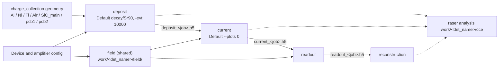

# Charge Collection Efficiency Test Bench (`bench/cce`)

`raser cce` is the benchmark experiment workflow for Charge Collection Efficiency (CCE) measurements. It runs the same five-slice simulation chain as [`signal`](signal.md) (`deposit`, `field`, `current`, `readout`, `reconstruction`), loads the charge-collection experimental geometry `charge_collection` by default, sets events per job to `10000`, and turns off per-event plotting (`--plots 0`). Experiment results are written to `work/<det_name>/cce/`, and `raser analysis` then summarizes charge collection efficiency and timing resolution.



## Command

```bash
raser cce <det_name> [source] [options]
```

## Inputs

- **Experiment defaults**: `src/raser/bench/cce/charge_collection.json` sets default `"g4setup": "charge_collection"`, and the workflow overrides `events_per_job = 10000` and `plots = 0`.
- **Component search paths**: Mounts `src/raser/bench/cce/components` and `src/raser/bench/signal/components` in order (plus project and global `components/`; see [`../supports/README.md`](../supports/README.md)).
- **Device, source, and front-end files**:
  - `<det_name>.json` ([`../components/device.md`](../components/device.md)): reads dimensions `l_x`, `l_y`, `l_z` (`um`), material `material`, readout electrode layout, bias `bias.voltage` (`V`), temperature `temperature` (`K`), and irradiation parameters.
  - `<source>.json` (default `"decay/Sr90"`, [`../components/source.md`](../components/source.md)): reads source `kind` and emitted particle or nuclide parameters.
  - `<part>.cir` (specified by `--amplifier`, [`../components/afe.md`](../components/afe.md)).
- **Geant4 setup script `<g4setup>.py`**: Defaults to `src/raser/bench/cce/components/g4setup/charge_collection.py` ([`../components/g4setup.md`](../components/g4setup.md)), reading `G4SETUP`:
  - Global settings: `"world": "G4_Galactic"`, `"maxstep": 2` (`um`), `"source": {"at": [0, 0, -17000], "towards": [0, 0, 0], "angle": 0}` (`um`, `degree`).
  - Surrounding volumes list:

| Volume | Category | Material | Dimensions and Hole Parameters (`um`) | Center `position_z` (`um`) |
| --- | --- | --- | --- | --- |
| `Al` | `elemental` | `G4_Al` | `5000 x 5000 x 0.08` | `-89.3` |
| `Ni` | `elemental` | `G4_Ni` | `5000 x 5000 x 0.05` | `-89.395` |
| `Ti` | `elemental` | `G4_Ti` | `5000 x 5000 x 0.015` | `-89.38` |
| `Air` | `binary_compounds` | `Air` (N/O 70:30) | `5000 x 5000 x 5000`, z-axis cylinder subtracted (`tub_radius = 5000`, `tub_depth = 5000`) | `-89.4` |
| `SiC_main` | `binary_compounds` | `SiC` (Si/C 50:50) | `5000 x 5000 x 41.3`, z-axis cylinder subtracted (`tub_radius = 5000`, `tub_depth = 41.3`) | `0` |
| `pcb1` | `binary_compounds` | `SiO2` (Si/O 33.4:66.6) | `5000 x 5000 x 15`, z-axis cylinder subtracted (`tub_radius = 5000`, `tub_depth = 15`) | `-74.3` |
| `pcb2` | `binary_compounds` | `SiO2` (Si/O 33.4:66.6) | `5000 x 5000 x 15`, z-axis cylinder subtracted (`tub_radius = 5000`, `tub_depth = 1500`) | `15` |

- **Shared field directory `work/<det_name>/field/`**: If the field at the target bias and irradiation flux is not ready yet, the workflow automatically calls [`raser field`](../stages/field.md) before launching jobs.

## Outputs

The experiment directory is `work/<det_name>/cce/`, with the same directory layout and slice file formats as the five-slice signal chain in [Getting Started](../getting-started.md) (see [`../lifecycle/experiments.md`](../lifecycle/experiments.md), [`../lifecycle/slices.md`](../lifecycle/slices.md)). Each job `<job>` writes in order under the point directory `batch/` holding the slices:

- `deposit_<job>.h5`: energy deposition steps for recorded events (see [`../stages/deposit.md`](../stages/deposit.md)).
- `current_<job>.h5`: induced current and integrated charge per readout electrode (see [`../stages/current.md`](../stages/current.md)); when `--plots` is greater than `0`, writes carrier drift path plots, current plots, and (for strip or pixel devices) charge collection plots for the first `plots` events under `plots/job_<job>/event_<number>/`.
- `readout_<job>.h5`: output voltage waveforms for readout channels whose swing is at least `1e-3` times the event maximum swing (saved only for events with induced current; see [`../stages/readout.md`](../stages/readout.md)).
- `reconstruction_<job>.h5`: reconstruction result table per event (see [`../stages/reconstruction.md`](../stages/reconstruction.md)).

When `-g4_vis` is enabled, it renders geometry and tracks for a number of generated events equal to `-evt` (or `-gen`, default `10000` generated events); if `--g4-vis-driver` (case-insensitive) is `"TSG"`, `"TSG_FILE"`, `"TSG_OFFSCREEN"` (writes `g4_geometry.png`), or starts with `"OGL"`, it writes `g4_geometry` image in the run directory (other drivers starting with `"TSG"` raise `ValueError: the driver '<driver>' writes no picture to a given path; use a TSG or an OGL driver, or no output`), and then the job exits with `SystemExit`. After simulation finishes, running `raser analysis work/<det_name>/cce` on the experiment directory summarizes the CCE distribution and timing resolution at each scan point (see [`../stages/analysis.md`](../stages/analysis.md)).

## Options

| Option | Default | Unit | Meaning |
| --- | --- | --- | --- |
| `det_name` | None (required positional argument) | None | Detector component name or path |
| `source` | `"decay/Sr90"` | None | Signal source component name or path (optional positional argument) |
| `--g4setup` | `"charge_collection"` | None | Geant4 geometry environment component name or path |
| `-evt`, `--events-per-job` | `10000` | events | Number of recorded events per job (mutually exclusive with `-gen`) |
| `-gen`, `--generated-per-job` | `None` | events | Number of generated source events per job (replaces `-evt`) |
| `--generated-limit` | `None` (`10000000` at runtime) | events | Maximum generated source events allowed to record `-evt` events |
| `--edep-min` | `None` | `MeV` | Minimum total deposited energy inside the detector for a recorded event |
| `--edep-max` | `None` | `MeV` | Maximum total deposited energy inside the detector for a recorded event |
| `fano` (set via `--set`/`--scan`) | `True` | None | Whether to sample electron-hole pair counts per deposit step with the Fano factor |
| `-g4_vis` | `False` | None | Launch Geant4 geometry and track visualization (renders `-evt` or `-gen` generated events, default `10000`), then exit the job with `SystemExit` |
| `--g4-vis-driver` | `"OGL"` | None | Geant4 visualization driver name used by `-g4_vis` |
| `--plots` | `0` | events | First N recorded events per job to plot drift paths, currents, and (for strip/pixel devices) charge collection |
| `-vol`, `--voltage` | Taken from `device.bias.voltage` | `V` | Detector bias voltage (written to `device.bias.voltage`) |
| `-irr`, `--irradiation` | `None` (taken from device `irradiation_flux` when omitted; `0` if absent) | `neq/cm^2` | Irradiation fluence |
| `-amp`, `--amplifier` | `"SantaCruz+Gali52+Termination50"` | None | Front-end amplifier stages and termination load joined by `+` |
| `--sheet-resistance` | `None` | `Ohm` | Override sheet resistance of the resistive layer in the device file |
| `-threshold` | `10.0` | `mV` | Threshold for pulse timing and area calculation |
| `-amplitude_threshold` | `10.0` | `mV` | Amplitude threshold for event selection and cluster seed finding |
| `fractions` (set via `--set`/`--scan`) | `[0.1, 0.2, 0.3, 0.4, 0.5, 0.6, 0.7, 0.8, 0.9]` | None | Amplitude fraction list for Constant Fraction Discrimination (CFD) |
| `--edge` | `None` (uses `pulse_edge` exported by `readout`) | None | Trigger edge: `"rising"` or `"falling"` |
| `-s`, `--jobs` | `None` (single job) | jobs | Number of indexed jobs to run concurrently or submit |
| `--seed` | Randomly generated 31-bit integer | None | Master random seed |
| `--same-seeds` | `False` | None | Whether scan points share the same batch of random seeds |
| `-b`, `--batch` | `False` | None | Submit jobs to cluster queue |
| `-mem` | `1` | tier | Cluster job memory tier |
| `--dry-run` | `False` | None | Print points, slices, and job list to run and return immediately |
| `--scan` | `[]` | None | Scan parameter `address=value1,value2,...` (repeatable) |
| `--set` | `[]` | None | Fix single parameter `address=value` (repeatable) |

## Common Errors

| Error Message | Trigger Condition |
| --- | --- |
| `ValueError: events_per_job and generated_per_job are given at once in the command line; give one of them` | Both `-evt` and `-gen` are given on the command line (or `in the "set" of config.json` if both are in `"set"` of `config.json`) |
| `ValueError: events_per_job (<events>) and generated_per_job (<generated>): a job records a number of events or generates one, so exactly one of them is set` | Both `events_per_job` and `generated_per_job` end up unset |
| `RuntimeError: <recorded> of the <events> events asked for were recorded when the limit of <generated> generated events was reached ...` | Generated source events reach `generated_limit` before recording the requested `events_per_job` events |
| `` FileNotFoundError: no field of <det_name> ready for this run: solve it with `raser field <det_name>` `` | No ready solved field is found when the field slice runs |
| `ValueError: <det_name> has no resistive layer to give a sheet resistance of <sheet_ohm> Ohm` | `--sheet-resistance` is passed for a detector without `resistive_layer` |

## Related Pages

- [`../getting-started.md`](../getting-started.md)
- [`../cli.md`](../cli.md)
- [`../lifecycle/experiments.md`](../lifecycle/experiments.md)
- [`../lifecycle/slices.md`](../lifecycle/slices.md)
- [`../components/device.md`](../components/device.md)
- [`../components/source.md`](../components/source.md)
- [`../components/g4setup.md`](../components/g4setup.md)
- [`../components/afe.md`](../components/afe.md)
- [`../stages/deposit.md`](../stages/deposit.md)
- [`../stages/field.md`](../stages/field.md)
- [`../stages/current.md`](../stages/current.md)
- [`../stages/readout.md`](../stages/readout.md)
- [`../stages/reconstruction.md`](../stages/reconstruction.md)
- [`../stages/analysis.md`](../stages/analysis.md)
