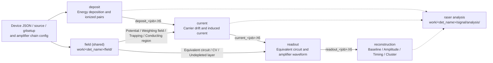

# Single-Detector Signal Test Bench (`bench/signal`)

`raser signal` is RASER's single-detector full-chain signal simulation benchmark workflow. Starting from the standard simulation chain, it assembles five slices—`deposit`, `field`, `current`, `readout`, and `reconstruction` (following the chain defaults in [`stages/README.md`](../stages/README.md))—turning energy deposits from a radioactive source or beam in a single device into electronics output waveforms and a reconstruction feature table for downstream [`raser analysis`](../stages/analysis.md) statistics on efficiency and timing resolution.



## Command

```bash
raser signal <det_name> [source] [options]
```

## Inputs

- **Chain default configuration**: Reads `raser.stages.chain.DEFAULTS` (default source `"decay/Sr90"`, geometry setup `"device_alone"`, `-evt 1`, `--plots 100`, amplifier `"SantaCruz+Gali52+Termination50"`, `-threshold 10.0`, `-amplitude_threshold 10.0`).
- **Component search paths**: Mounts `src/raser/bench/signal/components` (providing `g4setup/Sr90_collimator.py`, `g4setup/pcb_readout_gdml.py`, and `g4macro/vis_pcb.mac`) plus project and global component directories (see [`../supports/README.md`](../supports/README.md)).
- **Device, source, and front-end files**: `<det_name>.json` ([`../components/device.md`](../components/device.md)), `<source>.json` ([`../components/source.md`](../components/source.md)), and `<part>.cir` specified by `--amplifier` ([`../components/afe.md`](../components/afe.md)).
- **Geant4 setup script `<g4setup>.py`**: Defaults to `"device_alone"`, with options such as `"Sr90_collimator"`, `"pcb_readout_gdml"`, etc. ([`../components/g4setup.md`](../components/g4setup.md)).
  - When `"pcb_readout_gdml"` is selected, `GDMLDetectorConstruction` searches each component root, `g4experiment/` under each component root, and `src/raser/` in order for `pcb_readout.gdml`.
  - Helper script `src/raser/bench/signal/patch_pcb_gdml_material.py` (run directly as a Python script) reads `g4experiment/pcb_readout_raw.gdml` under the project path; after verifying `gdml.position_um == [0, 0, 0]` and `gdml.auto_center == False` in `pcb_readout_gdml.py`, it computes the geometric center of `Mesh2Tess_*` after trimming the outer 10% outlier points on each side, writes its negated value into `<position name="center" x="..." y="..." z="..." unit="mm"/>`, removes the `dummy` physical volume, renames the outer volume containing `WorldBox` to `World_Wrapper` (`2000000 x 2000000 x 2000000 um`), replaces `"Material"` with `"FR4"`, and writes `g4experiment/pcb_readout.gdml` under the project path.
- **Shared field directory `work/<det_name>/field/`**: If the field at the target bias and irradiation flux is not ready yet, the workflow automatically calls [`raser field`](../stages/field.md) before launching jobs.

## Outputs

The experiment directory is `work/<det_name>/signal/`, with `config.json` written at the top level and `run.json` and `batch/` written under each scan point's seed directory `<point>/<seed_folder>/` ([`../lifecycle/experiments.md`](../lifecycle/experiments.md), [`../lifecycle/slices.md`](../lifecycle/slices.md)). Each job `<job>` writes in order under the point directory `batch/` holding the slices:

| Output File / Directory | Written by Slice | Main Content and Notes |
| --- | --- | --- |
| `batch/deposit_<job>.h5` | [`deposit`](../stages/deposit.md) | Deposited energy (`MeV`), coordinates (`um`), time (`s`), and ionized electron-hole pairs |
| `batch/current_<job>.h5` | [`current`](../stages/current.md) | Induced current per electrode (`A`), time step `dt` (`s`), and integrated charge `charge` (`C`) |
| `plots/job_<job>/event_<number>/` | [`current`](../stages/current.md) | Carrier drift path and electrode induced current plots for the first `--plots` (default `100`) recorded events |
| `batch/readout_<job>.h5` | [`readout`](../stages/readout.md) | Voltage waveform `voltage` (`V`), start time `t0` (`s`), time step `dt` (`s`), `pulse_edge`, and device equivalent circuit parameters `device_circuit` (JSON string; omitted when no device circuit values are given) |
| `batch/reconstruction_<job>.h5` | [`reconstruction`](../stages/reconstruction.md) | Baseline, noise, amplitude (`V`), threshold-crossing time `ToA` on the selected edge (default `pulse_edge`), `ToT`, center of gravity `CoG`, constant fraction timing `CFD` (`s`), main-lobe `area` (`V s`), and cluster size and centroid |

When `-g4_vis` is enabled, it renders geometry and tracks for a number of generated events equal to `-evt` (or `-gen`, default `1` generated event; `gdml_import` geometry uses macro `vis_pcb.mac`); if `--g4-vis-driver` (case-insensitive) is `"TSG"`, `"TSG_FILE"`, `"TSG_OFFSCREEN"` (writes `g4_geometry.png`), or starts with `"OGL"`, it writes `g4_geometry` image in the run directory (other drivers starting with `"TSG"` raise `ValueError: the driver '<driver>' writes no picture to a given path; use a TSG or an OGL driver, or no output`), and then the job exits with `SystemExit`.

## Example Run (Bias Scan of `HPK-Si-PiN`)

Run the full-chain example from [Getting Started](../getting-started.md) on the `HPK-Si-PiN` planar silicon detector (`--dry-run` previews scan points and slice plans before running):

```bash
raser signal HPK-Si-PiN --scan voltage=100,200 -s 2 -evt 200 --seed 1
```

This run uses the default radioactive source `decay/Sr90`, `device_alone` geometry, and `SantaCruz+Gali52+Termination50` amplifier chain, recording the following facts:

- **Automatic shared field solve and scan point directories**: Because `work/HPK-Si-PiN/field/` is not yet solved, `raser signal` first runs `raser field HPK-Si-PiN -bias 100.0` and `-bias 200.0` into the shared field directory; `200 V` is the device default bias, so its results go directly to `work/HPK-Si-PiN/signal/seed_1/`, while `100 V` goes to `work/HPK-Si-PiN/signal/voltage_100/seed_1/`.
- **Slice files and statistics (job `0` in `seed_1/batch/`)**:
  - `deposit_0.h5`: Geant4 generated `7359` events and recorded `200` valid deposit events (`generated_fraction = 0.017037`), totaling `5476` deposition step records.
  - `current_0.h5`: `dt = 5e-12 s`, `electrodes = ['top']`, writing `charge` `(200, 1)`, `pairs` `(200,)`, etc. for `200` events plus drift path and induced current plots for the first `100` events (under `plots/job_0/event_<event_number>/`).
  - `readout_0.h5`: `dt = 5e-12 s`, `electrodes = ['top']`, `pulse_edge = ['falling']`, and `device_circuit` records junction capacitance `3.44162280284e-12 F`.
  - `reconstruction_0.h5`: `threshold = 0.01 V`, `amplitude_threshold = 0.01 V`, `edge = ['falling']`, `fractions = [0.1, ..., 0.9]`, writing `CFD` `(200, 1, 9)`, `ToA` `(200, 1)`, `selected` `(200,)`, etc.
- **Downstream statistics (`raser analysis work/HPK-Si-PiN/signal`)**: Aggregates `400` recorded events at each bias point, writing `points.json`, `points.png`, and per-point `result.json`, `events.h5`, and distribution plots under `analysis/`. At `200 V`, mean CCE is `0.9348` (`spread = 0.1445`), `276` events exceed the `10 mV` amplitude threshold, and `CFD30` timing resolution is `sigma = 33.35 ps`, `sigma68 = 31.66 ps`; at `100 V`, mean CCE is `0.9195` with `257` selected events.


Full terminal output, status query commands, and remaining distribution plots are shown in [Getting Started](../getting-started.md).

## Options

| Option | Default | Unit | Meaning |
| --- | --- | --- | --- |
| `det_name` | None (required positional argument) | None | Detector component name or path |
| `source` | `"decay/Sr90"` | None | Signal source component name or path (optional positional argument) |
| `--g4setup` | `"device_alone"` | None | Geant4 geometry environment component name or path |
| `-evt`, `--events-per-job` | `1` | events | Number of recorded events per job (mutually exclusive with `-gen`) |
| `-gen`, `--generated-per-job` | `None` | events | Number of generated source events per job (replaces `-evt`) |
| `--generated-limit` | `None` (`10000000` at runtime) | events | Maximum generated source events allowed to record `-evt` events |
| `--edep-min` | `None` | `MeV` | Minimum total deposited energy inside the detector for a recorded event |
| `--edep-max` | `None` | `MeV` | Maximum total deposited energy inside the detector for a recorded event |
| `fano` (set via `--set`/`--scan`) | `True` | None | Whether to sample electron-hole pair counts per deposit step with the Fano factor |
| `-g4_vis` | `False` | None | Launch Geant4 geometry and track visualization (renders `-evt` or `-gen` generated events, default `1`; `gdml_import` geometry uses `vis_pcb.mac`), then exit the job with `SystemExit` |
| `--g4-vis-driver` | `"OGL"` | None | Geant4 visualization driver name used by `-g4_vis` |
| `--plots` | `100` | events | First N recorded events per job to plot drift paths and currents |
| `-vol`, `--voltage` | Taken from `device.bias.voltage` | `V` | Detector bias voltage (written to `device.bias.voltage`) |
| `-irr`, `--irradiation` | `None` (taken from device `irradiation_flux` when omitted; `0` if absent) | `neq/cm^2` | Irradiation fluence |
| `-amp`, `--amplifier` | `"SantaCruz+Gali52+Termination50"` | None | Front-end amplifier stages and termination load joined by `+` |
| `--sheet-resistance` | `None` | `Ohm` | Override sheet resistance of the resistive layer in the device file |
| `-threshold` | `10.0` | `mV` | Threshold for pulse timing and area calculation |
| `-amplitude_threshold` | `10.0` | `mV` | Amplitude threshold for event selection and cluster seed finding |
| `fractions` (set via `--set`/`--scan`) | `[0.1, 0.2, 0.3, 0.4, 0.5, 0.6, 0.7, 0.8, 0.9]` | None | Amplitude fraction list for Constant Fraction Discrimination (CFD) |
| `--edge` | `None` (uses `pulse_edge` exported by `readout`) | None | Trigger edge: `"rising"` or `"falling"` |
| `-s`, `--jobs` | `None` (single job) | jobs | Number of indexed jobs to run concurrently or submit |
| `--seed` | Randomly generated 31-bit integer | None | Master random seed |
| `--same-seeds` | `False` | None | Whether scan points share the same batch of random seeds |
| `-b`, `--batch` | `False` | None | Submit jobs to cluster queue |
| `-mem` | `1` | tier | Cluster job memory tier |
| `--dry-run` | `False` | None | Print points, slices, and job list to run and return immediately |
| `--scan` | `[]` | None | Scan parameter `address=value1,value2,...` (repeatable) |
| `--set` | `[]` | None | Fix single parameter `address=value` (repeatable) |

## Common Errors

| Error Message | Trigger Condition |
| --- | --- |
| `ValueError: events_per_job and generated_per_job are given at once in the command line; give one of them` | Both `-evt` and `-gen` are given on the command line (or `in the "set" of config.json` if both are in `"set"` of `config.json`) |
| `ValueError: events_per_job (<events>) and generated_per_job (<generated>): a job records a number of events or generates one, so exactly one of them is set` | Both `events_per_job` and `generated_per_job` end up unset |
| `RuntimeError: <recorded> of the <events> events asked for were recorded when the limit of <generated> generated events was reached ...` | Generated source events reach `generated_limit` before recording the requested `events_per_job` events |
| `` FileNotFoundError: no field of <det_name> ready for this run: solve it with `raser field <det_name>` `` | No ready solved field is found when the field slice runs |
| `FileNotFoundError: Cannot find GDML file: pcb_readout.gdml\nSearched:\n  - <candidate_paths>` | `pcb_readout.gdml` is not found in any component root, `g4experiment/` under a component root, or `src/raser/` when using `--g4setup pcb_readout_gdml` |
| `SystemExit: [Error] ... 的 gdml 段应当是 position_um = [0, 0, 0]、auto_center = False ...` | `patch_pcb_gdml_material.py` exits when the `gdml` section of `pcb_readout_gdml.py` does not satisfy the centering precondition |

## Related Pages

- [`../getting-started.md`](../getting-started.md)
- [`../cli.md`](../cli.md)
- [`../lifecycle/experiments.md`](../lifecycle/experiments.md)
- [`../lifecycle/slices.md`](../lifecycle/slices.md)
- [`../components/device.md`](../components/device.md)
- [`../components/source.md`](../components/source.md)
- [`../components/g4setup.md`](../components/g4setup.md)
- [`../components/afe.md`](../components/afe.md)
- [`../stages/deposit.md`](../stages/deposit.md)
- [`../stages/field.md`](../stages/field.md)
- [`../stages/current.md`](../stages/current.md)
- [`../stages/readout.md`](../stages/readout.md)
- [`../stages/reconstruction.md`](../stages/reconstruction.md)
- [`../stages/analysis.md`](../stages/analysis.md)
