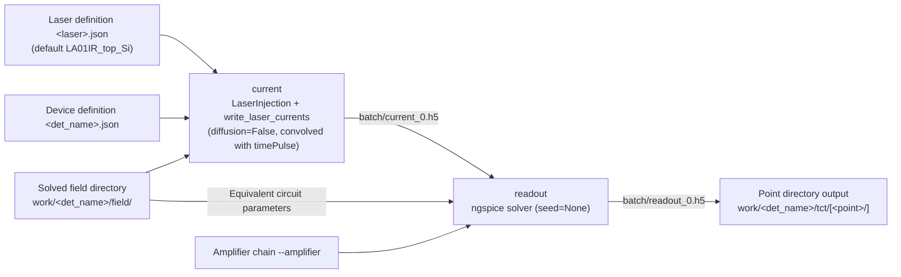

# Transient Current Technique Test Bench (`bench/tct`)

`raser tct` runs Transient Current Technique (TCT) laser pulse simulations. Its slice chain consists of `current` and `readout` with random-seed directory management turned off (`seeds=False`): the `current` slice computes drift-induced currents directly from laser injection parameters and the device electric field solved in [`work/<det_name>/field/`](../stages/field.md), and the `readout` slice then solves the noiseless output voltage waveform of the front-end amplifier chain.



## Command

```bash
raser tct <det_name> [laser] [options]
```

## Inputs

- **Experiment defaults**: `src/raser/bench/tct/transient_current.json` sets default laser component `"laser": "LA01IR_top_Si"`; readout defaults follow `chain.READOUT_DEFAULTS` (default `--amplifier "SantaCruz+Gali52+Termination50"`).
- **Device definition `<det_name>.json`** ([`../components/device.md`](../components/device.md)): reads geometry dimensions `l_x`, `l_y`, `l_z` (`um`), material `material`, readout electrodes, bias `bias.voltage` (`V`), temperature `temperature` (`K`), irradiation parameters, and optional `field_interpolation_bins`.
- **Laser definition `<laser>.json`** ([`../components/laser.md`](../components/laser.md)): reads absorption mechanism `tech` (`"SPA"` or `"TPA"`), incidence direction `direction` (`"top"`, `"bottom"`, or `"edge"`), refractive index `refractionIndex`, two-photon absorption coefficient `beta_2` (when `tech` is `"TPA"`), wavelength `wavelength` (`nm`), optional absorption coefficient `alpha` (`1/m`; when omitted, interpolated from `components/laser/absorption/<material>.txt`, or `0.0` above the table's last wavelength), pulse `temporal_FWHM` (`s`), `pulse_energy` (`J`), focus spot `spacial_FWHM` (`um`), `central_time` (`s`), optional Rayleigh length `l_Rayleigh` (`um`), relative focus coordinates `fx_rel, fy_rel, fz_rel`, and grouping parameters `pairs_per_group`, `groups`.
- **Analog front-end file `<part>.cir`**: specified by `--amplifier` ([`../components/afe.md`](../components/afe.md)).
- **Solved field directory `work/<det_name>/field/`**: potential, doping, conducting region, trapping rate, and weighting field files at the target bias and irradiation fluence must be solved beforehand via [`raser field <det_name>`](../stages/field.md).

## Outputs

The `tct` workflow sets `seeds=False`. The experiment directory is `work/<det_name>/tct/`, with `config.json` at the top level; each scan point writes `run.json`, `batch/`, and `plots/` directly inside the point directory (`work/<det_name>/tct/` for the nominal point, `work/<det_name>/tct/<point>/` for other scan points; see [`../lifecycle/experiments.md`](../lifecycle/experiments.md), [`../lifecycle/slices.md`](../lifecycle/slices.md)):

| Output Path | Written by Slice | Content and Units |
| --- | --- | --- |
| `batch/current_0.h5` | [`current`](../stages/current.md) | Drifts carriers via `LaserInjection` and `write_laser_currents` (`diffusion=False`), convolves the induced current with the Gaussian laser time pulse `timePulse`, and writes it as `event = 0` (`current` [`A`], `dt` [`s`], `t0` [`s`], `charge` [`C`]; see [`../core/current.md`](../core/current.md)) |
| `plots/nocarrier_<fx_rel>_<fy_rel>_<fz_rel>.pdf` | `current` | 3D spatial distribution plot of laser carriers (axis units `um`) |
| `plots/nocarrier2D_<fx_rel>_<fy_rel>_<fz_rel>.pdf` | `current` | 2D x-z projection plot of laser carriers (axis units `um`), accompanied by the current waveform plot |
| `batch/readout_0.h5` | [`readout`](../stages/readout.md) | Reads `batch/current_0.h5`, solves the device equivalent circuit and amplifier chain with ngspice (`seed=None`), and writes the noiseless output voltage waveform `voltage` (`V`), `t0` (`s`), `dt` (`s`), `pulse_edge`, and `device_circuit` (JSON string, omitted when no device circuit values are given; see [`../core/readout.md`](../core/readout.md)) for event `0` |

## Options

| Option | Default | Unit | Meaning |
| --- | --- | --- | --- |
| `det_name` | None (required positional argument) | None | Detector component name or path |
| `laser` | `"LA01IR_top_Si"` | None | Laser component name or path (optional positional argument) |
| `-vol`, `--voltage` | Taken from `device.bias.voltage` | `V` | Detector bias voltage (written to `device.bias.voltage`) |
| `-amp`, `--amplifier` | `"SantaCruz+Gali52+Termination50"` | None | Front-end amplifier stages and termination load joined by `+` |
| `-b`, `--batch` | `False` | None | Submit jobs to cluster queue |
| `-mem` | `1` | tier | Cluster job memory tier |
| `--dry-run` | `False` | None | Print points, slices, and job list to run and return immediately |
| `--scan` | `[]` | None | Scan parameter `address=value1,value2,...` (repeatable) |
| `--set` | `[]` | None | Fix single parameter `address=value` (repeatable) |

## Common Errors

| Error Message | Trigger Condition |
| --- | --- |
| `` FileNotFoundError: no <mode> field of <det_name> at the irradiation flux <flux> in <root> ...; solve it with `raser field <det_name> -bias <voltage> --mode <mode> -irr <flux>` `` | No field exists under `work/<det_name>/field/` for that irradiation fluence or mode |
| `` ValueError: the field in <folder> was solved for another device (<differing>); solve it again with `raser field <det_name> -bias <voltage> --mode <mode>` `` | The field in `work/<det_name>/field/` was solved for a previous device definition |
| `` FileNotFoundError: the field in <folder> is not solved at <voltage> V (solved at: ...); solve it with `raser field <det_name> -bias <voltage> --mode <mode>` `` | The electric potential field at target bias `<voltage>` V has not been solved in this field directory |
| `` FileNotFoundError: the field in <folder> has no weighting field at <voltage> V (solved at: ...); solve it with `raser field <det_name> -bias <voltage> --mode <mode> -wf` `` | The weighting field at target bias `<voltage>` V is missing from this field directory |
| `ValueError: no absorption table of <material>: give alpha [1/m] in the laser file` | `alpha` is not given in the laser file and `components/laser/absorption/<material>.txt` does not exist |
| `ValueError: the absorption table of <material> starts at <min> nm, the laser has <wavelength> nm: give alpha [1/m] in the laser file` | Laser wavelength is shorter than the lower limit of the absorption table and `alpha` is not explicitly given (`alpha` is `0.0` above the last row of the table) |
| `NameError: <tech>` | Laser `tech` is neither `"SPA"` nor `"TPA"` |
| `NameError: <direction>` | Laser `direction` is not `"top"`, `"bottom"`, or `"edge"` |

## Related Pages

- [`../cli.md`](../cli.md)
- [`../lifecycle/experiments.md`](../lifecycle/experiments.md)
- [`../lifecycle/slices.md`](../lifecycle/slices.md)
- [`../components/device.md`](../components/device.md)
- [`../components/laser.md`](../components/laser.md)
- [`../components/afe.md`](../components/afe.md)
- [`../stages/field.md`](../stages/field.md)
- [`../core/current.md`](../core/current.md)
- [`../core/readout.md`](../core/readout.md)
