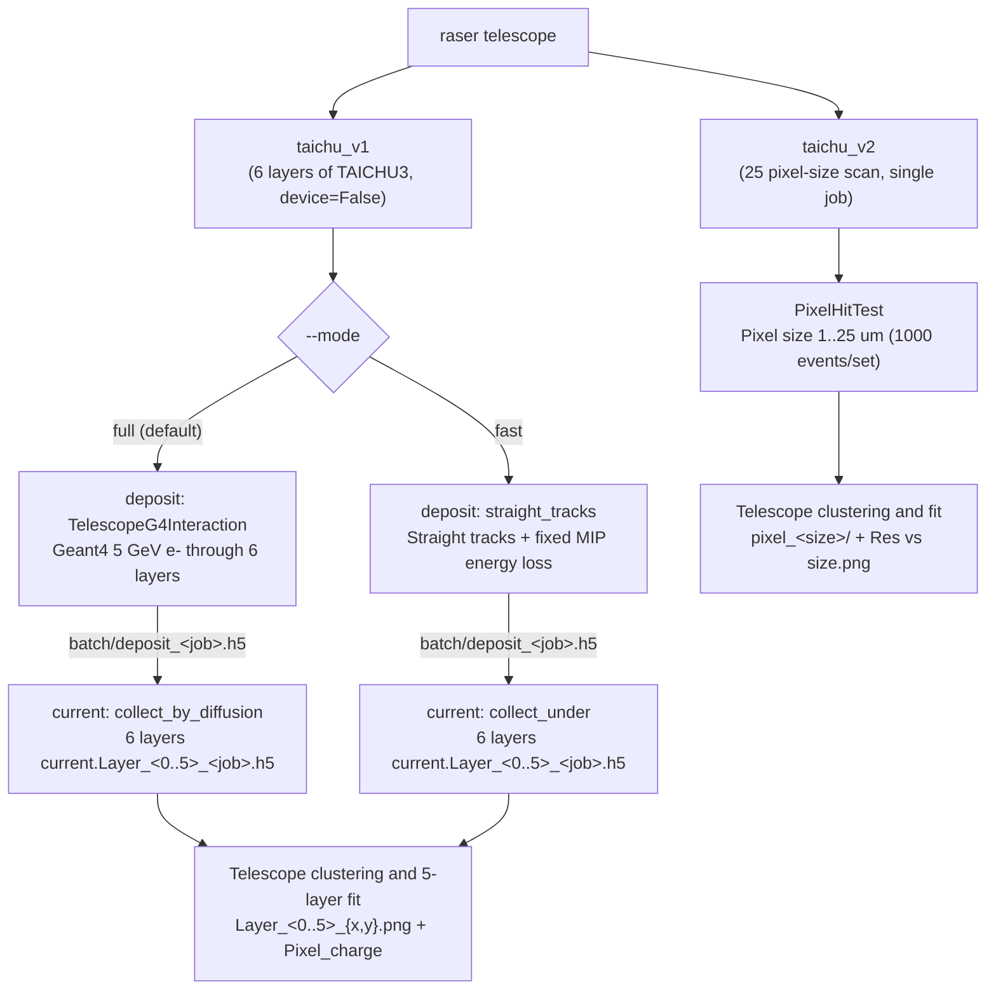

# Beam Telescope Test Bench (`bench/telescope`)

`raser telescope` targets spatial resolution studies for pixel-detector beam telescopes and provides two required subcommands, `taichu_v1` and `taichu_v2`. `taichu_v1` runs `deposit` and `current` slices to simulate 5 GeV electrons passing through 6 layers of `TAICHU3` pixel arrays, collects pixel charge layer by layer, and performs island clustering, leave-one-out straight-line fitting, and Gaussian residual fits; `taichu_v2` generates synthetic hit data for 25 pixel sizes in a single job to scan telescope resolution versus pixel size.



## Commands

```bash
raser telescope taichu_v1 [options]
raser telescope taichu_v2 [variant] [options]
```

## Inputs

### `taichu_v1`

- **Telescope configuration `src/raser/bench/telescope/telescope.json`**:
  - Simulation and fitting parameters: `"geant4_model": "telescope"`, `"total_events": 1000` (default events per job), `"ltz": [20000.0, 60000.0, 100000.0, 140000.0, 180000.0, 220000.0]` (`um`, z coordinates of the 6 layers used in track fitting), `"seedcharge": 100` (electrons, seed pixel threshold for clustering), `"collection_window_s": 10e-9` (`s`, lateral diffusion collection window in `"full"` mode).
  - Pixel volume and array definitions: `"object.pixel.Taichu"` (`G4_Si`, `25 x 25 x 20 um`) and `"object.pixel.Taichu_2"` (`G4_Si`, `25 x 25 x 150 um`, containing `part_1` and `part_2` mixture parts; every entry under `"object.pixel"` is built as a pixel volume); `"object.layer"` defines 6 pixel array layers `Layer_0` through `Layer_5`, each `60 x 60` `Taichu` pixels centered at z = `-100000`, `-60000`, `-20000`, `20000`, `60000`, `100000 um` with `"rotation_xyz": [0, 0, 0]` (`degree`).
  - Beam and world parameters: `"world": "G4_Galactic"`, `"par_type": "e-"`, `"par_energy": 5000` (`MeV`), `"maxstep": 2` (`um`), `"par_in": [0, 0, -400000]` (`um`), `"par_out": [0, 0, 100000]` (`um`), `"par_randx": 750` (`um`), `"par_randy": 750` (`um`).
- **Detector component `TAICHU3`** (`src/raser/components/device/TAICHU3.json`, [`../components/device.md`](../components/device.md)): reads pixel pitches `p_x = 25.0`, `p_y = 25.0` (`um`), thickness `l_z = 20` (`um`), pixel counts `x_ele_num = 60`, `y_ele_num = 60`, collection region widths `e_width_x = 10.0`, `e_width_y = 10.0` (`um`), `doping`, and `temperature` (`300.0 K`).

### `taichu_v2`

- `taichu_v2` builds 25 virtual detector and geometry parameter sets in memory (pixel size `p_x = p_y` increasing uniformly from `1.0 um` to `25.0 um`, thickness `l_z = 200.0 um`, `seedcharge = 100`, `ltz = [20000.0, 60000.0, 100000.0, 140000.0, 180000.0, 220000.0] um`), and `PixelHitTest` generates `1000` synthetic straight-track hit events through the 6 layers for each set from random stream `"pixel_hit_test"`.

## Outputs

### `taichu_v1`

The `taichu_v1` workflow sets `device=False`. The experiment directory is `work/telescope/taichu_v1/`, with `config.json` at the top level and `run.json` and `batch/` under each scan point's seed directory `<point>/<seed_folder>/` ([`../lifecycle/experiments.md`](../lifecycle/experiments.md), [`../lifecycle/slices.md`](../lifecycle/slices.md)). Each job `<job>` runs the `deposit` and `current` slices in order:

| Output File | Written by Slice / Function | Content and Notes |
| --- | --- | --- |
| `batch/deposit_<job>.h5` | `deposit` (`telescope_signal.deposits`) | `"full"` mode runs `TelescopeG4Interaction` (Geant4 simulation of 5 GeV electrons through 6 pixel layers); `"fast"` mode runs `straight_tracks` (samples beam slopes from random stream `"telescope_straight_tracks"`, splits straight tracks by `maxstep`, and assigns fixed MIP mean energy loss). Every generated event is recorded; `detector` is recorded as layer name `"Layer_0"`–`"Layer_5"`, coordinates `x, y, z` (`um`) are converted to layer local coordinates, and `pairs` are sampled via `ionized_pairs` ([`../core/deposit.md`](../core/deposit.md)) |
| `batch/current.Layer_<0..5>_<job>.h5` | `current` (`telescope_signal.currents`) | One current file per layer (time step `DIFFUSION_STEP = 50e-12 s`, current `A`, charge `C`; see [`../core/current.md`](../core/current.md)). `"full"` mode calls `collect_by_diffusion` (electrons random-walk laterally in the field-free epitaxial layer in `50e-12 s` steps and are collected upon entering the pixel center `e_width_x * e_width_y` within `10e-9 s`); `"fast"` mode calls `collect_under` (deposited pairs are collected immediately by the pixel directly beneath). No event row is written for a layer in events with no deposits in that layer; pixels collecting more than `HIT_ELECTRONS = 0.2` electrons are recorded as hits |
| `plots/job_<job>/Pixel_charge.{pdf,root}` | `current` (`draw_charge`) | 2D pixel collected-electron distribution of the last event in the last layer (`Layer_5`) |
| `plots/job_<job>/Layer_<0..5>_{x,y}.png` | `current` (`Telescope`) | Clusters pixels with at least `seedcharge` (`100`) collected electrons using depth-first search (`island`), selects events with exactly 1 cluster in all 6 layers, fits a straight line to the cluster centroids of 5 layers while leaving 1 layer out as DUT, and plots x and y residual histograms and Gaussian fits per layer (showing Entries, Mean, Sigma [`um`]); fitted standard deviation `Resolution_Tol` and `Resolution_DUT` (`um`, multiplied by leverage factor `sqrt(1 - kt)`) are printed to stdout |

### `taichu_v2`

- Under `work/telescope/taichu_v2/`, the seed directory `<seed_folder>/` holds `run.json` and `batch/`; alongside it, `work/telescope/taichu_v2/<YYYY_MMDD_HHMM>/` receives 25 subdirectories `pixel_<size>/Layer_<0..5>_{x,y}.png` (residual Gaussian fit plots for each pixel size) and the summary curve `Res vs size.png` (`Layer_2` x-direction standard deviation `Resolution_Tol[2][0]` versus `Pixel Size [um]`, vertical axis in `um`).

## Options

### `raser telescope taichu_v1`

| Option | Default | Unit | Meaning |
| --- | --- | --- | --- |
| `-evt`, `--events-per-job` | `1000` | events | Number of events simulated per job |
| `--mode` | `"full"` | None | Simulation mode: `"full"` (Geant4 deposition + `collect_by_diffusion` lateral diffusion collection) or `"fast"` (`straight_tracks` straight tracks + `collect_under` immediate collection beneath pixel) |
| `-s`, `--jobs` | `None` (single job) | jobs | Number of indexed jobs to run concurrently or submit |
| `--seed` | Randomly generated 31-bit integer | None | Master random seed |
| `--same-seeds` | `False` | None | Whether scan points share the same batch of random seeds |
| `-b`, `--batch` | `False` | None | Submit jobs to cluster queue |
| `-mem` | `1` | tier | Cluster job memory tier |
| `--dry-run` | `False` | None | Print points, slices, and job list to run and return immediately |
| `--scan` | `[]` | None | Scan parameter `address=value1,value2,...` (repeatable) |
| `--set` | `[]` | None | Fix single parameter `address=value` (repeatable) |

### `raser telescope taichu_v2`

| Option | Default | Unit | Meaning |
| --- | --- | --- | --- |
| `variant` | `"taichu_v2"` | None | Legend label string in `Res vs size.png` (optional positional argument) |
| `-s`, `--jobs` | `None` (single job) | jobs | Number of indexed jobs to run concurrently or submit |
| `--seed` | Randomly generated 31-bit integer | None | Master random seed |
| `--same-seeds` | `False` | None | Whether scan points share the same batch of random seeds |
| `-b`, `--batch` | `False` | None | Submit jobs to cluster queue |
| `-mem` | `1` | tier | Cluster job memory tier |
| `--dry-run` | `False` | None | Print jobs to run and return immediately |
| `--scan` | `[]` | None | Scan parameter `address=value1,value2,...` |
| `--set` | `[]` | None | Fix single parameter `address=value` |

## Common Errors

| Error Message | Trigger Condition |
| --- | --- |
| `ValueError: <layer_name> is rotated: the fast mode has straight tracks through layers that face the beam only` | A layer in `telescope.json` has non-zero `"rotation_xyz"` under `--mode fast` |
| `ValueError: <det_name> is not a pixel device` | Detector passed to `collect_by_diffusion` does not have `electrodes == "pixel"` |
| `ValueError: the device file of <det_name> has no e_width_x [um]` (or `e_width_y`) | Pixel detector definition is missing collection-region width `e_width_x` or `e_width_y` |

## Related Pages

- [`../cli.md`](../cli.md)
- [`../lifecycle/experiments.md`](../lifecycle/experiments.md)
- [`../lifecycle/slices.md`](../lifecycle/slices.md)
- [`../components/device.md`](../components/device.md)
- [`../core/deposit.md`](../core/deposit.md)
- [`../core/current.md`](../core/current.md)
