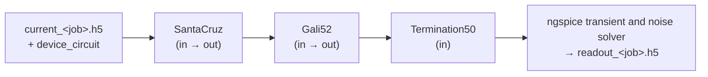

# Analog Front-End Components (`components/afe`)

`src/raser/components/afe/` stores SPICE subcircuit files (`.cir`) for analog front-end (AFE) amplifier stages and termination loads. Analog front-end components act on the downstream [`readout`](../stages/readout.md) slice of the simulation chain: the CLI option `-amp` / `--amplifier` (default `"SantaCruz+Gali52+Termination50"`) lists the stages from the detector to the termination load separated by `"+"`, which are loaded, parsed into structured dictionaries, and solved by `ngspice` for transient response and noise spectra, converting each electrode's induced current into voltage waveforms `readout_<job>.h5`.



## Lookup Order and File Format

`named_chain(name)` ([`../core/readout.md`](../core/readout.md)) splits the `--amplifier` option on `"+"` into stage names, locates `afe/<part>.cir` in order of component search priority ([`../supports/README.md`](../supports/README.md)), parses each via `read_subcircuit(path)`, and passes them to `raser.core.readout.spice`.

### Example Amplifier Chain: `SantaCruz+Gali52+Termination50`

In the [Getting Started](../getting-started.md) example `raser signal HPK-Si-PiN --scan voltage=100,200 -s 2 -evt 200 --seed 1`, the command uses the default amplifier chain `"SantaCruz+Gali52+Termination50"`, reading three `.cir` files in `src/raser/components/afe/`:

1. **First stage `SantaCruz.cir`**: The top of the file defines the transistor subcircuit `.subckt BFR840L3RHESD 1 2 3` and its diode/transistor `.MODEL` entries (written to `"models"`), and the main subcircuit is a two-port inverting transimpedance stage:

```spice
.subckt SantaCruz in out
VCC 8 0 dc 2.25
R13 in 0 1MEG
C1 in 3 3.3n
x1 5 3 0 BFR840L3RHESD ; npn
R1 3 4 475
R2 4 5 3k
C2 4 5 3.3n
C5 5 out 3.3n
L1 5 6 47U
R3 6 7 63.7
C7 8 0 10n
C8 7 0 10n
C3 7 0 1n
C4 7 0 1n
L2 8 7 2.2u
.ends SantaCruz
```

2. **Second stage `Gali52.cir`**: A two-port inverting gain stage using noiseless auxiliary resistor `Rp` and capacitor `Cp` to form a `1.41 GHz` single pole and `22.66 dB` gain under `50 Ohm` matching:

```spice
.subckt Gali52 in out
Rin in 0 50
* minus twice 10^(22.66/20): the 50 Ohm output and the 50 Ohm load halve it
E1 a 0 in 0 -27.17
Rp a b 1
Cp b 0 112.9p
E2 c 0 b 0 1
Rout c out 50
.ends Gali52
```

3. **Termination load `Termination50.cir`**: A one-port `50 Ohm` load to ground:

```spice
.subckt Termination50 in
R1 in 0 50
.ends Termination50
```

In this example, the front-end chain is solved jointly with the `HPK-Si-PiN` junction capacitance `3.44162280284 pF` for transient waveforms; `readout_0.h5` writes `pulse_edge = ['falling']` and `dt = 5e-12 s`. Downstream `reconstruction` selects `276` out of `400` events exceeding the `10 mV` threshold at `200 V`, with `CFD30` timing resolution `sigma = 33.35 ps`.

### Subcircuit and Port Rules

- Each `<name>.cir` file must contain a subcircuit definition sharing the filename stem: `.subckt <name> <ports>` ... `.ends` (the parser also accepts reaching EOF while still inside the named subcircuit and appends `.ends <name>` when writing the netlist).
- The ground node is fixed to `"0"`.
- Ports are bound positionally (`dict(zip(("in", "out"), ports))`): amplifier stages before the termination load must declare two ports (first input `"in"`, second output `"out"`); the last component in the chain is the termination load and must declare only one input port `"in"`.
- When the same amplifier stage name repeats in a chain, later instances are named `<name>_2`, `<name>_3`, etc., in the chain dictionary.
- Lines starting with `*` are ignored as SPICE comments; other non-comment, non-empty lines outside `.subckt <name>` (such as transistor `.subckt` and `.MODEL` definitions) are stored verbatim (preserving trailing `;` comments) in the stage description's `"models"` list and deduplicated per whole `"models"` list at the top of the `ngspice` netlist (only identical model blocks are merged).
- On element lines inside the main `.subckt <name>`, text after `;` is stripped by `read_subcircuit` and read as schematic layout hints in `src/raser/core/readout/schematic.py`.

### Supported Element Syntax Inside `.subckt <name>`

| SPICE Element Line | Parsed Dictionary Representation | Unit | Meaning |
| --- | --- | --- | --- |
| `R<name> <node1> <node2> <value>` | `{"between": [n1, n2], "ohm": R}` | `Ohm` | Resistor with thermal noise |
| `R<name> <node1> <node2> <value> noisy=0` | `{"between": [n1, n2], "ohm": R, "noiseless": True}` | `Ohm` | Noiseless resistor (used to model feedback equivalent input impedance or pole auxiliary networks) |
| `C<name> <node1> <node2> <value>` | `{"between": [n1, n2], "farad": C}` | `F` | Capacitor |
| `L<name> <node1> <node2> <value>` | `{"between": [n1, n2], "henry": L}` | `H` | Inductor |
| `V<name> <plus> <minus> [dc] <value>` | `{"between": [plus, minus], "volt": V}` | `V` | DC voltage source |
| `E<name> <out+> <out-> <in+> <in-> <gain>` | `{"between": [o+, o-], "follows": [i+, i-], "gain": G}` | dimensionless | Voltage-controlled voltage source (gain `G`) |
| `X<name> <nodes...> <subckt_model>` | `{"model": model, "nodes": [...]}` | None | Instance of a subcircuit defined in `"models"` of the file |

Element values support case-insensitive SPICE prefixes: `t` ($10^{12}$), `g` ($10^{9}$), `meg` ($10^{6}$), `k` ($10^{3}$), `m` ($10^{-3}$), `u` ($10^{-6}$), `n` ($10^{-9}$), `p` ($10^{-12}$), `f` ($10^{-15}$); unit letters immediately following the prefix are ignored.

## Built-in Components

`src/raser/components/afe/` contains the following 5 SPICE components:

| Component Name | Ports | Circuit Description |
| --- | --- | --- |
| `BroadBandCividec` | 2 (amplifier stage) | CIVIDEC C2 broadband current amplifier, bandwidth `1 MHz - 2 GHz`, gain `40 dB` |
| `ChargeSensitiveCremat` | 2 (amplifier stage) | Cremat CR-110-R2.2 charge-sensitive preamplifier, open-loop gain `1.4 V/pC`, decay time `140 us` |
| `Gali52` | 2 (amplifier stage) | Mini-Circuits GALI-52+ inverting gain block, low-frequency gain `22.66 dB`, pole `1.41 GHz` |
| `SantaCruz` | 2 (amplifier stage) | UC Santa Cruz single-channel LGAD readout board, `475 Ohm` feedback inverting transimpedance stage based on `BFR840L3RHESD` |
| `Termination50` | 1 (termination load) | `50 Ohm` termination resistor to ground |

## Common Errors

| Error Message | Trigger Condition |
| --- | --- |
| `FileNotFoundError: Cannot find RASER component afe/<name>.cir` | The specified `.cir` file is not found in component search paths |
| `ValueError: <text> is not a SPICE number` | Element value or gain cannot be parsed as a SPICE number |
| `ValueError: Cannot read the element <line> of <path>` | Subcircuit contains a SPICE statement other than `R`, `C`, `L`, `V`, `E`, or `X` |
| `ValueError: <path> has to hold .subckt <name> with the nodes in, or in and out` | File lacks `.subckt` with the filename stem, or port count is not 1 or 2 |
| `ValueError: <path> has no output: it can only be the load, the last of the chain, not its part <place> of <len>` | A one-port load file is placed before the end of the amplifier chain |
| `ValueError: <load_path> is the last of the chain and has to be a load, with the node in alone` | The last file in the amplifier chain declares a second (output) port |
| `ValueError: The stage <name> has the node <node> as input and as output; give the output a node of its own` | Writing the netlist finds that a subcircuit's input and output ports use the same node name |
| `ValueError: A stage cannot be named "load"` | An amplifier stage in the chain is named `"load"` |

## Related Pages

- [Getting Started](../getting-started.md)
- [`../stages/readout.md`](../stages/readout.md)
- [`../core/readout.md`](../core/readout.md)
- [`../supports/README.md`](../supports/README.md)
