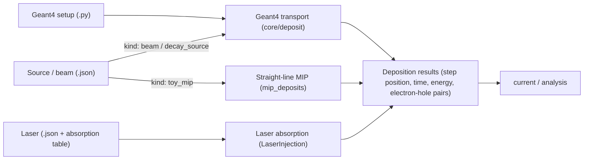

# Energy Deposition Components (`components/deposit`)

Energy deposition components are stored together under `components/deposit/` (see [Architecture Overview](../architecture.md#components)) and located and loaded by `read_g4setup`, `load_source`, and `load_laser` in [`components/loader.py`](../supports/README.md). Combined with the geometry dimensions and material of [Detector Components](device.md), they respectively describe the surrounding Geant4 geometry setup (Python scripts), radioactive sources and particle beams (JSON), and laser pulses and material interband absorption coefficient tables (JSON and `.txt`). They are read by the [`deposit`](../stages/deposit.md) stage ([`core/deposit`](../core/deposit.md)) to compute energy deposition steps and initial electron-hole pairs inside the device, and the results are handed off to [`current`](../stages/current.md) ([`core/current`](../core/current.md)) and [`analysis`](../stages/analysis.md) ([`core/analysis`](../core/analysis.md)).



When looking up a component, the project folder's own component takes priority; if not found, it is searched by name in the component library.

## Component File Contents

### Geant4 Setup: `device_alone.py`

Below is the verbatim `device_alone.py` from the library:

```python
"""The device alone in vacuum, the source 17 mm above its top face.

What surrounds the device in Geant4; reading it imports no Geant4."""

G4SETUP = {
    "name": "device_alone",
    "description": "The device alone in vacuum",
    "geant4_model": "device",
    "object": {},
    "source": {"at": [0, 0, -17000], "towards": [0, 0, 0], "angle": 0},
    "world": "G4_Galactic",
    "maxstep": 2,
    "g4_vis": False,
}
```

When surrounding geometric bodies are present, they are listed by box name under `object["elemental"]` (Geant4 NIST materials) or `object["binary_compounds"]` (binary compounds). For example, an aluminum foil in `time_resolution.py`:

```python
"object": {
    "elemental": {
        "Al": {
            "name": "Al",
            "material": "G4_Al",
            "side_x": 5000,
            "side_y": 5000,
            "side_z": 10,
            "colour": [1, 0.1, 0.8],
            "position_x": 0,
            "position_y": 0,
            "position_z": -15000,
        },
    },
},
```

### Radioactive Source: `decay/Sr90.json`

```json
{
    "name" : "Sr90",
    "kind" : "decay_source",
    "description" : "Sr-90 beta source: every event is one decay, of Sr-90 or of its daughter Y-90 with the same chance, on a disk 5 mm across; what the decay emits goes isotropically within 15 degrees of the axis",
    "nuclides" : [[38, 90], [39, 90]],
    "par_radius" : 2500,
    "par_cone" : 15
}
```

### Particle Beam: `beam/proton.json`

```json
{
    "name" : "proton",
    "kind" : "beam",
    "par_type" : "proton",
    "par_energy" : 1000.0,
    "par_randx" : 0,
    "par_randy" : 0
}
```

### Laser: `LA01IR_top_Si.json`

```json
{
    "description" : "Particulars LA-01 IR FC, 1064 nm: pulse <350 ps to 4 ns, spot at focus <11 um FWHM, few to 100 MIP in 300 um Si (https://www.particulars.si/products.php?prod=scanTCT.html); pulse_energy is about 10 MIP in 300 um Si",
    "tech" : "SPA",
    "direction" : "top",

    "refractionIndex" : 3.51,

    "wavelength" : 1064,
    "temporal_FWHM" : 350e-12,
    "pulse_energy" : 1.8e-13,
    "spacial_FWHM" : 11,
    "central_time" : 1e-9,

    "pairs_per_group" : 1000,
    "groups" : 3200,

    "fx_rel" : 0.25,
    "fy_rel" : 0.5,
    "fz_rel" : 0.0
}
```

## Key Meanings

The only keys users can set in the three types of deposition component files are listed in the tables below.

### Setup

#### Top-Level `G4SETUP` Keys

When no setup component is specified, the code uses the built-in default dictionary `DEVICE_ALONE`.

| Key | `DEVICE_ALONE` Default | Unit | Meaning |
| --- | --- | --- | --- |
| `name` | None (optional) | None | Setup name |
| `description` | None (optional) | None | Text description of the setup geometry |
| `geant4_model` | `"device"` (required for Geant4 sources) | None | Geometry model identifier; imports an external GDML when set to `"gdml_import"`, otherwise builds surrounding boxes from `object` |
| `world` | `"G4_Galactic"` (required for Geant4 sources) | None | Geant4 NIST material name of the world cube |
| `maxstep` | `2` (required) | `um` | Maximum step limit inside the `"Device"` logical volume (also read by `toy_mip` when `packets` is not specified) |
| `source` | `{"at": [0, 0, -17000], "towards": [0, 0, 0], "angle": 0}` (required for Geant4 sources) | `um` for `at`, `towards`; `degree` for `angle` | Source position `at`, aim point `towards`, and incidence tilt angle `angle` in Geant4 coordinates (`angle` defaults to `0`) |
| `object` | `{}` (required for Geant4 sources) | None | Surrounding geometry dictionary; `{}` when there are no surrounding objects; may contain `"elemental"` and `"binary_compounds"` sub-dictionaries |

#### Keys for the Two `object` Geometry Categories

| Key | Applicable Category | Unit | Meaning |
| --- | --- | --- | --- |
| `name` | Both (required) | None | Geometry object name |
| `material` | `elemental` (required) | None | Geant4 NIST material name, such as `"G4_Al"`, `"G4_Ni"`, `"G4_Ti"`, `"G4_Si"`, `"G4_BRASS"` |
| `material_1`, `material_2` | `binary_compounds` (required) | None | Element symbols of the two constituents of the binary compound, such as `"Si"`, `"C"`, `"N"`, `"O"` |
| `compound_name` | `binary_compounds` (required) | None | Compound material name; compounds sharing a name within the same run must have identical composition and density |
| `density` | `binary_compounds` (required) | `g/cm^3` | Compound density |
| `natoms_1`, `natoms_2` | `binary_compounds` (required) | None | Atomic-count shares of the two elements (multiplied by atomic masses in code to convert to mass fractions) |
| `side_x`, `side_y`, `side_z` | Both (required) | `um` | Full box dimensions along $x$, $y$, and $z$ |
| `position_x`, `position_y`, `position_z` | Both (required) | `um` | Box center position in the Geant4 world coordinate system |
| `colour` | Both (required) | None | Visualization RGB color list `[r, g, b]` (dimensionless, `0` to `1`) |
| `tub` | Optional for `elemental`, required for `binary_compounds` (use `{}` for no hole) | `um` | Cylindrical hole subtracted from the box center along the $z$ axis, containing radius `"tub_radius"` and half-length `"tub_depth"` |

#### Additional `"gdml_import"` Keys

| Key | Default | Unit | Meaning |
| --- | --- | --- | --- |
| `world_half_size_um` | None (optional) | `um` | Overrides the world cube half-side length in non-wrapper-world mode |
| `gdml.file` | None (required) | None | Path to the GDML file to import |
| `gdml.top_volume` | `None` | None | Top-level logical volume name to import; uses the GDML world volume if unspecified or unmatched |
| `gdml.validate` | `False` | None | Whether to validate the GDML schema when reading |
| `gdml.auto_center` | `True` | None | Whether to automatically translate and center using the coordinate bounds center of the GDML geometry nodes |
| `gdml.position_um` | `[0.0, 0.0, 0.0]` | `um` | Translation vector `[x, y, z]` of the imported geometry |
| `gdml.rotation_xyz` | `[0.0, 0.0, 0.0]` | `degree` | Rotation angles of the imported geometry about the $X$, $Y$, and $Z$ axes |
| `gdml.placement_name` | `"ImportedGDML"` | None | Physical volume name of the imported geometry |
| `visualization` | `{}` | None | Visualization style dictionary for the imported geometry and device (containing `imported_visible`, `imported_force_wireframe`, `imported_force_solid`, `imported_colour_rgba`, `device_visible`, `hide_device`, `device_force_wireframe`, `device_force_solid`, `device_colour_rgba`) |

### Sources and Beams

#### Common Keys

| Key | Default | Unit | Meaning |
| --- | --- | --- | --- |
| `name` | None (optional) | None | Signal source name |
| `kind` | None (required) | None | Source type: `"beam"`, `"decay_source"`, or `"toy_mip"` |
| `description` | None (optional) | None | Text description of the signal source |

#### `beam` and `decay_source` Keys

| Key | Default | Unit | Meaning |
| --- | --- | --- | --- |
| `par_type` | None (required for `beam` and monoenergetic `decay_source` without `nuclides`) | None | Geant4 particle name (such as `"e-"`, `"mu-"`, `"pi-"`, `"proton"`, `"alpha"`) or a list of particle names sampled with equal probability |
| `par_energy` | None (required together with `par_type`) | `MeV` | Particle kinetic energy, or a list of kinetic energies of the same length as `par_type` |
| `par_randx`, `par_randy` | `0`, `0` | `um` | Half-widths of uniform random offsets added to the $x$ and $y$ components of the emission direction vector `towards - at` (in `um`) |
| `particles` | None (optional) | `um` for `offset` | List of particle dictionaries for a multi-particle bunch; all particles in the list are emitted simultaneously in every event; each item may set a translation `"offset"` (default `[0, 0, 0]` `um`) and override `par_type`, `par_energy`, `par_randx`, and `par_randy` |
| `nuclides` | None (required for nuclide-decay `decay_source`) | None | List of radioactive nuclides `[Z, A]` at rest; each event selects one nuclide with equal probability for a single decay |
| `par_radius` | `0` | `um` | Radius of the circular planar decay source perpendicular to the emission axis |
| `par_cone` | `None` | `degree` | Half-angle of the cone around the emission axis for isotropic emission of decay products |

#### `toy_mip` Keys

| Key | Default | Unit | Meaning |
| --- | --- | --- | --- |
| `landau_sampling` | None (required) | None | Whether to sample each segment's deposited energy from a Landau distribution; takes the fixed mean energy loss when `false` |
| `start` | `[l_x / 2, l_y / 2, 0.0]` | `um` | Start point `[x, y, z]` of the straight track in detector coordinates |
| `end` | `[l_x / 2, l_y / 2, l_z]` | `um` | End point `[x, y, z]` of the straight track in detector coordinates |
| `position_range_um` | None (optional) | `um` | Uniform transverse sampling range for the start point `{"x": [lo, hi], "y": [lo, hi]}` (both `x` and `y` keys must be given) |
| `direction_sigma_mrad` | None (optional) | `mrad` | Standard deviations `{"x": sigma_x, "y": sigma_y}` for Gaussian sampling of track slopes $dx/dz$ and $dy/dz$ around `0` |
| `packets` | `ceil(length / maxstep)` | segments | Number of equal deposition segments into which a single track is split |

### Laser and Absorption Coefficient Table

| Key | Default | Unit | Meaning |
| --- | --- | --- | --- |
| `description` | None (optional) | None | Laser model and parameter description |
| `tech` | None (required) | None | Absorption mechanism: `"SPA"` (single-photon absorption) or `"TPA"` (two-photon absorption) |
| `direction` | None (required) | None | Incidence face: `"top"` (from $z = 0$ along $+z$), `"bottom"` (from $z = l_z$ along $-z$), or `"edge"` (from $x = 0$ along $+x$) |
| `refractionIndex` | None (required) | None | Refractive index $n$ of the device material at this wavelength |
| `wavelength` | None (required) | `nm` | Laser wavelength (multiplied by `1e-3` after reading to convert to `um`) |
| `alpha` | Log-linear interpolation from `deposit/absorption/<material>.txt` | `1/m` | Linear absorption coefficient $\alpha$ |
| `beta_2` | None (required for `"TPA"`) | `m/W` | Two-photon absorption coefficient $\beta_2$ |
| `temporal_FWHM` | None (required) | `s` | Temporal full width at half maximum $\text{FWHM}_t$ of the laser pulse |
| `pulse_energy` | None (required) | `J` | Single laser pulse energy $E_{\text{pulse}}$ |
| `spacial_FWHM` | None (required) | `um` | Spatial full width at half maximum $\text{FWHM}_{\text{sp}}$ of the Gaussian spot at focus |
| `l_Rayleigh` | Computed from `spacial_FWHM`, `refractionIndex`, and `wavelength` | `um` | Rayleigh length $l_R$ in the medium |
| `central_time` | None (required) | `s` | Central arrival time $t_c$ of the laser pulse |
| `pairs_per_group` | None (required) | pairs | Upper limit on the number of electron-hole pairs in a single carrier group |
| `groups` | None (required) | groups | Minimum number of carrier groups partitioned for each absorption mechanism |
| `fx_rel`, `fy_rel`, `fz_rel` | None (required) | None | Relative coordinates of the focus in the detector coordinate system; absolute position is `(fx_rel * l_x, fy_rel * l_y, fz_rel * l_z)` (in `um`) |

The absorption coefficient table (`deposit/absorption/<material>.txt`) is a whitespace-delimited two-column text file with comment lines starting with `#`: the first column is wavelength (in `nm`), and the second column is the interband absorption coefficient at `300 K` (in `1/cm`).

All remaining parameters (default world half-side length, maximum generated-events limit, built-in Geant4 densities of diamond and silicon carbide, radioactive decay lifetime threshold, material mean ionization energy, Fano factor, mean linear ionization rate and Landau width for `toy_mip`, the `4` rings $\times$ `8` sectors cross-section partitioning and optical-path integration refinement factor for lasers) are hardcoded in the code and cannot be set in component files:

| Constant or Fixed Item | Value | Unit | Definition Location and Meaning |
| --- | --- | --- | --- |
| `WORLD_HALF_SIDE` | `25000` | `um` | `src/raser/core/deposit/simulate_deposits.py`, default half-side length of the Geant4 world cube when the device, surrounding objects, and source do not exceed this range |
| `GENERATED_LIMIT` | `10000000` | events | `src/raser/core/deposit/generation.py`, default upper limit on source events generated to reach the target number of recorded events |
| Geant4 `"Diamond"` density | `3.52` | `g/cm^3` | `src/raser/core/deposit/geant4/detector_construction.py`, fixed density when constructing the diamond detector material from carbon (`"G4_C"`) (PDG Atomic and Nuclear Properties table, diamond) |
| Geant4 `"SiC"` density and atomic ratio | `3.21`, `50 : 50` | `g/cm^3`, dimensionless | `src/raser/core/deposit/geant4/detector_construction.py`, fixed density and silicon-to-carbon atomic ratio when constructing the silicon carbide detector material (4H-SiC density from M. E. Levinshtein, S. L. Rumyantsev, M. S. Shur (eds.), *Properties of Advanced Semiconductor Materials*, Wiley (2001)) |
| Radioactive decay time threshold | `1.0e60` | `year` | `src/raser/core/deposit/geant4/interaction.py`, passed to `SetTimeThresholdForRadioactiveDecay` to allow arbitrarily long-lived nuclides to decay |
| `RADIOACTIVE_DECAY` | `210` | dimensionless | `src/raser/core/deposit/geant4/nuclide_source.py`, sub-process subtype ID used by `DecayStackingAction` to identify `G4RadioactiveDecay` products |
| `PAIR_ENERGY_EV` | `"Si": 3.6`, `"SiC": 7.83`, `"Diamond": 13.1` | `eV` | `src/raser/core/deposit/ionization.py`, mean ionization energy to create one electron-hole pair for each material (silicon value approximates the 3.65 eV given in S. Navas et al. (PDG), *Phys. Rev. D* 110 (2024) 030001, doi:10.1103/PhysRevD.110.030001, Sec. 35.8; silicon carbide value from A. Gsponer et al., *Nucl. Instrum. Methods Phys. Res. A* 1064 (2024) 169412, doi:10.1016/j.nima.2024.169412; diamond value from T. Shimaoka et al., *Phys. Status Solidi A* 213 (2016) 2629, doi:10.1002/pssa.201600195) |
| `FANO_FACTOR` | `"Si": 0.115`, `"SiC": 0.128`, `"Diamond": 0.382` | dimensionless | `src/raser/core/deposit/ionization.py`, Fano factor for ionization pair-count fluctuations for each material (silicon value from K. Ramanathan, N. Kurinsky, *Phys. Rev. D* 102 (2020) 063026, doi:10.1103/PhysRevD.102.063026; silicon carbide value from S. K. Chaudhuri, K. J. Zavalla, K. C. Mandal, *Appl. Phys. Lett.* 102 (2013) 031109, doi:10.1063/1.4776703; diamond value from Shimaoka et al., ibid.) |
| `PAIRS_PER_UM` | `"Si": 80.0`, `"SiC": 55.0` | `pairs/um` | `src/raser/core/deposit/mip_track.py`, mean number of electron-hole pairs per unit track length in `toy_mip` mode (silicon value from PDG Sec. 35.8 and H. Bichsel, *Rev. Mod. Phys.* 60 (1988) 663, doi:10.1103/RevModPhys.60.663; silicon carbide value converted from 7.83 eV and MIP energy loss) |
| `LANDAU_WIDTH_MEV_PER_UM` | `"Si": 1.78e-5`, `"SiC": 2.46e-5` | `MeV/um` | `src/raser/core/deposit/mip_track.py`, Landau sampling width parameter for deposited energy per unit track length in `toy_mip` mode, computed from PDG Chapter 34 as $\xi = (K/2)\langle Z/A\rangle\rho x/\beta^2$ ($\beta = 1$) (see [`core/deposit`](../core/deposit.md#toy-mip-track)) |
| Photon energy constants $h$, $c$ | `6.626e-34`, `2.998e8` | `J s`, `m/s` | `src/raser/core/deposit/laser.py`, Planck constant and speed of light used to compute single-photon energy $h c / \lambda$ |
| Laser optical-path integration step multiplier | `50` | steps | `src/raser/core/deposit/laser.py`, integration subdivision multiplier applied after dividing the optical path length by the minimum characteristic scale $\min(L, l_R, 10^6/\alpha)$ |
| `rings`, `sectors` | `4`, `8` | rings, sectors | `src/raser/core/deposit/laser.py`, number of equal-share concentric rings and azimuthal sectors partitioning the laser cross section (`32` groups per layer) |

## How the Program Uses the Component

### Geant4 Setup Construction and Coordinate Transformation (`simulate_deposits.py`, `geant4/`)

1. **Merging setup and source configurations (`read_g4setup`, `g4_configuration`)**: `read_g4setup` (`loader.py`) executes `<name>.py` to obtain the `G4SETUP` dictionary and records the script `"sha256"` (raising `ValueError` if pointed at a `.json` file); when no setup is provided, `DEVICE_ALONE` is used. `g4_configuration` checks that the source dictionary does not contain placement keys `par_in`, `par_out`, or `par_angle`, and extracts `at`, `towards`, and `angle` from the setup's `source` dictionary into `par_in` (`um`), `par_out` (`um`), and `par_angle` (`degree`), respectively. Legacy keys in setup examples such as `g4_vis` and `total_events` are overridden by runtime options or ignored during merging; geometry visualization is controlled by the `-g4_vis` option of the [`deposit`](../stages/deposit.md) stage.
2. **Computing world size and building geometry (`world_half_side`, `GeneralDetectorConstruction`, `GDMLDetectorConstruction`)**:
   - `world_half_side` finds the maximum extent `reach` (`um`) across the device boundary $\max(l_x/2, l_y/2, l_z)$, all `object` box boundaries $|p_u| + s_u/2$ ($u \in \{x, y, z\}$), and all source origins $|c| + \text{par\_radius}$: if $\text{reach} \le 25000\ \mu\text{m}$, the world cube half-side length is $25000\ \mu\text{m}$; otherwise it is $2 \times \text{reach}$.
   - The Geant4 coordinate origin is placed at the center of the device top face, in `um`; the device logical volume `"Device"` occupies $x \in [-l_x/2, l_x/2]$, $y \in [-l_y/2, l_y/2]$, $z \in [0, l_z]$, with $z < 0$ above the top face.
   - `GeneralDetectorConstruction` places `"Device"` and the boxes in `object["elemental"]` and `object["binary_compounds"]` into the world volume in order. `position_x`, `position_y`, and `position_z` are box center coordinates; to place the bottom face of a box at distance $d$ (`um`) above the device top face, set $\text{position\_z} = -(d + \text{side\_z}/2)$. When a box has a non-empty `tub`, `G4SubtractionSolid` subtracts a cylindrical hole of radius `tub_radius` and half-length `tub_depth` (`um`) along the $z$ axis from the box center. If `geant4_model == "gdml_import"`, `GDMLDetectorConstruction` is used instead to import the external GDML geometry specified by `gdml.file`.
3. **Incidence tilt rotation (`tilted`)**: When `source.angle` (denoted $\theta$, in `degree`) is non-zero, `tilted` verifies that the source origin satisfies $z_0 < 0$ or $z_0 > l_z$ and $z_1 \ne z_0$ (raising `ValueError` otherwise), and computes the x-coordinate where the line from `at` to `towards` intersects the device entrance face $z_{\text{face}} = 0$ (when $z_0 < 0$) or $z_{\text{face}} = l_z$ (when $z_0 > l_z$):
   $$x_{\text{pivot}} = x_0 + \frac{z_{\text{face}} - z_0}{z_1 - z_0}(x_1 - x_0) \tag{1}$$
   It then rotates the source origin `par_in` and aim point `par_out` (including each particle's origin and aim point in `particles`) by angle $\theta$ about the axis passing through $(x_{\text{pivot}}, 0, z_{\text{face}})$ parallel to the $y$ axis:
   $$\begin{pmatrix} x' \\ y' \\ z' \end{pmatrix} = \begin{pmatrix} (x - x_{\text{pivot}})\cos\theta + (z - z_{\text{face}})\sin\theta + x_{\text{pivot}} \\ y \\ -(x - x_{\text{pivot}})\sin\theta + (z - z_{\text{face}})\cos\theta + z_{\text{face}} \end{pmatrix} \tag{2}$$
   where $(x_0, y_0, z_0)$ and $(x_1, y_1, z_1)$ are `par_in` and `par_out` (`um`) before rotation, $(x, y, z)$ and $(x', y', z')$ are coordinates (`um`) before and after rotation, and surrounding geometry objects remain fixed.
4. **Step limit, energy-window filtering, and coordinate translation (`GeneralSteppingAction`, `GeneralEventAction`, `GeneralG4Interaction`)**: Individual particle step lengths inside `"Device"` are limited by `maxstep` (`um`). Every step taken inside `"Device"` is recorded with its midpoint position $\frac{1}{2}(\mathbf{r}_{\text{in}} + \mathbf{r}_{\text{out}})$, start position $\mathbf{r}_{\text{in}}$ (`um`), global time (`s`), and deposited energy (`MeV`); when writing the deposit file, `deposits.py` keeps only steps with deposited energy greater than $0$. At the end of each event, it is counted as a recorded event only if the total deposited energy inside the device is greater than $0$ and falls within `[edep_min, edep_max]` (`MeV`). After the Geant4 run finishes, `GeneralG4Interaction` translates every step's midpoint and start point from Geant4 coordinates to detector coordinates: $x \leftarrow x + l_x/2$, $y \leftarrow y + l_y/2$, with $z$ unchanged, moving the origin to a corner of the top face so the domain becomes $x \in [0, l_x]$, $y \in [0, l_y]$, $z \in [0, l_z]$ (`um`).

### Radioactive Sources, Beams, and Ionization Pair Conversion (`nuclide_source.py`, `primary_generator_action.py`, `mip_track.py`, `ionization.py`)

1. **Radioactive nuclide decay source (`kind == "decay_source"` with `nuclides`)**: In each event, `NuclideGeneratorAction` selects one nuclide $[Z, A]$ from `nuclides` with equal probability, samples a stationary decay point uniformly on a disk of radius `par_radius` (`um`) centered at `par_in` and perpendicular to the emission axis `par_out - par_in`, and lets Geant4 `G4RadioactiveDecayPhysics` simulate the decay. `DecayStackingAction` terminates the residual daughter nucleus immediately (`fKill`) so subsequent decay chains are not tracked, and resets the global start time of emitted decay products to `0.0 s`. When `par_cone` (denoted $\theta_{\text{cone}}$, in `degree`) is given, `DecayStackingAction` resamples the product momentum direction from random stream `stream("source")` isotropically within a cone of half-angle $\theta_{\text{cone}}$ around the emission axis, and the corresponding solid-angle fraction is written to the deposit file attribute `generated_fraction`:
   $$f_{\text{gen}} = \frac{1 - \cos\theta_{\text{cone}}}{2} \tag{3}$$
   where $f_{\text{gen}}$ is the dimensionless solid-angle fraction (for example, in `Sr90.json` with $\theta_{\text{cone}} = 15^\circ$, $f_{\text{gen}} \approx 0.017037$, so dividing the number of generated events by $f_{\text{gen}}$ gives the total number of decays over full $4\pi$ solid angle); when `nuclides` or `par_cone` is not set, $f_{\text{gen}} = 1.0$. Decay sources that omit `nuclides` and provide `par_type` and `par_energy` (such as `decay/Am241.json`) emit monoenergetic particles in the same way as particle beams below.
2. **Particle beam (`kind == "beam"`)**: `GeneralPrimaryGeneratorAction` simultaneously emits all particles in `particles` in each event (or a single particle when `particles` is omitted): for each particle, it draws uniform transverse offsets $\Delta x \sim \mathcal{U}(-\text{par\_randx}, \text{par\_randx})$ and $\Delta y \sim \mathcal{U}(-\text{par\_randy}, \text{par\_randy})$ (`um`) from random stream `stream("source")`, adds them to the $x$ and $y$ components of the direction vector `par_out - par_in` (if `par_type` and `par_energy` are equal-length lists, one particle type and its corresponding kinetic energy are chosen with equal probability per event), and emits from `par_in + offset` (`um`).
3. **Straight-line minimum-ionizing track (`kind == "toy_mip"`)**: Without starting Geant4, `mip_deposits` determines in detector coordinates the track start point $\mathbf{r}_{\text{start}}$ (default $[l_x/2, l_y/2, 0.0]$ `um`; if `position_range_um` is given, samples $x_0, y_0$ uniformly within the intervals from `stream("toy_mip")`) and end point $\mathbf{r}_{\text{end}}$ (default $[l_x/2, l_y/2, l_z]$ `um`; if `direction_sigma_mrad` is given, draws slopes $s_x, s_y$ from $\mathcal{N}(0, (\sigma_{\text{mrad}}\times 10^{-3})^2)$, and whenever the start point or slope was sampled sets $x_{\text{end}} = x_{\text{start}} + s_x(z_{\text{end}} - z_{\text{start}})$ and $y_{\text{end}} = y_{\text{start}} + s_y(z_{\text{end}} - z_{\text{start}})$). The track length $L = |\mathbf{r}_{\text{end}} - \mathbf{r}_{\text{start}}|$ (`um`) is divided equally into $N_{\text{pkt}}$ segments (`int(packets)` if `packets` is given, otherwise $\lceil L / \text{maxstep} \rceil$), each of length $\Delta s = L / N_{\text{pkt}}$ (`um`), with mean deposited energy $\bar{E}_{\text{seg}} = \text{PAIRS\_PER\_UM}[\text{material}] \times \varepsilon_{\text{pair}} \times 10^{-6} \times \Delta s$ (`MeV`), where $\varepsilon_{\text{pair}}$ is the material mean ionization energy `PAIR_ENERGY_EV[material]` (`eV`, see Eq. (4)). When `landau_sampling` is `true`, each segment's energy is sampled from `stream("toy_mip")` as $\max(0.0,\, \text{Landau}(\bar{E}_{\text{seg}},\, w_{\text{Landau}}\Delta s))$, where $w_{\text{Landau}}$ is the Landau width per unit track length `LANDAU_WIDTH_MEV_PER_UM[material]` (`MeV/um`); when `false`, it is fixed to $\bar{E}_{\text{seg}}$. All deposition segments are assigned creation time `0.0 s`.
4. **Ionization pair conversion (`ionized_pairs`)**: Each step's deposited energy $E_k$ (`MeV`) from Geant4 or `toy_mip` is divided by the material mean ionization energy in `ionized_pairs(event, material, fano=True)` to obtain the mean number of electron-hole pairs $\bar{N}_k$:
   $$\bar{N}_k = \frac{E_k}{\varepsilon_{\text{pair}} \times 10^{-6}}, \qquad N_k = \begin{cases} \max\!\left(0.0,\, \mathcal{N}\bigl(\bar{N}_k,\, F\,\bar{N}_k\bigr)\right), & \text{fano} = \text{True} \\ \bar{N}_k, & \text{fano} = \text{False} \end{cases} \tag{4}$$
   where:
   - $E_k$: deposited energy of the $k$-th deposition step, `MeV`;
   - $\varepsilon_{\text{pair}}$: material mean ionization energy `PAIR_ENERGY_EV[material]`, `eV`;
   - $F$: material Fano factor `FANO_FACTOR[material]` (dimensionless);
   - $\bar{N}_k$, $N_k$: mean and final number of electron-hole pairs written to `pairs`, pairs; when Fano sampling is enabled, event `event.event` draws Gaussian random numbers from its independent random stream `stream(f"ionization/{event.event}")`.

### Laser Absorption and Carrier Group Partitioning (`laser.py`)

1. **Absorption coefficient and Gaussian beam envelope (`absorption_coefficient`, `LaserInjection`)**: `LaserInjection` multiplies the input `wavelength` (`nm`) by $10^{-3}$ to obtain wavelength $\lambda$ (`um`). If `alpha` (`1/m`) is not provided in the laser file, `absorption_coefficient` reads `deposit/absorption/<material>.txt`, performs linear interpolation on the natural logarithm of the absorption coefficient between adjacent wavelengths, and multiplies by `100.0` to convert to `1/m` (returning `0.0` for wavelengths above the table maximum and raising `ValueError` below the table minimum). The beam waist radius at focus $w_0$, Rayleigh length in the medium $l_R$ (when `l_Rayleigh` is not given), and squared beam radius $w^2(s)$ at distance $s$ (`um`) along the optical path are:
   $$w_0 = \frac{\text{FWHM}_{\text{sp}}}{\sqrt{2\ln 2}}, \qquad l_R = \frac{\pi w_0^2 n}{\lambda}, \qquad w^2(s) = w_0^2\!\left[1 + \left(\frac{s - s_{\text{focus}}}{l_R}\right)^2\right] \tag{5}$$
   where:
   - $\text{FWHM}_{\text{sp}}$: spatial full width at half maximum of the spot at focus `spacial_FWHM`, `um`;
   - $w_0$, $w(s)$: beam waist radius at focus and beam radius at optical-path position $s$, `um`;
   - $n$: refractive index `refractionIndex` (dimensionless);
   - $\lambda$: laser wavelength, `um`;
   - $l_R$: Rayleigh length in the medium `l_Rayleigh`, `um`;
   - $s_{\text{focus}}$: distance of the focus from the entrance face along the propagation direction, `um` ($z_{\text{focus}}$ for `"top"` incidence, $l_z - z_{\text{focus}}$ for `"bottom"` incidence, and $x_{\text{focus}}$ for `"edge"` incidence, where the absolute focus coordinates $(x_{\text{focus}}, y_{\text{focus}}, z_{\text{focus}}) = (\text{fx\_rel}\cdot l_x,\, \text{fy\_rel}\cdot l_y,\, \text{fz\_rel}\cdot l_z)$ lie directly in the detector coordinate system).
2. **Single-photon and two-photon linear absorption densities (`LaserInjection.__init__`)**: The single-photon energy is $E_{\text{ph}} = h c / (\lambda \times 10^{-6})$ (`J`), and the total number of photons per pulse is $N_{\text{ph}} = E_{\text{pulse}} / E_{\text{ph}}$. The number of electron-hole pairs generated per unit length (per meter) along the optical path at position $s$ (`um`), integrated over the cross section, is:
   - When $\alpha \ne 0$, single-photon absorption is included (transverse profile proportional to $\exp(-2r^2/w^2)$, temporal width $\text{FWHM}_t$):
     $$\left(\frac{dN}{ds_{\text{m}}}\right)_{\text{SPA}} = \alpha\,N_{\text{ph}}\,\exp\!\left(-\alpha\,s \times 10^{-6}\right) \tag{6}$$
   - When `tech == "TPA"`, two-photon absorption is additionally included (transverse profile proportional to $\exp(-4r^2/w^2)$, temporal width $\text{FWHM}_t / \sqrt{2}$):
     $$\left(\frac{dN}{ds_{\text{m}}}\right)_{\text{TPA}} = \frac{\beta_2\,E_{\text{pulse}}^2\,\exp\!\left(-2\alpha\,s \times 10^{-6}\right)}{2\,E_{\text{ph}}\,\pi\,w^2(s)\times 10^{-12}}\sqrt{\frac{2\ln 2}{\pi}}\,\frac{1}{\text{FWHM}_t} \tag{7}$$
   where:
   - $(dN/ds_{\text{m}})_{\text{SPA}}$, $(dN/ds_{\text{m}})_{\text{TPA}}$: electron-hole pairs generated per meter at optical-path position $s$ by single-photon and two-photon absorption, $\text{m}^{-1}$;
   - $\alpha$: linear absorption coefficient `alpha`, `1/m`;
   - $\beta_2$: two-photon absorption coefficient `beta_2`, `m/W`;
   - $E_{\text{pulse}}$: single-pulse energy `pulse_energy`, `J`;
   - $E_{\text{ph}}$: single-photon energy, `J`;
   - $\text{FWHM}_t$: laser pulse temporal full width at half maximum `temporal_FWHM`, `s`.
3. **Equal-share grid partitioning and deposit output (`_add_groups`, `laser_deposits`)**: For each active absorption mechanism, trapezoidal integration over $\lceil 50 L / \min(L, l_R, 10^6/\alpha) \rceil + 1$ sample points along the total optical path length $L$ inside the device ($l_z$ for `"top"` and `"bottom"`, $l_x$ for `"edge"`, in `um`) gives the cumulative pair-count curve and total pair count $N_{\text{tot}}$. The cross section is partitioned into `32` cells consisting of `4` equal-carrier-share concentric rings (dimensionless normalized radius $\rho_r = \sqrt{-\ln(1 - (r + 0.5)/4)/k}$, $r = 0, 1, 2, 3$, with $k=2$ for single-photon and $k=4$ for two-photon) and `8` equal-angle sectors ($\phi_m = (m + 0.5)\pi/4$, $m = 0, \dots, 7$), and the optical path is split by equal share into $N_{\text{slab}} = \lceil \max(N_{\text{tot}} / \text{pairs\_per\_group},\, \text{groups}) / 32 \rceil$ slabs. A carrier group carrying $N_{\text{tot}} / (32 N_{\text{slab}})$ electron-hole pairs is placed at the center of each cell with creation time `central_time` (`s`); groups falling outside the lateral boundaries of the device are discarded. `laser_deposits` packages all groups into `Deposits` for event `0` (with each group's deposited energy written as $N_{\text{group}}\,\varepsilon_{\text{pair}}\times 10^{-6}\ \text{MeV}$).

## Built-in Components

### Built-in Geant4 Setups

| Component Name | Description | Source | Applicable Devices or Experiments |
| --- | --- | --- | --- |
| `device_alone` | Device placed alone in vacuum (`"G4_Galactic"`), source `17 mm` above the top face, `maxstep = 2 um` | `description`: `The device alone in vacuum` | Default setup for [`deposit`](../stages/deposit.md), [`signal`](../bench/signal.md), [`bmos`](../apps/bmos.md) |
| `Sr90_collimator` | In air (`"G4_AIR"`), a `5 mm` thick brass (`"G4_BRASS"`) collimator with a `1 mm` diameter central hole (`tub_radius = 500 um`) between source and device | `description`: `In air, a brass block 5 mm thick with a hole 1 mm across between the Sr-90 source (z = -17 mm, above the top face) and the device: the block spans z = -16.5 to -11.5 mm` | [`signal`](../bench/signal.md) |
| `pcb_readout_gdml` | PCB readout board setup importing external `pcb_readout.gdml` (`"geant4_model": "gdml_import"`) | File docstring: `The readout board of the PCB, imported from pcb_readout.gdml` | [`signal`](../bench/signal.md) |
| `time_resolution` | Between the source and device under test, places `Al` (`10 um`), reference device `HPK-Si-LGAD` (centered at `z = -10000 um`, see [`timeres`](../bench/timeres.md)), and upper/lower `pcb1`, `pcb2` boards with `500 um` radius holes | File docstring: `The setup of the time-resolution experiment: a reference silicon device and boards` | Default setup for [`timeres`](../bench/timeres.md) |

### Built-in Sources and Beams

| Category | Component Name | Description | Source | Applicable Devices or Experiments |
| --- | --- | --- | --- | --- |
| Particle beam (`beam`) | `beam/electron` | `1000.0 MeV` electron beam (`"e-"`, `par_randx = par_randy = 0`) | Unspecified | |
| Particle beam (`beam`) | `beam/muon` | `1000.0 MeV` $\mu^-$ beam (`"mu-"`, `par_randx = par_randy = 0`) | Unspecified | |
| Particle beam (`beam`) | `beam/pion` | `1000.0 MeV` $\pi^-$ beam (`"pi-"`, `par_randx = par_randy = 0`) | Unspecified | |
| Particle beam (`beam`) | `beam/proton` | `1000.0 MeV` proton beam (`"proton"`, `par_randx = par_randy = 0`) | Unspecified | [`signal`](../bench/signal.md) proton beam tests |
| Particle beam (`beam`) | `beam/proton_3GeV_spread` | `3000 MeV` proton beam with transverse aim spread half-width `par_randx = par_randy = 728.6 um` | `description`: `3 GeV protons whose directions spread uniformly by up to 300/7000 = 0.0429 along x and along y...` | `3 GeV` spread proton beam tests paired with `device_alone` |
| Radioactive source (`decay`) | `decay/Am241` | `5.54 MeV` monoenergetic $\alpha$-particle source (`"par_type": "alpha"`) | `description`: `Am-241 alpha source` | [`signal`](../bench/signal.md) $\alpha$-source tests |
| Radioactive source (`decay`) | `decay/Sr90` | Equal-probability at-rest decay $\beta$ source of $^{90}\text{Sr}$ (`[38, 90]`) and $^{90}\text{Y}$ (`[39, 90]`), disk radius `2500 um`, emission half-cone angle `15 degree` | `description`: `Sr-90 beta source: every event is one decay, of Sr-90 or of its daughter Y-90 with the same chance, on a disk 5 mm across; what the decay emits goes isotropically within 15 degrees of the axis` | Default source for [`deposit`](../stages/deposit.md), [`signal`](../bench/signal.md), [`timeres`](../bench/timeres.md) |
| Straight-line MIP (`toy`) | `toy/MIP` | Straight minimum-ionizing track through the device center, `landau_sampling = true` | `description`: `Straight toy MIP through the active sensor volume with Landau and Fano fluctuations.` | Fast straight-line MIP tests for any Si or SiC device |
| Straight-line MIP (`toy`) | `toy/MIP_pixel_edge` | `50`-segment straight MIP from `[600.0, 450.0, 0.0]` to `[600.0, 450.0, 300.0] um`, `landau_sampling = true` | `description`: `Straight toy MIP crossing a pixel boundary.` | `general_pixel` ($300\ \mu\text{m}$ thick pixel boundary test) |
| Straight-line MIP (`toy`) | `toy/MIP_pixel_edge_fast` | `5`-segment straight MIP from `[600.0, 450.0, 0.0]` to `[600.0, 450.0, 300.0] um`, `landau_sampling = false` | `description`: `Low-statistics toy MIP crossing a pixel boundary for field-shape checks.` | `general_pixel` (fast field-shape check) |
| Straight-line MIP (`toy`) | `toy/MIP_strip_edge` | Straight MIP across depth `0.0` to `67.3 um`, start $x \in [150.0, 270.0]\ \mu\text{m}$, $y = 270.0\ \mu\text{m}$, $x$-slope standard deviation `10.0 mrad`, `landau_sampling = true` | `description`: `Straight toy MIP crossing a strip boundary.` | `SiC_LGAD_strip` ($67.3\ \mu\text{m}$ thick strip boundary test) |
| Bunch source (`bmos`) | `bunch` | Simultaneously emits three `80 MeV` protons per event at `offset` `[-1, 1, 0]`, `[0, 1, 0]`, and `[1, 1, 0] um` | `description`: `A bunch of three 80 MeV protons side by side, 1 um apart along x and 1 um off the axis along y` | Default source for [`bmos`](../apps/bmos.md) |

### Built-in Lasers and Absorption Coefficient Tables

| Category | Component Name | Description | Source | Applicable Devices or Experiments |
| --- | --- | --- | --- | --- |
| Single-photon Si (`Si`) | `LA01IR_edge_Si` | `"SPA"`, `1064 nm` side (`"edge"`) incidence, pulse width `350 ps`, spot `11 um`, pulse energy `1.8e-13 J` | `description`: Particulars LA-01 IR FC (`1064 nm`) scanning TCT laser parameters | Edge [`tct`](../bench/tct.md) on Si devices (such as `HPK-Si-PiN`) |
| Single-photon Si (`Si`) | `LA01IR_top_Si` | `"SPA"`, `1064 nm` top (`"top"`) incidence, pulse width `350 ps`, spot `11 um`, pulse energy `1.8e-13 J` | `description`: Particulars LA-01 IR FC (`1064 nm`) scanning TCT laser parameters | Default laser component for [`tct`](../bench/tct.md) (such as `HPK-Si-PiN`) |
| Single-photon Si (`Si`) | `LA01R_bottom_Si` | `"SPA"`, `660 nm` bottom (`"bottom"`) incidence, pulse width `350 ps`, spot `8 um`, pulse energy `7.2e-14 J` | `description`: Particulars LA-01 R FC (`660 nm`) scanning TCT laser parameters | Bottom [`tct`](../bench/tct.md) on Si devices |
| Single-photon Si (`Si`) | `LA01R_top_Si` | `"SPA"`, `660 nm` top (`"top"`) incidence, pulse width `350 ps`, spot `8 um`, pulse energy `7.2e-14 J` | `description`: Particulars LA-01 R FC (`660 nm`) scanning TCT laser parameters | Top [`tct`](../bench/tct.md) on Si devices |
| Single-photon SiC (`SiC`) | `PIL037_edge_SiC` | `"SPA"`, `375 nm` side (`"edge"`) incidence, $\alpha = 21000\ \text{m}^{-1}$, pulse width `60 ps`, spot `20 um`, pulse energy `1.23e-12 J` | `description`: NKT Photonics PILAS PIL037 (`375 nm`) datasheet | Edge [`tct`](../bench/tct.md) on SiC devices (such as `NJU-PiN`) |
| Single-photon SiC (`SiC`) | `PIL037_top_SiC` | `"SPA"`, `375 nm` top (`"top"`) incidence, $\alpha = 1000\ \text{m}^{-1}$, pulse width `60 ps`, spot `20 um`, pulse energy `1.23e-12 J` | `description`: NKT Photonics PILAS PIL037 (`375 nm`) datasheet | Top [`tct`](../bench/tct.md) and [`signal`](../bench/signal.md) on SiC devices (such as `NJU-PiN`) |
| Two-photon Si (`Si`) | `TPA1550_edge_Si` | `"TPA"`, `1550 nm` side (`"edge"`) incidence, $\beta_2 = 1.5\times 10^{-11}\ \text{m/W}$, pulse width `430 fs`, spot `1.448 um`, $l_R = 10.73\ \mu\text{m}$, pulse energy `5e-11 J` | `description`: TPA-TCT `1550 nm` femtosecond fiber laser (`arXiv:2412.09017`, Section 2.1) | Edge two-photon [`tct`](../bench/tct.md) on Si devices |
| Two-photon Si (`Si`) | `TPA1550_top_Si` | `"TPA"`, `1550 nm` top (`"top"`) incidence, $\beta_2 = 1.5\times 10^{-11}\ \text{m/W}$, pulse width `430 fs`, spot `1.448 um`, $l_R = 10.73\ \mu\text{m}$, pulse energy `1.5e-12 J` | `description`: TPA-TCT `1550 nm` femtosecond fiber laser (`arXiv:2412.09017`, Section 2.1) | Top two-photon [`tct`](../bench/tct.md) on Si devices |
| Absorption coefficient table (`deposit/absorption/`) | `Si.txt` | Interband absorption coefficient (`1/cm`) of intrinsic silicon at `300 K` for wavelengths from `250 nm` to `1450 nm` | File header comment: M. A. Green, *Sol. Energy Mater. Sol. Cells* 92 (2008) 1305, Table 1 (doi:10.1016/j.solmat.2008.06.009) | Laser simulations of silicon (`"Si"`) devices without an explicit `alpha` |
