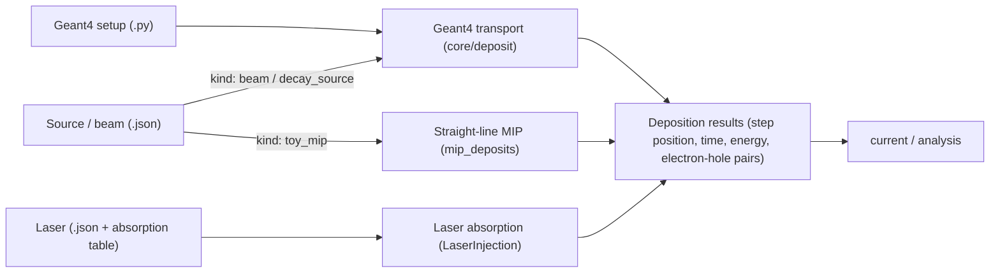

# Energy Deposition Components (`components/deposit`)

Energy deposition components are stored together under `components/deposit/` (see [Architecture Overview](../architecture.md#components)) and located and loaded by `read_g4setup`, `load_source`, and `load_laser` in [`components/loader.py`](../supports/README.md). Combined with the geometry dimensions and material of [Detector Components](device.md), they respectively describe the surrounding Geant4 geometry setup (Python scripts), radioactive sources and particle beams (JSON), and laser pulses and material interband absorption coefficient tables (JSON and `.txt`). They are read by the [`deposit`](../stages/deposit.md) stage ([`core/deposit`](../core/deposit.md)) to compute energy deposition steps and initial electron-hole pairs inside the device, and the results are handed off to [`current`](../stages/current.md) ([`core/current`](../core/current.md)) and [`analysis`](../stages/analysis.md) ([`core/analysis`](../core/analysis.md)).



When looking up a component, the project folder's own component takes priority; if not found, it is searched by name in the component library.

## Component File Contents

### Geant4 Setup: `device_alone.py`

Below is the verbatim `device_alone.py` from the library:

```python
"""The device alone in vacuum, the source 17 mm upstream of its front surface.

What surrounds the device in Geant4; reading it imports no Geant4."""

G4SETUP = {
    "name": "device_alone",
    "description": "The device alone in vacuum",
    "source": {"name": "decay/Sr90", "angle": 0},
    "geant4_model": "device",
    "materials": {},
    "objects": {},
    "along_beam": ["source", {"gap": 17000}, {"slot": "Device"}],
    "world": "G4_Galactic",
    "maxstep": 2,
}
```

When surrounding geometric bodies are present, custom materials are defined under `materials` (Geant4 NIST material names starting with `"G4_"` may also be used directly), geometric bodies (boxes `"box"` or cylinders/tubes `"tube"`) are listed by name under `objects`, and their positions are arranged in `along_beam`. For example:

```python
G4SETUP = {
    "world": "G4_Galactic",
    "maxstep": 2,
    "materials": {
        "SiO2": {"density": 2.2, "elements": {"Si": 1, "O": 2}},
    },
    "objects": {
        "Al":   {"shape": "box", "size": [5000, 5000, 10], "material": "G4_Al"},
        "pcb1": {"shape": "box", "size": [20000, 20000, 1500], "hole": 500, "material": "SiO2"},
        "pipe": {"shape": "tube", "inner_radius": 10000, "outer_radius": 10500, "length": 200000, "material": "G4_Al"},
    },
    "along_beam": [...],
}
```

### Radioactive Source: `decay/Sr90.json`

```json
{
    "name" : "Sr90",
    "kind" : "decay_source",
    "description" : "Sr-90 beta source: every event is one decay, of Sr-90 or of its daughter Y-90 with the same chance, at the entrance of a 3 mm copper collimator with a 1 mm bore",
    "nuclides" : [[38, 90], [39, 90]],
    "par_radius" : 0,
    "collimator" : {
        "material" : "G4_Cu",
        "length" : 3000,
        "radius" : 500,
        "outer_side" : 8000
    }
}
```

These are typical dimensions for a copper collimator; the actual source used should match the physical object. Every radioactive source in the library is described together with its collimator; a radioactive source without a `collimator` key can still be written, and emits into the full solid angle.

### Particle Beam: `beam/proton.json`

```json
{
    "name" : "proton",
    "kind" : "beam",
    "par_type" : "proton",
    "par_energy" : 1000.0,
    "par_randx" : 0,
    "par_randy" : 0
}
```

### Laser: `LA01IR_top_Si.json`

```json
{
    "description" : "Particulars LA-01 IR FC, 1064 nm: pulse <350 ps to 4 ns, spot at focus <11 um FWHM, few to 100 MIP in 300 um Si (https://www.particulars.si/products.php?prod=scanTCT.html); pulse_energy is about 10 MIP in 300 um Si",
    "tech" : "SPA",
    "direction" : "top",

    "refractionIndex" : 3.51,

    "wavelength" : 1064,
    "temporal_FWHM" : 350e-12,
    "pulse_energy" : 1.8e-13,
    "spacial_FWHM" : 11,
    "central_time" : 1e-9,

    "pairs_per_group" : 1000,
    "groups" : 3200,

    "fx_rel" : 0.25,
    "fy_rel" : 0.5,
    "fz_rel" : 0.0
}
```

## Key Meanings

The only keys users can set in the three types of deposition component files are listed in the tables below.

### Setup

#### Top-Level `G4SETUP` Keys

When no setup component is specified, the code uses the built-in default dictionary `DEVICE_ALONE`.

| Key | `DEVICE_ALONE` Default | Unit | Meaning |
| --- | --- | --- | --- |
| `name` | None (optional) | None | Setup name |
| `description` | None (optional) | None | Text description of the setup geometry |
| `geant4_model` | `"device"` (required for Geant4 sources) | None | Geometry model identifier; imports an external GDML when set to `"gdml_import"`, otherwise builds surrounding geometry from `materials` and `objects` |
| `world` | `"G4_Galactic"` (required for Geant4 sources) | None | Geant4 NIST material name of the world cube |
| `maxstep` | `2` (required) | `um` | Maximum step limit inside the device active-layer logical volume (also read by `toy_mip` when `packets` is not specified) |
| `source` | `{"name": "decay/Sr90", "angle": 0}` | none; `degree` | The source the setup uses. `name` is the source component name (a source is a separate component, shared by several setups and experiments); `angle` is the incidence tilt angle (default `0`), used only for single-slot setups to rotate the source about the device front-surface center (for collimated sources, the source together with its collimator rotates as a whole, and emitted particle positions and directions rotate accordingly); beam emission direction is $+z$. Keys other than `name` and `angle` override same-named keys of the source component |
| `materials` | `{}` (optional) | `g/cm^3` for `density` | Custom materials dictionary mapping material name to `{"density": <g/cm3>, "elements": {<element symbol>: <atomic share>, ...}}` (any number of elements); used only for `material` in `objects`, as are Geant4 NIST material names starting with `"G4_"` (device `material` takes only `"Si"`, `"SiC"`, or `"Diamond"`) |
| `objects` | `{}` (required for Geant4 sources) | `um` | Surrounding objects dictionary; `{}` when there are no surrounding objects; each object defines only shape (`"box"` or `"tube"`), dimensions, material, and optional `colour` without position, and is placed via `along_beam` |
| `along_beam` | `["source", {"gap": 17000}, {"slot": "Device"}]` (required, except `"gdml_import"`) | None | A line starting from `"source"` and pointing downstream along $+z$, ordering the source, gaps, objects, and device slots (supporting side-by-side lists); which device goes into each slot is specified by the experiment, and the placement formulas are given in [Energy Deposition and Ionization](../core/deposit.md#line-along-the-beam) |

#### Keys for `along_beam` Items

`along_beam` lists items in order along $+z$ starting from `"source"`, with adjacent items having no `gap` between them flush against each other:

```python
"along_beam": [
    "source",
    {"gap": 1995}, "Al",
    {"gap": 4978.5},
    {"slot": "ref"}, "pcb1",
    {"gap": 8183.5},
    {"slot": "dut"}, "pcb2",
]
```

| Item Kind | Key | Default | Unit | Meaning |
| --- | --- | --- | --- | --- |
| `"source"` | None (string) | None (required first item) | None | Source; must be the first item of `along_beam`, has thickness `0`, and carries the world coordinate origin (at the collimator exit plane center when carrying a collimator, from which all `gap`s in the setup are measured) |
| `{"gap": d}` | `gap` | None | `um` | Gap of length $d \ge 0$ along $z$ |
| `"<object name>"` or `{"object": "<object name>", ...}` | `object`, `offset` | `offset` defaults to `[0, 0]` | `um` for `offset` | A geometry object in `objects`, occupying its thickness along $z$ (`size[2]` for `"box"`, `length` for `"tube"`) and laterally centered at `offset`; shorthand `"<object name>"` equals `offset = [0, 0]` |
| `{"slot": "<slot name>", ...}` | `slot`, `facing`, `offset`, `rotation_z`, `colour` | `facing` defaults to `"upstream"`, `offset` to `[0, 0]`, `rotation_z` to `0`, `colour` to `[1, 0.1, 0.8]` | `um` for `offset`, `degree` for `rotation_z` | A device (for a setup with only one device, the slot name is `"Device"`), occupying the total thickness $l_z + t$ of all layers in its geometry along $z$; `facing` is `"upstream"` (front surface facing the source) or `"downstream"` (flipped $180^\circ$ about the $y$ axis, front surface facing downstream); `rotation_z` about the $z$ axis is restricted to `0`, `90`, `180`, `270`; `colour` is the visualization RGB color list `[r, g, b]` (`0` to `1`) |
| `[item, item, ...]` | items in list | None | None | Side-by-side items whose front faces align at the same $z$, occupying the thickness of the thickest item along $z$ and staggered laterally via each item's `offset` |

If the first item of `along_beam` is not `"source"`, if a `gap` is negative, if an object name is not in `objects`, if the same object or slot appears twice, if `facing` is neither `"upstream"` nor `"downstream"`, if `rotation_z` has an invalid value, if side-by-side items overlap transversely, or if the slot names do not match the experiment's device table, `ValueError` is raised.

#### Keys for `materials` and `objects`

Each entry in `materials` maps a material name to a dictionary of density and elemental atomic-count shares (unlimited number of elements, converted in code to mass fractions using atomic weights; see [`core/deposit`](../core/deposit.md#setup), Eq. (25)); `ValueError` is raised if a material name conflicts with a Geant4 NIST material name, an element symbol is unrecognized by Geant4, or density or an atomic share is not positive:

| Key | Parent Dictionary / Applicable Shape | Default | Unit | Meaning |
| --- | --- | --- | --- | --- |
| `density` | `materials.<material name>` | None (required) | `g/cm^3` | Material density (must be positive) |
| `elements` | `materials.<material name>` | None (required) | None | Dictionary mapping element symbols to atomic-count shares `{<symbol>: <share>, ...}` (unlimited elements; shares must be positive) |
| `shape` | `objects.<object name>` | None (required) | None | Object shape: `"box"` (rectangular box) or `"tube"` (cylinder or tube with axis along $z$) |
| `material` | `objects.<object name>` | None (required) | None | Material name defined in `materials` or a Geant4 NIST material name starting with `"G4_"` |
| `size` | `objects.<object name>` (`"box"`) | None (required for `"box"`) | `um` | Full box dimensions `[x, y, z]` along $x$, $y$, and $z$ (thickness along $z$ is `size[2]`) |
| `hole` | `objects.<object name>` (`"box"`) | None (optional) | `um` | Radius of a centered circular hole along $z$ passing through the full thickness (must be $> 0$ and less than the box transverse half-sizes $\min(\texttt{size[0]}, \texttt{size[1]})/2$) |
| `outer_radius` | `objects.<object name>` (`"tube"`) | None (required for `"tube"`) | `um` | Outer radius of the cylinder (must be positive) |
| `length` | `objects.<object name>` (`"tube"`) | None (required for `"tube"`) | `um` | Total length of the cylinder along $z$ (thickness along $z$ is `length`; must be positive) |
| `inner_radius` | `objects.<object name>` (`"tube"`) | `0` (optional) | `um` | Inner radius of the cylinder (default `0` for a solid cylinder; $> 0$ for a tube or ring; must satisfy $0 \le \texttt{inner\_radius} < \texttt{outer\_radius}$) |
| `colour` | `objects.<object name>` | None (optional) | None | Visualization RGB color list `[r, g, b]` (dimensionless, `0` to `1`) |

`ValueError` is raised if `shape` is neither `"box"` nor `"tube"`, if a required dimension key is missing, if a dimension is not positive, if `hole` is not less than the box transverse half-sizes, if `inner_radius` is not less than `outer_radius`, or if `material` is neither in `materials` nor a valid NIST material name.

#### Additional `"gdml_import"` Keys

| Key | Default | Unit | Meaning |
| --- | --- | --- | --- |
| `world_half_size_um` | None (optional) | `um` | Overrides the world cube half-side length in non-wrapper-world mode |
| `gdml.file` | None (required) | None | Path to the GDML file to import |
| `gdml.top_volume` | `None` | None | Top-level logical volume name to import; uses the GDML world volume if unspecified or unmatched |
| `gdml.validate` | `False` | None | Whether to validate the GDML schema when reading |
| `gdml.auto_center` | `True` | None | Whether to automatically translate and center using the coordinate bounds center of the GDML geometry nodes |
| `gdml.position_um` | `[0.0, 0.0, 0.0]` | `um` | Translation vector `[x, y, z]` of the imported geometry |
| `gdml.rotation_xyz` | `[0.0, 0.0, 0.0]` | `degree` | Rotation angles of the imported geometry about the $X$, $Y$, and $Z$ axes |
| `gdml.placement_name` | `"ImportedGDML"` | None | Physical volume name of the imported geometry |
| `visualization` | `{}` | None | Visualization style dictionary for the imported geometry and device (containing `imported_visible`, `imported_force_wireframe`, `imported_force_solid`, `imported_colour_rgba`, `device_visible`, `hide_device`, `device_force_wireframe`, `device_force_solid`, `device_colour_rgba`) |

### Sources and Beams

#### Common Keys

| Key | Default | Unit | Meaning |
| --- | --- | --- | --- |
| `name` | None (optional) | None | Signal source name |
| `kind` | None (required) | None | Source type: `"beam"`, `"decay_source"`, or `"toy_mip"` |
| `description` | None (optional) | None | Text description of the signal source |

#### `beam` and `decay_source` Keys

| Key | Default | Unit | Meaning |
| --- | --- | --- | --- |
| `par_type` | None (required for `beam` and monoenergetic `decay_source` without `nuclides`) | None | Geant4 particle name (such as `"e-"`, `"mu-"`, `"pi-"`, `"proton"`, `"alpha"`) or a list of particle names sampled with equal probability |
| `par_energy` | None (required together with `par_type`) | `MeV` | Particle kinetic energy, or a list of kinetic energies of the same length as `par_type` |
| `par_randx`, `par_randy` | `0`, `0` | `um` | Half-widths of uniform random offsets added to the $x$ and $y$ components of the emission direction vector ($\mathbf{r}_{\text{out}} - \mathbf{r}_{\text{in}}$, in `um`) |
| `particles` | None (optional) | `um` for `offset` | List of particle dictionaries for a multi-particle bunch; all particles in the list are emitted simultaneously in every event; each item may set a translation `"offset"` (default `[0, 0, 0]` `um`) and override `par_type`, `par_energy`, `par_randx`, and `par_randy` |
| `nuclides` | None (required for nuclide-decay `decay_source`) | None | List of radioactive nuclides `[Z, A]` at rest; each event selects one nuclide with equal probability for a single decay |
| `par_radius` | `0` | `um` | Radius of the circular planar decay source perpendicular to the emission axis; with `collimator`, the disk lies on the collimator entrance face centered on the bore axis |
| `collimator` | None (optional) | `um` for `length`, `radius`, `outer_side` | Collimator dictionary `{"material": <Geant4 NIST material name>, "length": <um>, "radius": <bore radius um>, "outer_side": <outer side length um>}`; exit plane center is at the world origin $z = 0$ and collimator body is on the $z < 0$ side; when omitted, the source emits isotropically into full $4\pi$ space |
| `activity` | None (optional) | `Bq` | Decays per second of each nuclide; Sr-90 and Y-90 are in secular equilibrium, so both nuclides decay at this activity each |

#### `toy_mip` Keys

| Key | Default | Unit | Meaning |
| --- | --- | --- | --- |
| `landau_sampling` | None (required) | None | Whether to sample each segment's deposited energy from a Landau distribution; takes the fixed mean energy loss when `false` |
| `start` | `[l_x / 2, l_y / 2, 0.0]` | `um` | Start point `[x, y, z]` of the straight track in detector coordinates |
| `end` | `[l_x / 2, l_y / 2, l_z]` | `um` | End point `[x, y, z]` of the straight track in detector coordinates |
| `position_range_um` | None (optional) | `um` | Uniform transverse sampling range for the start point `{"x": [lo, hi], "y": [lo, hi]}` (both `x` and `y` keys must be given) |
| `direction_sigma_mrad` | None (optional) | `mrad` | Standard deviations `{"x": sigma_x, "y": sigma_y}` for Gaussian sampling of track slopes $dx/dz$ and $dy/dz$ around `0` |
| `packets` | `ceil(length / maxstep)` | segments | Number of equal deposition segments into which a single track is split |

### Laser and Absorption Coefficient Table

| Key | Default | Unit | Meaning |
| --- | --- | --- | --- |
| `description` | None (optional) | None | Laser model and parameter description |
| `tech` | None (required) | None | Absorption mechanism: `"SPA"` (single-photon absorption) or `"TPA"` (two-photon absorption) |
| `direction` | None (required) | None | Incidence face: `"top"` (from $z = 0$ along $+z$), `"bottom"` (from $z = l_z$ along $-z$), or `"edge"` (from $x = 0$ along $+x$) |
| `refractionIndex` | None (required) | None | Refractive index $n$ of the device material at this wavelength |
| `wavelength` | None (required) | `nm` | Laser wavelength (multiplied by `1e-3` after reading to convert to `um`) |
| `alpha` | Log-linear interpolation from `deposit/absorption/<material>.txt` for silicon; calculated for silicon carbide from the 4H-SiC indirect absorption model at the device temperature (see [`core/deposit`](../core/deposit.md) Eqs. (7a) and (7b)) | `1/m` | Linear absorption coefficient $\alpha$ |
| `beta_2` | None (required for `"TPA"`) | `m/W` | Two-photon absorption coefficient $\beta_2$ |
| `temporal_FWHM` | None (required) | `s` | Temporal full width at half maximum $\text{FWHM}_t$ of the laser pulse |
| `pulse_energy` | None (required) | `J` | Single laser pulse energy $E_{\text{pulse}}$ |
| `spacial_FWHM` | None (required) | `um` | Spatial full width at half maximum $\text{FWHM}_{\text{sp}}$ of the Gaussian spot at focus |
| `l_Rayleigh` | Computed from `spacial_FWHM`, `refractionIndex`, and `wavelength` | `um` | Rayleigh length $l_R$ in the medium |
| `central_time` | None (required) | `s` | Central arrival time $t_c$ of the laser pulse |
| `pairs_per_group` | None (required) | pairs | Upper limit on the number of electron-hole pairs in a single carrier group |
| `groups` | None (required) | groups | Minimum number of carrier groups partitioned for each absorption mechanism |
| `fx_rel`, `fy_rel`, `fz_rel` | None (required) | None | Relative coordinates of the focus in the detector coordinate system; absolute position is `(fx_rel * l_x, fy_rel * l_y, fz_rel * l_z)` (in `um`) |

The absorption coefficient table (`deposit/absorption/<material>.txt`) is a whitespace-delimited two-column text file with comment lines starting with `#`: the first column is wavelength (in `nm`), and the second column is the interband absorption coefficient at `300 K` (in `1/cm`).

All remaining parameters (default world half-side length, maximum generated-events limit, built-in Geant4 densities of diamond and silicon carbide, radioactive decay lifetime threshold, material mean ionization energy, Fano factor, mean linear ionization rate and Landau width for `toy_mip`, the `4` rings $\times$ `8` sectors cross-section partitioning and optical-path integration refinement factor for lasers) are hardcoded in the code and cannot be set in component files:

| Constant or Fixed Item | Value | Unit | Definition Location and Meaning |
| --- | --- | --- | --- |
| `WORLD_HALF_SIDE` | `25000` | `um` | `src/raser/core/deposit/simulate_deposits.py`, default half-side length of the Geant4 world cube when the device, surrounding objects, and source do not exceed this range |
| `GENERATED_LIMIT` | `10000000` | events | `src/raser/core/deposit/generation.py`, default upper limit on source events generated to reach the target number of recorded events |
| `EMISSION_BLOCK_DECAYS` | `1000000` | decays | Fixed number of decays per block actually sent into Geant4 (those falling within emitted directions) for the emission distribution of a collimated radioactive source |
| Geant4 `"Diamond"` density | `3.52` | `g/cm^3` | `src/raser/core/deposit/geant4/detector_construction.py`, fixed density when constructing the diamond detector material from carbon (`"G4_C"`) (PDG Atomic and Nuclear Properties table, diamond) |
| Geant4 `"SiC"` density and atomic ratio | `3.21`, `50 : 50` | `g/cm^3`, dimensionless | `src/raser/core/deposit/geant4/detector_construction.py`, fixed density and silicon-to-carbon atomic ratio when constructing the silicon carbide detector material (4H-SiC density from M. E. Levinshtein, S. L. Rumyantsev, M. S. Shur (eds.), *Properties of Advanced Semiconductor Materials*, Wiley (2001)) |
| Radioactive decay time threshold | `1.0e60` | `year` | `src/raser/core/deposit/geant4/interaction.py`, passed to `SetTimeThresholdForRadioactiveDecay` to allow arbitrarily long-lived nuclides to decay |
| `RADIOACTIVE_DECAY` | `210` | dimensionless | `src/raser/core/deposit/geant4/nuclide_source.py`, sub-process subtype ID used by `DecayStackingAction` to identify `G4RadioactiveDecay` products |
| `PAIR_ENERGY_EV` | `"Si": 3.6`, `"SiC": 7.83`, `"Diamond": 13.1` | `eV` | `src/raser/core/deposit/ionization.py`, mean ionization energy to create one electron-hole pair for each material (silicon value approximates the 3.65 eV given in S. Navas et al. (PDG), *Phys. Rev. D* 110 (2024) 030001, doi:10.1103/PhysRevD.110.030001, Sec. 35.8; silicon carbide value from A. Gsponer et al., *Nucl. Instrum. Methods Phys. Res. A* 1064 (2024) 169412, doi:10.1016/j.nima.2024.169412; diamond value from T. Shimaoka et al., *Phys. Status Solidi A* 213 (2016) 2629, doi:10.1002/pssa.201600195) |
| `FANO_FACTOR` | `"Si": 0.115`, `"SiC": 0.128`, `"Diamond": 0.382` | dimensionless | `src/raser/core/deposit/ionization.py`, Fano factor for ionization pair-count fluctuations for each material (silicon value from K. Ramanathan, N. Kurinsky, *Phys. Rev. D* 102 (2020) 063026, doi:10.1103/PhysRevD.102.063026; silicon carbide value from S. K. Chaudhuri, K. J. Zavalla, K. C. Mandal, *Appl. Phys. Lett.* 102 (2013) 031109, doi:10.1063/1.4776703; diamond value from Shimaoka et al., ibid.) |
| `PAIRS_PER_UM` | `"Si": 80.0`, `"SiC": 55.0` | `pairs/um` | `src/raser/core/deposit/mip_track.py`, mean number of electron-hole pairs per unit track length in `toy_mip` mode (silicon value from PDG Sec. 35.8 and H. Bichsel, *Rev. Mod. Phys.* 60 (1988) 663, doi:10.1103/RevModPhys.60.663; silicon carbide value converted from 7.83 eV and MIP energy loss) |
| `LANDAU_WIDTH_MEV_PER_UM` | `"Si": 1.78e-5`, `"SiC": 2.46e-5` | `MeV/um` | `src/raser/core/deposit/mip_track.py`, Landau sampling width parameter for deposited energy per unit track length in `toy_mip` mode, computed from PDG Chapter 34 as $\xi = (K/2)\langle Z/A\rangle\rho x/\beta^2$ ($\beta = 1$) (see [`core/deposit`](../core/deposit.md#toy-mip-track)) |
| Photon energy constants $h$, $c$ | `6.626e-34`, `2.998e8` | `J s`, `m/s` | `src/raser/core/deposit/laser.py`, Planck constant and speed of light used to compute single-photon energy $h c / \lambda$ |
| Laser optical-path integration step multiplier | `50` | steps | `src/raser/core/deposit/laser.py`, integration subdivision multiplier applied after dividing the optical path length by the minimum characteristic scale $\min(L, l_R, 10^6/\alpha)$ |
| `rings`, `sectors` | `4`, `8` | rings, sectors | `src/raser/core/deposit/laser.py`, number of equal-share concentric rings and azimuthal sectors partitioning the laser cross section (`32` groups per layer) |

## How the Program Uses the Component

### Geant4 Setup Construction and Coordinate Transformation (`simulate_deposits.py`, `geant4/`)

1. **Merging setup and source configurations (`read_g4setup`, `g4_configuration`)**: `read_g4setup` (`loader.py`) executes `<name>.py` to obtain the `G4SETUP` dictionary and records the script `"sha256"` (raising `ValueError` if pointed at a `.json` file); when no setup is provided, `DEVICE_ALONE` is used. `g4_configuration` checks that the source dictionary does not contain placement keys `par_in`, `par_out`, or `par_angle`, sets `par_in` to the world origin `[0, 0, 0]` and `par_out` to an aiming point along $+z$ (the device front-surface center `[0, 0, P_z]` for a single slot), and extracts `angle` (default `0`) from the setup's `source` block into `par_angle` (`degree`); the source passed in is the source component named by `name` in the `source` block, together with the overriding keys, read by the [`deposit`](../stages/deposit.md) stage. Geometry visualization is controlled by the `-g4_vis` option of the [`deposit`](../stages/deposit.md) stage.
2. **Computing world size and building geometry (`world_half_side`, `GeneralDetectorConstruction`, `GDMLDetectorConstruction`)**:
   - `world_half_side` centers the world cube at the midpoint $(0, 0, L_{\text{col}}/2)$ of the `along_beam` line and finds the maximum extent `reach` (`um`) across half the line's total length $L_{\text{col}}/2$, every item's transverse half-size plus `offset`, and the source disk radius `par_radius`: if $\text{reach} \le 25000\ \mu\text{m}$, the world cube half-side length is $25000\ \mu\text{m}$; otherwise it is $2 \times \text{reach}$.
   - The Geant4 world coordinate origin $(0, 0, 0)$ is placed on the source (at the center of the collimator exit plane when carrying a collimator, from which all `gap`s in the setup are measured) with the $z$ axis pointing downstream along the beam, in `um`. Starting from `"source"` ($z = 0$), accumulating thicknesses and `gap`s along `along_beam` yields the front-face position $z_i$ of each item: for each slot, an active-layer logical volume named after the slot (slot name `"Device"` for a single device) and logical volumes for layers outside the active layer (see [Detector Components](../components/device.md); deposition is recorded only in the active layer) are built and placed according to `facing` (`"upstream"` facing the source, or `"downstream"` flipped $180^\circ$ about the $y$ axis facing downstream), `offset`, and `rotation_z`; in multi-slot setups the source cannot be tilted (`angle` must be `0`), and `toy_mip` tracks start from the world origin `(0, 0, 0)` along $+z$ and pass through all slots without setting `start`, `end`, or `position_range_um`.
   - `GeneralDetectorConstruction` builds custom materials from `materials` (unlimited number of elements, converted from atomic-count shares to mass fractions using atomic weights; names defined in `materials` and NIST material names starting with `"G4_"` are used only for `material` in `objects`, while device `material` takes only `"Si"`, `"SiC"`, or `"Diamond"`), and places the devices of all slots and the referenced objects from `objects` into the world volume in `along_beam` order; each object spans $[z_i, z_i + d_i]$ along $z$ (`size[2]` for `"box"`, `length` for `"tube"`) with transverse center at `offset`. When a `"box"` object specifies `hole`, `G4SubtractionSolid` subtracts a centered cylindrical through-hole of radius `hole` (`um`) along the $z$ axis; a `"tube"` object is built with `G4Tubs` using `inner_radius` (default `0`), `outer_radius`, and `length` (`um`). If `geant4_model == "gdml_import"`, `GDMLDetectorConstruction` is used instead to import the external GDML geometry specified by `gdml.file` (without using `along_beam`).
3. **Incidence tilt rotation (`tilted`)**: When `source.angle` (denoted $\theta$, in `degree`) is non-zero (used only for single-slot setups; a multi-slot setup with non-zero `angle` raises `ValueError`), `tilted` rotates the source origin and aiming point about the single-slot device front-surface center $(x_{\text{pivot}}, P_y, z_{\text{face}}) = (P_x, P_y, P_z)$ (for collimated sources, the source together with its collimator rotates as a whole, and emitted particle positions and directions rotate accordingly via Eq. (2)):
   $$x_{\text{pivot}} = P_x, \qquad z_{\text{face}} = P_z \tag{1}$$
   It rotates the source origin `par_in` and aim point `par_out` (including each particle's origin and aim point in `particles`) by angle $\theta$ about the axis passing through $(x_{\text{pivot}}, P_y, z_{\text{face}})$ parallel to the $y$ axis:
   $$\begin{pmatrix} x' \\ y' \\ z' \end{pmatrix} = \begin{pmatrix} (x - x_{\text{pivot}})\cos\theta + (z - z_{\text{face}})\sin\theta + x_{\text{pivot}} \\ y \\ -(x - x_{\text{pivot}})\sin\theta + (z - z_{\text{face}})\cos\theta + z_{\text{face}} \end{pmatrix} \tag{2}$$
   where $(x, y, z)$ and $(x', y', z')$ are coordinates (`um`) before and after rotation, and slots and surrounding geometry objects remain fixed.
4. **Step limit, energy-window filtering, and coordinate translation (`GeneralSteppingAction`, `GeneralEventAction`, `GeneralG4Interaction`)**: Individual particle step lengths inside each slot's active-layer logical volume are limited by `maxstep` (`um`), and every step is recorded with its midpoint position $\frac{1}{2}(\mathbf{r}_{\text{in}} + \mathbf{r}_{\text{out}})$, start position $\mathbf{r}_{\text{in}}$ (`um`), global time (`s`), and deposited energy (`MeV`); when writing the deposit file, `deposits.py` keeps only steps with deposited energy greater than $0$. Event recording is decided by the per-slot energy windows `windows`, the logical expression `require`, and the coincidence timing window `coincidence_window_ns` (see [Energy Deposition and Ionization](../core/deposit.md#recording-conditions-for-multiple-devices); a recorded event keeps the deposit steps of all slots). After the Geant4 run finishes, `GeneralG4Interaction` inverse-transforms every step's midpoint and start point from Geant4 world coordinates according to that slot's `facing`, `offset`, and `rotation_z` into that slot device's own device coordinates (origin at a corner of the device front surface, with the active layer spanning $x \in [0, l_x]$, $y \in [0, l_y]$, $z \in [0, l_z]$ `um`), and writes the slot name (`"Device"` for a single device) as the detector name in the deposit file.

### Radioactive Sources, Beams, and Ionization Pair Conversion (`nuclide_source.py`, `primary_generator_action.py`, `mip_track.py`, `ionization.py`)

1. **Radioactive nuclide decay source (`kind == "decay_source"` with `nuclides`)**: In each event, `NuclideGeneratorAction` selects one nuclide $[Z, A]$ from `nuclides` with equal probability, samples a stationary decay point uniformly on a disk of radius `par_radius` (`um`) perpendicular to the emission axis, and lets Geant4 `G4RadioactiveDecayPhysics` simulate the decay; `DecayStackingAction` terminates the residual daughter nucleus immediately (`fKill`) and resets the global start time of emitted decay products to `0.0 s`. Without `collimator`, the source emits isotropically over full $4\pi$ solid angle directly into the experiment simulation with deposit file attribute `emission_probability = 1.0`. With `collimator`, the collimator body spans $z \in [-L, 0]$ with the entrance disk centered at $(0, 0, -L)$ (all `gap`s in the setup are measured from the collimator exit plane $z = 0$), only directions with straight path length in the collimator material $\ell(\mathbf{r}_0, \hat{\mathbf{d}}) \le R_{\text{CSDA}}(E_{\max})$ are emitted ($E_{\max}$ is the largest $\beta$-spectrum endpoint energy among the nuclides in the source; the covered $4\pi$ fraction is written to `emission.h5` attribute `generated_fraction`), electrons inside the collimator material undergo range rejection (see [`core/deposit`](../core/deposit.md#radioactive-decay-sources), Eq. (23)), and non-neutrino particles crossing the exit plane $z = 0$ are recorded into the block-cached emission distribution asset `work/<source_name>/emission/<node_id>/emission.h5` (fixed number of decays actually sent into Geant4 per block `EMISSION_BLOCK_DECAYS = 1000000`, corresponding to full-space decays `decays = EMISSION_BLOCK_DECAYS / generated_fraction`; block `0` also runs a forward-hemisphere control check written to `emission_check` in `node.json`). Each experiment's `deposit` stage launches the particles of each decay from the emission distribution at the exit plane $z = 0$ and writes the emission probability to deposit file attribute `emission_probability` (taking $\sum\texttt{emitted} / \sum\texttt{decays}$ across the blocks used when a job spans multiple blocks):
   $$\varepsilon = \frac{\texttt{emitted}}{\texttt{decays}} \tag{3}$$
   where $\varepsilon$ is the dimensionless emission probability, `emitted` is the number of decays crossing the exit plane, and `decays` is the corresponding full-space decay count of that block (`EMISSION_BLOCK_DECAYS / generated_fraction`; see [`core/deposit`](../core/deposit.md#radioactive-decay-sources) for details). Decay sources that omit `nuclides` and provide `par_type` and `par_energy` (such as `decay/Am241.json`) emit monoenergetic particles in the same way as particle beams below without generating an emission distribution.
2. **Particle beam (`kind == "beam"`)**: `GeneralPrimaryGeneratorAction` simultaneously emits all particles in `particles` in each event (or a single particle when `particles` is omitted): for each particle, it draws uniform transverse offsets $\Delta x \sim \mathcal{U}(-\text{par\_randx}, \text{par\_randx})$ and $\Delta y \sim \mathcal{U}(-\text{par\_randy}, \text{par\_randy})$ (`um`) from random stream `stream("source")`, adds them to the $x$ and $y$ components of the direction vector `par_out - par_in` (if `par_type` and `par_energy` are equal-length lists, one particle type and its corresponding kinetic energy are chosen with equal probability per event), and emits from `par_in + offset` (`um`).
3. **Straight-line minimum-ionizing track (`kind == "toy_mip"`)**: Without starting Geant4, `mip_deposits` determines in detector coordinates the track start point $\mathbf{r}_{\text{start}}$ (default $[l_x/2, l_y/2, 0.0]$ `um`; if `position_range_um` is given, samples $x_0, y_0$ uniformly within the intervals from `stream("toy_mip")`) and end point $\mathbf{r}_{\text{end}}$ (default $[l_x/2, l_y/2, l_z]$ `um`; if `direction_sigma_mrad` is given, draws slopes $s_x, s_y$ from $\mathcal{N}(0, (\sigma_{\text{mrad}}\times 10^{-3})^2)$, and whenever the start point or slope was sampled sets $x_{\text{end}} = x_{\text{start}} + s_x(z_{\text{end}} - z_{\text{start}})$ and $y_{\text{end}} = y_{\text{start}} + s_y(z_{\text{end}} - z_{\text{start}})$). The track length $L = |\mathbf{r}_{\text{end}} - \mathbf{r}_{\text{start}}|$ (`um`) is divided equally into $N_{\text{pkt}}$ segments (`int(packets)` if `packets` is given, otherwise $\lceil L / \text{maxstep} \rceil$), each of length $\Delta s = L / N_{\text{pkt}}$ (`um`), with mean deposited energy $\bar{E}_{\text{seg}} = \text{PAIRS\_PER\_UM}[\text{material}] \times \varepsilon_{\text{pair}} \times 10^{-6} \times \Delta s$ (`MeV`), where $\varepsilon_{\text{pair}}$ is the material mean ionization energy `PAIR_ENERGY_EV[material]` (`eV`, see Eq. (4)). When `landau_sampling` is `true`, each segment's energy is sampled from `stream("toy_mip")` as $\max(0.0,\, \text{Landau}(\bar{E}_{\text{seg}},\, w_{\text{Landau}}\Delta s))$, where $w_{\text{Landau}}$ is the Landau width per unit track length `LANDAU_WIDTH_MEV_PER_UM[material]` (`MeV/um`); when `false`, it is fixed to $\bar{E}_{\text{seg}}$. All deposition segments are assigned creation time `0.0 s`.
4. **Ionization pair conversion (`ionized_pairs`)**: Each step's deposited energy $E_k$ (`MeV`) from Geant4 or `toy_mip` is divided by the material mean ionization energy in `ionized_pairs(event, material, fano=True)` to obtain the mean number of electron-hole pairs $\bar{N}_k$:
   $$\bar{N}_k = \frac{E_k}{\varepsilon_{\text{pair}} \times 10^{-6}}, \qquad N_k = \begin{cases} \max\!\left(0.0,\, \mathcal{N}\bigl(\bar{N}_k,\, F\,\bar{N}_k\bigr)\right), & \text{fano} = \text{True} \\ \bar{N}_k, & \text{fano} = \text{False} \end{cases} \tag{4}$$
   where:
   - $E_k$: deposited energy of the $k$-th deposition step, `MeV`;
   - $\varepsilon_{\text{pair}}$: material mean ionization energy `PAIR_ENERGY_EV[material]`, `eV`;
   - $F$: material Fano factor `FANO_FACTOR[material]` (dimensionless);
   - $\bar{N}_k$, $N_k$: mean and final number of electron-hole pairs written to `pairs`, pairs; when Fano sampling is enabled, event `event.event` draws Gaussian random numbers from its independent random stream `stream(f"ionization/{event.event}")`.

### Laser Absorption and Carrier Group Partitioning (`laser.py`)

1. **Absorption coefficient and Gaussian beam envelope (`absorption_coefficient`, `LaserInjection`)**: `LaserInjection` multiplies the input `wavelength` (`nm`) by $10^{-3}$ to obtain wavelength $\lambda$ (`um`). If `alpha` (`1/m`) is not provided in the laser file, `absorption_coefficient` reads `deposit/absorption/<material>.txt`, performs linear interpolation on the natural logarithm of the absorption coefficient between adjacent wavelengths, and multiplies by `100.0` to convert to `1/m` (returning `0.0` for wavelengths above the table maximum and raising `ValueError` below the table minimum). The beam waist radius at focus $w_0$, Rayleigh length in the medium $l_R$ (when `l_Rayleigh` is not given), and squared beam radius $w^2(s)$ at distance $s$ (`um`) along the optical path are:
   $$w_0 = \frac{\text{FWHM}_{\text{sp}}}{\sqrt{2\ln 2}}, \qquad l_R = \frac{\pi w_0^2 n}{\lambda}, \qquad w^2(s) = w_0^2\!\left[1 + \left(\frac{s - s_{\text{focus}}}{l_R}\right)^2\right] \tag{5}$$
   where:
   - $\text{FWHM}_{\text{sp}}$: spatial full width at half maximum of the spot at focus `spacial_FWHM`, `um`;
   - $w_0$, $w(s)$: beam waist radius at focus and beam radius at optical-path position $s$, `um`;
   - $n$: refractive index `refractionIndex` (dimensionless);
   - $\lambda$: laser wavelength, `um`;
   - $l_R$: Rayleigh length in the medium `l_Rayleigh`, `um`;
   - $s_{\text{focus}}$: distance of the focus from the entrance face along the propagation direction, `um` ($z_{\text{focus}}$ for `"top"` incidence, $l_z - z_{\text{focus}}$ for `"bottom"` incidence, and $x_{\text{focus}}$ for `"edge"` incidence, where the absolute focus coordinates $(x_{\text{focus}}, y_{\text{focus}}, z_{\text{focus}}) = (\text{fx\_rel}\cdot l_x,\, \text{fy\_rel}\cdot l_y,\, \text{fz\_rel}\cdot l_z)$ lie directly in the detector coordinate system).
2. **Single-photon and two-photon linear absorption densities (`LaserInjection.__init__`)**: The single-photon energy is $E_{\text{ph}} = h c / (\lambda \times 10^{-6})$ (`J`), and the total number of photons per pulse is $N_{\text{ph}} = E_{\text{pulse}} / E_{\text{ph}}$. The number of electron-hole pairs generated per unit length (per meter) along the optical path at position $s$ (`um`), integrated over the cross section, is:
   - When $\alpha \ne 0$, single-photon absorption is included (transverse profile proportional to $\exp(-2r^2/w^2)$, temporal width $\text{FWHM}_t$):
     $$\left(\frac{dN}{ds_{\text{m}}}\right)_{\text{SPA}} = \alpha\,N_{\text{ph}}\,\exp\!\left(-\alpha\,s \times 10^{-6}\right) \tag{6}$$
   - When `tech == "TPA"`, two-photon absorption is additionally included (transverse profile proportional to $\exp(-4r^2/w^2)$, temporal width $\text{FWHM}_t / \sqrt{2}$):
     $$\left(\frac{dN}{ds_{\text{m}}}\right)_{\text{TPA}} = \frac{\beta_2\,E_{\text{pulse}}^2\,\exp\!\left(-2\alpha\,s \times 10^{-6}\right)}{2\,E_{\text{ph}}\,\pi\,w^2(s)\times 10^{-12}}\sqrt{\frac{2\ln 2}{\pi}}\,\frac{1}{\text{FWHM}_t} \tag{7}$$
   where:
   - $(dN/ds_{\text{m}})_{\text{SPA}}$, $(dN/ds_{\text{m}})_{\text{TPA}}$: electron-hole pairs generated per meter at optical-path position $s$ by single-photon and two-photon absorption, $\text{m}^{-1}$;
   - $\alpha$: linear absorption coefficient `alpha`, `1/m`;
   - $\beta_2$: two-photon absorption coefficient `beta_2`, `m/W`;
   - $E_{\text{pulse}}$: single-pulse energy `pulse_energy`, `J`;
   - $E_{\text{ph}}$: single-photon energy, `J`;
   - $\text{FWHM}_t$: laser pulse temporal full width at half maximum `temporal_FWHM`, `s`.
3. **Equal-share grid partitioning and deposit output (`_add_groups`, `laser_deposits`)**: For each active absorption mechanism, trapezoidal integration over $\lceil 50 L / \min(L, l_R, 10^6/\alpha) \rceil + 1$ sample points along the total optical path length $L$ inside the device ($l_z$ for `"top"` and `"bottom"`, $l_x$ for `"edge"`, in `um`) gives the cumulative pair-count curve and total pair count $N_{\text{tot}}$. The cross section is partitioned into `32` cells consisting of `4` equal-carrier-share concentric rings (dimensionless normalized radius $\rho_r = \sqrt{-\ln(1 - (r + 0.5)/4)/k}$, $r = 0, 1, 2, 3$, with $k=2$ for single-photon and $k=4$ for two-photon) and `8` equal-angle sectors ($\phi_m = (m + 0.5)\pi/4$, $m = 0, \dots, 7$), and the optical path is split by equal share into $N_{\text{slab}} = \lceil \max(N_{\text{tot}} / \text{pairs\_per\_group},\, \text{groups}) / 32 \rceil$ slabs. A carrier group carrying $N_{\text{tot}} / (32 N_{\text{slab}})$ electron-hole pairs is placed at the center of each cell with creation time `central_time` (`s`); groups falling outside the lateral boundaries of the device are discarded. `laser_deposits` packages all groups into `Deposits` for event `0` (with each group's deposited energy written as $N_{\text{group}}\,\varepsilon_{\text{pair}}\times 10^{-6}\ \text{MeV}$).

## Built-in Components

### Built-in Geant4 Setups

| Component Name | Description | Source | Applicable Devices or Experiments |
| --- | --- | --- | --- |
| `device_alone` | Device placed alone in vacuum (`"G4_Galactic"`), source (`decay/Sr90`, `angle = 0`) `17 mm` upstream of the device front surface, `maxstep = 2 um` | `description`: `The device alone in vacuum` | Default setup for [`deposit`](../stages/deposit.md), [`signal`](../bench/signal.md), [`bmos`](../apps/bmos.md) |
| `pcb_readout_gdml` | PCB readout board setup importing external `pcb_readout.gdml` (`"geant4_model": "gdml_import"`), source `decay/Sr90`, `angle = 0` | File docstring: `The readout board of the PCB, imported from pcb_readout.gdml` | [`signal`](../bench/signal.md) |
| `telescope` | In vacuum (`"G4_Galactic"`), 8 slots `ref1`, `ref2`, `ref3`, `dut1`, `dut2`, `ref4`, `ref5`, `ref6` arranged along the beam, the first layer `260 mm` after the source and each further layer `40 mm` behind the back of the one before it, `rotation_z` all `0`, `maxstep = 2 um` | File docstring | Default setup for [`telescope`](../bench/telescope.md) |
| `time_resolution` | `along_beam` places `Al` (`10 um`), the reference silicon device (slot `ref`), the upper apertured board `pcb1` (`1500 um`), the DUT (slot `dut`), and the lower apertured board `pcb2` (`1500 um`) sequentially along the beam with `gap = 1995`, `4978.5`, `8183.5 um` (see [`timeres`](../bench/timeres.md)), source `decay/Sr90`, `angle = 0` | File docstring: `The setup of the time-resolution experiment: a reference silicon device and boards` | Default setup for [`timeres`](../bench/timeres.md) |

### Built-in Sources and Beams

| Category | Component Name | Description | Source | Applicable Devices or Experiments |
| --- | --- | --- | --- | --- |
| Particle beam (`beam`) | `beam/electron` | `1000.0 MeV` electron beam (`"e-"`, `par_randx = par_randy = 0`) | Unspecified | |
| Particle beam (`beam`) | `beam/muon` | `1000.0 MeV` $\mu^-$ beam (`"mu-"`, `par_randx = par_randy = 0`) | Unspecified | |
| Particle beam (`beam`) | `beam/pion` | `1000.0 MeV` $\pi^-$ beam (`"pi-"`, `par_randx = par_randy = 0`) | Unspecified | |
| Particle beam (`beam`) | `beam/proton` | `1000.0 MeV` proton beam (`"proton"`, `par_randx = par_randy = 0`) | Unspecified | [`signal`](../bench/signal.md) proton beam tests |
| Particle beam (`beam`) | `beam/proton_3GeV_spread` | `3000 MeV` proton beam with transverse aim spread half-width `par_randx = par_randy = 728.6 um` | `description`: `3 GeV protons whose directions spread uniformly by up to 300/7000 = 0.0429 along x and along y...` | `3 GeV` spread proton beam tests paired with `device_alone` |
| Radioactive source (`decay`) | `decay/Am241` | `5.54 MeV` monoenergetic $\alpha$-particle source (`"par_type": "alpha"`) | `description`: `Am-241 alpha source` | [`signal`](../bench/signal.md) $\alpha$-source tests |
| Radioactive source (`decay`) | `decay/Sr90` | Equal-probability at-rest decay $\beta$ source of $^{90}\text{Sr}$ (`[38, 90]`) and $^{90}\text{Y}$ (`[39, 90]`), `par_radius = 0`, with a copper (`"G4_Cu"`) collimator (`length = 3000 um`, `radius = 500 um`, `outer_side = 8000 um`; typical copper collimator dimensions, actual source should match physical object) | `description`: `Sr-90 beta source: every event is one decay, of Sr-90 or of its daughter Y-90 with the same chance, at the entrance of a 3 mm copper collimator with a 1 mm bore` | Source named by the setups of [`deposit`](../stages/deposit.md), [`signal`](../bench/signal.md), [`timeres`](../bench/timeres.md) |
| Straight-line MIP (`toy`) | `toy/MIP` | Straight minimum-ionizing track through the device center, `landau_sampling = true` | `description`: `Straight toy MIP through the active sensor volume with Landau and Fano fluctuations.` | Fast straight-line MIP tests for any Si or SiC device |
| Straight-line MIP (`toy`) | `toy/MIP_pixel_edge` | `50`-segment straight MIP from `[600.0, 450.0, 0.0]` to `[600.0, 450.0, 300.0] um`, `landau_sampling = true` | `description`: `Straight toy MIP crossing a pixel boundary.` | `general_pixel` ($300\ \mu\text{m}$ thick pixel boundary test) |
| Straight-line MIP (`toy`) | `toy/MIP_pixel_edge_fast` | `5`-segment straight MIP from `[600.0, 450.0, 0.0]` to `[600.0, 450.0, 300.0] um`, `landau_sampling = false` | `description`: `Low-statistics toy MIP crossing a pixel boundary for field-shape checks.` | `general_pixel` (fast field-shape check) |
| Straight-line MIP (`toy`) | `toy/MIP_strip_edge` | Straight MIP across depth `0.0` to `67.3 um`, start $x \in [150.0, 270.0]\ \mu\text{m}$, $y = 270.0\ \mu\text{m}$, $x$-slope standard deviation `10.0 mrad`, `landau_sampling = true` | `description`: `Straight toy MIP crossing a strip boundary.` | `SiC_LGAD_strip` ($67.3\ \mu\text{m}$ thick strip boundary test) |
| Particle beam (`beam`) | `beam/electron_5GeV_spread` | `5000 MeV` electron beam (`"e-"`), transverse aim spread half-width `par_randx = par_randy = 390 um`, a direction spread of $\pm 1.5\ \text{mrad}$ in the `telescope` setup | Beam from original `telescope.json` ($\pm 750\ \mu\text{m}$ on a $500\ \text{mm}$ direction, also $\pm 1.5\ \text{mrad}$) | Default source for [`telescope`](../bench/telescope.md) |
| Straight-line MIP (`toy`) | `toy/MIP_telescope` | Straight-line MIP starting from the world origin where the source sits along $+z$ and passing through all slots, slope standard deviation `1.0 mrad` in both $x$ and $y$, `landau_sampling = false` | Newly added | Fast run for [`telescope`](../bench/telescope.md) |
| Bunch source (`bmos`) | `bunch` | Simultaneously emits three `80 MeV` protons per event at `offset` `[-1, 1, 0]`, `[0, 1, 0]`, and `[1, 1, 0] um` | `description`: `A bunch of three 80 MeV protons side by side, 1 um apart along x and 1 um off the axis along y` | Default source for [`bmos`](../apps/bmos.md) |

### Built-in Lasers and Absorption Coefficient Tables

| Category | Component Name | Description | Source | Applicable Devices or Experiments |
| --- | --- | --- | --- | --- |
| Single-photon Si (`Si`) | `LA01IR_edge_Si` | `"SPA"`, `1064 nm` side (`"edge"`) incidence, pulse width `350 ps`, spot `11 um`, pulse energy `1.8e-13 J` | `description`: Particulars LA-01 IR FC (`1064 nm`) scanning TCT laser parameters | Edge [`tct`](../bench/tct.md) on Si devices (such as `HPK-Si-PiN`) |
| Single-photon Si (`Si`) | `LA01IR_top_Si` | `"SPA"`, `1064 nm` top (`"top"`) incidence, pulse width `350 ps`, spot `11 um`, pulse energy `1.8e-13 J` | `description`: Particulars LA-01 IR FC (`1064 nm`) scanning TCT laser parameters | Default laser component for [`tct`](../bench/tct.md) (such as `HPK-Si-PiN`) |
| Single-photon Si (`Si`) | `LA01R_bottom_Si` | `"SPA"`, `660 nm` bottom (`"bottom"`) incidence, pulse width `350 ps`, spot `8 um`, pulse energy `7.2e-14 J` | `description`: Particulars LA-01 R FC (`660 nm`) scanning TCT laser parameters | Bottom [`tct`](../bench/tct.md) on Si devices |
| Single-photon Si (`Si`) | `LA01R_top_Si` | `"SPA"`, `660 nm` top (`"top"`) incidence, pulse width `350 ps`, spot `8 um`, pulse energy `7.2e-14 J` | `description`: Particulars LA-01 R FC (`660 nm`) scanning TCT laser parameters | Top [`tct`](../bench/tct.md) on Si devices |
| Single-photon SiC (`SiC`) | `PIL037_edge_SiC` | `"SPA"`, `375 nm` side (`"edge"`) incidence, $\alpha$ calculated from the 4H-SiC absorption model ($905\ \text{m}^{-1}$ at $300\ \text{K}$), pulse width `60 ps`, spot `20 um`, pulse energy `1.23e-12 J` | `description`: NKT Photonics PILAS PIL037 (`375 nm`) datasheet | Edge [`tct`](../bench/tct.md) on SiC devices (such as `NJU-PiN`) |
| Single-photon SiC (`SiC`) | `PIL037_top_SiC` | `"SPA"`, `375 nm` top (`"top"`) incidence, $\alpha$ calculated from the 4H-SiC absorption model ($905\ \text{m}^{-1}$ at $300\ \text{K}$), pulse width `60 ps`, spot `20 um`, pulse energy `1.23e-12 J` | `description`: NKT Photonics PILAS PIL037 (`375 nm`) datasheet | Top [`tct`](../bench/tct.md) and [`signal`](../bench/signal.md) on SiC devices (such as `NJU-PiN`) |
| Two-photon Si (`Si`) | `TPA1550_edge_Si` | `"TPA"`, `1550 nm` side (`"edge"`) incidence, $\beta_2 = 1.5\times 10^{-11}\ \text{m/W}$, pulse width `430 fs`, spot `1.448 um`, $l_R = 10.73\ \mu\text{m}$, pulse energy `5e-11 J` | `description`: TPA-TCT `1550 nm` femtosecond fiber laser (`arXiv:2412.09017`, Section 2.1) | Edge two-photon [`tct`](../bench/tct.md) on Si devices |
| Two-photon Si (`Si`) | `TPA1550_top_Si` | `"TPA"`, `1550 nm` top (`"top"`) incidence, $\beta_2 = 1.5\times 10^{-11}\ \text{m/W}$, pulse width `430 fs`, spot `1.448 um`, $l_R = 10.73\ \mu\text{m}$, pulse energy `1.5e-12 J` | `description`: TPA-TCT `1550 nm` femtosecond fiber laser (`arXiv:2412.09017`, Section 2.1) | Top two-photon [`tct`](../bench/tct.md) on Si devices |
| Absorption coefficient table (`deposit/absorption/`) | `Si.txt` | Interband absorption coefficient (`1/cm`) of intrinsic silicon at `300 K` for wavelengths from `250 nm` to `1450 nm` | File header comment: M. A. Green, *Sol. Energy Mater. Sol. Cells* 92 (2008) 1305, Table 1 (doi:10.1016/j.solmat.2008.06.009) | Laser simulations of silicon (`"Si"`) devices without an explicit `alpha` |
