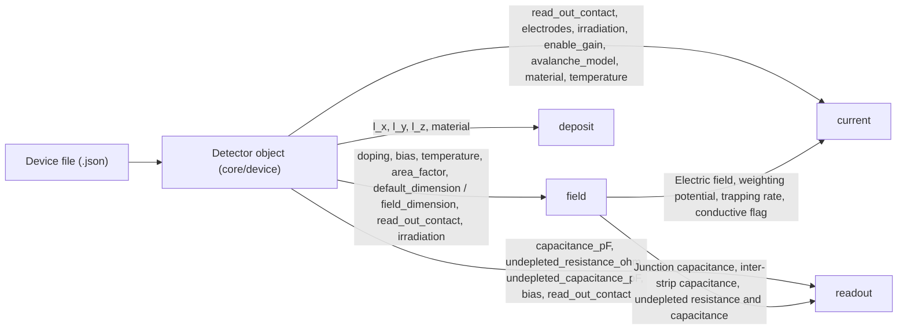

# Detector Components (`components/device`)

Device component files (`components/device/<device_name>.json` or `device.json` inside a project folder) are located and loaded into memory by `device_file` and `Detector` in [`core/device`](../core/device.md). They define the detector's three-dimensional size, semiconductor material, readout electrode layout, doping profile, bias voltage, operating temperature, irradiation defects, avalanche multiplication model, and device equivalent-circuit parameters, and are used by four stages: [`field`](../stages/field.md) ([`core/field`](../core/field.md)), [`deposit`](../stages/deposit.md) ([`core/deposit`](../core/deposit.md)), [`current`](../stages/current.md) ([`core/current`](../core/current.md)), and [`readout`](../stages/readout.md) ([`core/readout`](../core/readout.md)). Following [Architecture Overview](../architecture.md#components), geometry is separated from the mesh, and the mesh belongs to [`field`](../stages/field.md).



When looking up a component, the project folder's own component takes priority; if not found, it is searched by name in the component library.

## Component File Contents

Below is `components/device/HPK-Si-PiN.json` from the library. Device files have no `mesh` section: geometry (layer thicknesses, materials, and which face carries the electrodes) is an intrinsic property of the device, and which mesh to use is specified by settings in the [`field`](../stages/field.md) section.

```json
{
    "det_name" : "HPK-Si-PiN",
    "det_model" : "planar",
    "material" : "Si",

    "l_x" : 1300,
    "l_y" : 1300,
    "l_z" : 50,

    "doping":{
        "Acceptors" : "5e12*(step((50e-4)-x)-step(1e-4-x)) + 1.0e18*(step((151e-4)-x)-step((50e-4)-x))",
        "Donors" : "1.0e19*step(1e-4-x)"
    },

    "bias" : {
        "electrode" : "top",
        "voltage" : 200.0
    },

    "temperature" : 300.0,
    "capacitance_pF" : 3.44162280284,
    "field_source" : "devsim",
    "field_dimension" : 1,

    "area_factor" : 0.0169,
    "default_dimension" : 1,
    "read_out_contact" : [{"x_span":0, "y_span":0, "name":"top"}],
    "field_shift_x" : 0
}
```

## Key Meanings

The only keys users can set in a device JSON file are listed in the tables below.

### Geometry, Material, and Electrodes

| Key | Default | Unit | Meaning |
| --- | --- | --- | --- |
| `det_name` | JSON filename stem (`path.stem`) | None | Detector name, also assigned to the `det_name`, `device`, and `region` attributes of `Detector` |
| `det_model` | None (required) | None | Detector structural model identifier; takes one of `"planar"`, `"lgad"`, `"ilgad_planar"`, `"strip"`, `"lgadstrip"`, `"pixel"`, `"lgad_pixel"`, `"lgadpixel"`, `"3D_pixel"`, `"3D_column_series"` in the library; parallel-plate junction capacitance estimation is skipped when the lowercased string contains `"3d"` |
| `material` | None (required) | None | Semiconductor material name: `"Si"`, `"SiC"`, `"Diamond"` (passed to `Material` in [`core/model`](../core/model.md) and [`core/deposit`](../core/deposit.md)), or `"GaN"` (HEMT transport branch) |
| `l_x`, `l_y`, `l_z` | None (required) | `um` | Full detector dimensions along $x$, $y$, and $z$, with $z$ as the thickness direction |
| `electrodes` | `"pad"` | None | Readout electrode layout: `"pad"`, `"strip"`, or `"pixel"`, with exclusive keys validated by `LAYOUT_KEYS` |
| `read_ele_num` | `1` for `"pad"`, `x_ele_num * y_ele_num` for `"pixel"` | count | Total number of readout electrodes; required for `"strip"` layout |
| `x_ele_num`, `y_ele_num` | `1, 1` for `"pad"`, `read_ele_num, 1` for `"strip"` | count | Number of readout electrodes along $x$ and $y$; required for `"pixel"` layout |
| `p_x` | `l_x` for `"pad"` | `um` | Readout electrode pitch along $x$; required for `"strip"` or `"pixel"` layout |
| `p_y` | `l_y` for `"pad"` and `"strip"` | `um` | Readout electrode pitch along $y$; required for `"pixel"` layout |
| `e_width_x`, `e_width_y` | None (required for `collect_by_diffusion`) | `um` | $x$ and $y$ dimensions of the central rectangular collection region of each pixel in field-free pure-diffusion pixel collection mode |
| `read_out_contact` | None (required) | count for `x_span`, `y_span` | List of readout contact dictionaries, each containing `"name"` and optional neighboring unit-cell expansion spans `"x_span"` (default `0`) and `"y_span"` (default `0`) for repeated single-electrode layouts |
| `comment` | None (optional) | None | Descriptive note about the device |

### Bias, Doping, Irradiation, and Multiplication

| Key | Default | Unit | Meaning |
| --- | --- | --- | --- |
| `bias` | None (required) | `V` for `voltage` | Bias object containing the biased contact name `"electrode"` and bias voltage `"voltage"` |
| `temperature` | None (required) | `K` | Detector operating temperature $T$ |
| `doping` | None (required for field solving and pure-diffusion collection) | `cm^-3` | Doping object; field solving reads depth-dependent expressions (mesh coordinates in `cm`) `"Acceptors"` and `"Donors"` plus optional irradiation additions `"Acceptors_ir"` and `"Donors_ir"`; pure-diffusion collection reads numeric `"Donors"` and `"Acceptors"` |
| `irradiation` | When omitted, `irradiation_model` is `None` and `irradiation_flux` is `0` | `neq/cm^2` for `irradiation_flux` | Irradiation object; when provided, must contain both defect model `"irradiation_model"` (`"XingChen"`, `"Perugia"`, `"Schwandt"`, `"CommonDefect"`) and fluence `"irradiation_flux"` |
| `avalanche_model` | `None` | None | Impact-ionization multiplication model name: `"vanOverstraeten"`, `"Okuto"`, or `"Hatakeyama"` (DEVSIM field solving additionally supports `"NoAvalanche"`, `"CustomAvalanche"`, `"Fine_exponential_models"`, `"Tunnel"`) |
| `enable_gain` | `False` | None | Whether to enable carrier avalanche multiplication; when `true`, `avalanche_model` must also be provided |
| `gain_pair_threshold` | `0.05` | pairs | Minimum accumulated pair count required to emit a new gain cluster in multidimensional-field `"local_path"` multiplication mode (negative values are clamped to `0.0`) |
| `gain_max_carriers` | `50000` | clusters | Maximum number of gain clusters allowed per event in multidimensional-field `"local_path"` multiplication mode; unlimited when $\le 0$ |
| `local_gain_emit_slices` | `1` | clusters | Number of sub-clusters evenly split along the step segment per emission in multidimensional-field `"local_path"` multiplication mode (at least `1`) |
| `local_gain_integration_steps` | `3` | steps | Number of midpoint sample points used to integrate the impact-ionization coefficient within a single drift step in multidimensional-field `"local_path"` multiplication mode (at least `1`) |
| `U_const` | `0` | `cm^-3 s^-1` | Constant or node expression added to the SRH recombination rate in field solving; in SiC it also combines with the field-enhancement factor to form `R_TAT` |
| `parameter` | None (optional) | parameter-dependent | Parameter dictionary `{"name": <str>, "value": <float>}` written to the DEVSIM solving region (for example, the SiC trap-assisted tunneling saturation field `"F_sat"`, default `1e5 V/cm`) |

### Device Circuit

| Key | Default | Unit | Meaning |
| --- | --- | --- | --- |
| `capacitance_pF` | None (optional) | `pF` | Junction capacitance of a single readout electrode; when omitted, falls back in order to the field-solving result or the parallel-plate estimate |
| `depletion_depth` | `l_z` | `um` | Depletion depth used for parallel-plate junction capacitance estimation (must be greater than `0`) |
| `bias_resistance_ohm` | `None` | `Ohm` | Bias resistance from a single readout electrode to signal ground |
| `coupling_capacitance_pF` | `None` | `pF` | AC coupling capacitance from a single readout electrode to the amplifier input; when provided, `bias_resistance_ohm` must also be given |
| `undepleted_resistance_ohm`, `undepleted_capacitance_pF` | `None` | `Ohm`, `pF` | Equivalent parallel resistance and capacitance of the undepleted bulk under bias; when omitted, computed by 1D `field` from the field solution at the runtime bias; the two keys must be given together or both omitted |
| `resistive_layer` | None (optional) | `Ohm` for `sheet_resistance`, `cm^-2` for `implanted`, `um` for `thickness`, `°C` for `anneal` | Resistive charge-sharing layer definition object, containing sheet resistance `"sheet_resistance"` (or aluminum-implantation parameters `"implanted"`, `"thickness"`, `"anneal"`), cell span (`"strips"` or `"pads"`), and optional grounded contacts `"grounded"` and dielectric coupling layer `"coupling"` (with `"thickness"` [`um`] and dimensionless `"permittivity"`) |

### Physics Models and Solving Dimension

| Key | Default | Unit | Meaning |
| --- | --- | --- | --- |
| `default_dimension` | None (required) | None | Default field-solving dimension: `1`, `2`, or `3` |
| `field_dimension` | `default_dimension` | None | Field-solving dimension overriding `default_dimension` |
| `area_factor` | `1.0` | `cm^2` for 1D, `cm` for 2D, dimensionless for 3D | Area or length factor converting specific current, specific capacitance, and undepleted specific impedance from 1D or 2D solutions to full-device totals |
| `frequency` | `field.solver.ac.frequency` (`1000.0`) | `Hz` | Overrides the small-signal AC capacitance and noise analysis frequency in field solving |
| `field.solver` | `SOLVER` (see [`../core/field.md`](../core/field.md)) | `V` for voltage, `Hz` for frequency, count for iterations | Deep-merged overrides for the default DEVSIM solver parameters `SOLVER` |
| `field_interpolation_bins` | `None` (`{"x": 30, "y": 30, "z": 30}` by default for 3D interpolation) | count | Per-axis bin counts used by `DevsimField` when interpolating a 3D unstructured point cloud onto a regular grid |
| `hemt_physics` | None (optional) | `cm^2/(V s)` for mobility, `V` for voltage, `nm` for length | Enables the 2D AlGaN/GaN HEMT DC transfer-characteristic solver when `hemt_physics.transport_model == "drift_diffusion_v1"` |

Physical models are registered by name and selected by name in device files; each material has default selected models (see [`core/model`](../core/model.md)). All remaining parameters related to device physics and equivalent circuits (vacuum permittivity, default selected mobility models for each material, conductive-region thresholds, weighting-field permittivity multiplier on conductive edges, and fit parameters for aluminum-implanted SiC resistive layers) are hardcoded in the code and have no corresponding keys in device files:

| Constant or Fixed Item | Value | Unit | Definition Location and Meaning |
| --- | --- | --- | --- |
| `EPSILON_0_F_PER_M` / `VACUUM_PERMITTIVITY_F_M` | `8.8541878128e-12` | `F/m` | `src/raser/core/device/build_device.py:20`, `src/raser/core/field/circuit_parameters.py:17`, vacuum permittivity used in parallel-plate junction capacitance and resistive-layer dielectric coupling capacitance calculations |
| Default mobility models | `"Si"`: `"Selberherr"`; `"SiC"`: `"Das"`; `"Diamond"`: `"Pernegger"` | None | `src/raser/core/model/material.py:46`, `:53`, `:59`, `src/raser/core/current/cal_current.py:313`, default selected mobility model for each material |
| `ELEMENTARY_CHARGE` / `ELEMENTARY_CHARGE_C` | `1.602176634e-19` | `C` | `src/raser/core/field/conductive.py:9`, `src/raser/core/field/implanted_aluminium.py:15`, elementary charge used in conductivity and resistive-layer sheet-resistance conversions |
| `RESISTIVITY` | `10.0` | `Ohm cm` | `src/raser/core/field/conductive.py:10`, upper resistivity threshold for classifying a mesh node as highly conductive |
| `UNDEPLETED` | `0.5` | dimensionless | `src/raser/core/field/conductive.py:11`, lower threshold on the ratio of carrier concentration to net doping concentration for classifying a net-doped node as undepleted |
| `CONDUCTOR_PERMITTIVITY` | `1e10` | dimensionless | `src/raser/core/field/weighting.py:15`, permittivity amplification factor applied to edges between two conductive nodes when solving the weighting field |
| `TAT_SATURATION_FIELD` | `1e5` | `V/cm` | `src/raser/core/model/recombination.py:34`, `src/raser/core/field/create_parameter.py:124`, default saturation field `F_sat` for trap-assisted tunneling in SiC |
| `BOLTZMANN_EV_K` | `8.617333262e-5` | `eV/K` | `src/raser/core/field/implanted_aluminium.py:16`, Boltzmann constant used in the Arrhenius activation-ratio fit for aluminum-implanted SiC |
| `IMPLANTED_CM3`, `THICKNESS_CM`, `MEASURED_K`, `ZERO_CELSIUS_K` | `1e20`, `300e-7`, `300.0`, `273.15` | `cm^-3`, `cm`, `K`, `K` | `src/raser/core/field/implanted_aluminium.py:19-30`, experimental calibration reference parameters for the sheet resistance of aluminum-implanted 4H-SiC resistive layers |

## How the Program Uses the Component

### Locating the File and Constructing `Detector` (`core/device/build_device.py`)

1. **Resolving the file path (`device_file`)**:
   - If the input path is an existing folder, returns `device.json` inside that folder;
   - If the input has a file suffix or multiple path segments, returns that path directly;
   - If `<work_root>/<device_name>/device.json` exists, returns that project's custom device file;
   - Otherwise calls `component_file_path("device", str(device_name))` to return `device/<device_name>.json` from the component search paths.
2. **Validating layout and deriving attributes (`Detector.__init__`)**:
   - Deep-copies the JSON dictionary into `device_dict`, assigns all top-level keys to identically named attributes of `Detector`, and extracts `voltage = float(device_dict["bias"]["voltage"])` (in `V`) and `dimension = device_dict.get("field_dimension", device_dict["default_dimension"])`.
   - Validates that `electrodes` is one of `("pad", "strip", "pixel")`, and that `device_dict` contains all keys in `LAYOUT_KEYS[electrodes]` and no keys exclusive to another layout; otherwise raises `ValueError`.
   - Computes the avalanche flag `has_avalanche = (avalanche_model is not None) and bool(enable_gain)`; raises `ValueError` if `enable_gain` is true while `avalanche_model` is `None`.

### `field` Stage (`stages/field`, `core/field`)

1. **Read tracking and doping evaluation (`reading.py`, `create_mesh.py`)**: `solver_section.main` wraps the device object in `Reading(Detector(...))` to automatically record device attributes and JSON keys accessed during solving, writing them into the `"read"` field of the field node `<device_project>/field/<node_id>/node.json`. `DevsimMesh.setDoping` evaluates `Acceptors` and `Donors` (and optional irradiation terms `Acceptors_ir` and `Donors_ir`) from `doping` at mesh nodes to obtain the net doping concentration:
   $$N_{\text{net}}(x) = N_D(x) - N_A(x) \tag{1}$$
   where:
   - $N_{\text{net}}(x)$: net doping concentration at the mesh node, $\text{cm}^{-3}$;
   - $N_D(x)$, $N_A(x)$: donor and acceptor concentrations at the node (including optional `_ir` terms), $\text{cm}^{-3}$;
   - $x$: 1D DEVSIM mesh coordinate along depth, $\text{cm}$, corresponding to the $z$ coordinate (in `um`) in `deposit` and `current`; in expressions, `step(a)` equals $1$ for $a > 0$ and $0$ for $a < 0$, so the difference of two `step` functions defines a doping interval.
2. **Solving potential, electric field, weighting potential, and trapping rates (`create_parameter.py`, `solver_section.py`, `loop_section.py`)**: `bias` and `temperature` determine contact boundary conditions and semiconductor parameters (thermal voltage, bandgap, intrinsic carrier concentration), solving the potential and electric field on the `dimension`-dimensional mesh and solving the weighting potential for each readout electrode according to `read_out_contact`; when `irradiation` is given, defect space charge and electron/hole trapping rates are solved simultaneously. `area_factor` scales specific currents and specific capacitances solved on 1D (multiplied by area $l_x l_y$, in `cm^2`) or 2D (multiplied by the length perpendicular to the solving plane, in `cm`) meshes to full-device IV and CV values.
3. **Undepleted bulk impedance extraction (`conductive.py`, `save_milestone.py`)**: When 1D DEVSIM solving does not deplete the entire device at the applied bias, adjacent node intervals satisfying $|N_{\text{net}}| > 0$, $n + p > 0.5|N_{\text{net}}|$, and resistivity $\rho = [e(\mu_n n + \mu_p p)]^{-1} \ge 10.0\ \Omega\cdot\text{cm}$ are integrated into undepleted layer thickness $w_{\text{undep}}$ (`cm`), specific resistance $r_{\text{undep}} = \sum \bar{\rho}\,\Delta x$ (`Ohm cm^2`), and specific capacitance $c_{\text{undep}} = 10^{12}\varepsilon / w_{\text{undep}}$ (`pF/cm^2`), where $e$ is the elementary charge (C), $\mu_n$ and $\mu_p$ are the electron and hole mobilities ($\text{cm}^2/(\text{V}\cdot\text{s})$), $n$ and $p$ are the electron and hole concentrations ($\text{cm}^{-3}$), and $\varepsilon$ is the material permittivity (F/cm), saved to `<V>V.undepleted.json` and converted in the readout stage via `area_factor` to full-device undepleted resistance and capacitance.


Three-region depth doping profile of `HPK-Si-PiN`: `0–1 um` at the surface is an $n^+$ layer with `Donors` at $1.0\times 10^{19}\ \text{cm}^{-3}$, `1–50 um` is the active bulk with `Acceptors` at $5\times 10^{12}\ \text{cm}^{-3}$, and `50–151 um` is a $p^+$ substrate at $1.0\times 10^{18}\ \text{cm}^{-3}$ (`l_z = 50` `um` is the active layer thickness, while the `field` mesh extends to the back electrode at the bottom of the substrate).

### `deposit` Stage (`stages/deposit`, `core/deposit`)

`GeneralDetectorConstruction` (`detector_construction.py`) reads `l_x`, `l_y`, `l_z` (in `um`) and `material` (supporting `"Si"`, `"SiC"`, `"Diamond"`) to build a box solid named `"Device"` at the center of the Geant4 world spanning $x \in [-l_x/2, l_x/2]$, $y \in [-l_y/2, l_y/2]$, $z \in [0, l_z]$, with the origin at the center of the top face (see [`deposit.md`](deposit.md) for details). Straight-line minimum-ionizing tracks (`mip_deposits`), laser injection (`LaserInjection`), and ionization pair conversion (`ionized_pairs`) likewise read these four keys to determine device spatial bounds, material mean ionization energy, Fano factor, and interband absorption coefficient table.

### `current` Stage (`stages/current`, `core/current`)

1. **Channel naming and weighting-potential translation (`cal_current.py`)**: `electrode_names(read_out_contact, read_ele_num)` takes each item's `"name"` directly when `len(read_out_contact) == read_ele_num`, and generates `"<name>1"` through `"<name><read_ele_num>"` when `len(read_out_contact) == 1`. Together with `electrodes` (`"pad"`, `"strip"`, or `"pixel"`) and `x_ele_num`, `y_ele_num`, `p_x`, `p_y` (`um`), this determines the centered electrode array extent. When `read_out_contact` lists all electrodes, each channel uses its own weighting potential to compute Shockley-Ramo induced charge; when only 1 electrode is listed for a repeated layout, `electrodes_near` translates weighting potential `0` from the electrode index $(i_x, i_y)$ containing the carrier trajectory start point to neighboring electrodes $i \in [\max(i_x - s_x, 0),\, \min(i_x + s_x, N_x - 1)]$, $j \in [\max(i_y - s_y, 0),\, \min(i_y + s_y, N_y - 1)]$ (where $s_x$ is the field object's `cells_either_side` or `x_span`, and $s_y$ is `y_span`).
2. **Drift, trapping, and avalanche multiplication (`drift.py`, `cal_current.py`, `diffusion.py`)**: Single-step drift reads `material` and `temperature` (`K`) to obtain mobility and thermal diffusion step standard deviation. When `irradiation_model is not None`, `surviving` integrates the field's electron or hole trapping rate along the drift path and deducts trapped carriers via exponential attenuation; trapping is omitted when there is no `irradiation` block. When `has_avalanche` is true, `CalCurrentGain` computes multiplied carriers after primary carrier drift and sums them back into the total current: for 1D fields (`len(my_f.axes) == 1`), `"planar_integral"` integrates the impact-ionization coefficient along depth and releases multiplied pairs at the center depth of the peak-field interval; for multidimensional fields, `"local_path"` integrates the impact-ionization coefficient along each trajectory using `local_gain_integration_steps` sample points, and once pending pairs reach `gain_pair_threshold`, emits new gain clusters split by `local_gain_emit_slices` (raising `ValueError` if the total exceeds `gain_max_carriers`). Field-free pure-diffusion pixel collection `collect_by_diffusion` reads `e_width_x`, `e_width_y` (`um`) and numeric `doping.Donors`, `doping.Acceptors` (`cm^-3`).

### `readout` Stage (`stages/readout`, `core/field`, `core/readout`)

1. **Single-electrode junction capacitance priority (`circuit_parameters.junction_capacitance`, `build_device.Detector.capacitance`)**:
   - If the device file specifies `capacitance_pF`, takes `float(capacitance_pF) * 1e-12` directly (in `F`, source recorded as `"device file"`; this value is fixed and does not vary with bias; omit this key if bias-dependent junction capacitance is desired);
   - Otherwise, if `field` solved capacitance at the current bias (`<voltage>V.cv.json` or the strip-row mutual capacitance sum), takes the field-solved capacitance (in `F`, source recorded as `"field"`);
   - Otherwise, when lowercased `det_model` does not contain `"3d"`, `Detector.capacitance` estimates single-electrode junction capacitance from the parallel-plate formula (3D devices return `None` and raise `ValueError`):
     $$C_{\text{est}} = \varepsilon_0\,\varepsilon_r\,\frac{A \times 10^{-12}}{d \times 10^{-6}} \times 10^{12} \tag{2}$$
     where:
     - $C_{\text{est}}$: parallel-plate estimated single-electrode junction capacitance, `pF` (`junction_capacitance` multiplies by $10^{-12}$ to convert to `F`, source recorded as `"parallel plate"`);
     - $\varepsilon_0$: vacuum permittivity, `8.8541878128e-12` `F/m`;
     - $\varepsilon_r$: relative permittivity of the material given by `Material(material).permittivity` (dimensionless);
     - $A$: readout area of a single electrode, `um^2`, equal to $p_x p_y$ for `"strip"` or `"pixel"` layouts and $l_x l_y$ for `"pad"` layout;
     - $d$: depletion depth `depletion_depth` (defaults to `l_z`), `um`.
2. **Undepleted layer and additional device circuitry (`circuit_parameters.py`, `device_circuit.py`, `pulse_edge.py`)**: Undepleted-layer parallel resistance and capacitance take the paired `undepleted_resistance_ohm` (`Ohm`) and `undepleted_capacitance_pF` (`pF`) from the device file first; when omitted, they are read from `<V>V.undepleted.json` solved by `field` (specific resistance divided by the device area, specific capacitance multiplied by it, `area_factor` in 1D and `l_x`×`l_y` in 2D and 3D; see W. Riegler, *Nucl. Instrum. Methods Phys. Res. A* 940 (2019) 453, doi:10.1016/j.nima.2019.06.056) with no such layer at full depletion. If the device file also configures `bias_resistance_ohm`, `coupling_capacitance_pF`, or `resistive_layer` (building a resistive network circuit via `device_row` or `device_grid`; the aluminum-implanted SiC sheet-resistance model comes from M. Spera et al., *Materials* 12 (2019) 3468, doi:10.3390/ma12213468 / `arXiv:2001.08021`), these elements are placed in front of the amplifier chain (see [`readout.md`](readout.md#how-the-program-uses-the-component) for netlist structure). `pulse_edges` determines from `bias.electrode`, `bias.voltage`, and `read_out_contact` whether a readout electrode collects electrons or holes, setting the output pulse edge to `"rising"` or `"falling"`.

`bias.electrode` and each `name` in `read_out_contact` must match the contact names in the `field` mesh; the legacy keys `field_source`, `field_shift_x`, and `field_shift_y` retained in example files are no longer read by the code and may be omitted when writing new device files.

## Built-in Components

`components/device/` contains the following 23 detector components:

| Component Name | Description | Source | Applicable Devices or Experiments |
| --- | --- | --- | --- |
| `3D-LGAD` | Si `lgad_pixel` device ($35 \times 35 \times 30\ \mu\text{m}$, 3D) | Unspecified | |
| `3d_column_series` | Si `3D_column_series` device ($50 \times 50 \times 100\ \mu\text{m}$, column radius $3\ \mu\text{m}$) | Unspecified | |
| `3d_pixel` | Si `3D_pixel` device ($1000 \times 1000 \times 150\ \mu\text{m}$, $40 \times 40$ pixels) | Unspecified | |
| `AlGaN_GaN_HEMT_TRANSPORT_V1` | GaN `planar` device (2D AlGaN/GaN HEMT DC transfer-characteristic model) | `hemt_physics.model_provenance`: `Exploratory electron-only 2D drift-diffusion branch; no paper calibration` | `raser field` (HEMT `drift_diffusion_v1` DC sweep) |
| `CMOS_strip` | Si `strip` device ($3200 \times 2800 \times 150\ \mu\text{m}$, $40$ strips, pitch $75.5\ \mu\text{m}$, Gmsh mesh) | Unspecified | |
| `CMOS_strip_tcad` | Si `strip` device ($3200 \times 2800 \times 180\ \mu\text{m}$, $40$ strips, pitch $75.5\ \mu\text{m}$, TCAD mesh) | Unspecified | |
| `DJLGAD_Ayyoub_1D_with_coefficient` | Si `lgad` device, 1D Ayyoub DJ-LGAD coefficient variant (gain-layer Gaussian exponent includes `1/2`, peak $3.0\times 10^{16}\ \text{cm}^{-3}$, standard deviation $0.17\ \mu\text{m}$) | `comment`: 1D Ayyoub DJ-LGAD coefficient variant (derived from `DJLGAD_Ayyoub_1D`) | |
| `DJLGAD_Ayyoub_Table1_1D` | Si `lgad` device, 1D approximate DJ-LGAD model reproducing Ayyoub Table 1 | `comment`: 1D approximate DJ-LGAD model reproducing Ayyoub Table 1 from the literature | |
| `general_pixel` | Si `pixel` device ($900 \times 900 \times 300\ \mu\text{m}$, $3 \times 3$ pixels, pitch $300\ \mu\text{m}$) | Unspecified | |
| `general_strip` | Si `strip` device ($1000 \times 1000 \times 180\ \mu\text{m}$, $40$ strips, pitch $25\ \mu\text{m}$) | Unspecified | |
| `HPK-Si-LGAD` | Si `lgad` device ($1300 \times 1300 \times 50\ \mu\text{m}$, 1D) | HPK (Hamamatsu Photonics) silicon LGAD (component model `HPK-Si-LGAD`) | |
| `HPK-Si-PiN` | Si `planar` device ($1300 \times 1300 \times 50\ \mu\text{m}$, 1D) | HPK (Hamamatsu Photonics) silicon PiN (component model `HPK-Si-PiN`) | [Getting Started](../getting-started.md) and `examples/HPK-Si-PiN/` (default device for [`signal`](../bench/signal.md) and other examples) |
| `iLGAD` | Si `ilgad_planar` device ($10000 \times 10000 \times 285\ \mu\text{m}$, 1D) | Unspecified | |
| `ITk-md8` | Si `planar` device ($8000 \times 8000 \times 50\ \mu\text{m}$, 1D, with `"Schwandt"` irradiation model) | ATLAS ITk MD8 silicon planar diode (component model `ITk-md8`) | |
| `ITk-Si-strip` | Si `strip` device ($96791 \times 48000 \times 305\ \mu\text{m}$, $1282$ strips, pitch $75.5\ \mu\text{m}$, with `"XingChen"` irradiation model) | ATLAS ITk silicon microstrip detector (component model `ITk-Si-strip`) | |
| `NJU-PiN` | SiC `planar` device ($5000 \times 5000 \times 100\ \mu\text{m}$, 1D/2D) | Nanjing University (NJU) 4H-SiC PiN (component model `NJU-PiN`) | SiC example device for [`signal`](../bench/signal.md) and [`tct`](../bench/tct.md) |
| `NJU-PiN-bmos` | SiC `planar` device ($5000 \times 5000 \times 100\ \mu\text{m}$, 1D/2D) | Nanjing University (NJU) 4H-SiC PiN (component model `NJU-PiN-bmos`) | [`bmos`](../apps/bmos.md) |
| `pixel_ayyouby` | Si `lgadpixel` device, 3×3 array Ayyoub-style DJ-LGAD pixel (pitch $20 \times 20\ \mu\text{m}$) | `comment`: Ayyoub-style 3×3 DJ-LGAD pixel model | |
| `SICAR-1` | SiC `lgad` device ($1000 \times 1000 \times 32.5\ \mu\text{m}$, 1D) | SICAR-1 4H-SiC LGAD (component model `SICAR-1`) | |
| `SICAR-1-PiN` | SiC `planar` device ($1000 \times 1000 \times 50\ \mu\text{m}$, 1D) | SICAR-1 4H-SiC PiN (component model `SICAR-1-PiN`) | |
| `SiC_LGAD_strip` | SiC `lgadstrip` device ($420 \times 420 \times 67.3\ \mu\text{m}$, $3$ strips, pitch $120\ \mu\text{m}$) | Unspecified | |
| `strip_ayyouby` | Si `lgadstrip` device, three-channel Ayyoub-style DJ-LGAD strip detector (pitch $20\ \mu\text{m}$) | `comment`: Ayyoub-style three-channel DJ-LGAD strip model | |
| `TAICHU3` | Si `pixel` device ($1500 \times 1500 \times 20\ \mu\text{m}$, $60 \times 60$ pixels, pitch $25 \times 25\ \mu\text{m}$) | TAICHU3 CMOS pixel sensor (component model `TAICHU3` / `Taichu3`) | [`telescope`](../bench/telescope.md) (default sensor for `taichu_v1`) |
