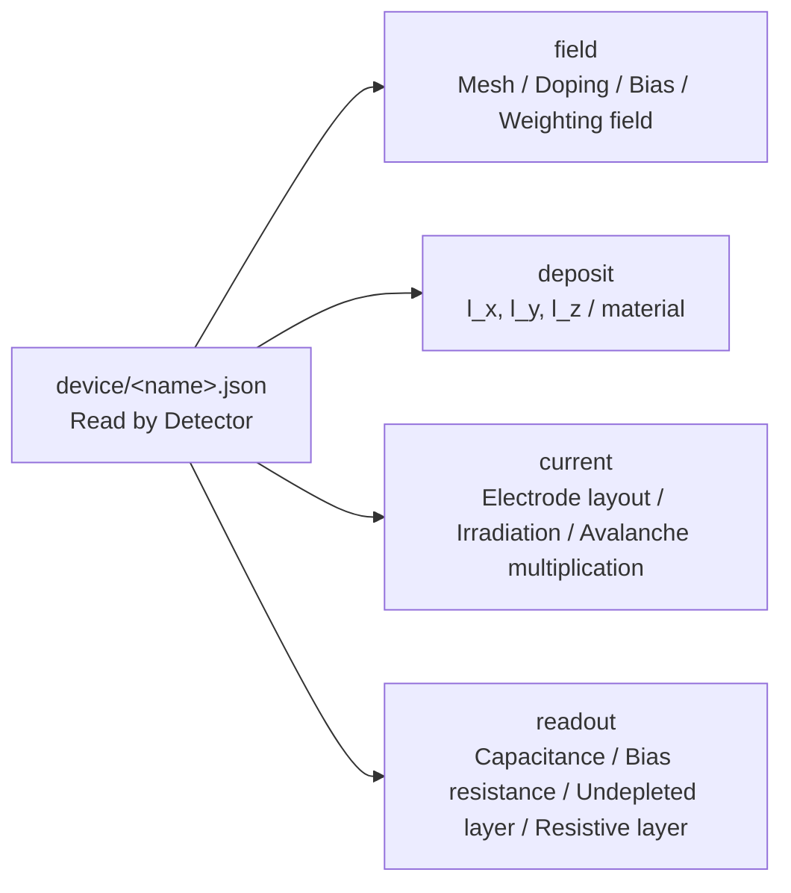
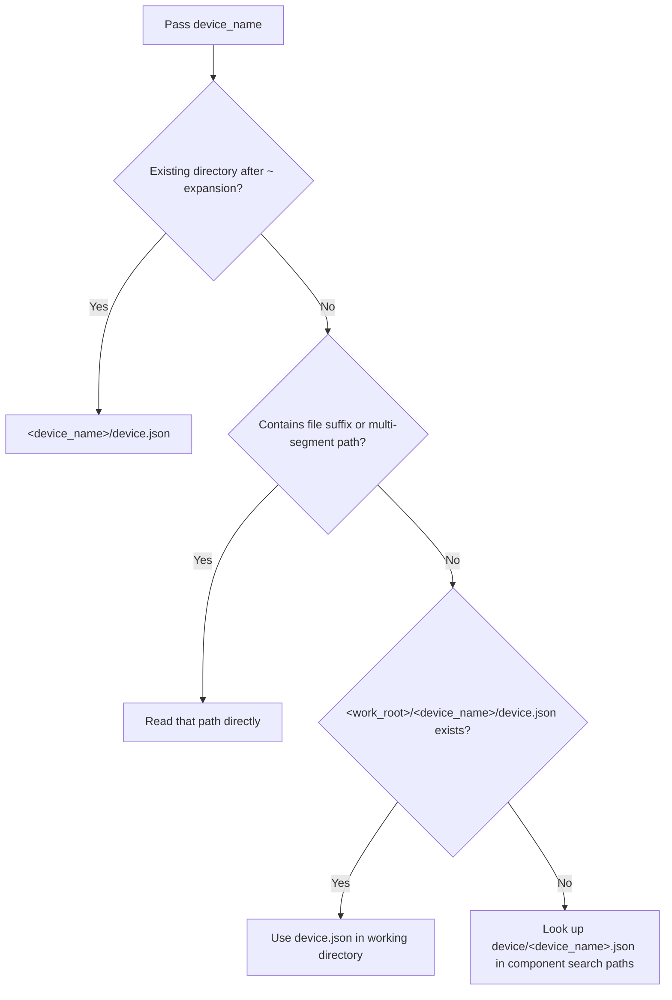

# Detector Components (`components/device`)

`src/raser/components/device/` stores detector JSON definition files and Gmsh mesh generation scripts. Device definitions sit at the front of the simulation chain: the workflow locates the working directory and run snapshot from the device name, `field` builds the mesh, doping, bias, and weighting field from it, `deposit` reads the 3D dimensions and material to build the sensitive volume, `current` reads the electrode layout, irradiation, and avalanche multiplication parameters, and `readout` assembles the junction capacitance, bias resistance, undepleted layer, and resistive layer equivalent circuit from it.



## Lookup Order and File Format

`Detector` ([`../core/device.md`](../core/device.md)) locates the detector JSON file in the following order:



The top level of the file must be a JSON object. Each key becomes an attribute of the `Detector` instance with the same name and is written in full to `run.json["files"]["device"]` in the experiment directory. Passing `device.<key_path>` via `--set` / `--scan` (or the top-level shorthand `voltage`, which maps to `device.bias.voltage`) overrides the corresponding key in the file at runtime.

### Example Device File: `HPK-Si-PiN.json`

In the [Getting Started](../getting-started.md) example `raser signal HPK-Si-PiN --scan voltage=100,200 -s 2 -evt 200 --seed 1`, the program reads the device definition from `src/raser/components/device/HPK-Si-PiN.json`:

```json
{
    "det_name" : "HPK-Si-PiN",
    "det_model" : "planar",
    "material" : "Si",

    "l_x" : 1300,
    "l_y" : 1300,
    "l_z" : 50,

    "doping":{
        "Acceptors" : "5e12*(step((50e-4)-x)-step(1e-4-x)) + 1.0e18*(step((151e-4)-x)-step((50e-4)-x))",
        "Donors" : "1.0e19*step(1e-4-x)"
    },

    "bias" : {
        "electrode" : "top",
        "voltage" : 200.0
    },

    "temperature" : 300.0,
    "capacitance_pF" : 3.44162280284,
    "field_source" : "devsim",
    "field_dimension" : 1,

    "area_factor" : 0.0169,
    "default_dimension" : 1,
    "read_out_contact" : [{"x_span":0, "y_span":0, "name":"top"}],
    "field_shift_x" : 0,

    "mesh" : {
        "1D_mesh" : {
            "mesh_line" : [
                {"pos" : 0,      "ps" : 1e-4, "tag" : "top"},
                {"pos" : 0.5e-4, "ps" : 1e-5, "tag" : "jun_up"},
                {"pos" : 1e-4,   "ps" : 1e-5, "tag" : "mid"},
                {"pos" : 4e-4,   "ps" : 1e-5, "tag" : "jun_down"},
                {"pos" : 150e-4, "ps" : 1e-4, "tag" : "bot"}
            ],
            "region" : [
                {
                    "material" : "Silicon",
                    "region" : "HPK-Si-PiN",
                    "tag1" : "top",
                    "tag2" : "bot"
                }
            ],
            "contact" : [
                {"name" : "top", "tag" : "top", "material" : "metal"},
                {"name" : "bot", "tag" : "bot", "material" : "metal"}
            ]
        }
    }
}
```

This run directly uses several definitions in the file:

- **`bias.voltage` is `200.0` V**: When scanning `voltage=100,200`, `200 V` matches the device default, so results go to `work/HPK-Si-PiN/signal/seed_1/`, while `100 V` goes to `work/HPK-Si-PiN/signal/voltage_100/seed_1/`.
- **`l_x`, `l_y`, `l_z` and `material`**: The `1300 × 1300 × 50 um` `"Si"` sensitive volume is passed to Geant4 and `current` drift.
- **`read_out_contact` and `capacitance_pF`**: Only `"top"` is a readout contact (`electrodes` defaults to `"pad"`). Attributes in `readout_0.h5` write `electrodes=['top']`, and `capacitance_pF = 3.44162280284` is taken directly into `device_circuit` (`"farad": 3.44162280284e-12, "from": "device file"`).
- **`default_dimension = 1` and `mesh.1D_mesh`**: `field` builds a 1D DEVSIM mesh along the `z` axis (`top`, `jun_up`, `mid`, `jun_down`, `bot`), scales IV/CV curves by `area_factor = 0.0169` cm$^2$, and writes `100.0V.undepleted.json` and `200.0V.undepleted.json`.

### Geometry, Material, and Electrode Layout Keys

| Key | Default | Unit | Meaning |
| --- | --- | --- | --- |
| `det_name` | JSON filename stem | None | Detector name, also used as the DEVSIM `device` and default `region` name |
| `det_model` | None (required when reading capacitance without `capacitance_pF` or a solved-field capacitance, and when computing current) | None | Detector model identifier (such as `"planar"`, `"lgad"`, `"ilgad_planar"`, `"strip"`, `"lgadstrip"`, `"pixel"`, `"lgad_pixel"`, `"lgadpixel"`, `"3D_pixel"`, `"3D_column_series"`); checked for `"3d"` (case-insensitive) when reading capacitance |
| `material` | None (required for parallel-plate capacitance estimate, field solving, or current computation) | None | Detector semiconductor material (`Material` supports `"Si"`, `"SiC"`, `"Diamond"`; library devices use `"Si"`, `"SiC"`, and `"GaN"`, with `"GaN"` in `AlGaN_GaN_HEMT_TRANSPORT_V1`) |
| `l_x`, `l_y`, `l_z` | None (required) | `um` | Full detector dimensions along x, y, and z (z is thickness) |
| `default_dimension` | None (required) | None | Default field solver dimension (`1`, `2`, or `3`) |
| `field_dimension` | Taken from `default_dimension` | None | Field solver dimension overriding `default_dimension` |
| `area_factor` | `1.0` | `cm^2` for 1D, `cm` for 2D, dimensionless for 3D | Area or length factor converting DEVSIM IV current, CV capacitance, mesh specific capacitance, or undepleted-layer specific impedance into total device values |
| `electrodes` | `"pad"` | None | Readout electrode layout: `"pad"`, `"strip"`, or `"pixel"` |
| `read_ele_num` | `1` for `"pad"`, `x_ele_num * y_ele_num` for `"pixel"` | count | Total number of readout electrodes (written in JSON when `electrodes` is `"strip"`) |
| `x_ele_num`, `y_ele_num` | `1, 1` for `"pad"`, `read_ele_num, 1` for `"strip"` | count | Number of readout electrodes along x and y (written in JSON when `electrodes` is `"pixel"`) |
| `p_x` | `l_x` for `"pad"` | `um` | Readout electrode pitch along x (written in JSON when `electrodes` is `"strip"` or `"pixel"`) |
| `p_y` | `l_y` for `"pad"` and `"strip"` | `um` | Readout electrode pitch along y (written in JSON when `electrodes` is `"pixel"`) |
| `read_out_contact` | None (required) | None | List of readout contacts, each an object with `"name"` and optional `"x_span"` (fallback x-direction expansion cells when `cells_either_side` is absent while reading weighting fields) and `"y_span"` (neighboring cells expanded on both sides in y for weighting fields); when only 1 contact is listed and `read_ele_num > 1`, readout electrode names become `<name>1..<name><read_ele_num>` (in DEVSIM, x expansion for a single repeated readout contact is set by `cells_either_side`) |
| `e_width_x`, `e_width_y` | None (optional) | `um` | Width of the charge-collection region at each pixel center in the field-free pixel diffusion model |
| `comment` | None (optional) | None | Device description text |

### Bias, Doping, Irradiation, and Multiplication Keys

| Key | Default | Unit | Meaning |
| --- | --- | --- | --- |
| `bias` | None (required) | None | Bias object containing `"electrode"` (biased contact name) and `"voltage"` (bias voltage in `V`) |
| `temperature` | None (required) | `K` | Detector operating temperature |
| `doping` | None (required for DEVSIM solving) | `cm^-3` | Doping object containing `"Acceptors"` and `"Donors"` (DEVSIM expressions or numeric strings), optional `"Acceptors_ir"` and `"Donors_ir"` (`create_mesh.py` reads these capitalized names; `NJU-PiN`, `NJU-PiN-bmos`, and `AlGaN_GaN_HEMT_TRANSPORT_V1` contain lowercase `"donors_ir": "0"`), and `"by_region"` per-region doping read by the HEMT transport solver |
| `irradiation` | When the whole object is omitted, `irradiation_model` is `None` and `irradiation_flux` is `0` | None | Irradiation object; when given, both `"irradiation_model"` (`"XingChen"`, `"Perugia"`, `"Schwandt"`, or `"CommonDefect"`) and `"irradiation_flux"` (in `neq/cm^2`) are required |
| `avalanche_model` | `None` | None | Impact ionization model name; carrier drift multiplication supports `"vanOverstraeten"`, `"Okuto"`, and `"Hatakeyama"` (other values raise `Unsupported avalanche model`) |
| `enable_gain` | `false` | None | Whether to enable carrier multiplication; when `true`, `avalanche_model` must be provided |
| `gain_pair_threshold` | `0.05` | pairs | Pair-count threshold for emitting a new carrier packet in local path multiplication |
| `gain_max_carriers` | `50000` | packets | Maximum carrier packets allowed by local path multiplication; when positive, raises `ValueError` if the next emission exceeds the cap; `0` or negative disables the limit |
| `local_gain_emit_slices` | `1` | slices | Carrier packets generated per emission in local path multiplication; distributed evenly along a single growing step, or placed at the center position and time weighted by added pairs across steps |
| `local_gain_integration_steps` | `3` | steps | Ionization-coefficient integration sample points within a single drift step in local path multiplication |
| `U_const` | `0` | `cm^-3 s^-1` | Constant term added to the SRH recombination rate `USRH` in DEVSIM (library devices use `-5e10`) |
| `parameter` | None (optional) | parameter-dependent | Object written to DEVSIM region parameters, reading `"name"` and `"value"` |

### Equivalent Circuit and Resistive Layer Keys

| Key | Default | Unit | Meaning |
| --- | --- | --- | --- |
| `capacitance_pF` | None (optional) | `pF` | Junction capacitance of a single readout electrode; when omitted, prefers the solved-field value passed by the caller (resistive-layer readout takes it directly from the device or estimate), then tries a parallel-plate estimate; when `det_model` contains `"3d"` (case-insensitive), only an explicit or solved-field value is valid, otherwise circuit construction raises `ValueError` |
| `depletion_depth` | Taken from `l_z` | `um` | Depletion depth used for the parallel-plate junction capacitance estimate |
| `bias_resistance_ohm` | `None` | `Ohm` | Bias resistance of a single readout electrode |
| `coupling_capacitance_pF` | `None` | `pF` | AC coupling capacitance of a single readout electrode (in readout circuits without `resistive_layer`, providing this requires `bias_resistance_ohm` as well, otherwise `ValueError` is raised) |
| `undepleted_resistance_ohm`, `undepleted_capacitance_pF` | `None` | `Ohm`, `pF` | Undepleted bulk resistance and capacitance in readout circuits without `resistive_layer`; must be both given or both omitted; raises `ValueError` if a row-of-strips circuit has an undepleted layer |
| `frequency` | Prefers `field.solver.ac.frequency`; `1000.0` if neither is set | `Hz` | DEVSIM AC capacitance solver frequency |
| `resistive_layer` | None (optional) | None | Resistive layer definition object: must include `"sheet_resistance"` (`Ohm`) or aluminum-implant parameters `"implanted"` (`cm^-2`), `"thickness"` (`um`), `"anneal"` (`C`) when sheet resistance is not set via readout options, plus `"strips"` or `"pads"` cell-span dict, optional `"grounded"`, and `"coupling"` (with `"thickness"` in `um` and `"permittivity"`) |

### Field Solver and Mesh Keys

| Key | Default | Unit | Meaning |
| --- | --- | --- | --- |
| `field` | None (optional) | None | Field configuration object, optionally containing `"solver"` (overriding step sizes, tolerances, and `saved_voltage_interval` of `SOLVER`); any change under `field` marks solved fields as stale |
| `field_interpolation_bins` | `30` per axis (`{"x": 30, "y": 30, "z": 30}`) for 3D point clouds needing rebinning | None | Bin-count object `{"x": nx, "y": ny, "z": nz}` for interpolating and rebinning non-constant, non-complete-regular-grid 3D point clouds; raises `ValueError` when entering this branch with unknown axis names or any bin count below `2` |
| `mesh` | None (required for DEVSIM solving) | None | Mesh configuration object, with optional `"plugin"` (boolean, default `false`, whether a 2D mesh lies in the transverse x-y plane), `"mesher"` (3D axis order is `("x", "y", "z")` for `"sde"`, otherwise `("z", "x", "y")`), and `"1D_mesh"`, `"2D_mesh"`, or `"gmsh_mesh"` (TCAD fields are imported via `raser field -ext`) |
| `hemt_physics` | None (optional) | None | AlGaN/GaN HEMT physics and bias-sweep configuration; enables the 2D electron transport solver when `"transport_model"` is `"drift_diffusion_v1"` |

In `mesh.1D_mesh` and `mesh.2D_mesh`, `"pos"`, `"ps"` in `"mesh_line"`, and bounds `"xl"`, `"xh"`, `"yl"`, `"yh"` in `"region"` and `"contact"` are all in `cm`; `mesh.2D_mesh` may also contain `"ac_contact"` and `"interface"` read by the AC weighting-field solver (`ac-weightfield`) (the HEMT transport solver also reads `"interface"`). Spatial coordinates `x`, `y`, `z` in doping expressions correspond to DEVSIM mesh coordinates (in `cm`). The `.msh` file named by `mesh.gmsh_mesh.file` is located by `Detector.file(name)` from the detector JSON directory (or as an absolute path); `"tag1"` and `"tag2"` in `mesh.gmsh_mesh.region` of `TAICHU3.json` are passed to `devsim.add_gmsh_region(**region)`. Some device JSON files also keep `"field_shift_x"`, `"field_shift_y"`, `"field_source"`, `"electrode_width_um"`, `mesh.tcad_mesh`, `mesh.gmsh_mesh.axes_um`, and `field.source`, `field.dimension` as retained configuration fields (written to `run.json` in the file snapshot).

## Built-in Components

`src/raser/components/device/` contains the following 23 detector JSON components (`CMOS_strip.py` and `__main__.py` in the same directory generate `CMOS_strip.msh`):

| Component | Component | Component | Component |
| --- | --- | --- | --- |
| `3D-LGAD` | `3d_column_series` | `3d_pixel` | `AlGaN_GaN_HEMT_TRANSPORT_V1` |
| `CMOS_strip` | `CMOS_strip_tcad` | `DJLGAD_Ayyoub_1D_with_coefficient` | `DJLGAD_Ayyoub_Table1_1D` |
| `general_pixel` | `general_strip` | `HPK-Si-LGAD` | `HPK-Si-PiN` |
| `iLGAD` | `ITk-md8` | `ITk-Si-strip` | `NJU-PiN` |
| `NJU-PiN-bmos` | `pixel_ayyouby` | `SICAR-1` | `SICAR-1-PiN` |
| `SiC_LGAD_strip` | `strip_ayyouby` | `TAICHU3` | |

## Common Errors

| Error Message | Trigger Condition |
| --- | --- |
| `ValueError: `electrodes` must be pad, strip or pixel, not <value>` | `electrodes` is not one of `"pad"`, `"strip"`, `"pixel"` |
| `ValueError: <path>: `electrodes` is <layout>, which takes the keys [...]; missing [...], keys of another layout [...]` | Keys required by the current `electrodes` layout are missing, or keys exclusive to another layout are mixed in |
| `ValueError: gain is enabled but `avalanche_model` is missing in detector settings` | `enable_gain` is `true` but `avalanche_model` is not set |
| `ValueError: depletion_depth must be positive` | Entering parallel-plate capacitance estimation (neither `capacitance_pF` nor solved-field capacitance given, non-3D device model) with `depletion_depth` (or `l_z` when unset) less than or equal to 0 |
| `FileNotFoundError: Cannot find <path>, named by <definition_path>` | `Detector.file` cannot find an external mesh file referenced by the device JSON |
| `ValueError: <det_name> gives <key> alone: the undepleted layer has both undepleted_resistance_ohm and undepleted_capacitance_pF` | In a readout circuit without `resistive_layer`, only one of undepleted resistance and capacitance is provided |
| `ValueError: A coupling capacitance needs a bias resistance: without it the electrode has no DC potential` | In a readout circuit without `resistive_layer`, `coupling_capacitance_pF` is given without `bias_resistance_ohm` |
| `ValueError: <det_name> is a row of strips and has an undepleted layer, from the <source>: the circuit of a row has none` | A single-readout-electrode repeated-strip device using a row-of-strips circuit without `resistive_layer` has an undepleted layer |

## Related Pages

- [Getting Started](../getting-started.md)
- [`../core/device.md`](../core/device.md)
- [`../core/field.md`](../core/field.md)
- [`../core/current.md`](../core/current.md)
- [`../core/readout.md`](../core/readout.md)
- [`../supports/README.md`](../supports/README.md)
