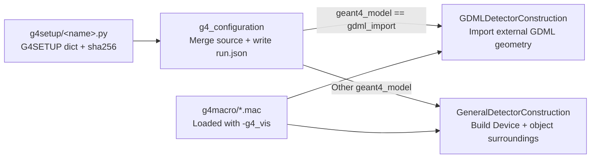

# Geant4 Geometry Components (`components/g4setup`)

`src/raser/components/g4setup/` and `components/g4setup/` under each test bench store Python script components (`<name>.py`) describing the Geant4 geometry around the detector, maximum step limit inside the detector, and spatial placement of the signal source. The `g4setup` component acts on the [`deposit`](../stages/deposit.md) slice at the start of the simulation chain: specified via `--g4setup` (default `"device_alone"`; `cce` defaults to `"charge_collection"`, `timeres` defaults to `"time_resolution"`), the `G4SETUP` dictionary defined in the script is written to `run.json` together with the SHA-256 digest of the script bytes, so modifying the script automatically marks dependent runs as stale.



## Lookup Order and File Format

`read_g4setup(selector)` locates `g4setup/<selector>.py` in component search paths (or reads an explicit `.py` file path), executes it in an isolated module namespace, extracts the top-level dictionary `G4SETUP`, and returns `{**G4SETUP, "file": str(selector), "sha256": <digest>}`.

The Geant4 world origin `(0, 0, 0)` lies at the center of the detector top face (`z = 0`). The detector solid `"Device"` occupies `x in [-l_x/2, l_x/2]`, `y in [-l_y/2, l_y/2]`, `z in [0, l_z]`, with `z < 0` above the top face. `GeneralDetectorConstruction` builds `"Device"` when the device material is `"Si"`, `"Diamond"`, or `"SiC"` (other materials raise `KeyError` when setting the step limit). `GDMLDetectorConstruction` (`"gdml_import"`) builds `"Device"` when the material is `"Si"` (with `"SiC"` or external `binary_compounds`, calling the Geant4 base constructor directly omits `compound_materials`, raising `AttributeError` when `create_binary_compounds` is called).

### Example Setup Script: `device_alone.py`

In the [Getting Started](../getting-started.md) example `raser signal HPK-Si-PiN --scan voltage=100,200 -s 2 -evt 200 --seed 1`, the command uses the default `g4setup = "device_alone"`, corresponding to `src/raser/components/g4setup/device_alone.py`:

```python
G4SETUP = {
    "name": "device_alone",
    "description": "The device alone in vacuum",
    "geant4_model": "device",
    "object": {},
    "source": {"at": [0, 0, -17000], "towards": [0, 0, 0], "angle": 0},
    "world": "G4_Galactic",
    "maxstep": 2,
    "g4_vis": False,
}
```

In this example:

- **Source placement and environment**: `"world": "G4_Galactic"` and `"object": {}` place `HPK-Si-PiN` alone in vacuum; `"source"` places `decay/Sr90` `17 mm` (`z = -17000 um`) above the top face aiming vertically at the top-face center `[0, 0, 0]`, with Geant4 step limit `maxstep = 2 um`.
- **Run snapshot record**: `"files.g4setup"` in `work/HPK-Si-PiN/signal/seed_1/run.json` stores all keys of `G4SETUP` plus `"file": "device_alone"` and `"sha256": "7fd37c9e44d82bbf2280687067320d0e94fc587e9bec870d760f3c608a3869d1"`.

### Top-Level `G4SETUP` Keys

| Key | Default | Unit | Meaning |
| --- | --- | --- | --- |
| `name` | None (optional) | None | Environment component name |
| `description` | None (optional) | None | Text description of the environment geometry |
| `geant4_model` | None (required for Geant4 sources; `toy_mip` only reads `maxstep`) | None | Geant4 geometry model identifier; `"gdml_import"` uses `GDMLDetectorConstruction` to import external GDML, while other values use `GeneralDetectorConstruction` |
| `world` | None (required for Geant4 sources outside wrapper-world mode) | None | Geant4 NIST material name for the world volume (such as `"G4_Galactic"`, `"G4_AIR"`); world-cube half-side is computed by `world_half_side` (minimum `25000 um`, or twice the maximum coordinate extent if the detector, surrounding objects, or source origin plus `par_radius` exceeds it). When the GDML file text contains `RASER_GDML_WRAPPER_WORLD`, the GDML world volume is used directly and `world` and the computed half-side are ignored |
| `maxstep` | None (required) | `um` | Maximum Geant4 step limit inside the detector `"Device"` logical volume (also used to split `toy_mip` tracks when `packets` is not set) |
| `source` | None (required for Geant4 sources) | `um`, `degree` | Source placement object `{"at": [x, y, z], "towards": [x, y, z], "angle": a}`: `at` is the source origin (written to `par_in`), `towards` is the aim point (written to `par_out`), and `angle` (default `0`) is the incidence angle (written to `par_angle`, rotating `par_in` and `par_out` of the source and all particles around an axis parallel to the y axis through the intersection of `par_in -> par_out` with detector face `z = 0` or `z = l_z`) |
| `object` | None (required for Geant4 sources) | None | Dictionary of surrounding volumes (`{}` when empty); may contain `"elemental"` and `"binary_compounds"` sub-dictionaries |

All 5 scripts in the library retain `"g4_vis": False` in `G4SETUP`; runtime Geant4 geometry visualization is controlled by CLI options `-g4_vis` and `--g4-vis-driver` (see [`../stages/deposit.md`](../stages/deposit.md)).

### `object.elemental` and `object.binary_compounds` Volume Keys

Each entry under `object["elemental"]` defines an elemental or NIST-material box, and each entry under `object["binary_compounds"]` defines a binary-compound box:

| Key | Category | Unit | Meaning |
| --- | --- | --- | --- |
| `name` | Both | None | Logical and physical volume name |
| `material` | `elemental` | None | Geant4 NIST material name (such as `"G4_Al"`, `"G4_Ni"`, `"G4_Ti"`, `"G4_Si"`, `"G4_BRASS"`) |
| `material_1`, `material_2` | `binary_compounds` | None | Element symbols of the two constituents (such as `"Si"`, `"C"`, `"N"`, `"O"`) |
| `compound_name` | `binary_compounds` | None | Compound material name (in `GeneralDetectorConstruction`, entries sharing `compound_name` must match item-by-item in `material_1`, `material_2`, `density`, `natoms_1`, `natoms_2`) |
| `density` | `binary_compounds` | `g/cm^3` | Compound density |
| `natoms_1`, `natoms_2` | `binary_compounds` | None | Atomic count shares of the two elements (converted to mass fractions weighted by atomic mass for Geant4) |
| `side_x`, `side_y`, `side_z` | Both | `um` | Full dimensions of the box along x, y, and z |
| `position_x`, `position_y`, `position_z` | Both | `um` | Center position of the box in Geant4 world coordinates |
| `colour` | Both | None | Visualization RGB color list `[r, g, b]` |
| `tub` | Optional for `elemental`, required for `binary_compounds` (pass `{}` for no hole) | `um` | Cylinder subtracted along the z axis from the box center, with `"tub_radius"` (radius) and `"tub_depth"` (half-length; penetrates full thickness when `tub_depth >= side_z / 2`) |

### Additional Keys for `"gdml_import"`

When `geant4_model` is `"gdml_import"`, `GDMLDetectorConstruction` also reads:

| Key | Default | Unit | Meaning |
| --- | --- | --- | --- |
| `world_half_size_um` | None (optional) | `um` | Overrides the Geant4 world-cube half-side outside wrapper-world mode |
| `gdml.file` | None (required) | None | GDML file path, searched in order: existing absolute path, `<component_root>/<file>`, `<component_root>/g4experiment/<file>`, `src/raser/<file>` |
| `gdml.top_volume` | `None` | None | Top logical volume name to import; when the GDML file text contains `RASER_GDML_WRAPPER_WORLD`, the imported world volume is used directly as the Geant4 world volume; otherwise, if the file has an exact `name="<top_volume>"` or `name='<top_volume>'` attribute and `parser.GetVolume` returns a valid logical volume, that volume is used, else the GDML world volume is used |
| `gdml.validate` | `False` | None | Whether `G4GDMLParser.Read` validates the GDML schema |
| `gdml.auto_center` | `True` | None | Whether to estimate the geometric center from `<position>` tags in the GDML and auto-center it (skipped in wrapper-world mode) |
| `gdml.position_um` | `[0.0, 0.0, 0.0]` | `um` | Translation vector `[x, y, z]` of the imported geometry (skipped in wrapper-world mode) |
| `gdml.rotation_xyz` | `[0.0, 0.0, 0.0]` | `degree` | Rotation angles of the imported geometry around the X, Y, and Z axes (skipped in wrapper-world mode) |
| `gdml.placement_name` | `"ImportedGDML"` | None | Physical volume name of the imported geometry (skipped in wrapper-world mode) |
| `visualization` | `{}` | None | Visualization style dictionary, optionally containing `"imported_visible"`, `"imported_force_wireframe"`, `"imported_force_solid"`, `"imported_colour_rgba"`, `"device_visible"`, `"hide_device"`, `"device_force_wireframe"`, `"device_force_solid"`, `"device_colour_rgba"` |

## Built-in Components

| Directory | Component Name | Description |
| --- | --- | --- |
| Global `src/raser/components/g4setup/` | `device_alone` | Device alone in vacuum, source `17 mm` above top face |
| `src/raser/bench/cce/components/g4setup/` | `charge_collection` | Default setup for `raser cce` ([`../bench/cce.md`](../bench/cce.md)) |
| `src/raser/bench/signal/components/g4setup/` | `Sr90_collimator`, `pcb_readout_gdml` | Mounted setups for `raser signal` ([`../bench/signal.md`](../bench/signal.md)); `pcb_readout_gdml` references `pcb_readout.gdml`, which must be generated beforehand or it raises `Cannot find GDML file` |
| `src/raser/bench/timeres/components/g4setup/` | `time_resolution` | Default setup for `raser timeres` ([`../bench/timeres.md`](../bench/timeres.md)) |

`G4SETUP` in `charge_collection`, `time_resolution`, and `pcb_readout_gdml` also includes `"total_events"` or particle keys `"par_type"`, `"par_energy"`, `"par_randx"`, `"par_randy"`: at runtime `total_events` is always replaced by `g4_configuration`; particle keys are overridden when the source JSON provides the same key (for example, pairing `pcb_readout_gdml` with `decay/Am241` keeps `par_randx`, `par_randy = 300`).

Companion Geant4 visualization macro files live under `g4macro/` (searched when `-g4_vis` is enabled):

- `init_vis.mac`, `vis.mac` (`src/raser/components/g4macro/`)
- `vis_pcb.mac` (`src/raser/bench/signal/components/g4macro/`, used when `geant4_model == "gdml_import"`)

## Common Errors

| Error Message | Trigger Condition |
| --- | --- |
| `ValueError: <path>: a g4setup is a script now; write it as <name>.py with its keys in G4SETUP` | A `.json`-suffixed `g4setup` was passed, or a same-named `.json` file exists in the matched component root |
| `FileNotFoundError: Cannot find RASER component g4setup/<name>.py` | The specified `g4setup` script is not found in component search paths |
| `ValueError: the g4setup <name> does not place the source: give it source = {at, towards, angle}` | `G4SETUP` is missing the `"source"` key under a Geant4 source configuration |
| `ValueError: the source runs from z = <z0> um to z = <z1> um and enters neither face of the device (z = 0 and z = <l_z> um): there is no point to turn it about by par_angle = <angle>` | Non-zero incidence `angle` is set, but the source origin lies within the detector thickness or the line is parallel to the faces |
| `ValueError: Conflicting Geant4 material definition for <compound_name>` | Multiple `binary_compounds` volumes in `GeneralDetectorConstruction` (or a `"SiC"` device and an external volume) share `compound_name` without matching `material_1`, `material_2`, `density`, `natoms_1`, and `natoms_2` |
| `ValueError: g4experiment json is missing gdml.file` | `gdml.file` is empty when `geant4_model` is `"gdml_import"` |
| `FileNotFoundError: Cannot find GDML file: <path>` | The GDML file specified by `gdml.file` cannot be found (includes list of searched paths) |

## Related Pages

- [Getting Started](../getting-started.md)
- [`source.md`](source.md)
- [`../stages/deposit.md`](../stages/deposit.md)
- [`../bench/cce.md`](../bench/cce.md)
- [`../bench/signal.md`](../bench/signal.md)
- [`../bench/timeres.md`](../bench/timeres.md)
- [`../supports/README.md`](../supports/README.md)
