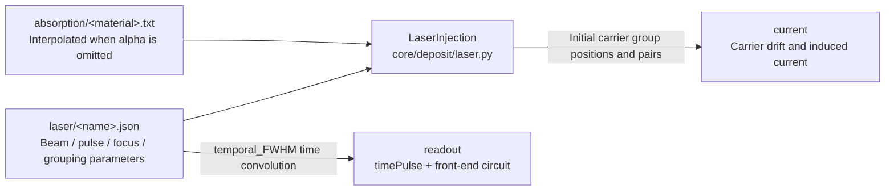

# Laser Components (`components/laser`)

`src/raser/components/laser/` stores Transient Current Technique (TCT) laser pulse JSON definitions and material intrinsic band-to-band absorption coefficient tables. Laser components are used only in the `raser tct` workflow, which skips the `deposit` slice, computes initial ionized carrier groups inside the detector directly from laser pulse parameters and material absorption, and drives the subsequent `current` and `readout` slices (for particle signal simulation, see [Getting Started](../getting-started.md)).



## Lookup Order and File Format

`raser tct` ([`../bench/tct.md`](../bench/tct.md)) locates `laser/<selector>.json` via component search paths or reads an explicit file path, passing the JSON object directly to `LaserInjection` ([`../core/deposit.md`](../core/deposit.md)). Below is the single-photon infrared laser component `src/raser/components/laser/LA01IR_top_Si.json` as an example of the JSON format:

```json
{
    "description" : "Particulars LA-01 IR FC, 1064 nm: pulse <350 ps to 4 ns, spot at focus <11 um FWHM, few to 100 MIP in 300 um Si (https://www.particulars.si/products.php?prod=scanTCT.html); pulse_energy is about 10 MIP in 300 um Si",
    "tech" : "SPA",
    "direction" : "top",

    "refractionIndex" : 3.51,

    "wavelength" : 1064,
    "temporal_FWHM" : 350e-12,
    "pulse_energy" : 1.8e-13,
    "spacial_FWHM" : 11,
    "central_time" : 1e-9,

    "pairs_per_group" : 1000,
    "groups" : 3200,

    "fx_rel" : 0.25,
    "fy_rel" : 0.5,
    "fz_rel" : 0.0
}
```

### Laser JSON Keys

| Key | Default | Unit | Meaning |
| --- | --- | --- | --- |
| `description` | None (optional) | None | Laser model and experimental parameter notes |
| `tech` | None (required) | None | Absorption mechanism: `"SPA"` (single-photon absorption) or `"TPA"` (two-photon absorption); `"TPA"` with `alpha != 0` also generates single-photon carrier groups, whereas `alpha = 0` generates only two-photon carrier groups |
| `direction` | None (required) | None | Laser beam incidence direction: `"top"` (along `+z` from `z = 0`), `"bottom"` (along `-z` from `z = l_z`), or `"edge"` (along `+x` from `x = 0`) |
| `refractionIndex` | None (required) | None | Refractive index of the detector material at this laser wavelength (required; used to compute the Rayleigh length when `l_Rayleigh` is not provided) |
| `wavelength` | None (required) | `nm` | Laser wavelength |
| `alpha` | Interpolated from absorption table | `1/m` | Linear absorption coefficient; when omitted, `absorption_coefficient` interpolates from `components/laser/absorption/<material>.txt` |
| `beta_2` | None (required for `"TPA"`) | `m/W` | Two-photon absorption coefficient |
| `temporal_FWHM` | None (required) | `s` | Temporal full width at half maximum of the Gaussian laser pulse; `raser tct` uses `timePulse` to convolve the total induced current with `temporal_FWHM` (same width for both mechanisms), while per-group `time_FWHM` (`temporal_FWHM` for SPA, `temporal_FWHM / sqrt(2)` for TPA) is read by the core laser deposition interface `laser_deposits` |
| `pulse_energy` | None (required) | `J` | Single-pulse energy |
| `spacial_FWHM` | None (required) | `um` | Spatial full width at half maximum of the Gaussian beam spot at focus (beam waist radius $w_0 = \text{spacial\_FWHM} / \sqrt{2\ln 2}$) |
| `l_Rayleigh` | $\pi w_0^2 \cdot \text{refractionIndex} / (\text{wavelength} \times 10^{-3})$ | `um` | Rayleigh length in the medium |
| `central_time` | None (required) | `s` | Central arrival time of the laser pulse |
| `pairs_per_group` | None (required) | pairs | Maximum number of electron-hole pairs in a single carrier group |
| `groups` | None (required) | groups | Minimum number of carrier groups per absorption mechanism (beam cross section is divided into 4 equal-share rings × 8 sectors and split along the beam path into `ceil(max(total / pairs_per_group, groups) / 32)` layers; groups inside detector bounds are kept for drift) |
| `fx_rel`, `fy_rel`, `fz_rel` | None (required) | None | Normalized laser focus coordinates in the detector frame; absolute focus position is `(fx_rel * l_x, fy_rel * l_y, fz_rel * l_z)` |

### Absorption Coefficient Table Format (`absorption/<material>.txt`)

`components/laser/absorption/<material>.txt` is a whitespace-delimited two-column numeric text file where lines starting with `#` are comments:

- Column 1: wavelength in `nm`.
- Column 2: intrinsic band-to-band absorption coefficient at 300 K in `1/cm`.

`absorption_coefficient(material, wavelength)` linearly interpolates the natural logarithm of the absorption coefficient between adjacent wavelength rows and multiplies by `100.0` to convert to `1/m`. When the laser wavelength exceeds the maximum wavelength in the table, it returns `0.0`.

## Built-in Components

`src/raser/components/laser/` contains the following 8 laser JSON components and 1 material absorption table:

| Category | Component Name | Mechanism / Range |
| --- | --- | --- |
| Single-photon silicon (`Si`) | `LA01IR_edge_Si`, `LA01IR_top_Si`, `LA01R_bottom_Si`, `LA01R_top_Si` | `"SPA"` |
| Single-photon silicon carbide (`SiC`) | `PIL037_edge_SiC`, `PIL037_top_SiC` | `"SPA"` |
| Two-photon silicon (`Si`) | `TPA1550_edge_Si`, `TPA1550_top_Si` | `"TPA"` |
| Absorption table (`absorption/`) | `Si.txt` | Wavelength `250 nm` to `1450 nm` |

## Common Errors

| Error Message | Trigger Condition |
| --- | --- |
| `FileNotFoundError: Cannot find RASER component laser/<name>.json` | The specified laser file is not found in component search paths |
| `ValueError: no absorption table of <material>: give alpha [1/m] in the laser file` | `alpha` is not given in the laser file and `components/laser/absorption/<material>.txt` does not exist |
| `ValueError: the absorption table of <material> starts at <min> nm, the laser has <wavelength> nm: give alpha [1/m] in the laser file` | Laser wavelength is shorter than the starting wavelength of the absorption table and `alpha` is not explicitly given |
| `NameError: <tech>` | `tech` is neither `"SPA"` nor `"TPA"` |
| `NameError: <direction>` | When generating carrier groups (`alpha != 0` or `tech == "TPA"`), `direction` is not `"top"`, `"bottom"`, or `"edge"` (when `tech == "SPA"` and `alpha == 0`, group generation is skipped and an empty list is returned) |

## Related Pages

- [Getting Started](../getting-started.md)
- [`../bench/tct.md`](../bench/tct.md)
- [`../core/deposit.md`](../core/deposit.md)
- [`../core/current.md`](../core/current.md)
- [`../supports/README.md`](../supports/README.md)
