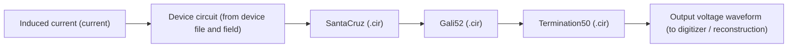

# Front-End Readout Circuit Components (`components/readout`)

Front-end readout circuit components are SPICE subcircuit files (`.cir`, stored under `components/readout/` following the top-level design in [Architecture Overview](../architecture.md#components)). They take the electrode induced currents output by [`current`](../stages/current.md) ([`core/current`](../core/current.md)) and the device equivalent circuit `DeviceCircuit` provided by [`field`](../stages/field.md) ([`core/field`](../core/field.md)) and [Detector Components](device.md). The [`readout`](../stages/readout.md) stage ([`core/readout`](../core/readout.md)) reads the `.cir` files in the `+`-joined order, cascades them into an amplifier and termination-load chain connected after the device equivalent circuit, and hands the netlist to `ngspice` to solve the transient response and frequency-domain thermal noise; the resulting output voltage waveforms are passed to [`digitizer`](../stages/digitizer.md) ([`core/digitizer`](../core/digitizer.md)) or [`reconstruction`](../stages/reconstruction.md) ([`core/reconstruction`](../core/reconstruction.md)).



When looking up a component, the project folder's own component takes priority; if not found, it is searched by name in the component library.

## Component File Contents

Below are the verbatim `.cir` files and corresponding schematics for the three stages in the default front-end chain `SantaCruz+Gali52+Termination50`:

### `SantaCruz`

```spice
.subckt SantaCruz in out
VCC 8 0 dc 2.25
R13 in 0 1MEG
C1 in 3 3.3n
x1 5 3 0 BFR840L3RHESD ; npn
R1 3 4 475
R2 4 5 3k
C2 4 5 3.3n
C5 5 out 3.3n
L1 5 6 47U
R3 6 7 63.7
C7 8 0 10n
C8 7 0 10n
C3 7 0 1n
C4 7 0 1n
L2 8 7 2.2u
.ends SantaCruz
```


Schematic of the `SantaCruz` amplifier stage: the signal travels from `in` through `C1` (`3.3 nF`) to the base of `x1`, and from the collector through `C5` (`3.3 nF`) to `out`; `R13` (`1 MOhm`) references the input to DC ground; `R1` (`475 Ohm`) in series with `R2` (`3 kOhm`) $\parallel$ `C2` (`3.3 nF`) connects the collector back to the base for transimpedance feedback; `VCC` (`2.25 V`) supplies power through `L2` (`2.2 uH`), `R3` (`63.7 Ohm`), and `L1` (`47 uH`), where `L1` blocks high-frequency signals from entering the supply and `C3` (`1 nF`), `C4` (`1 nF`), `C7` (`10 nF`), and `C8` (`10 nF`) provide decoupling; `x1` references the `BFR840L3RHESD` subcircuit and `.MODEL` definitions placed before the main subcircuit in the same file.

### `Gali52`

```spice
.subckt Gali52 in out
Rin in 0 50
* minus twice 10^(22.66/20): the 50 Ohm output and the 50 Ohm load halve it
E1 a 0 in 0 -27.17
Rp a b 1
Cp b 0 112.9p
E2 c 0 b 0 1
Rout c out 50
.ends Gali52
```


Schematic of the `Gali52` amplifier stage: `E1` is a voltage-controlled voltage source with inverting gain `-27.17` (after voltage division between the `50 Ohm` output resistance `Rout` and a `50 Ohm` load, the effective gain is `-13.585`, i.e., `22.66 dB`), `Rp` (`1 Ohm`) and `Cp` (`112.9 pF`) form a single-pole low-pass filter at $1/(2\pi R_p C_p) = 1.41\ \text{GHz}$, `E2` (gain `1`) buffers the signal before outputting through `Rout`, and both the input resistance `Rin` and output resistance `Rout` are `50 Ohm`.

### `Termination50`

```spice
.subckt Termination50 in
R1 in 0 50
.ends Termination50
```


Schematic of the `Termination50` termination load: a `50 Ohm` resistor `R1` to ground, serving as the final stage of the readout chain with only a single input port `in`.

## Key Meanings

Front-end circuit components are `.cir` text files; users can define and modify the subcircuit ports, SPICE element lines inside the main subcircuit, auxiliary models (`.subckt` and `.MODEL`) outside the main subcircuit, and schematic layout hints following `;` at the end of a line. In the experiment `config.json` or via CLI `--set` / `--scan`, element values inside the main subcircuit can also be overridden or scanned using `readout.<stage_name>.<element_name>` (such as `readout.SantaCruz.R1`).

### Subcircuit Ports and Element Line Syntax

Each `.cir` file must contain a `.subckt <name> <ports...>` block whose name matches the filename stem (`path.stem`), with the ground node fixed to `"0"`. Seven element line formats are supported inside the main subcircuit (`src/raser/core/readout/circuit.py`):

| SPICE Element Line Format | Default | Unit | Meaning |
| --- | --- | --- | --- |
| `.subckt <filename> in out` / `.subckt <filename> in` | None (required) | None | Main subcircuit header declaration: preceding amplifier stages must declare two ports `in out`, while the termination load at the end of the chain must declare only one port `in` |
| `R<name> <node1> <node2> <value>` | None | `Ohm` | Resistor with thermal noise (parsed as `{"between": [n1, n2], "ohm": R}`) |
| `R<name> <node1> <node2> <value> noisy=0` | None | `Ohm` | Noiseless resistor (parsed as `{"between": [n1, n2], "ohm": R, "noiseless": True}`, used to model noiseless equivalent input impedance from active feedback or auxiliary pole resistors) |
| `C<name> <node1> <node2> <value>` | None | `F` | Capacitor (parsed as `{"between": [n1, n2], "farad": C}`) |
| `L<name> <node1> <node2> <value>` | None | `H` | Inductor (parsed as `{"between": [n1, n2], "henry": L}`) |
| `V<name> <plus> <minus> [dc] <value>` | None | `V` | DC voltage source (parsed as `{"between": [n+, n-], "volt": V}`) |
| `E<name> <out+> <out-> <follows+> <follows-> <gain>` | None | dimensionless | Voltage-controlled voltage source (parsed as `{"between": [o+, o-], "follows": [f+, f-], "gain": G}`) |
| `X<name> <nodes...> <subcircuit_model>` | None | None | Instance calling an external subcircuit defined outside the main subcircuit in the same file (parsed as `{"model": <model_name>, "nodes": [...]}`) |

Element values support scientific notation and case-insensitive SPICE prefixes: `t` ($10^{12}$), `g` ($10^{9}$), `meg` ($10^{6}$), `k` ($10^{3}$), `m` ($10^{-3}$), `u` ($10^{-6}$), `n` ($10^{-9}$), `p` ($10^{-12}$), `f` ($10^{-15}$); unit letters immediately following the prefix are ignored.

### Schematic Layout Hint Syntax

Text after `;` at the end of element lines inside the main subcircuit is read by `schematic.py` to control grid layout in rendered schematics:

| Layout Hint Format | Default | Unit | Meaning |
| --- | --- | --- | --- |
| `; <direction> [steps]` | Automatic layout (defaults to `2.0` steps when direction is given) | grid steps | Specifies the direction (`right`, `left`, `up`, `down`) from the element's first node to its second node and the grid step span |
| `; <main_hint>, shift <direction> [steps]` | No shift (defaults to `2.0` steps when direction is given) | grid steps | Translates the entire element in the specified direction and reconnects both terminal nodes with orthogonal wires |
| `; npn` | None (required for plotting `X` instances) | None | Draws a three-node (collector, base, emitter) subcircuit instance `X` as an NPN bipolar transistor symbol with the base on the left |
| `; amp` | Automatically recognized for `E` elements | grid steps (fixed `2.0` steps rightward) | Draws a voltage-controlled voltage source `E` whose negative control and output terminals share ground as a triangular amplifier symbol |

All remaining parameters related to netlist solving, frequency-domain noise sampling, local circuit expansion, and pulse-polarity probing are hardcoded in `src/raser/core/readout/` and cannot be set in `.cir` component files:

| Constant or Fixed Item | Value | Unit | Definition Location and Meaning |
| --- | --- | --- | --- |
| `LOWEST_NOISE_HZ` | `1e3` | `Hz` | `src/raser/core/readout/job.py:17`, lower frequency bound of `ngspice` frequency-domain noise analysis (upper bound is the Nyquist frequency $0.5 / \Delta t$) |
| `PER_DECADE` | `50` | points/decade | `src/raser/core/readout/spice.py:210`, number of frequency sample points per decade in `ngspice` `noise` analysis |
| `ngspice` noise analysis temperature | `27` (`300.15`) | `°C` (`K`) | `src/raser/core/readout/spice.py:239`, fixed operating temperature for `ngspice` frequency-domain noise analysis, independent of `temperature` in the device file |
| `RECORD` | `256` | multiple | `src/raser/core/readout/spectral_noise.py:7`, ratio of the frequency-domain record length to the waveform time-bin count when `noise_from_spectrum` synthesizes time-domain Gaussian noise |
| `PART_EDGE` | `1e-3` | dimensionless | `src/raser/core/readout/job.py:23`, voltage-swing fraction relative to the event's largest-swing channel used to retain output channel waveforms and to stop strip-row local circuit expansion |
| Pulse-polarity probe parameters | probe capacitance `1e-12`, injected charge `1e-15`, `dt = 10e-12`, `2000` bins (injected at bin `5`) | `F`, `C`, `s`, bins | `src/raser/core/readout/pulse_edge.py:38-41`, fixed probe input used by `chain_sign` to test whether an amplifier chain is non-inverting or inverting |
| `NO_ANSWER_V` | `1e-9` | `V` | `src/raser/core/readout/pulse_edge.py:30`, minimum output swing threshold for `chain_sign` to judge that an amplifier chain responds to a `1 fC` injection |
| `COLLECTOR`, `EMITTER`, `dpi` | `(2, 1)`, `(2, -1)`, `160` | grid steps, grid steps, `dpi` | `src/raser/core/readout/schematic.py:38-39, 612`, grid offsets of the NPN transistor collector and emitter relative to the base, and resolution of exported schematics |

## How the Program Uses the Component

### Reading and Parsing the Subcircuit Chain (`circuit.py`)

1. **Splitting the chain name on `+` (`named_chain`, `read_chain`)**: `named_chain(name)` splits the `amplifier` setting on `"+"`, locates each segment via `component_path("afe", f"{part}.cir")`, and passes the paths to `read_chain(paths)`.
2. **Parsing a single stage file (`read_subcircuit`)**: Reads the `.cir` file line by line, strips trailing schematic layout hints at `";"`, and skips blank lines and comment lines starting with `"*"`. All non-comment lines outside `.subckt <filename> ...` and `.ends` (auxiliary `.subckt` and `.MODEL` definitions) are preserved verbatim in the `"models"` list; inside the main subcircuit, `spice_number` converts element values into standard SI units ($\Omega$, $\text{F}$, $\text{H}$, $\text{V}$).
3. **Port validation and duplicate numbering (`read_chain`)**: The first $N - 1$ entries in the chain must declare two ports `in` and `out` (raising `ValueError` otherwise) and are stored in order in `"stages"`, automatically appending `_2`, `_3`, etc., from the second occurrence onward if the same amplifier stage appears repeatedly in the chain; the final entry must declare only a single port `in` as the termination load `"load"` (raising `ValueError` if it includes `out`; naming an amplifier stage `"load"` raises `ValueError` when assembling the netlist).

### Netlist Assembly and Transient Solving (`spice.py`, `job.py`)

Below is the transient netlist generated for `HPK-Si-PiN` (junction capacitance `3.4416228 pF`, fully depleted) with the default chain `SantaCruz+Gali52+Termination50` (internal element lines of the `BFR840L3RHESD` model at the top are omitted):

```spice
device > SantaCruz > Gali52 > load
.subckt BFR840L3RHESD 1 2 3
* Internal elements and .MODEL definitions of BFR840L3RHESD omitted here (preserved verbatim from SantaCruz.cir)
.ends BFR840L3RHESD
.subckt SantaCruz in out
V_VCC 8 0 2.25
R_R13 in 0 1000000
C_C1 in 3 3.3e-09
X_x1 5 3 0 BFR840L3RHESD
R_R1 3 4 475
R_R2 4 5 3000
C_C2 4 5 3.3e-09
C_C5 5 out 3.3e-09
L_L1 5 6 4.7e-05
R_R3 6 7 63.7
C_C7 8 0 1e-08
C_C8 7 0 1e-08
C_C3 7 0 1e-09
C_C4 7 0 1e-09
L_L2 8 7 2.2e-06
.ends SantaCruz
.subckt Gali52 in out
R_Rin in 0 50
E_E1 a 0 in 0 -27.17
R_Rp a b 1
C_Cp b 0 1.129e-10
E_E2 c 0 b 0 1
R_Rout c out 50
.ends Gali52
.subckt load in
R_R1 in 0 50
.ends load
X1_1 top_pad in1_2 SantaCruz
X1_2 in1_2 out1 Gali52
Xload1 out1 load
Ctop_depleted top_pad 0 3.4416228e-12
I1 0 top_pad PWL(2.5e-12 0 7.5e-12 2e-06 1.25e-11 5e-06 1.75e-11 1e-06)
.save v(out1)
.control
tran 5e-12 2e-11
wrdata out.raw v(out1)
.endc
.end
```

The netlist generated by `write_netlist` (`spice.py`) has five sections from top to bottom:

1. **External models and stage subcircuits (`_chain`, `subcircuit`)**: The first line is the title line `device > SantaCruz > Gali52 > load`. External definitions from each component's `"models"` follow (such as `BFR840L3RHESD`, deduplicated so identical model blocks appear only once in the netlist), followed in order by `.subckt SantaCruz`, `.subckt Gali52`, and the final termination load `.subckt load` (regardless of its filename, the final stage is always named `load` in the netlist; inside the main subcircuit, each element name is prefixed with its SPICE type letter `R_`, `C_`, `L_`, `V_`, `E_`, or `X_`, and values are formatted in standard SI units with `.9g`).
2. **Cascaded instances (`_chain`)**: For the $k$-th output channel in `circuit.outputs` (starting from `1`), the input of `X<k>_1` connects to the device output node (here `top_pad`, formed from readout electrode name `top` plus `_pad`), inter-stage nodes are named `in<k>_<j>` ($j = 2, \dots, N_{\text{stages}}$), and the final amplifier output and load `Xload<k>` connect to `out<k>` (if the chain has no amplifier stages and only a load, the load connects directly to the device output node).
3. **Device equivalent circuit (`circuit.lines`)**: Writes `DeviceCircuit.lines` constructed by [`core/field/circuit_parameters.py`](../core/field.md). For a fully depleted planar device, this is the junction capacitance `Ctop_depleted top_pad 0 3.4416228e-12` (in `F`) between `top_pad` and ground `0`.
4. **Piecewise-linear induced current sources (`_current_sources`)**: Writes `I<k> <from> <to> PWL(...)`, with positive current flowing from `<from>` to `<to>` (from `0` to `top_pad` when fully depleted). To prevent `ngspice` from treating the first point as a steady-state DC current present before the start, the code prepends one zero-current bin (`0 A` at bin center $0.5\,\Delta t = 2.5\times 10^{-12}\ \text{s}$), followed by the $m$-th time bin ($m = 0, \dots, n_{\text{bin}} - 1$) centered at $t_m = (m + 1.5)\,\Delta t$ (in `s`) with the average induced current of that bin (in `A`; the example above illustrates three bins of `2`, `5`, and `1 uA`).
5. **Transient solve and interpolated output (`_transient`, `_run`)**: `.save` retains only the output node voltages to export; `tran <dt> <dt * (bins + 1)>` solves for duration $(n_{\text{bin}} + 1)\,\Delta t$ with step equal to the induced-current bin width $\Delta t$ (`5e-12 s`) and exports via `wrdata`; after invoking `ngspice -b`, `_run` linearly interpolates output voltages back onto bin centers $t_m = (m + 1.5)\,\Delta t$, returning output voltage waveforms of shape `(outputs, bins)` (in `V`).

For single-contact multi-strip devices, `write_waveforms` (`job.py`) uses `_solve_part` around hit strips carrying non-zero induced current, starting from `margin = 1` on both sides and doubling `margin` iteratively to expand the local circuit until the maximum voltage change between consecutive expansions across all channels with swing $\ge \text{PART\_EDGE} \times V_{\max}$ (`PART_EDGE = 1e-3`) is $< 10^{-3} V_{\max}$ or the full row is covered; for each event, only channels whose maximum absolute voltage swing is $\ge 10^{-3} V_{\max}$ (with $V_{\max} > 0$) are written to `readout_<job>.h5`.

### Undepleted Layer Connection in the Netlist (`device_circuit.planar_circuit`)

When the device has an undepleted bulk (for example, undepleted resistance `1000 Ohm` and capacitance `2 pF`), the four lines for the device circuit and current source in the netlist become:

```spice
Ctop_depleted top_pad top_inner 3.4416228e-12
Rtop_undepleted top_inner 0 1000
Ctop_undepleted top_inner 0 2e-12
I1 top_inner top_pad PWL(2.5e-12 0 7.5e-12 0 1.25e-11 0 1.75e-11 0)
```

The depletion-layer junction capacitance `Ctop_depleted` now connects between the readout electrode `top_pad` and internal node `top_inner`; the undepleted-layer parallel resistance `Rtop_undepleted` (`Ohm`) and capacitance `Ctop_undepleted` (`F`) connect between `top_inner` and ground `0`; and the induced current source `I1` connects between `top_inner` and `top_pad`, spanning only the depleted layer. This places a parallel RC impedance in series between the depleted layer and the back electrode, producing signal voltage division and RC time-constant shaping while `Rtop_undepleted` contributes thermal noise in frequency-domain noise analysis.

### Frequency-Domain Noise Analysis and Time-Domain Synthesis (`spice.py`, `job.py`, `spectral_noise.py`)

1. **Solving one-sided voltage noise spectral density (`noise_spectra`, `output_noise_spectrum`)**: Noise is added only when an integer `noise_seed` is passed to the run (when `noise_seed` is `None`, noiseless waveforms are output). Using the same device circuit and amplifier chain, the code places an AC source `I1 <from> <to> dc 0 ac 1` across the first induced-current source's node pair, selects the middle channel `group[len(group) // 2]` for each equivalent-circuit symmetry group `circuit.alike`, and runs `ngspice -b` at fixed temperature `27 °C` with `noise v(<node>) I1 dec 50 1000 <0.5/dt>`, obtaining the one-sided output voltage noise amplitude spectral density $S_V(f)$ (in $\text{V}/\sqrt{\text{Hz}}$) from $f_{\min} = 10^3\ \text{Hz}$ to the Nyquist frequency $f_{\max} = 0.5 / \Delta t\ \text{Hz}$ at `50` points per decade.
2. **Band power integration and complex Gaussian spectral sampling (`band_power`, `noise_from_spectrum`)**: For each saved waveform of length $n_{\text{bin}}$ in a single event, on a real-FFT frequency grid $f_k = k\,\Delta f$ ($k = 0, 1, \dots, \lfloor N_{\text{rec}}/2 \rfloor$) of length $N_{\text{rec}} = 256\,n_{\text{bin}}$ (`RECORD = 256`) and frequency step $\Delta f = 1 / (N_{\text{rec}}\,\Delta t)$ (`Hz`), the trapezoidal cumulative power function $P(f) = \int_0^f S_V^2(f')\,df'$ (power density set to `0` outside the spectral range, in $\text{V}^2$) yields the power $\Delta P_k$ in the $k$-th frequency band and the complex Gaussian spectral standard deviation $\sigma_k$:
   $$\Delta P_k = P\!\left(f_k + \tfrac{1}{2}\Delta f\right) - P\!\left(\max\!\left(f_k - \tfrac{1}{2}\Delta f,\, 0\right)\right), \qquad \sigma_k = \frac{1}{2}\,N_{\text{rec}}\sqrt{\Delta P_k} \tag{1}$$
   where:
   - $\Delta P_k$: noise voltage variance in the frequency band of width $\Delta f$ around $f_k$, $\text{V}^2$;
   - $N_{\text{rec}} = 256\,n_{\text{bin}}$: extended time-domain record length (dimensionless);
   - $\sigma_k$: standard deviation of the independent zero-mean Gaussian draws for the real and imaginary parts of interior complex spectral bins $X_k$ ($0 < k < N_{\text{rec}}/2$), $\text{V}$; the DC component $X_0$ (which represents slow noise below $f_{\min}$ as an event-by-event baseline shift) and, for even $N_{\text{rec}}$, the Nyquist component $X_{N_{\text{rec}}/2}$ are drawn from the real Gaussian distribution $\mathcal{N}(0,\, N_{\text{rec}}^2 \Delta P_k)$.
3. **Inverse transform, truncation, and superposition**: The random number generator is initialized independently by seed, event number, and global channel index via `np.random.default_rng([noise_seed, event.event, place[name]])`; `np.fft.irfft(X, n=N_rec)[:bins]` takes the first $n_{\text{bin}}$ samples (in `V`) and adds them directly to that channel's output voltage waveform.

### Pulse Edge Polarity Determination (`pulse_edge.py`)

1. **Determining collected charge sign (`collected_charge_sign`)**: Reads `bias.electrode` and `bias.voltage` (`V`) from the device file. If the readout electrode is the biased electrode, its potential relative to the opposite electrode is $V_{\text{above}} = V_{\text{bias}}$; otherwise $V_{\text{above}} = -V_{\text{bias}}$ (raising `ValueError` if $V_{\text{above}} == 0$). When $V_{\text{above}} > 0$, the electrode is at higher potential and collects electrons, returning $s_q = -1$; when $V_{\text{above}} < 0$, it collects holes, returning $s_q = +1$.
2. **Probing amplifier-chain polarity (`chain_sign`)**: On a single-electrode planar circuit with junction capacitance $1\ \text{pF}$ (`1e-12 F`), time bin width $\Delta t = 10\ \text{ps}$ (`10e-12 s`), and `2000` bins, injects $+1\ \text{fC}$ of positive charge at bin `5` (current $10^{-15} / \Delta t = 10^{-4}\ \text{A}$) and solves for the largest-magnitude deviation $V_{\text{largest}}$ of the amplifier-chain output voltage relative to the first-bin quiescent voltage `voltage[0]`: if $|V_{\text{largest}}| < 10^{-9}\ \text{V}$ (`NO_ANSWER_V`), raises `ValueError`; returns $s_{\text{chain}} = +1$ for $V_{\text{largest}} > 0$ and $s_{\text{chain}} = -1$ for $V_{\text{largest}} < 0$.
3. **Combining channel pulse edge (`pulse_edges`)**: Computes $s_q \cdot s_{\text{chain}}$ for each output channel, recording `"rising"` if greater than `0` and `"falling"` if less than `0`, and writes the result to the `pulse_edge` attribute of `readout_<job>.h5` for downstream timing and triggering.

## Built-in Components

`components/readout/` (source path `src/raser/components/afe/`) contains the following 5 SPICE circuit components:

| Component Name | Ports | Circuit Description | Source | Applicable Devices or Experiments |
| --- | --- | --- | --- | --- |
| `BroadBandCividec` | 2 (amplifier stage: `in`, `out`) | CIVIDEC C2 broadband non-inverting current amplifier, bandwidth `1 MHz - 2 GHz`, gain `40 dB`, `1 nF` input coupling and `1 MOhm` bias, `50 Ohm` input/output impedance, equivalent input current noise `0.4 uA rms` | File header comment: CIVIDEC datasheet *"C2 Broadband Amplifier, 2 GHz, 40 dB"* | Broadband current readout (such as `BroadBandCividec+Termination50`) |
| `ChargeSensitiveCremat` | 2 (amplifier stage: `in`, `out`) | Cremat CR-110-R2.2 charge-sensitive preamplifier, feedback capacitor `Cf = 1.4 pF` in parallel with `Rf = 100 MOhm`, unloaded gain `1.4 V/pC`, decay time `140 us`, output impedance `50 Ohm` | File header comment: Cremat CR-110-R2.2 Application Guide (July 2023) and Cremat website LTspice model `CR-110-R2` | Charge-sensitive preamplifier readout (such as `ChargeSensitiveCremat+Termination50`) |
| `Gali52` | 2 (amplifier stage: `in`, `out`) | Mini-Circuits GALI-52+ inverting gain block, low-frequency gain `22.66 dB`, pole `1.41 GHz`, `50 Ohm` input/output impedance | File header comment: Mini-Circuits GALI series datasheet (single-pole fit to `100 MHz` to `2 GHz` S-parameters in a `50 mA`, `4.4 V`, `50 Ohm` system) | Second stage of the default chain for [`readout`](../stages/readout.md), [`signal`](../bench/signal.md), [`timeres`](../bench/timeres.md), [`tct`](../bench/tct.md), [`bmos`](../apps/bmos.md), [`cflm`](../apps/cflm.md) |
| `SantaCruz` | 2 (amplifier stage: `in`, `out`) | UC Santa Cruz single-channel LGAD readout board, `475 Ohm` feedback inverting transimpedance amplifier stage based on `BFR840L3RHESD`, `2.25 V` supply, `3.3 nF` input/output AC coupling | File header comment: SCIPP/UCSC schematic *"Prototype Beam Test Board"* (M. Wilder, 2016-02-19, `proto_beam_test_board_V1.1C.pdf`) | First stage of the default chain for [`readout`](../stages/readout.md), [`signal`](../bench/signal.md), [`timeres`](../bench/timeres.md), [`tct`](../bench/tct.md), [`bmos`](../apps/bmos.md), [`cflm`](../apps/cflm.md) |
| `Termination50` | 1 (termination load: `in`) | `50 Ohm` termination load resistor to ground | File header comment: `50 Ohm` input termination of an oscilloscope or downstream instrument | Final termination load of the default chain for [`readout`](../stages/readout.md), [`signal`](../bench/signal.md), [`timeres`](../bench/timeres.md), [`tct`](../bench/tct.md), [`bmos`](../apps/bmos.md), [`cflm`](../apps/cflm.md) |


Schematic of the `BroadBandCividec` amplifier stage: `Rbias` is the `1 MOhm` input DC bias resistor and `Cin` is the `1 nF` AC coupling capacitor; the `50 Ohm` input impedance is split into two parallel resistors—`Rn` (`325.4 Ohm`) generating thermal noise and noiseless `Rq` (`59.08 Ohm`, `noisy=0`)—so that the input current noise over the `2 GHz` single-pole bandwidth matches the manufacturer specification of `0.4 uA rms`; `E1` has gain `200` (halved to `100`, i.e., `40 dB`, by the `50 Ohm` output resistance `Rout` and `50 Ohm` load), and `Rp` (`1 Ohm`) with `Cp` (`79.58 pF`) sets the `2 GHz` single pole.


Schematic of the `ChargeSensitiveCremat` amplifier stage: `Cin` (`12.24 pF`) and the series equivalent input voltage-noise resistor `Rs` (`43.1 Ohm`) precede the first stage `E1` of inverting gain `-3000`, bridged by the `Cf` (`1.4 pF`) and `Rf` (`100 MOhm`) feedback loop and the noiseless pole `Rp` (`1 kOhm`, `noisy=0`), `Cp` (`401.3 pF`), followed by the second stage `E3` of gain `+2` and the `50 Ohm` output resistance `Rout`.
