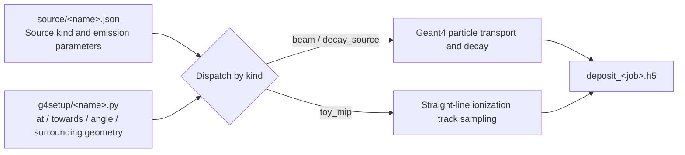

# Signal Source Components (`components/source`)

`src/raser/components/source/` stores JSON definition files for particle beams, radioactive nuclide decay sources, and straight-line minimum ionizing particles (toy MIP). Signal source components act on the [`deposit`](../stages/deposit.md) slice at the start of the simulation chain: the CLI selects the source component via the positional argument `source` (default `"decay/Sr90"`; the `bmos` app defaults to `"bunch"`), loads it together with `g4setup`, and passes both to energy deposition to produce `deposit_<job>.h5`.



## Lookup Order and File Format

The workflow looks up `source/<selector>.json` by component search priority (see [`../supports/README.md`](../supports/README.md)) or reads an explicit JSON file path. The top level must be a JSON object, dispatched by `"kind"` in the deposition stage `simulate_deposits` ([`../core/deposit.md`](../core/deposit.md)).

### Example Source Component: `decay/Sr90.json`

In the [Getting Started](../getting-started.md) example `raser signal HPK-Si-PiN --scan voltage=100,200 -s 2 -evt 200 --seed 1`, the command omits the positional argument `source`, so it defaults to `src/raser/components/source/decay/Sr90.json`:

```json
{
    "name" : "Sr90",
    "kind" : "decay_source",
    "description" : "Sr-90 beta source: every event is one decay, of Sr-90 or of its daughter Y-90 with the same chance, on a disk 5 mm across; what the decay emits goes isotropically within 15 degrees of the axis",
    "nuclides" : [[38, 90], [39, 90]],
    "par_radius" : 2500,
    "par_cone" : 15
}
```

Together with the default `device_alone` geometry, this source behaves as follows in the example:

- **Equal-probability two-nuclide decay**: Each event picks $^{90}\text{Sr}$ (`[38, 90]`) or its daughter $^{90}\text{Y}$ (`[39, 90]`) with equal probability for one decay at rest, with the decay vertex sampled uniformly on a disk of radius `par_radius = 2500 um` (`5 mm` diameter) perpendicular to the `par_in -> par_out` axis.
- **Emission solid angle and recording efficiency**: Decay products are emitted isotropically inside a cone of half-angle `par_cone = 15°` around the axis. The `deposit_0.h5` attribute `generated_fraction = 0.017037086855465844` matches the solid-angle fraction $(1 - \cos 15^\circ) / 2$; to collect `-evt 200` events with non-zero energy deposition in `HPK-Si-PiN`, job `0` generated `generated_events = 7359` events in Geant4.

### Common Keys

| Key | Default | Unit | Meaning |
| --- | --- | --- | --- |
| `name` | None (optional) | None | Signal source name (removed before passing to Geant4) |
| `kind` | None (required) | None | Signal source type: `"beam"`, `"decay_source"`, or `"toy_mip"` (removed before passing to Geant4) |
| `description` | None (optional) | None | Text description of the signal source (removed before passing to Geant4) |

### `"beam"` and `"decay_source"` Source Keys

When `kind` is `"beam"` or `"decay_source"`, `g4_configuration` extracts the `"source"` block from the `g4setup` component ([`g4setup.md`](g4setup.md); defaults to built-in `DEVICE_ALONE`) as position `par_in`, aim point `par_out`, and incidence angle `par_angle`, then merges keys from the source JSON before passing to Geant4 (keys in the source JSON override same-named keys in `g4setup`, while remaining `par_*` keys follow `g4setup`):

| Key | Default | Unit | Meaning |
| --- | --- | --- | --- |
| `par_type` | None (must eventually be set for ordinary particle-gun emissions; may come from `g4setup` or `particles` entries) | None | Geant4 particle name (such as `"e-"`, `"mu-"`, `"pi-"`, `"proton"`, `"alpha"`, `"gamma"`), or a list of particle names (same length as `par_energy`, sampled with equal probability per event) |
| `par_energy` | None (must eventually be set for ordinary particle-gun emissions; may come from `g4setup` or `particles` entries) | `MeV` | Particle kinetic energy, or a list of kinetic energies matching `par_type` |
| `par_randx`, `par_randy` | `0`, `0` | `um` | Uniform random offset half-width applied to the x and y components of the direction vector `par_out - par_in` |
| `particles` | None (optional) | None | Multi-particle bunch list; when `nuclides` is not enabled, all particles in the list are emitted simultaneously per event; each entry may set `"offset"` (`[dx, dy, dz]`, default `[0, 0, 0]`, in `um`, shifting that particle's origin and aim point) and override top-level `"par_type"`, `"par_energy"`, `"par_randx"`, `"par_randy"` |
| `nuclides` | None (optional) | None | List of radioactive nuclides `[Z, A]` (atomic number, mass number) at rest (such as `[[38, 90], [39, 90]]`); when given, enables `G4RadioactiveDecayPhysics` and `NuclideGeneratorAction`, sampling one nuclide with equal probability per event for one decay, stopping daughter nuclei and zeroing decay product times |
| `par_radius` | `0` | `um` | Radius of the disk perpendicular to the `par_in -> par_out` axis on which nuclide decay positions are uniformly sampled |
| `par_cone` | `None` | `degree` | Half-angle of the cone around the `par_in -> par_out` axis for isotropic emission of nuclide decay products (Geant4 reads from the merged config); `deposit` records the solid-angle fraction $(1 - \cos(\text{par\_cone})) / 2$ in `generated_fraction` only when the source JSON itself has both `nuclides` and non-`None` `par_cone` (otherwise records `1.0`) |

### `"toy_mip"` Source Keys

When `kind` is `"toy_mip"`, `mip_deposits` generates a straight deposition track along the segment from `start` to `end` (defaulting along z through the center from `[l_x / 2, l_y / 2, 0.0]` to `[l_x / 2, l_y / 2, l_z]`; when a custom segment or sampled slope is used, energy loss is computed along the full segment and labeled `"Device"`), with all deposits at time `0.0 s`. Silicon (`"Si"`) has a mean ionization rate of `80.0` pairs/`um` and Landau width `2.0e-5 MeV/um`; silicon carbide (`"SiC"`) has a mean ionization rate of `55.0` pairs/`um` and Landau width `3.2e-5 MeV/um`.

| Key | Default | Unit | Meaning |
| --- | --- | --- | --- |
| `landau_sampling` | None (required) | None | Boolean; whether each segment's deposited energy is sampled from a Landau distribution (clamped to `0.0` if negative; fixed mean energy loss when `false`) |
| `start` | `[l_x / 2, l_y / 2, 0.0]` | `um` | Track start `[x, y, z]` in detector coordinates |
| `end` | `[l_x / 2, l_y / 2, l_z]` | `um` | Track end `[x, y, z]` in detector coordinates |
| `position_range_um` | None (optional) | `um` | Uniform transverse sampling range for the start point `{"x": [lo, hi], "y": [lo, hi]}` |
| `direction_sigma_mrad` | None (optional) | `mrad` | Gaussian standard deviations around `0` for track slopes `dx/dz` and `dy/dz`: `{"x": sigma_x, "y": sigma_y}`; when `position_range_um` or non-zero slopes are given, the end transverse coordinates follow from the start point and slopes |
| `packets` | `ceil(length / max_step)` | segments | Number of segments into which a track is split; when omitted, split using `maxstep` (in `um`) from `g4setup` |

## Built-in Components

`src/raser/components/source/` contains the following 11 signal source components:

| Category | Component Name | Description |
| --- | --- | --- |
| Particle beam (`beam`) | `beam/electron`, `beam/muon`, `beam/pion`, `beam/proton`, `beam/proton_3GeV_spread` | Single-particle beam source definitions |
| Radioactive source (`decay`) | `decay/Am241`, `decay/Sr90` | Radioactive nuclide decay source definitions |
| Straight-line MIP (`toy`) | `toy/MIP`, `toy/MIP_pixel_edge`, `toy/MIP_pixel_edge_fast`, `toy/MIP_strip_edge` | Straight-line minimum-ionizing-track definitions |

In addition, `src/raser/apps/bmos/components/source/` provides the bunch source component `bunch` (mounted automatically under `raser bmos`; see [`../apps/bmos.md`](../apps/bmos.md)).

## Common Errors

| Error Message | Trigger Condition |
| --- | --- |
| `TypeError: Component definition must be a JSON object: <path>` | The top level of the source JSON file is not a JSON object |
| `FileNotFoundError: Cannot find RASER component source/<name>.json` | The specified source name is not found in component search paths |
| `FileNotFoundError: Cannot find RASER source file: <path>` / `IsADirectoryError: RASER source input must be a file: <path>` | The explicit file path does not exist or points to a directory |
| `ValueError: no simulation of deposits for a source of kind <kind>; known: ['toy_mip', 'beam', 'decay_source']` | `kind` is not in the known list |
| `ValueError: the source <name> gives [...]: where a source sits and where it aims are of the g4setup, in its key source = {at, towards, angle}` | A `"beam"` or `"decay_source"` JSON or its `particles` item contains `"par_in"`, `"par_out"`, or `"par_angle"` (in a `"toy_mip"` source these keys trigger the unknown-keys `ValueError` on the next line) |
| `ValueError: keys [...] of the toy MIP source are not read; known: [...]` | A `toy_mip` source contains unrecognized keys |
| `ValueError: the toy MIP source must say landau_sampling: true or false` | A `toy_mip` source is missing the `landau_sampling` key |
| `ValueError: no toy MIP energy loss for the material <material>; known: ['Si', 'SiC']` | `toy_mip` encounters a detector material other than `"Si"` or `"SiC"` |
| `ValueError: par_type has <N> particles and par_energy <M>` | `par_type` and `par_energy` lists have different lengths |

## Related Pages

- [Getting Started](../getting-started.md)
- [`g4setup.md`](g4setup.md)
- [`../core/deposit.md`](../core/deposit.md)
- [`../stages/deposit.md`](../stages/deposit.md)
- [`../apps/bmos.md`](../apps/bmos.md)
- [`../supports/README.md`](../supports/README.md)
