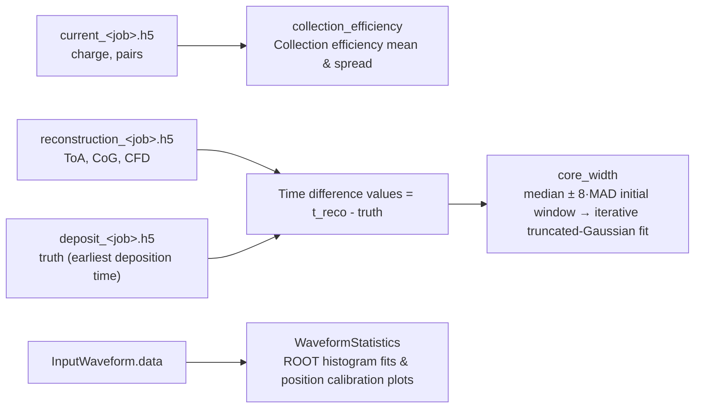

# Statistical Analysis (`core/analysis`)

`src/raser/core/analysis/` sits at the end of the simulation chain. It provides charge collection efficiency calculation (`collection.py`), iterative truncated-Gaussian maximum-likelihood fitting for timing resolution (`resolution.py`), and the ROOT waveform statistics plotting class `WaveformStatistics` (`waveform_stats.py`) for single-event dictionaries. See [../stages/analysis.md](../stages/analysis.md) for the CLI summary workflow across scan points of an experiment.

## Charge Collection Efficiency and Timing Resolution Algorithms

### Charge Collection Efficiency (`collection.py`)

`collection_efficiency(charge, pairs)` takes the net induced charge per readout electrode `charge` (shape `(events, electrodes)`, in `C`) and initial electron-hole pairs `pairs` (shape `(events,)`), and computes for each event the ratio of the absolute algebraic sum of net charges across all electrodes to the total initial ionized charge:

$$\eta = \frac{\left|\sum_{j} Q_{j}\right|}{N_{\text{pairs}} \cdot e}$$

where the elementary charge is `ELEMENTARY_CHARGE = 1.602176634e-19` C.

### Truncated-Gaussian Fit and Iterative Core Width (`resolution.py`)

- **`truncated_gaussian(values, low, high)`**: For samples falling inside the window `[low, high]`, minimizes the negative log-likelihood of a normalized truncated Gaussian within the window using `scipy.optimize.minimize` (`method="L-BFGS-B"`, mean bounded to `[low, high]`), inverts the second-order central-difference Hessian with step `step = 1e-4` to obtain parameter standard errors, and returns `(mean, mean_error, sigma, sigma_error)` (in the same unit as the input).
- **`core_width(values, window=None)`**: Requires at least `MINIMUM_EVENTS = 20` samples. When `window` is not explicitly given, sets the initial window to `median ± 8 * MAD` (`MAD` is the median absolute deviation); then in each round calls `truncated_gaussian` and updates the window to `[mean - 2 * sigma, mean + 2 * sigma]` for up to `ROUNDS = 6` rounds (stops and returns the previous round's fit if `abs(sigma - previous_sigma) <= 5e-3 * previous_sigma`, if the new bounds extend outside the current window, if the window-width reduction ratio is $\le 10^{-3}$, or if a later round has fewer than `20` samples in the window; raises `TooFewValues` if the first-round window has fewer than `20` samples). The returned dict contains:

| Key | Unit | Meaning |
| --- | --- | --- |
| `"events"` | count | Total number of input samples |
| `"window"` | same as input | Final fit window `[low, high]` |
| `"window_events"` | count | Number of samples inside the final window |
| `"rounds"` | rounds | Number of iteration rounds actually executed |
| `"mean"`, `"mean_error"` | same as input | Truncated-Gaussian fitted mean and standard error |
| `"sigma"`, `"sigma_error"` | same as input | Truncated-Gaussian fitted core width $\sigma$ and standard error |
| `"sigma68"` | same as input | Half the distance between the `16%` and `84%` quantiles of samples inside the window |

## Waveform Statistics Plotting Class (`waveform_stats.py`)

`WaveformStatistics(my_d, threshold, amplitude_threshold)` is called directly in Python. It takes device object `my_d` (`det_model` must match `'planar'`, `'lgad'`, `'strip'`, or `'pixel'`, reading `l_x`, `l_y`, `p_x`, `p_y`, `read_ele_num`, `x_ele_num`, `y_ele_num`) and threshold parameters, collects event dictionaries from `InputWaveform.data` (see [reconstruction.md](reconstruction.md)) via `fill_data(data)`, and calls `draw(output_path, tag, vis=False)` to output histograms and fitting macros using ROOT:

| Output Files (`.pdf` and `.C`) | Fit or Histogram Type | Unit / Binning Notes |
| --- | --- | --- |
| `<tag>_ToA`, `<tag>_CFD50` | `TH1F` Gaussian fit `gaus` | X-axis unit `s`; legend multiplies $\sigma$ and error by `1e12` to display in `ps` |
| `<tag>_charge`, `<tag>_amplitude`, `<tag>_ToT` | `TH1F` Landau fit `landau` | 100 bins; x-axis and legend labeled `a.u.` (filled `ToT` values are in `s`) |
| `<tag>_gravity_center_ToT`, `..._amplitude`, `..._charge` | `TH1F` 1D distribution | 400 bins (generated when valid data exist) |
| `<tag>_cluster_size_ToT`, `..._amplitude`, `..._charge` | `TH1I` integer histogram | 11 bins over `[0, 11)` |
| `<tag>_gravity_center_ToT_error`, `..._amplitude_error`, `..._charge_error` | `TH1F` Gaussian fit `gaus` | 100 bins around `sorted(data)[len(data) // 2] ± 1` (generated when valid data exist) |
| `<tag>_ita_calibration_ToT`, `..._amplitude`, `..._charge` | `TH2F` 2D calibration plot | `original_x / pitch_x - round(...)` vs. reconstructed centroid `value - round(value)`, `20 x 20` bins (X-axis passed `[-0.5, 0.5]`, Y-axis passed `[0.5, -0.5]`) |

## Analysis Calculations in the Example (`HPK-Si-PiN`)

In the [Getting Started](../getting-started.md) example, running `raser analysis work/HPK-Si-PiN/signal` invokes `collection_efficiency` and `core_width` on `400` recorded events at each of the two bias points `100 V` and `200 V`, writing results to `result.json` (and comparison file `points.json`):

- **Charge collection efficiency (`collection`)**: At `200 V` across `400` events, `mean = 0.9348` (`mean_error = 0.007225`, `spread = 0.1445`); at `100 V`, `mean = 0.9195`.
- **Timing resolution (`timing`)**: At `200 V`, `276` events exceed the `10 mV` amplitude threshold (`polarity = -1.0`). Iterative fits with `core_width` on time differences relative to the earliest deposition time `truth` yield: `ToA` retains `241` events in the window after `5` rounds with `sigma = 123.99 ps` and `sigma68 = 123.69 ps`; `CoG` takes `4` rounds to give `sigma = 87.49 ps` and `sigma68 = 78.01 ps`; `CFD10` takes `4` rounds to give `sigma = 46.19 ps` and `sigma68 = 39.89 ps`; `CFD20` takes `5` rounds to give `sigma = 37.54 ps`.

## Common Errors

| Exception Type | Error Message | Trigger Condition |
| --- | --- | --- |
| `ValueError` | `charge has shape <shape> and pairs <shape>, expected (events, electrodes) and (events,)` / `events <indices> have no pairs` | Array shapes in `collection_efficiency` do not match or some events have `pairs <= 0` |
| `TooFewValues(ValueError)` | `<len> values, fewer than 20` / `<inside> of <len> values are inside [<low>, <high>], fewer than 20` | Input samples or samples inside the window for `core_width` are fewer than `20` |
| `ValueError` | `all values in the window are equal` / `the window [<low>, <high>] is empty` / `values have shape <shape>, expected (events,)` | Window bounds are non-increasing, all samples in the window are equal, or input array is not 1D |
| `ArithmeticError` | `the fit in [<low>, <high>] did not converge: <message>` | Truncated-Gaussian fit in `truncated_gaussian` failed to converge |
| `ValueError` | `Unsupported detector model for waveform statistics: <det_model>` / `Waveform statistics output tag must be explicit` | `WaveformStatistics` receives an unknown `det_model` or `draw` is called with `tag=None` |

## Related Pages

- [Getting Started](../getting-started.md)
- [../stages/analysis.md](../stages/analysis.md)
- [device.md](device.md)
- [current.md](current.md)
- [reconstruction.md](reconstruction.md)
